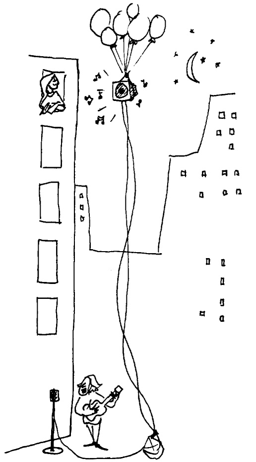
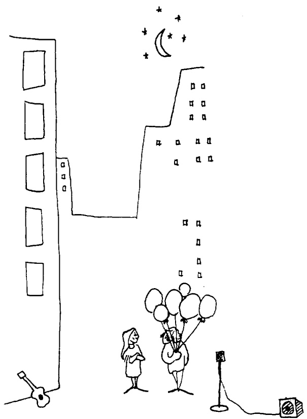

# Contextual Prerequisites for Understanding: Some Investigations of Comprehension and Recall $^{1}$

JOHN D. BRANSFORD AND MARCIA K. JOHNSON

State University of New York, Stony Brook, New York 11790

The present paper presents a series of studies showing that relevant contextual knowledge is a prerequisite for comprehending prose passages. Four studies are reported, each demonstrating increased comprehension ratings and recall scores when Ss were supplied with appropriate information before they heard test passages. Supplying Ss with the same information subsequent to the passages produced much lower comprehension ratings and recall scores. Various explanations of the results are considered, and the role of topics in activating cognitive contexts is discussed.

The present paper sketches a general approach to some problems of comprehension and memory. Several studies are reported which employ an experimental paradigm that seems particularly adaptable to such problems and that has been useful in developing the point of view proposed here.

Probably the most well-developed approach to comprehension stems from theories based on transformational linguistics (e.g., Chomsky, 1957, 1965, 1968; Postal, 1964). Sentences are assumed to have both superficial and underlying (deep) structures. The surface structure characterizes the phonological shape of the sentence, but the deep structural information is presumed necessary for characterizing sentence meaning (see Katz & Postal, 1964). According to Katz & Postal (p. 12), the semantically interpreted deep structural relations underlying sentences constitute a full analysis of their cognitive meaning. Comprehension thus involves the recovery and interpretation of the abstract deep structural relations underlying sentences,

$^{1}$  This research was supported in part by a Research Foundation of the State University of New York summer research fellowship to the second author. Senior authorship was decided by tossing a coin. We wish to thank Brian O'Callaghan, guidance counselor, and the students of Ward Melville High School, East Setauket, New York, for their cooperation.

and sentence memory involves retention of the deep structural but not necessarily the surface structural forms. Many studies have demonstrated the importance of deep structure in sentence perception and memory tasks (e.g., Bever, Lackner, & Kirk, 1969; Blumenthal, 1967, Blumenthal & Boakes, 1967; Perfetti, 1969; Rohrman, 1968; Sachs, 1967; Wanner, 1968).

However, several lines of research support the notion that performance in comprehension and memory tasks has a broader base than simply the semantically interpreted deep structural relations underlying linguistic inputs. Kintsch (1972), for example, has shown that Ss often know more than a sentence specifies directly. The results of experiments by Bransford and Franks (1971), Bransford, Barclay, and Franks (1972) and by Johnson, Bransford, & Solomon (in press) indicate that the information Ss use in a sentence memory task may originate from the integration of information from several related sentences and may include ideas not directly expressed in the acquisition materials.

For example, Johnson, Bransford, and Solomon (in press) presented Ss with short passages like either (a) “The river was narrow. A beaver hit the log that a turtle was sitting beside and the log flipped over from the shock. The turtle was very surprised by the event”

<small>Copyright © 1972 by Academic Press, Inc. All rights of reproduction in any form reserved.</small>

or (b) “The river was narrow. A beaver hit the log that a turtle was sitting on and the log flipped over from the shock. The turtle was very surprised by the event.” After acquisition, the Ss were read a list of recognition sentences and asked to indicate which sentences they had actually heard during the acquisition task. Those Ss hearing passage (b) were much more likely to think they had heard the novel sentence, “A beaver hit the log and knocked the turtle into the water,” than those hearing passage (a). The Ss’ understanding of the acquisition sentences apparently involved a realization of the probable consequences of the situations suggested by the input sentences; Ss frequently thought they had heard information which could only have been inferred.

The experiments mentioned above lend considerable support to the idea that Ss do not simply interpret and store the meanings of sentences per se. Rather, Ss create semantic products that are a joint function of input information and prior knowledge. The present paper focuses directly on the role played by prior knowledge in comprehension. Its purpose is to show that not only is prior knowledge reflected in the S's performance in tasks involving the comprehension of linguistic information, but that certain knowledge may be necessary for the meaningful processing of the information in the first place. In the experiments presented below, the availability of prior knowledge is manipulated in order to assess its influence on Ss' ability to comprehend and remember linguistic materials.

## EXPERIMENT I

The information presented to the Ss consisted of a passage in which the sentences followed rules of normal English construction and the vocabulary items were used in non-metaphorical ways. The prediction tested was that Ss who received the appropriate prerequisite knowledge would be able to comprehend the passage quite easily, and hence would subsequently be able to recall it relatively well. On the other hand, Ss who did not have access to the appropriate knowledge should find the passage difficult to understand and recall. The prerequisite knowledge was in the form of a picture that provided information about the context underlying the stimulus passage. The passage did not simply describe the contextual picture, but instead described various events that could happen given the context as a conceptual base.

## Method

The experiment consisted of an acquisition phase, followed by two tasks—comprehension rating and recall. There were five independent groups of Ss with 10 Ss per group. In addition to the No Context (1) Ss (who simply heard the passage) and Ss (who saw the appropriate co they heard the passage), there were of Ss. Context After Ss first heard saw the appropriate picture. Since contextual information is necess process of comprehension, the C expected to assign lower compress recall less than the Context Before Ss were shown a picture before presented. The partial context pie the objects represented in the picture, but the objects were assumed that the availability of ations of the objects would be Context and Context Before g comprehension and recall perfor group were expected to be low among the objects in the partial stituted an inappropriate con passage. Finally, No Context (2 twice. This group was included repetitions in the absence of cor

FIG. 1. Appropriate context picture for Experiment I.

(who simply heard the passage) and the Context Before Ss (who saw the appropriate context picture before they heard the passage), there were three other groups of Ss. Context After Ss first heard the passage and then saw the appropriate picture. Since it was assumed that contextual information is necessary for the ongoing process of comprehension, the Context After Ss were expected to assign lower comprehension ratings and recall less than the Context Before Ss. Partial Context Ss were shown a picture before the passage was presented. The partial context picture contained all of the objects represented in the appropriate context picture, but the objects were rearranged. It was assumed that the availability of concrete representations of the objects would be equal for the Partial Context and Context Before groups. However, the comprehension and recall performances of the former group were expected to be lower since the relations among the objects in the partial context picture constituted an inappropriate conceptual base for the passage. Finally, No Context (2) Ss heard the passage twice. This group was included to assess the effects of repetitions in the absence of context.

Materials. The passage was as follows:

If the balloons popped, the sound wouldn't be able to carry since everything would be too far away from the correct floor. A closed window would also prevent the sound from carrying, since most buildings tend to be well insulated. Since the whole operation depends on a steady flow of electricity, a break in the middle of the wire would also cause problems. Of course, the fellow could shout, but the human voice is not loud enough to carry that far. An additional problem is that a string could break on the instrument. Then there could be no accompaniment to the message. It is clear that the best situation would involve less distance. Then there would be fewer potential problems. With face to face contact, the least number of things could go wrong.

The appropriate- and partial-context pictures are shown in Figures 1 and 2, respectively.

Procedure. The Ss assigned to a given condition were tested as a group in a single session. All Ss were told that they were going to hear a tape-recorded passage and were asked to attempt to comprehend and remember it. They were informed that they would later be asked to recall the passage as accurately as they could. The Context Before and Partial Context Ss were given 30 seconds to inspect their respective pictures before the start of the recorded passage. The No Context (2) group heard the same recording twice. After acquisition, there was a 2-minute delay before Ss rated the passage. During this interval, Ss received recall sheets, Context After Ss were allowed 30 sec. to inspect the appropriate picture, and instructions about how to use the comprehension scale were given. A seven-point scale was used, with 1 indicating the passage was very difficult to comprehend, 4 indicating moderate, and 7 indicating very easy. Immediately after the rating task, Ss were asked to recall the passage as accurately as they could and were told that if they could not remember it word for word, they should write down as many ideas as possible. Seven minutes were allowed for recall.

FIG. 2. Partial context picture for Experiment I.

Subjects. The Ss were 50 male and female high school students who volunteered to participate in the experiment.

## Results

We have adopted the following standard procedure for scoring recall protocols of sentence materials or prose passages: Idea units are designated a priori and correspond either to individual sentences, basic semantic propositions, or phrases. Maximum possible scores for the materials used in Experiments I–IV are given in the appropriate tables. The protocols, which cannot be identified as to condition, are scored independently by two judges against the list of idea units. Paraphrases are allowed. Interjudge reliability for materials such as those used in the present experiments ranges from .91 to .99. Any differences in the assignment of scores to Ss are resolved by a third judge. These adjusted scores are then used in the final analysis of the data.

The mean comprehension rating and the mean number of ideas recalled for each group in Experiment I are given in Table 1. For both comprehension and recall scores, Dunnett's test was used to compare the Context Before condition with each of the other four conditions. The comprehension ratings were higher in the Context Before condition than in each of the other four conditions; all values of $d(5, 45) \geqslant 4.19$, $p < .005$. The Ss in the Context Before condition also recalled a greater number of ideas than Ss in each of the other four conditions; all values of $d(5, 45) \geqslant 4.12$, $p < .005$. An inspection of the data in Table 1 suggests that, relative to the No Context (1) condition, hearing the passage twice, receiving the context after or receiving the partial context before, increased comprehension ratings somewhat. Relative to the No Context (1) condition, these manipulations had little effect on recall scores.

## Discussion

The presentation of the appropriate semantic context had a marked effect on both comprehension ratings and recall. All Ss presumably knew the lexical meanings of the words and were familiar with the sentence structures used in the passage. Comprehension ratings and recall were relatively low, however, when Ss did not receive the appropriate context before they heard the passage.

The large difference in recall between the Context Before and the No Context (1) groups could be due to various factors. For example, knowledge of the appropriate context could simply provide information that allowed Ss to generate (at recall) ideas based on pre-experimental experiences, and many of these ideas could have overlapped with those in the passage. If this were an important factor, the Context After Ss should also have been able to augment recall by guessing or generating ideas from the picture. Providing the Ss with the appropriate context after they heard the passage did not, however, produce an increment in recall.

TABLE 1

MEAN COMPREHENSION RATINGS AND MEAN NUMBER OF IDEAS RECALLED, EXPERIMENT I

|  | No context (1) | No context (2) | Context after | Partial context | Context before | Maximum score |
| --- | --- | --- | --- | --- | --- | --- |
| Comprehension | $2.30 (.30)^a$ | 3.60 (.27) | 3.30 (.45) | 3.70 (.56) | 6.10 (.38) | 7 |
| Recall | 3.60 (.64) | 3.80 (.79) | 3.60 (.75) | 4.00 (.60) | 8.00 (.65) | 14 |

$^{a}$  Standard error in parentheses.

One might also argue that the Context Before group benefited from a more available set of retrieval cues (i.e., the elements of the picture—balloons, wire, window, etc.) relative to the No Context group. There are data to suggest that retrieval cues are important for recall and that it is important that these cues be present at input (e.g., Tulving & Osler, 1968). The elements of the picture were available to the Partial Context Ss before they heard the passage, yet their recall was far below that of the Context Before group. What the partial context picture lacked was the appropriate information about the relations among the concrete elements. Understanding the relations in the appropriate context was a prerequisite for understanding the events suggested by the passage. Although considerable research is needed to assess the relative contributions of comprehension versus retrieval processes to remembering, it seems clear that there is little reason to expect retrieval cues to augment recall for prose appreciably if Ss have not understood the meaning of a passage. On the other hand, comprehension per se does not necessarily guarantee subsequent recall. Pilot studies using the passage in Experiment I indicate that recall scores for the Context Before Ss can be increased by supplying them with key words as retrieval cues.

The comparison of the No Context (2) and Context Before groups can be viewed as a transfer of training design, where the No Context (2) group receives Learn A, Learn A, Test A and the Context Before group receives Learn B, Learn A, Test A where Learn B represents time taken to study the prerequisite context. For Ss in the present experiment, it was more beneficial to transfer from B to A than it was to spend time trying to learn A. Generally, this should be the case if the context in question is truly a prerequisite for comprehension.

The finding that neither Context After, nor Partial Context, nor No Context (2) groups showed augmented recall relative to No Context (1) Ss was somewhat surprising, although these groups were expected to be clearly inferior to the Context Before group. Eventually, it will be important to characterize those situations under which these types of treatments will benefit the Ss' performance. For present purposes, however, the major points are the clear advantage of the Context Before group and the resulting picture of the comprehension process that is supported by the general pattern of the results.

In Experiment I, it was very unlikely that the appropriate prerequisite context was (in all its details) part of the preexperimental knowledge of the Ss. If one generally characterizes comprehension as a process requiring appropriate semantic contexts, then the conditions under which existing structures become activated are extremely important. If a passage does not provide sufficient cues about its appropriate semantic context, the S is in a problem-solving situation in which he must find a suitable organization of his store of previous knowledge. Experiments II, III, and IV involve materials for which the appropriate contexts should be part of the preexperimental knowledge of most Ss. Some Ss are given a cue (a topic for the passage) that should help activate a suitable context.

It should be noted that the experiments to follow are similar to a set of studies that became available in the literature at the time the present paper was being written: Dooling and Lachman (1971) found that providing the topic of a passage affected subsequent recall. The present studies are included here, however, because (a) the passages used are relatively straightforward linguistic descriptions whereas those used by Dooling and Lachman were explicitly metaphorical; and (b) the present studies include conditions where Ss receive knowledge of the topic after hearing the passage in order to determine whether recall increments are simply due to Ss' abilities to generate probable statements about familiar topics.

## EXPERIMENTS II, III, AND IV

The results of Experiments II, III, and IV will be presented and discussed after the procedures have been described since the three studies were similar in design.

## Method

These experiments were similar to Experiment I in that the acquisition phase, consisting of a single auditory presentation of the materials, was followed by comprehension rating and recall tasks. The rating scale was the same as that used in Experiment I. The conditions in each of the studies were as follows. Experiment II: A No Topic group (17 Ss) heard a passage and received no additional information; a Topic After group (17 Ss) received the topic of the passage after acquisition and prior to the rating and recall tasks; a Topic Before group (18 Ss) received the topic prior to the presentation of the passage. Experiment III: Topic After (10 Ss) and Topic Before (11 Ss) conditions. Experiment IV: No Topic (9 Ss), Topic After (11 Ss), and Topic Before (11 Ss) conditions.

Materials. Materials for Experiments II and III consisted of passages A and B, respectively. Passage B is a slightly longer version of Passage A. Experiments II and III were conducted under different conditions and no comparisons of Ss' performance on Passages A and B were planned or conducted.

## Passage A:

The procedure is actually quite simple. First you arrange things into different groups depending on their makeup. Of course, one pile may be sufficient depending on how much there is to do. If you have to go somewhere else due to lack of facilities that is the next step, otherwise you are pretty well set. It is important not to overdo any particular endeavor. That is, it is better to do too few things at once than too many. In the short run this may not seem important, but complications from doing too many can easily arise. A mistake can be expensive as well. The manipulation of the appropriate mechanisms should be self-explanatory, and we need not dwell on it here. At first the whole procedure will seem complicated. Soon, however, it will become just another facet of life. It is difficult to foresee any end to the necessity for this task in the immediate future, but then one never can tell.

## Passage B:

The procedure is actually quite simple. First you arrange things into different groups. Of course, one pile may be sufficient depending on how much there is to do. If you have to go somewhere else due to lack of facilities that is the next step, otherwise you are pretty well set. It is important not to overdo things. That is, it is better to do too few things at once than too many. In the short run this may not seem important but complications can easily arise. A mistake can be expensive as well. At first the whole procedure will seem complicated. Soon, however, it will become just another facet of life. It is difficult to foresee any end to the necessity for this task in the immediate future, but then one never can tell. After the procedure is completed one arranges the materials into different groups again. Then they can be put into their appropriate places. Eventually they will be used once more and the whole cycle will then have to be repeated. However, that is part of life.

The materials used in Experiment IV were less like a paragraph than those used in Experiments I–III and the sentences were presented as sentences, rather than in paragraph form. In order of presentation, the sentences were:

A newspaper is better than a magazine/ A seashore is a better place than the street/ At first it is better to run than to walk/ You may have to try several times/ It takes some skill but it's easy to learn/ Even young children can enjoy it/ Once successful, complications are minimal/ Birds seldom get too close/ Rain, however, soaks in very fast/ Too many people doing the same thing can also cause problems/ One needs lots of room/ If there are no complications, it can be very peaceful/ A rock will serve as an anchor/ If things break loose from it, however, you will not get a second chance/

Experiment II procedure. All Ss were tested simultaneously. Assignment of Ss to conditions was made by randomizing the instruction sheets in blocks of the three experimental treatments and passing the resulting stack of booklets out in normal classroom fashion. The written instructions told the Ss to listen carefully to the passage that E would read to them and that they would later be asked to recall it as accurately as possible. The instruction sheet for the Topic Before Ss included the additional sentence, "The paragraph you will hear will be about washing clothes." Immediately after the passage was read, Ss opened their comprehension rating instructions. For the Context After Ss, these instructions included the sentence, "It may help you to know that the paragraph was about washing clothes." Approximately 2 minutes after the end of acquisition, Ss were reminded to recall as accurately as possible and instructed to write down at least the essential ideas. Five minutes were allowed for recall.

Experiment III procedure. The Ss were tested in groups corresponding to the two conditions. Both groups heard the same tape recording of Passage B. All instructions and the topic (again, “washing clothes”) were given verbally by E. Acquisition instructions informed Ss that they would later be asked to recall all the essential ideas of the passage. There was a 1-minute interval between the end of acquisition and the comprehension rating and a 1-minute interval between the rating and recall tasks. Six minutes were allowed for recall.

Experiment IV procedure. All Ss were tested simultaneously with a procedure similar to that used in Experiment II. The topic (which was presented on the acquisition instruction sheet and on the comprehension rating instruction sheet for Topic Before and Topic After groups, respectively) was “making and flying a kite.” The sentences were read by E and there was a 2-second interval between the end of one sentence and the beginning of the next. Six minutes were allowed for recall.

Subjects. In Experiment II the Ss were 52 male and female students enrolled in a course in human learning at the State University of New York, Stony Brook. The Ss for Experiments III (N = 21) and IV (N = 31) were male and female high school student volunteers.

## Results

Mean comprehension ratings and mean recall scores for conditions in Experiments II and III are presented in Table 2 and those for Experiment IV are presented in Table 3.

Experiment II. Comprehension ratings were higher in the Topic Before condition than in either the No Topic or the Topic After conditions, Dunnett's test (3, 49) = 4.46 and 4.80, p < .005, respectively. Likewise, recall was greater in the Topic Before condition than in the No Topic or Topic After conditions,  $d(3, 49) = 3.97$  and 4.20, p < .005, respectively.

Experiment III. Both comprehension ratings and recall scores were higher in the Topic Before condition than in the Topic After condition: the Fs (1, 19) were 12.24 for comprehension and 20.03 for recall, p < .005 in both cases.

TABLE 2

MEAN COMPREHENSION RATINGS AND MEAN NUMBER OF IDEAS RECALLED

<table><tr><td rowspan="2"></td><td colspan="4">Experiment II</td><td colspan="3">Experiment III</td></tr><tr><td>No topic</td><td>Topic after</td><td>Topic before</td><td>Maximum score</td><td>Topic after</td><td>Topic before</td><td>Maximum score</td></tr><tr><td>Comprehension</td><td> $2.29 (.22)^a$ </td><td>2.12 (.26)</td><td>4.50 (.49)</td><td>7</td><td>3.40 (.48)</td><td>5.27 (.27)</td><td>7</td></tr><tr><td>Recall</td><td>2.82 (.60)</td><td>2.65 (.53)</td><td>5.83 (.49)</td><td>18</td><td>3.30 (.66)</td><td>7.00 (.43)</td><td>20</td></tr></table>

$^{a}$  Standard error in parentheses.

TABLE 3

MEAN COMPREHENSION RATINGS AND MEAN NUMBER OF IDEAS RECALLED, EXPERIMENT IV

|  | No topic | Topic after | Topic before | Maximum score |
| --- | --- | --- | --- | --- |
| Comprehension | $2.44 (.47)^a$ | 3.82 (.52) | 4.00 (.59) | 7 |
| Recall | 3.22 (.55) | 3.18 (.57) | 5.54 (.76) | 14 |

$^{a}$  Standard error in parentheses.

Experiment IV. In the analysis of the comprehension ratings, the Topic Before scores were higher than the No Topic scores,  $d(3, 28) = 2.01$ , p < .05. However, there was no significant difference between ratings of the Topic Before and Topic After Ss, p > .05. Recall of the Topic Before Ss was superior to that of both No Topic and of Topic After Ss,  $d(3, 28) = 2.49$  and 2.68, p < .05, respectively.

## DISCUSSION

The results of Experiments II, III, and IV indicate that prior knowledge of a situation does not guarantee its usefulness for comprehension. In order for prior knowledge to aid comprehension, it must become an activated semantic context. As in Experiment I, it appears that for maximum benefit the appropriate information must be present during the ongoing process of comprehension. Comprehension and recall scores of the Topic After groups were generally much lower than those of the Topic Before groups. In short, the effect of topic in Experiments II, III, and IV was similar to that of context in Experiment I.

Lachman and his associates (Pompi & Lachman, 1967; Dooling & Lachman, 1971) suggested that knowledge of the topic facilitates retention by functioning as a mnemonic device. In recognition, Ss score higher on theme-related words because they match test words to the theme. In recall, a reconstructive process (with the theme as the mediating schema) is emphasized. The present writers view the role of the topic as something more than a schema for generating lexical matches or associations, however. Its critical role appears to be in helping Ss create contexts that can be used to comprehend the passages in the first place. At least in the present experiments, Topic After groups were at a considerable disadvantage relative to Topic Before groups. Most importantly, knowledge of the topic of a passage may be neither necessary nor sufficient for optimal comprehension. Note, for example, that the context supplied in Experiment I did not contain information about the topic of the stimulus passage. The topic would be something like "Possible breakdowns in communication during a serenade." The picture simply supplied information about a basic situation that could have been developed in many different directions. The stimulus passage discussed just one of the many possible sets of events that could have taken place. The picture greatly improved comprehension and recall scores, despite the fact that Ss in the Context Before group had no more explicit prior information about the topic than Ss in the other groups. Moreover, knowledge of the topic alone is not sufficient for optical comprehension of the passage in Experiment I. Pilot studies indicate that Ss receiving the topic of this passage before hearing it were still clearly inferior to Context Before Ss. The topic "possible breakdowns in communication during a serenade" is not sufficient to suggest the kind of contextual information communicated by the appropriate context picture.

It is interesting that in all the experiments, the absence of an appropriate semantic context seemed to have an effect on memory that is similar to that found when Ss are led to focus on nonsemantic aspects of linguistic inputs. For example, attention to the orthographic properties of sentences or words (rather than attention to their semantic features) causes a considerable decrement in recall (Bobrow & Bower, 1969; Hyde & Jenkins, 1969). In the present experiments all Ss presumably tried to process the information semantically, yet attention to semantic properties alone will not guarantee the availability of an adequate context for comprehension of prose.

Additional evidence that contexts are important for processing incoming information is that many of the Ss in the present experiments who were not provided with the context or topic prior to hearing the passage reported that they actively searched for a

ARNHEIM, R
Califor
AUSUBEL, I
view. N
Inc., 19
BARTLETT, F
Univer
BEVER, T. G
lying st
of imm
Psycho,
BLUMENTHA
of Verl
203–20
BLUMENTHA
sentenc
Learnin situation generally for unders they could extent to a problem stances. M allow one are sufficiently in iso additional by percep context, ir
The not may be p tion, or t perception discussed heim, 197 Gombrich 1971). Alt to provide these view processes prehendin results do tic context of context strategy f prior know

situation that the passage might be about; generally they were unable to find one suitable for understanding the entire passage, although they could make parts of it make sense. The extent to which context availability becomes a problem will certainly vary with the circumstances. Many sentences provide cues that allow one to create contextual structures that are sufficient for processing sentences seemingly in isolation. In other cases one will need additional information, such as that built up by perceptual context or previous linguistic context, in order to comprehend.

The notions that certain cognitive structures may be prerequisites for knowledge acquisition, or that such structures may influence perception and recall, have, of course, been discussed by many investigators (e.g., Arnheim, 1971; Ausubel, 1960; Bartlett, 1932; Gombrich, 1961, Piaget, 1950; and Winograd, 1971). Although at present it is not possible to provide a precise statement synthesizing these views and specifying mechanisms and processes operating during the acts of comprehending and remembering, the present results do emphasize the crucial role of semantic contexts. The experimental manipulation of context availability may constitute a useful strategy for investigating the interaction of prior knowledge and present input events.

## REFERENCES

ARNHEIM, R. Visual thinking. Berkeley: University of California Press, 1971.

AUSUBEL, D. P. Educational psychology: A cognitive view. New York: Holt, Rinehart and Winston, Inc., 1968.

BARTLETT, F. C. Remembering. Cambridge: Cambridge University Press, 1932.

BEVER, T. G., LACKNER, J. R., & KIRK, R. The underlying structures of sentences are the primary units of immediate speech processing. Perception and Psychophysics, 1969, 6, 225–234.

BLUMENTHAL, A. Prompted recall of sentences. Journal of Verbal Learning and Verbal Behavior. 1967, 6, 203–206.

BLUMENTHAL, A. & BOAKES, R. Prompted recall of sentences: A further study. Journal of Verbal Learning and Verbal Behavior, 1967, 6, 674–675.

BOBROW, S. A., & BOWER, G. H. Comprehension and recall of sentences. Journal of Experimental Psychology, 1969, 80, 455–461.

BRANSFORD, J. D., BARCLAY, J. R., & FRANKS, J. J. Sentence memory: A constructive versus interpretive approach. Cognitive Psychology, 1972, 3, 193–209.

BRANSFORD, J. D., & FRANKS, J. J. The abstraction of linguistic ideas. Cognitive Psychology, 1971, 2, 331–350.

CHOMSKY, N. Syntactic structures. London: Mouton and Company, 1957.

CHOMSKY, N. Aspects of the theory of syntax. Cambridge: M.I.T. Press, 1965.

CHOMSKY, N. Language and mind. New York: Harcourt, Brace and World, 1968.

DOOLING, D. J., & LACHMAN, R. Effects of comprehension on retention of prose. Journal of Experimental Psychology, 1971, 88, 216–222.

GOMBRICH, E. H. Art and illusion, New York: Pantheon Books, 1961.

HYDE, T. S., & JENKINS, J. J. Differential effects of incidental tasks on the organization of recall of a list of highly associated words. Journal of Experimental Psychology, 1969, 82, 472-481.

JOHNSON, M. K., BRANSFORD, J. D., & SOLOMON, S. Memory for tacit implications of sentences. Journal of Experimental Psychology, in press.

KATZ, J. J., & POSTAL, P. M. An integrated theory of linguistic descriptions. Cambridge: M.I.T. Press, 1964.

KINTSCH, W. Notes on the structure of semantic memory. In E. Tulving and W. Donaldson (Eds.), Organization of memory. New York: Academic Press, 1972.

PERFETTI, C. R. Lexical density and phrase structure depth as variables in sentence retention. Journal of Verbal Learning and Verbal Behavior, 1969, 8, 719–724.

PIAGET, J. The psychology of intelligence. London: Routledge and Kegan Paul, Ltd., 1947.

POMPI, K. F., & LACHMAN, R. Surrogate processes in the short-term retention of connected discourse. Journal of Experimental Psychology, 1967, 75, 143–150.

POSTAL, P. M. Underlying and superficial linguistic structure. Harvard Educational Review, 1964, 34, 246–266.

ROHRMAN, N. L. The role of syntactic structure in the recall of English nominalizations. Journal of Verbal Learning and Verbal Behavior, 1968, 7, 904–912.

SACHS, J. Recognition memory for syntactic and semantic aspects of connected discourse. Perception and Psychophysics, 1967, 2, 437–422.

TULVING, E., & OSLER, S. Effectiveness of retrieval cues in memory for words. Journal of Experimental Psychology, 1968, 77, 593–601.

WANNER, H. E. On remembering, forgetting and understanding sentences: a study of the deep structure hypothesis. Unpublished doctoral dissertation. Harvard University, 1968.

WINOGRAD, T. Procedures as a representation for data in a computer program for understanding natural language. Report No. MAC TR-84, Massachusetts Institute of Technology, Project MAC, 1971.

(Received March 13, 1972)

Information

Two linear paragraph by the paragraph Responses to than response remote pairs result is incon some subset chaining the

The classical e memory consists of slightly faded copi linked together by a disfavor among r chologists. Cogniti more receptive to E memories are the r tive process which input information, version of this in resemblance to the presented. Accord information is in organized settings asked a question at subjects must use reconstruct the Bartlett's words,

$^{1}$  This paper is base the Department of Psy partial fulfillment of t degree. The research was being supported b and was supported in Dr. Frank Restle. I am the continued support project.

$^{2}$  Now at the Depar College, Hanover, N.

Copyright © 1972 by Aca
All rights of reproduction