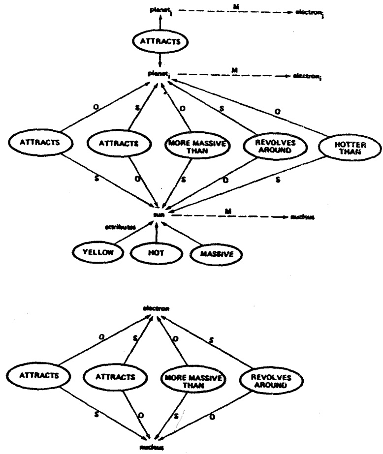

# Structure-Mapping: A Theoretical Framework for Analogy\*

DEDRE GENTNER

Bolt Beranek and Newman Inc.

A theory of analogy must describe how the meaning of an analogy is derived from the meanings of its parts. In the structure-mapping theory, the interpretation rules are characterized as implicit rules for mapping knowledge about a base domain into a target domain. Two important features of the theory are (a) the rules depend only on syntactic properties of the knowledge representation, and not on the specific content of the domains; and (b) the theoretical framework allows analogies to be distinguished cleanly from literal similarity statements, applications of abstractions, and other kinds of comparisons.

Two mapping principles are described: (a) Relations between objects, rather than attributes of objects, are mapped from base to target; and (b) The particular relations mapped are determined by systematicity, as defined by the existence of higher-order relations.

When people hear an analogy such as “An electric battery is like a reservoir” how do they derive its meaning? We might suppose that they simply apply their knowledge about reservoirs to batteries, and that the greater the match, the better the analogy. Such a “degree of overlap” approach seems reasonably correct for literal similarity comparisons. In Tversky’s (1977) contrast model, the similarity between A and B is greater the greater size of the intersection (A∩B) of their feature sets and the less the size of the two complement sets (A - B) and (B - A).' However, although the degree-of-overlap model appears to work well for literal similarity comparisons, it does not provide a good account of analogy. The strength of an analogical match does not seem to depend on the overall degree of featural overlap; not all features are equally relevant to the interpretation. Only certain kinds of mismatches count for or against analogies. For example, we could not support the battery-reservoir analogy by remarking (even if true) that batteries and reservoirs both tend to be cylindrical; nor does it weaken the analogy to show that their shapes are different. The essence of the analogy between batteries and reservoirs is that both store potential energy, release that energy to provide power for systems, etc. We can be quite satisfied with the analogy in spite of the fact that the average battery differs from the average reservoir in size, shape, color, and substance.

<small>\*This research was supported by the Department of the Navy, Office of Naval Research under Contract No. N00014-79-C-0338, and by the National Institute of Education under Contracts No. NIE-400-80-0030 and NIE-400-80-0031. I thank my colleagues Allan Collins, Ken Forbus, Don Gentner, Ed Smith, and Al Stevens, who collaborated on the development of these ideas; and Susan Carey, John Clement, Andy diSessa, Georges Rey, David Rumelhart, Patrick Winston, and Marianne Wiser for insightful discussions of this approach. I also thank Judith Block, Phillip Kohn, Mary McManamon, Patricia Stuart, Edna Sullivan and Ben Teitelbaum for their help with the research on which this paper is based, and Cindy Hunt for preparing the manuscript. Correspondence and requests for reprints should be sent to Dedre Gentner, Bolt Beranek and Newman Inc., Cambridge, MA 02238.</small>

As another example of the selectiveness of analogical mapping, consider the simple arithmetic analogy 3:6::2:4. We do not care how many features 3 has in common with 2, nor 6 with 4. It is not the overall number of shared versus nonshared features that counts here, but only the relationship "twice as great as" that holds between 3 and 6 and also between 2 and 4. To underscore the implicit selectiveness of the feature match, note that we do not consider the analogy 3:6::2:4 better or more apt than the analogy 3:6::200:400, even though by most accounts 3 has more features in common with 2 than with 200.

A theory based on the mere relative numbers of shared and non-shared predicates cannot provide an adequate account of analogy, nor, therefore, a sufficient basis for a general account of relatedness. In the structure-mapping theory, a simple but powerful distinction is made among predicate types that allows us to state which ones will be mapped. The central idea is that an analogy is an assertion that a relational structure that normally applies in one domain can be applied in another domain. Before laying out the theory, a few preliminaries are necessary.

## PRELIMINARY ASSUMPTIONS

1. Domains and situations are psychologically viewed as systems of objects, object-attributes and relations between objects.$^{2}$

'According to Tversky (1977), the negative effects of the two complement sets are not equal: for example, if we are asked "How similar is A to B", the set (B - A)—features of B not shared by A—counts much more than the set (A - B).

\*These "objects" may be clear entities (e.g., "rabbit"), component parts of a larger object (e.g., "rabbit's ear"), or even coherent combinations of smaller units (e.g., "herd of rabbits"); the important point is that they function as wholes at a given level of organization.

2. Knowledge is represented here as propositional networks of nodes and predicates (cf. Miller & Johnson-Laird, 1976; Norman, Rumelhart, & the LNR Group, 1975; Rumelhart & Ortony, 1977; Schank & Abelson, 1977). The nodes represent concepts treated as wholes; the predicates applied to the nodes express propositions about the concepts.

3. Two essentially syntactic distinctions among predicate types will be important. The first distinction is between object attributes and relationships. This distinction can be made explicit in the predicate structure: Attributes are predicates taking one argument, and relations are predicates taking two or more arguments. For example, COLLIDE (x,y) is a relation, while LARGE (x) is an attribute.$^{1}$

The second important syntactic distinction is between first-order predicates (taking objects as arguments) and second- and higher-order predicates (taking propositions as arguments). For example, if COLLIDE (x,y) and STRIKE (y,z) are first-order predicates, CAUSE [COLLIDE (x,y), STRIKE (y,z)] is a second-order predicate.

4. These representations, including the distinctions between different kinds of predicates, are intended to reflect the way people construe a situation, rather than what is logically possible.$^{4}$

## STRUCTURE-MAPPING: INTERPRETATION RULES FOR ANALOGY

The analogy “A T is (like) a B” defines a mapping from B to T. T will be called the target, since it is the domain being explicated. B will be called the base, since it is the domain that serves as a source of knowledge. Suppose that the representation of the base domain B can be stated in terms of object

One clarification is important here. Many attributive predicates implicitly invoke comparisons between the value of their object and some standard value on the dimension. LARGE (x) implicitly means "X is large for its class." For example, a large star is of a different size than a large mouse. But if LARGE (x) is implicitly interpreted as LARGER THAN (X, prototype-x), this might suggest that many surface attributes are implicitly two-place predicates. The theory assumes that only relations that apply within the domain of discourse are psychologically stored and processed as true relations. Thus, in the domain of the solar system, a relation such as LARGER THAN (sun, planet), that applies between two objects in the domain, is processed as a relation; whereas an external attributive comparison, such as LARGER THAN (sun, prototype-star), is processed as an attribute.

\*Logically, a relation $R(a,b,c)$ can perfectly well be represented as $Q(x)$, where $Q(x)$ is true just in case $R(a,b,c)$ is true. Psychologically, the representation must be chosen to model the way people think about the domain..

nodes $b_1, b_2, \ldots, b_n$ and predicates such as A, R, R', and that the target domain has object nodes $t_1, t_2, \ldots, t_m$. The analogy maps the object nodes of B onto the object nodes of T:

$$
\mathbf {M}: \mathbf {b} _ {i} - - > \mathbf {t} _ {i}
$$

These object correspondences are used to generate the candidate set of inferences in the target domain. Predicates from B are carried across $^{6}$ to T, using the node substitutions dictated by the object correspondences.

The mapping rules are

1. Discard attributes of objects:

$$
\mathrm{A} (\mathbf {b} _ {i}) ] - + - > [ \mathrm{A} (\mathbf {t} _ {i})
$$

2. Try to preserve relations between objects:

$$
\mathrm{R} (\mathbf {b} _ {i}, \mathbf {b} _ {j}) ] - - > [ \mathrm{R} (t _ {i}, t _ {j}),
$$

3. (The Systematicity Principle) To decide which relations are preserved, choose systems of relations:

$$
\begin{array}{r l} \mathbf {R} ^ {\prime} (\mathbf {R} _ {1} (\mathbf {b} _ {i}, \mathbf {b} _ {j}), \mathbf {R} _ {2} (\mathbf {b} _ {k}, \mathbf {b} _ {l}) ] - - > \\ [ \mathbf {R} ^ {\prime} (\mathbf {R} _ {1} (\mathbf {t} _ {i}, \mathbf {t} _ {j}), \mathbf {R} _ {2} (\mathbf {t} _ {k}, \mathbf {t} _ {l}) \end{array}
$$

Higher-order relations play an important role in analogy, as is discussed below.

Notice that this discussion has been purely structural; the distinctions invoked rely only on the syntax of the knowledge representation, not on the content. The content of the relations may be static spatial information, as in UNDER(x,y), or FULL(CONTAINER, WATER); or constraint information, as in PROPORTIONAL [(PRESSURE(liquid, source, goal), FLOW-RATE (liquid, source, goal)]; or dynamic causal information, as in CAUSE {AND [PUNCTURE (CONTAINER), FULL(CONTAINER, WATER)], FLOW-FROM (WATER, CONTAINER)}.

'Most explanatory analogies are 1-1 mappings, in which $m = n$. However, there are exceptions (Gentner, 1982).

\*The assumption that predicates are brought across as identical matches is crucial to the clarity of this discussion. The position that predicates need only be similar between the base and the domain (e.g., Hesse, 1966; Ortony, 1979) leads to a problem of infinite regress, with similarity of surface concepts defined in terms of similarity of components, etc. I will assume instead that similarity can be restated as identity among some number of component predicates.

## KINDS OF DOMAIN COMPARISONS

In the structure-mapping framework, the interpretation rules for analogy can be distinguished from those for other kinds of domain comparisons. The syntactic type of the shared versus nonshared predicates determines whether a given comparison is thought of as analogy, as literal similarity, or as the application of an abstraction.

In this section, different kinds of domain comparisons are described, using the solar system as a common theme. The top half of Figure 1 shows a partial representation of what might be a person's knowledge of our solar system. Both object-attributes, such as YELLOW (sun), and relations between objects, such as REVOLVE AROUND (planet, sun) are shown. Assuming that the hearer has the correct object correspondences, the question is which predicates will be mapped for each type of comparison.

(1) A literal similarity statement is a comparison in which a large number of predicates is mapped from base to target, relative to the number of nonmapped predicates (e.g., Tversky, 1977). The mapped predicates include both object-attributes and relational predicates.

EXAMPLE 1. The X12 star system in the Andromeda galaxy is like our solar system.

INTERPRETATION: Intended inferences include both object characteristics—e.g., “The X12 star is YELLOW, MEDIUM-SIZED, etc., like our sun,” and relational characteristics, such as “The X12 planets REVOLVE AROUND the X12 star, as in our system.”

In a literal similarity comparison, all or most of the predicates shown would be mapped.

(2) An analogy is a comparison in which relational predicates, but few or no object attributes, can be mapped from base to target.

EXAMPLE 2. The hydrogen atom is like our solar system.

INTERPRETATION: Intended inferences concern chiefly the relational structure: e.g., "The electron REVOLVES AROUND the nucleus, just as the planets REVOLVE AROUND the sun," but not "The nucleus is YELLOW, MASSIVE, etc., like the sun." The bottom half of Figure 1 shows these mapped relations. If higher-order relations are present in the base, they can be mapped as well: e.g., The hearer might map "The fact that the nucleus ATTRACTS the electron CAUSES the electron to REVOLVE around the nucleus" from "The fact that the sun ATTRACTS the planets CAUSES the planets to REVOLVE AROUND the sun." (This relation is not shown in Figure 1.)

(3) An abstraction is a comparison in which the base domain is an abstract relational structure. Such a structure would resemble Figure 1, except that the object nodes would be generalized physical entities, rather than particular objects like “sun” and “planet”. Predicates from the abstract base domain are mapped into the target domain; there are no nonmapped predicates.

Figure 1. Structure-mapping for the Rutherford analogy: "The atom is like the solar system."

EXAMPLE 3. The hydrogen atom is a central force system.

INTERPRETATION: Intended inferences include "The nucleus ATTRACTS the electron;" "The electron REVOLVES AROUND the nucleus." These are mapped from base propositions such as "The central object ATTRACTS the peripheral object;" or "The less massive object REVOLVES AROUND the more massive object." These intended inferences resemble those for the analogy (Example 2). The difference is that in the analogy there are other base predicates that are not mapped, such as "The sun is YELLOW."

All three kinds of comparison involve substantial overlap in relations, but, except for literal similarity, not in object-attributes. What happens if there is strong overlap in object-attributes but not in relations; e.g., “A sunflower looks like the sun.” or “The symbol for infinity is a sidewise 8.” Such a match is considered a mere appearance match. Unlike the comparisons considered so far, these matches do not involve relational mappings. Although they can be appealing and locally useful, their explanatory power is sharply limited. Mere appearance matches will not concern us further.

Table 1 summarizes these distinctions. Overlap in relations is necessary for any strong perception of similarity between two domains. Overlap in both object-attributes and inter-object relationships is seen as literal similarity, and overlap in relationships but not objects is seen as analogical relatedness. Overlap in object-attributes but not relationships is seen as a mere appearance match. Finally, a comparison with neither attribute overlap nor relational overlap is simply an anomaly.

TABLE I

Kinds of Predicates Mapped in Different Types of Domain Comparison

|  | No. of attributes mapped to target | No. of relations mapped to target | Example |
| --- | --- | --- | --- |
| Literal Similarity | Many | Many | The K5 solar system is like our solar system. |
| Analogy | Few | Many | The atom is like our solar system. |
| Abstraction | Few$^{n}$ | Many | The atom is a central force system. |
| Anomaly | Few | Few | Coffee is like the solar system |

$^{a}$ Abstraction differs from analogy and the other comparisons in having few object-attributes in the base domain as well as few object-attributes in the target domain.

According to this analysis, the contrast between analogy and literal similarity is a continuum, not a dichotomy. Given that two domains overlap in relationships, they are more literally similar to the extent that their object-attributes also overlap. A different sort of continuum applies between analogies and general laws: In both cases, a relational structure is mapped from base to target. If the base representation includes concrete objects whose individual attributes must be left behind in the mapping, the comparison is an analogy. As the object nodes of the base domain becomes more abstract and variable-like, the comparison is seen as an abstraction.

## Metaphor

A number of different kinds of comparisons go under the term “metaphor.” Many (perhaps most) metaphors are predominantly relational comparisons, and are thus essentially analogies. For example, in A. E. Housman’s comparison, “I could no more define poetry than a terrier can define a rat,” the object correspondences are terrier-poet and rat-poetry. Clearly, the intended inference is not that the poet is like a terrier, nor certainly that poetry is like a rat, but rather, that the relation between poet and poetry is like the relation between terrier and rat. Again, in Shakespeare’s “... What light from yonder window breaks? / It is the east, and Juliet is the sun! ...” Romeo does not mean that Juliet is yellow, hot or gaseous. Rather, he means that she appears above him, bringing him hope and gladness, etc. Though some attributes may be mapped from sun to Juliet (perhaps “beautiful”), the metaphor chiefly conveys a set of spatial and affective relationships.

Although most metaphors are relationally focused, some are predominantly attribute matches. These generally involve shared attributes that are few but striking, and often more salient in the base than in the target ([Ortony, 1979]: e.g., 'She's a giraffe," used to convey that she is tall. Many such metaphors involve conventional vehicles, such as "giraffe" above, or conventional dimensional matches, such as "a deep/shallow idea". [Glucksberg, Gildea, & Bookin, 1982; Lakoff & Johnson, 1980]). Moreover, metaphors can be mixtures of all of these. Finally, for metaphors that are analyzable as analogies or combinations of analogies, the mapping rules tend to be less regular than those for analogy (Gentner, 1982).

## HIGHER-ORDER PREDICATES AND SYSTEMATICITY

Relations have priority over object-attributes in analogy. However, as mentioned earlier, not all relations are equally likely to be preserved. For example, in the Rutherford analogy between solar system and atom, the relation MORE MASSIVE THAN (sun, planet) is mapped across to the atom, but the formally similar relation HOTTER THAN (sun, planet) is not. The goal of this section is to characterize this analogical relevance explicitly.

Part of our understanding about analogy is that it conveys a system of connected knowledge, not a mere assortment of independent facts. Such a system can be represented by an interconnected predicate structure in which higher-order predicates enforce connections among lower-order predicates. $^{7}$

The Order of a relation is determined by the order of its arguments. A first-order relation takes objects as its arguments. A second-order relation has at least one first-order relation among its arguments; and in general an nth order relation has at least one (n-1)th order argument.

To reflect this tacit preference for coherence in analogy, I propose the systematicity principle: A predicate that belongs to a mappable system of mutually interconnecting relationships is more likely to be imported into the target than is an isolated predicate.

In the Rutherford model, the set of predicates that forms a mappable system includes the following lower-order relations:

(1) DISTANCE (sun, planet)

(2) ATTRACTIVE FORCE (sun, planet)

(3) REVOLVES AROUND (planet, sun)

(4) MORE MASSIVE THAN (sun, planet)

One symptom of this systematicity is that changing one of these relations affects the others. For example, suppose we decrease the attraction between sun and planet; then the distance between them will increase, all else being equal. Thus relations (1) and (2) are interrelated. Again, suppose we reverse relation (4) to state that the planet is more massive than the sun; then we must also reverse relation (3), for the sun would then revolve around the planet.$^{8}$ One way of expressing these dependencies among the lower-order relations is as a set of simultaneous constraint equations:

$$
\mathrm{F} _ {\text {grow}} = \frac {\mathrm{Gm} _ {p} \mathrm{m} _ {s}}{\mathrm{R} ^ {2}} = \mathrm{m} _ {p} \mathrm{a} _ {p} = \mathrm{m}. \mathrm{a}
$$

where $F_{grav}$ is the gravitational force, $m_p$ is the mass of the planet; $a_p$ is the radial acceleration of the planet (and similarly $m$, and $a$, for the sun); $R$ is the distance between planet and sun; and $G$ is the gravitational constant.

The same interdependencies hold for the atom, if we make the appropriate node substitutions:

(5) DISTANCE (nucleus, electron)

(6) ATTRACTIVE FORCE (nucleus, electron)

(7) REVOLVES AROUND (electron, nucleus)

(8) MORE MASSIVE THAN (nucleus, electron)

The corresponding equations for the atom are

$$
\mathrm{F} _ {\text {elec}} = \frac {- \mathrm{q} _ {e} \mathrm{q} _ {n}}{\mathrm{R} ^ {2}} = \mathrm{m} _ {e} \mathrm{a} _ {e} = \mathrm{m} _ {n} \mathrm{a} _ {n}
$$

where  $F_{elec}$  is the electromagnetic force,  $q_{e}$  is the charge on the electron;  $m_{e}$  is the mass of the electron;  $a_{e}$  is the radial acceleration of the electron (and similarly for the nucleus);  $R_{e}$  is the distance between electron and nucleus and -1 is the electromagnetic constant.

\*This follows from the simultaneous equations below. The radial acceleration of either object is given by the force divided by its own mass; thus the lighter object has the greater radial acceleration. To maintain separation, it must also have a tangential velocity sufficient to keep it from falling into the larger object.

These equations embody higher-order relations that connect the lower-order relations (1) through (4) into a mutually constraining structure. By the systematicity principle, to the extent that people recognize (however vaguely) that the system of predicates connected with central forces is the deepest, most interconnected mappable system for this analogy, they will favor relations that belong to that system in their interpretations.$^{9}$ This is why MORE MASSIVE THAN is preserved while HOTTER THAN is not: Only MORE MASSIVE THAN participates in the central-force system of predicates.

As another demonstration of the operation of the systematicity principle, consider the analogy "Heat is like water," used to explain heat transfer from a warm house in cold weather. Suppose the hearer's knowledge about water includes two scenarios:

1. AND[CONTAIN(vessel, water), ON-TOP-OF (lid, vessel)]

2. CAUSE {AND [PUNCTURE(vessel), CONTAIN(vessel, water)], FLOW-FROM (water, vessel)}.

These can be paraphrased roughly as follows: (1) The vessel contains water and has a lid; (2) if a vessel that contains water is punctured, water will flow out. Assuming that the hearer has made the obvious object correspondences (water --> heat, vessel --> house, and lid --> roof),$^{10}$ which will be mapped?

Intuitively, the second scenario is more interesting than the first: (1) conveys merely a static spatial description, while (2) conveys a dynamic causal description. We would like chain (2) to be favored over chain (1), so that dynamic causal knowledge is likely to be present in the candidate set of attempted predications (to use Ortony's [1979] term). We could accomplish this by postulating that analogies select for dynamic causal knowledge, or more generally, for appropriate abstractions. Either of these would be a mistake: The former course limits the scope of analogy unreasonably, and the latter course is both vague, in that "appropriateness" is difficult to define explicitly, and incorrect, in that analogies can also convey inappropriate abstractions.$^{11}$ We want our rules for analogical interpretation to choose chain (2) over chain (1), but we want them to operate, at least initially, without appeal to specific content or appropriateness. The systematicity principle offers a way to satisfy both requirements. Dynamic causal information [e.g., (2)] will usually be represented in a more deeply embedded structure than simple stative information [e.g., (1)]. Thus, by promoting deeply nested relational chains, the systematicity principle operates to promote predicates that participate in causal chains and in other constraint relations. It is a purely syntactic mechanism that guarantees that the set of candidate mappings will be as interesting—in the sense that a mutually interconnected system of predicates is interesting—as the knowledge base allows.

In the next section, empirical support for the structure-mapping theory is briefly discussed. First, however, let us review the performance of the theory against a set of a priori theoretical criteria. The structure-mapping theory satisfies the first requirement of a theory of analogy, that it describes the rules by which the interpretation of an analogy is derived from the meanings of its parts. Further, the rules are such as to distinguish analogy from other kinds of domain comparisons, such as abstraction or literal similarity. Finally, a third feature of the structure-mapping theory is that the interpretation rules are characterizable purely syntactically. That is, the processing mechanism that selects the initial candidate set of predicates to map attends only to the structure of the knowledge representations for the two analogs, and not to the content.

## EMPIRICAL SUPPORT

There is research supporting the structure-mapping approach. In one set of studies, subjects wrote out interpretations of analogical comparisons such as “A cigarette is like a time bomb.” These interpretations were read to naive judges, who rated each assertion as to whether it was an attribute or a relation. (For a fuller description, see Gentner, 1980b). The results indicated a strong focus on relational information in interpreting analogies. Relational information predominates over attributional information in analogy interpretations, but not in object descriptions generated by the same subjects. Further, a correlation of aptness ratings and relationality ratings revealed that subjects rated as most apt those analogies for which they wrote the greatest amount of relational information.

<small>'I make the assumption here that partial knowledge of the system is often sufficient to allow a person to gauge its interconnectedness. In the present example, a person may recognize that force, mass, and motion are highly interrelated without having full knowledge of the governing equations.</small>

<small>$^{14}$ In this discussion I have made the simplifying assumption that, in comprehension of analogy, the hearer starts with the object correspondences and then maps across the relations. The actual order of processing is clearly variable. If the object assignment is left unspecified, the hearer can use knowledge about matching relations to decide on the object correspondences. Therefore, it is more accurate to replace the statement that the object correspondences are decided before the relational mappings begin with the weaker statement that the object correspondences are decided before the relational mappings are finished. This is largely because in a complex analogy, the number of mappable relations is largely compared to the number of object correspondences; indeed the number of mappable relations may have no clear upper bound.</small>

<small>"Unless we distinguish the structural rules for generating the candidate set from other conceptual criteria (such as appropriateness, insightfulness, or correctness) that can be applied to the candidate set, we rob analogy of its power to convey new information. Just as we can perform a syntactic analysis of what a sentence conveys, even when the information it conveys is semantically novel or implausible (e.g., "Man bites dog."), so we must be able to derive a structural analysis of an analogy that does not depend on a priori conceptual plausibility. Of course, our ultimate acceptance of the analogy will depend on whether its candidate set of predicates is plausible; but this is a separate matter."</small>

Other experimental evidence for structure-mapping as part of the psychological process of interpreting complex analogies has included developmental studies (Gentner, 1977a,b; 1980b) and studies of how people use analogies in learning science (Collins & Gentner, in preparation; Gentner, 1980a, 1981; Gentner & Gentner, 1983).

## RELATED RESEARCH

Complex explanatory analogies have until recently received little attention in psychology, perhaps because such analogies require fairly elaborate representations of meaning. Studies of analogy in scientific learning and in reasoning have emphasized the importance of shared complex representational structures (Clement, 1981, 1982; Collins & Gentner, in preparation; Darden, 1980; Gentner, 1980a; Gentner & Gentner, 1983; Hesse, 1966; Hobbs, 1979; Hoffman, 1980, Moore & Newell, 1973; Oppenheimer, 1955; Polya, 1973; Riley, 1981; Rumelhart & Norman, 1981; Steels, 1982; Stevens, Collins & Goldin, 1979; VanLehn & Brown, 1980). Although some of this work has been empirically tested, most of it remains in the area of interesting but unvalidated theory. In contrast, much of the psychological experimentation on analogy and metaphor has been either theory-neutral (e.g., Schustack & Anderson, 1979; Verbrugge & McCarrell, 1977) or based on rather simple representations of meaning: e.g., feature-list representations (e.g., Ortony, 1979) or multidimensional space representations (e.g., Rumelhart & Abrahamson, 1973; Tourangeau & Sternberg, 1981). These kinds of representations can deal well with object attributes, but are extremely limited in their ability to express relations between objects, and especially higher-order relations.

Recent work in cognitive science has begun to explore more powerful representational schemes. The Merlin system (Moore & Newell, 1973) featured a mechanism for “viewing x as y” (see also Steels, 1982) which involved explicit comparisons of the shared and nonshared predicates of two situations. Winston (1980, 1981), using a propositional representation system, has simulated the process of matching a current situation with a previously stored precedent and using the similarity match to justify importing inferences from the precedent to the current situation. Further, in recent work he has investigated importance-dominated matching; here the match between old and new situations is performed by counting only those predicates that occur in causal chains. This requirement is somewhat more restrictive than the structure-mapping principle that participation in any higher-order chain results in preferential mapping. However, it has the similar effect of focusing the matcher on systematic relational structures rather than on haphazard resemblances between situation. One valuable aspect of Winston's work is his modelling of the process of abstracting general rules from the analogical matches. Gick and Holyoak have also emphasized the relationship between analogical matching and the formation of general schemas in an interesting series of studies of transfer in problem-solving (Gick & Holyoak, 1980, 1983; Holyoak, in press).

Other researchers have explored specific instances of relational mapping. VanLehn and Brown (1980) have analyzed analogical learning of procedural rules in arithmetic, postulating mapping rules compatible with the rules proposed here. Clement (1981, 1982) has proposed four-stage series of processes of generating analogical comparisons during problem-solving. Rumelhart and Norman (1981) have used a schema-based representational system to discuss analogical transfer. Burstein (1983) and Carbonell (1981) have characterized the comprehension of analogy, emphasizing common goals and subgoals as organizing principles. In the main, these accounts are compatible with that given by the structure-mapping theory in each of the problem domains. Relations tend to be preserved across domains with dissimilar object-attributes: e.g., the matching of like procedures that apply to unlike sets of objects (VanLehn & Brown, 1980).

## THE ANALOGICAL SHIFT CONJECTURE

Some of the distinctions made here may appear rather academic. To illustrate their potential relevance, let us apply these distinctions to the spontaneous comparisons that people make in the course of learning a domain. An informal observation is that the earliest comparisons are chiefly literal-similarity matches, followed by analogies, followed by general laws. For example, Ken Forbus and I have observed a subject trying to understand the behavior of water flowing through a constricted pipe. His first comparisons were similarity matches, e.g., water coming through a constricted hose. Later, he produced analogies such as a train speeding up or slowing down, and balls banging into the walls and transferring momentum. Finally, he arrived at a general statement of the Bernoulli principle, that velocity increases and pressure decreases in a constriction.

This sequence can be understood in terms of the kinds of differences in predicate overlap discussed in this paper. In the structure-mapping framework, we can suggest reasons that the accessibility and the explanatory usefulness of a match may be negatively related. Literal similarity matches are highly accessible, since they can be indexed by object descriptions, by relational structures, or by both. But they are not very useful in deriving causal principles, precisely because there is too much overlap to know what is crucial. Potential analogies are less likely to be noticed, since they require accessing the data base via relational matches; object matches are of no use. However, once found, an analogy should be more useful in deriving the key principles, since the shared data structure is sparse enough to permit analysis. Moreover, if we assume the systematicity principle, then the set of overlapping predicates is likely to include higher-order relations such as CAUSE and IMPLIES. To state a general law requires another step beyond creating a temporary correspondence between unlike domains: The person must create a new relational structure whose objects are so lacking in specific attributes that the structure can be applied across widely different domains. (Forbus & Gentner, 1983; Gick & Holyoak, 1980; 1983).

## SUMMARY

The structure-mapping theory describes the implicit interpretation rules of analogy. The central claims of the theory are that analogy is characterized by the mapping of relations between objects, rather than attributes of objects, from base to target; and, further, that the particular relations mapped are those that are dominated by higher-order relations that belong to the mapping (the systematicity claim). These rules have the desirable property that they depend only on syntactic properties of the knowledge representation, and not on the specific content of the domain. Further, this theoretical framework allows us to state the differences between analogies and literal similarity statements, abstractions and other kinds of comparisons.

## REFERENCES

Burstein, M. H. Concept formation by incremental analogical reasoning and debugging. Proceedings of the 1983 International Machine Learning Workshop, Monticello, IL, June 1983.

Carbonell, J. G. Towards a computational model of problem solving and learning by analogy. Unpublished manuscript, Carnegie-Mellon University, February 1981.

Clement, J. Analogy generation in scientific problem solving. Proceedings of the Third Annual Meeting of the Cognitive Science Society, 1981.

Clement, J. Spontaneous analogies in problem solving: The progressive construction of mental models. Paper presented at the meeting of the American Education Research Association, New York, 1982.

Collins, A. M., & Gentner, D. Constructing runnable mental models, in preparation.

Darden, L. Theory construction in genetics. In T. Nicklles (Ed.) Scientific discovery: Case studies. D. Reidel Publishing Co., 1980.

Forbus, K. D. & Gentner, D. Learning physical domains: Towards a theoretical framework. Proceedings of the 1983 International Machine Learning Workshop, Monticello, IL, June 1983.

Gentner, D. Children's performance on a spatial analogies ask. Child Development, 1977, 48, 1034–1039. (a)

Gentner, D. If a tree had a knee, where would it be? Children's performance on simple spatial metaphors. Papers and Reports on Child Language Development, 1977, 13, 157-164. (b).

Gentner, D. The structure of analogical models in science (BBN Rrt No. 4451). Cambridge, MA: Bolt Beranek and Newman Inc., 1980. (a)

Gentner, D. Metaphor as structure-mapping. Paper presented at the meeting of the American Psychological Association, Montreal, September 1980. (b)

Gentner, D. Generative analogies as mental models. Proceedings of the Third Annual Cognitive Science Society, Berkeley, California, August 1981.

Gentner, D. Are scientific analogies metaphors? In D.Miall (Ed.), Metaphor: Problems and perspectives. Brighton, England: Harvester Press Ltd., 1982.

Gentner, D., & Gentner, D. R. Flowing waters or teeming crowds: Mental models of electricity. In D. Gentner & A. L. Stevens (Eds.), Mental models. Hillsdale, NJ: Lawrence Erlbaum Associates, 1983.

Gentner, D., & Grudin, J. Ninety years of mental metaphors. Proceedings of the Fifth Annual Cognitive Science Society, Rochester, NY, April 1983.

Cognitive Science Society, Research, 1980, pp. Gick, M. L., & Holyoak, K. J. Analogical problem solving. Cognitive Psychology, 1980, 12, 306-355.

Gick, M. L., & Holyoak, K. J. Schema induction and analogical transfer. Cognitive Psychology, 1983, 15, 1-38.

Glucksberg, S., Gildea, P., & Bookin, H. B. On understanding nonliteral speech: Can people ignore metaphors? Journal of Verbal Learning and Verbal Behavior, 1982, 21, 85-98.

Hesse, M. B. Models and analogies in science. Notre Dame, IN: University of Notre Dame Press, 1966.

Hobbs, J. R. Metaphor, metaphor schemata, and selective inferencing (SRI Technical Note 204). Menlo Park, CA. SRI International, Artificial Intelligence Center, December 1979.

1979.
Hoffman, R. R. Metaphor in science. In R. P. Honeck & R. R. Hoffman (Eds.), The psycho-
linguistics of figurative language. Hillsdale, NJ: Lawrence Erlbaum Associates, 1980.

Holyoak, K. J. Analogical thinking and human intelligence. In R. J. Sternberg (Ed.), Advances in the psychology of human intelligence (Vol. 2). Hillsdale, NJ: Lawrence Erlbaum Associates, in press.

Lakoff, G., & Johnson, M. Metaphors we live by. Chicago, IL: University of Chicago Press, 1980.

Miller, G. A. Images and models, similes and metaphors. In A. Ortony (Ed.), Metaphor and thought. Cambridge: Cambridge University Press, 1979.

Müller, G. A., & Johnson-Laird, P. N. Language and perception. Cambridge, MA: Harvard University Press, 1976.

Moore, J., & Newell, A. How can Merlin understand? In L. Gregg (Ed.), Knowledge and cognition. Potomac, MA: Lawrence Erlbaum Associates, 1973.

Norman, D. A., Rumelhart, D. E., & the LNR Research Group. Explorations in cognition. San Francisco, CA: W. H. Freeman & Co., 1975.

Oppenheimer, R. Analogy in science. Paper presented at the 63rd Annual Meeting of the American Psychological Association, San Francisco, September 1955.

Ortony, A. Beyond literal similarity. Psychological Review, 1979, 87, 161-180.

Ortolly, A. Beyond literal similarity. Psychological Polya, G. Mathematics and plausible reasoning (Volume 1). Princeton, NJ: Princeton University Press, 1973.

Riley, M. S. Representation and the acquisition of problem-solving skill in basic electricity/electronics. Paper presented at the Computer-based Instructional Systems and Simulation meeting, Carnegie-Mellon University, January 1981.

Rumelhart, D. E., & Abrahamson, A. A. A model for analogical reasoning. Cognitive Psychology, 1973, 5, 1-28.

chology, 1973, 5, 1-26.
Rumelhart, D. E., & Ortony, A. Representation of knowledge. In R. C. Anderson, R. J. Spiro, & W. E. Montague (Eds.), Schooling and the acquisition of knowledge. Hillsdale, NJ: Lawrence Erlbaum Associates, 1977.

Lawrence Erlbaum Associates, 1977.
Rumelhart, D. E., & Norman, D. A. Analogical processes in learning. In J. R. Anderson (Ed.), Cognitive skills and their acquisition. Hillsdale, NJ: Lawrence Erlbaum Associates, 1981.

1981.
Schank, R., & Abelson, R. Scripts, plans, goals, and understanding. Hillsdale, NJ: Lawrence Erlbaum Associates, 1977.

Erlbaum Associates, 1977.
Schustack, M. W., & Anderson, J. R. Effects of analogy to prior knowledge on memory for new information. Journal of Verbal Learning and Verbal Behavior, 1979, 18, 565–583.

new information. Journal of Verbal Learning and Computer Science, 1982.
Steels, L. An applicative view of object oriented programming (MIT A.I. Memo No. 15).
Cambridge, MA: Massachusetts Institute of Technology, March 1982.

Cambridge, MA: Massachusetts Institute of Journal of Stevens, A., Collins, A., & Goldin, S. E. Misconceptions in student's understanding. Journal of Man-Machine Studies, 1979, 11, 145-156.

of Man-Machine Studies, 1979, 11, 145–150.
Tourangeau, R., & Sternberg, R. J. Aptness in metaphor. Cognitive Psychology, 1981, 13, 27–55.

27-55.
Tversky, A. Features of similarity. Psychological Review, 1977, 84, 327-352.

Tversky, A. Features of similarity. Psychological networks: VanLehn, K., & Brown, J. S. Planning nets: A representation for formalizing analogies and semantic models of procedural skills. In R. E. Snow, P. A. Federico, & W. E. Montague (Eds.), Aptitude, learning and instruction: Cognitive process analyses. Hillsdale, NJ: Lawrence Erlbaum Associates, 1980.

NJ: Lawrence Eribaum Associates, 1980.
Verbrugge, R. R., & McCarrell, N. S. Metaphoric comprehension: Studies in reminding and
resembling. Cognitive Psychology, 1977, 9, 494–533.

resembling. Cognitive Psychology, 1970, 23, No. 12.
Winston, P. H. Learning and reasoning by analogy. CACM, 1980, 23, No. 12.

Winston, P. H. Learning and reasoning by analogy. CAEM, 1960, 23, No. 12.
B. M. Learning new principles from precedents and exercises. (MIT Artificial Intelli-

Winston, P. H. Learning new principles from precedents and exercises (Gence Memo No. 632). Cambridge, MA: Massachusetts Institute of Technology, May 1981.