This copy is for your personal, non-commercial use only.

If you wish to distribute this article to others, you can order high-quality copies for your colleagues, clients, or customers by [clicking here.](http://www.sciencemag.org/about/permissions.dtl)

Permission to republish or repurpose articles or portions of articles can be obtained by following the guidelines [here.](http://www.sciencemag.org/about/permissions.dtl)

The following resources related to this article are available online at **www.sciencemag.org (this infomation is current as of February 12, 2011 ):**

Updated information and services, including high-resolution figures, can be found in the online version of this article at: [http://www.sciencemag.org/content/331/6018/772.full.html](http://www.sciencemag.org/content/331/6018/772.full.html)

Supporting Online Material can be found at: [http://www.sciencemag.org/content/suppl/2011/01/19/science.1199327.DC1.html](http://www.sciencemag.org/content/suppl/2011/01/19/science.1199327.DC1.html)

This article cites 18 articles, 8 of which can be accessed free: [http://www.sciencemag.org/content/331/6018/772.full.html#ref-list-1](http://www.sciencemag.org/content/331/6018/772.full.html#ref-list-1)

This article appears in the following **subject collections:**

[http://www.sciencemag.org/cgi/collection/education](http://www.sciencemag.org/cgi/collection/education)

Education

4. M. Pawlikowski, A. Gruszka, S. Mucha, G. Melen-Mucha, Endocr. Regul. 35, 139 (2001).

5. A. Tanabe et al., J. Endocrinol. Invest. 21, 668 (1998).

6. G. P. Rossi et al.; PAPY Study Investigators, J. Am. Coll. Cardiol. 48, 2293 (2006).

7. R. P. Lifton et al., Nature 355, 262 (1992).

8. V. Kumar, A. K. Abbas, N. Fausto, J. C. Aster, Eds., in Robbins and Cotran Pathologic Basis of Disease (Saunders, Philadelphia, ed. 8, 2009), chap. 24.

9. R. P. Ghose, P. M. Hall, E. L. Bravo, Ann. Intern. Med. 131, 105 (1999).

10. J. M. Calvo-Romero, J. L. Ramos-Salado, Postgrad. Med. J. 76, 160 (2000).

11. Materials and methods are available as supporting material on Science Online.

12. L. D. Wood et al., Science 318, 1108 (2007).

13. T. Sjöblom et al., Science 314, 268 (2006).

14. G. Krapivinsky et al., Nature 374, 135 (1995).

15. D. A. Doyle et al., Science 280, 69 (1998).

16. X. Tao, J. L. Avalos, J. Chen, R. MacKinnon, Science 326, 1668 (2009).

17. L. Heginbotham, Z. Lu, T. Abramson, R. MacKinnon, Biophys. J. 66, 1061 (1994).

18. B. Roux, Annu. Rev. Biophys. Biomol. Struct. 34, 153 (2005).

19. K. M. Dibb et al., J. Biol. Chem. 278, 49537 (2003).

20. S. Corey, D. E. Clapham, J. Biol. Chem. 273, 27499 (1998).

21. K. A. Gregerson et al., Endocrinology 142, 2820 (2001).

22. C. R. Kahl, A. R. Means, Endocr. Rev. 24, 719 (2003).

23. H. L. Roderick, S. J. Cook, Nat. Rev. Cancer 8, 361 (2008).

24. D. S. Geller et al., J. Clin. Endocrinol. Metab. 93, 3117 (2008).

25. B. Navarro et al., Science 272, 1950 (1996).

26. G. Hajnóczky et al., Endocrinology 130, 1637 (1992).

27. J. J. Enyeart, L. Xu, S. Danthi, J. A. Enyeart, J. Biol. Chem. 277, 49186 (2002).

28. G. Czirják, P. Enyedi, Mol. Endocrinol. 16, 621 (2002).

29. D. W. Parsons et al., Science 321, 1807 (2008).

30. We thank the patients whose participation made this study possible and the staff of the Yale West Campus Genomics Center and the Endocrine Surgical Laboratory, Clinical Research Centre, University Hospital, Uppsala. Supported in

part by the Fondation Leducq Transatlantic Network in Hypertension, National Institutes of Health (NIH) grant DK54983, the Yale Center for Human Genetics and Genomics, Yale NIH O’Brien Center for Kidney Research, and the Yale NIH Clinical Translational Science Award, and by the Swedish Cancer Society, the Swedish Research Council, and the Lions Cancer Fund, Uppsala. U.I.S. is a fellow of the Deutsche Forschungsgemeinschaft; B.Z. is an investigator of the Yale Medical Scientist Training Program; T.C. is a Doris Duke–Damon Runyon Clinical Investigator; R.P.L. is a paid scientific advisor to Merck and is an investigator of the Howard Hughes Medical Institute.

## Supporting Online Material

www.sciencemag.org/cgi/content/full/331/6018/768/DC1Materials and Methods Figs. S1 to S8 Tables S1 to S5 References

7 October 2010; accepted 3 January 2011 10.1126/science.1198785

# Retrieval Practice Produces More Learning than Elaborative Studying with Concept Mapping

Jeffrey D. Karpicke\* and Janell R. Blunt

Educators rely heavily on learning activities that encourage elaborative studying, whereas activities that require students to practice retrieving and reconstructing knowledge are used less frequently. Here, we show that practicing retrieval produces greater gains in meaningful learning than elaborative studying with concept mapping. The advantage of retrieval practice generalized across texts identical to those commonly found in science education. The advantage of retrieval practice was observed with test questions that assessed comprehension and required students to make inferences. The advantage of retrieval practice occurred even when the criterial test involved creating concept maps. Our findings support the theory that retrieval practice enhances learning by retrieval-specific mechanisms rather than by elaborative study processes. Retrieval practice is an effective tool to promote conceptual learning about science.

Most thought on human learning is guided by a few tacit assumptions. One assumption is that learning happens primarily when people encode knowledge and experiences. A related assumption is that retrieval—the active, cue-driven process of reconstructing knowledge— only measures the products of a previous learning experience but does not itself produce learning. Just as we assume that the act of measuring a physical object would not change the size, shape, or weight of the object, so too people often assume that the act of measuring memory does not change memory (1, 2). Thus, most educational research and practice has focused on enhancing the processing that occurs when students encode knowledge— that is, getting knowledge “in memory.” Far less attention has been paid to the potential importance of retrieval to the process of learning. Indeed, recent National Research Council books about how students learn in educational settings (3–5) contain no mention of retrieval processes.

It is beyond question that activities that promote effective encoding, known as elaborative study tasks, are important for learning (6). However, research in cognitive science has challenged the assumption that retrieval is neutral and uninfluential in the learning process (7–11). Not only does retrieval produce learning, but a retrieval event may actually represent a more powerful learning activity than an encoding event. This research suggests a conceptualization of mind and learning that is different from one in which encoding places knowledge in memory and retrieval simply accesses that stored knowledge. Because each act of retrieval changes memory, the act of reconstructing knowledge must be considered essential to the process of learning.

Most previous research on retrieval practice has been conducted in the verbal learning tradition of memory research (12). The materials used have often not reflected the complex information students learn in actual educational settings (13). Most previous research has not used assessments thought to measure meaningful learning, which refers to students’ abilities to make inferences and exhibit deep understanding of concepts (14, 15). Perhaps the greatest impediment to broad application of retrieval practice, though, is that we do not know whether retrieval activities are more effective than other active, elaborative learning activities. Retrieval practice might produce levels of learning that are essentially the same as those produced by elaborative studying. Alternatively, if there are retrieval-specific mechanisms that promote learning, then retrieval practice may represent a way to promote student learning that goes beyond elaborative study activities used in science education.

The present experiments put retrieval practice to a test. Elaborative learning activities hold a central place in contemporary education. We examined the effectiveness of retrieval practice relative to elaborative studying with concept mapping (16–18). In concept mapping, students construct a diagram in which nodes are used to represent concepts, and links connecting the nodes represent relations among the concepts. Concept mapping is considered an active learning task, and it serves as an elaborative study activity when students construct concept maps in the presence of the materials they are learning. Under these conditions, concept mapping bears the defining characteristics of an elaborative study method: It requires students to enrich the material they are studying and encode meaningful relationships among concepts within an organized knowledge structure.

In two experiments, we compared the effectiveness of retrieval practice and elaborative studying with concept mapping for producing meaningful learning of science materials. Eighty undergraduate students participated in Experiment 1. The students first studied a science text under one of four conditions within a single initial learning session. In the study-once condition, students studied the text in a single study period. In the repeated study condition, students studied the text in four consecutive study periods (8). In the elaborative concept mapping condition, students studied the text in an initial study period and then created a concept map of the concepts in the text. The students were instructed about the nature of concept mapping, viewed an example of a concept map, and created their concept maps on paper while viewing the text. This is a typical way that concept mapping is used as an elaborative study activity (16–18). Finally, in the retrieval practice condition, students studied the text in an initial study period and then practiced retrieval by recalling as much of the information as they could on a free recall test. After recalling once, the students restudied the text and recalled again. The total amount of learning time was exactly matched in the concept mapping and retrieval practice conditions (19).

<small>Department of Psychological Sciences, Purdue University, West Lafayette, IN 47907, USA.</small>

<small>\*To whom correspondence should be addressed. E-mail: karpicke@purdue.edu</small>

At the end of the learning phase, we assessed students’ metacognitive knowledge of the effectiveness of these learning activities by having students make judgments of learning. After completing the learning phase, students predicted the percentage of information from the text they would remember in 1 week (20).

The students then returned to the laboratory 1 week later for a final short-answer test. To assess meaningful learning, the test included both verbatim questions, which assessed conceptual knowledge stated directly in the text, and inference questions, which required students to connect multiple concepts from the text. Both question types are conceptual, but verbatim and inference questions are thought to assess different depths of conceptual knowledge (14, 15).

The proportion of ideas produced on the initial concept maps and recalled in the retrieval practice condition was nearly identical [0.78 and 0.81, respectively; $F _ { 1 , 3 8 } = 0 . 4 6 ,$ not significant]. Therefore, the interpretation of any differences on the final test is not clouded by differences in initial learning time or differences in the initial proportion of ideas correctly produced in the concept mapping and retrieval practice conditions.

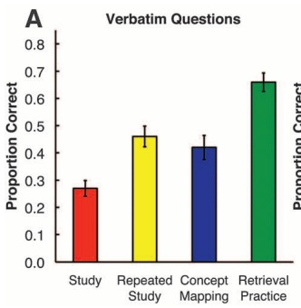

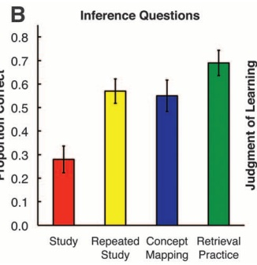

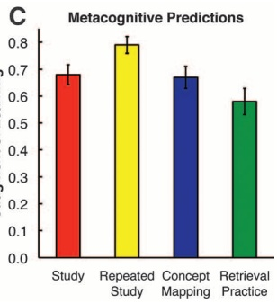

Fig. 1. Results of Experiment 1. (A and B) show the proportions correct on verbatim and inference shortanswer questions, respectively. (C) shows the proportion of information subjects predicted they would recall on the final test (their metacognitive judgments of learning). Error bars indicate SEM. On the final short-answer test, retrieval practice enhanced long-term learning above and beyond elaborative study with concept mapping by one and a half standard deviations (d = 1.50), yet students were largely unable to predict this benefit.

Students’ judgments of learning, solicited in the initial learning session, reflected little metacognitive knowledge of the benefits of retrieval practice (Fig. 1C). Students predicted that repeated studying would produce the best longterm retention and that practicing retrieval would produce the worst retention, even though the opposite was true (7, 8).

On the final test 1 week later, the repeated study, elaborative concept mapping, and retrieval practice conditions all outperformed the studyonce condition on both verbatim and inference questions (Fig. 1, A and B). Retrieval practice produced the best learning, better than elaborative studying with concept mapping, which itself was not significantly better than spending additional time reading. Collapsed across question type (verbatim and inference), the advantage of retrieval practice $( M = 0 . 6 7 )$ over elaborative studying with concept mapping $( M = 0 . 4 5 )$ represented about a 50% improvement in long-term retention scores $[d = 1.50,   F_{1,38} = 21.63,   \eta_{\mathrm{p}} = 0.36]$

We carried out a second experiment to replicate the results of our first experiment and extend them in three ways. First, we sought to generalize our results to texts that represent different knowledge structures commonly found in science education, because under some circumstances the effectiveness of different learning activities can depend on the structure of the materials that students are learning (21). We used texts with enumeration structures, which describe a list of concepts (e.g., a text describing properties of different muscle tissues), and texts with sequence structures, which describe a continuous and ordered series of events (e.g., a text describing the sequence of events involved in the process of digestion) (22).

Second, to determine the robustness of our retrieval practice effects, we examined the relative

Fig. 2. Results of Experiment 2. (A and B) show the proportions correct on the final short-answer tests for enumeration and sequence texts, respectively. (C and D) show the proportions correct on the final concept mapping tests for enumeration and sequence texts, respectively. Error bars indicate SEM. Retrieval practice enhanced long-term learning above and beyond elaborative concept mapping by more than one standard deviation on both types of final test $( d   =   \widehat { 1 } . 0 7$ and 1.01, respectively). (E to H) show the proportion of

Actual Performance

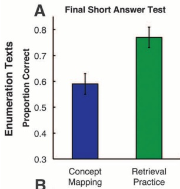

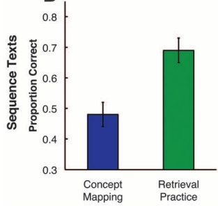

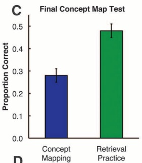

D

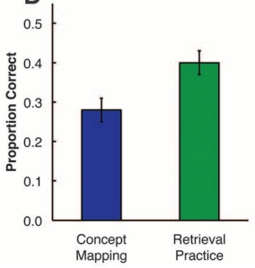

Metacognitive Predictions

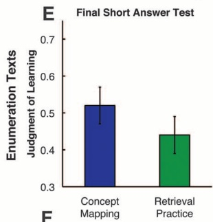

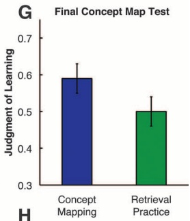

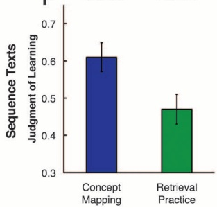

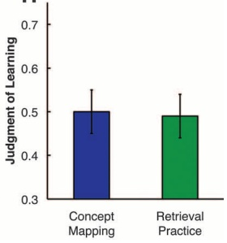

information subjects predicted they would recall on the final test in each initial learning condition. Students tended to believe that elaborative concept mapping would produce the same or even greater learning than retrieval practice, even though the opposite was true, as shown in (A) to (D).

Table 1. Number of subjects showing different patterns of actual performance and metacognitive judgments in Experiment 2. Retrieval, the retrieval practice condition; Mapping, the elaborative concept mapping condition; Final SA test, the final short-answer test condition; Final map test, the final concept mapping test condition; Total, the sums across the two final test conditions.

<table><tr><td rowspan="2"></td><td colspan="3">Actual performance</td></tr><tr><td>Retrieval &gt; Mapping</td><td>Retrieval = Mapping</td><td>Retrieval &lt; Mapping</td></tr><tr><td>Final SA test</td><td>52</td><td>3</td><td>5</td></tr><tr><td>Final map test</td><td>49</td><td>3</td><td>8</td></tr><tr><td>Total</td><td>101</td><td>6</td><td>13</td></tr><tr><td rowspan="2"></td><td colspan="3">Metacognitive predictions</td></tr><tr><td>Retrieval &gt; Mapping</td><td>Retrieval = Mapping</td><td>Retrieval &lt; Mapping</td></tr><tr><td>Final SA test</td><td>12</td><td>14</td><td>34</td></tr><tr><td>Final map test</td><td>18</td><td>17</td><td>25</td></tr><tr><td>Total</td><td>30</td><td>31</td><td>59</td></tr></table>

effectiveness of retrieval practice and elaborative concept mapping for each individual learner. We tested a total of 120 students and used a withinsubject design. Each student created a concept map of one science text and practiced retrieval of a second text. This experimental design allowed us to determine how many students showed an advantage of retrieval practice over concept mapping, how many showed the opposite result, and how many showed no difference between learning activities.

Third, we assessed long-term learning with two different final test formats. In Experiment 1, retrieval practice produced better performance than elaborative studying with concept mapping on a final short-answer test. It may be that the similarity of initial learning and final testing scenarios was important and that the final shortanswer test was more similar to the initial retrieval practice task than to the initial concept mapping task. Therefore, in Experiment 2, half of the students took a final short-answer test, like the one used in Experiment 1, and half took a final test in which they created concept maps of the two texts, without viewing the texts on the final test. If retrieval practice helps students build the conceptual knowledge structures they need to retain knowledge over the long term, then it should produce better performance than elaborative studying with concept mapping, even when the final test involves creating a concept map.

Initial learning time was again exactly matched in the elaborative concept mapping and retrieval practice conditions. However, in Experiment 2, students produced a greater proportion of ideas on the initial concept maps than they did on the initial tests in the retrieval practice condition [0.74 versus 0.65, respectively; $F_{1,117} = 23.13, \eta_{p}^{2} =$ 0.17]. Therefore, the initial level of performance favored the concept mapping condition.

The results on the final short-answer test were similar for verbatim and inference questions (Fig. 2), as was the case in Experiment 1. Therefore, the results were collapsed across question type. Retrieval practice produced better performance than elaborative concept mapping for both types of science text (Fig. 2, A and B). Collapsed across the two text formats, the advantage of retrieval practice was again large $d = 1.07, F_{1,59} =$ $68.54, \eta_{\mathrm{p}}^{2} = 0.54].$

Figure 2, C and D, shows performance on the final concept mapping test. If the nominal similarity of initial learning and final test conditions were important, one might expect initial elaborative study with concept mapping to produce the best performance when the final test also involved creating concept maps. That was not the case. Even when the final test involved using memory to construct a concept map, practicing retrieval during original learning produced better performance than engaging in elaborative study by creating concept maps during original learning $[d = 1.01,   F_{1,59} = 58.42,   \eta_{\mathrm{p}}^2 = 0.50]$

We again examined whether students exhibited metacognitive knowledge of the benefits of retrieval practice. Students’ judgments of learning were solicited after students had experienced each text in the initial learning phase. In general, students erroneously predicted that elaborative concept mapping would produce better long-term learning than retrieval practice (Fig. 2, E to H).

Finally, we examined the relative effectiveness of retrieval practice and elaborative study with concept mapping for every individual learner in the experiment. Table 1 shows the number of subjects who performed better after retrieval practice than concept mapping, the number who showed the opposite result, and the number who performed equivalently in both conditions. Overall, 101 out of 120 students (84%) performed better on the final test after practicing retrieval than after elaborative studying with concept mapping. Table 1 also shows students’ judgments of learning. Ninety out of 120 students (75%) believed that elaborative concept mapping would be just as effective or even more effective than practicing retrieval. Most students did not expect that retrieval practice would be more effective than elaborative concept mapping, but in fact it was.

Retrieval practice is a powerful way to promote meaningful learning of complex concepts commonly found in science education. Here, we have shown that retrieval practice produces more learning than elaborative studying, and we used concept mapping as a means of inducing elaboration while students studied. We hasten to add that concept mapping itself is not inherently just an elaborative study task. When students create concept maps in the presence of materials they are learning, the activity involves elaborative studying. Students could also create concept maps in the absence of materials they are learning, and then the activity would involve practicing retrieval of knowledge. Nevertheless, both elaborative concept mapping and retrieval practice are active learning tasks, and our results make it clear that whether a task is considered “active” is not diagnostic of how much learning the task will produce. The specific nature of the activity determines the degree and quality of learning, so understanding the nature of encoding and retrieval processes is crucial for designing educational activities.

There are several theoretical reasons to expect that the processes involved in retrieving knowledge differ fundamentally from the processes involved in elaborative studying. During elaboration, subjects attain detailed representations of encoded knowledge by enriching or increasing the number of encoded features, but during retrieval, subjects use retrieval cues to reconstruct what happened in a particular place at a particular time. In free recall, subjects must establish an organizational retrieval structure (23) and then discriminate and recover individual concepts within that structure (24). Retrieval practice likely enhances the diagnostic value of retrieval cues, which refers to how well a cue specifies a particular piece of knowledge to the exclusion of other potential candidates (25–27). Rather than multiplying or increasing the number of encoded features, which occurs during elaboration, retrieval practice may improve cue diagnosticity by restricting the set of candidates specified by a cue to be included in the search set (23, 25–27). Thus, mechanisms involved in retrieving knowledge play a role in producing learning.

Research on retrieval practice suggests a view of how the human mind works that differs from everyday intuition. Retrieval is not merely a readout of the knowledge stored in one’s mind; the act of reconstructing knowledge itself enhances learning. This dynamic perspective on the human mind can pave the way for the design of new educational activities based on consideration of retrieval processes.

## References and Notes

1. R. A. Bjork, in Information Processing and Cognition: The Loyola Symposium, R. L. Solso, Ed. (Erlbaum, Hillsdale, NJ, 1975), pp. 123–144.

2. J. D. Karpicke, H. L. Roediger III, J. Mem. Lang. 57, 151 (2007).

3. J. D. Bransford, A. L. Brown, R. R. Cocking, Eds., How People Learn: Brain, Mind, Experience, and School (National Research Council, Washington, DC, 2000).

4. M. S. Donovan, J. D. Bransford, Eds., How Students Learn: Science in the Classroom (National Research Council, Washington, DC, 2005).

5. R. A. Duschl, H. A. Schweingruber, A. W. Shouse, Eds., Taking Science to School: Learning and Teaching Science in Grades K-8 (National Research Council, Washington, DC, 2005).

6. F. I. M. Craik, E. Tulving, J. Exp. Psychol. Gen. 104, 268 (1975).

7. J. D. Karpicke, H. L. Roediger, Science 319, 966 (2008).

8. H. L. Roediger, J. D. Karpicke, Psychol. Sci. 17, 249 (2006).

9. S. K. Carpenter, H. Pashler, Psychon. Bull. Rev. 14, 474 (2007).

10. H. Pashler, D. Rohrer, N. J. Cepeda, S. K. Carpenter, Psychon. Bull. Rev. 14, 187 (2007).

11. M. A. Pyc, K. A. Rawson, J. Mem. Lang. 60, 437 (2009).

12. For a review, see (28).

13. See (29) and (30), however.

14. L. W. Anderson et al., A Taxonomy for Learning, Teaching, and Assessing: A Revision of Bloom’s Taxonomy of Educational Objectives (Longman, New York, 2000).

15. R. E. Mayer, Learning and Instruction (Prentice Hall, Upper Saddle River, NJ, 2008).

16. J. D. Novak, D. B. Gowin, Learning How to Learn (Cambridge Univ. Press, New York, 1984).

17. J. D. Novak, Res. Sci. Educ. 35, 23 (2005).

18. J. C. Nesbit, O. O. Adesope, Rev. Educ. Res. 76, 413 (2006).

19. Materials, methods, and additional results are available as supporting material on Science Online.

20. J. Dunlosky, J. Metcalfe, Metacognition (Sage, Thousand Oaks, CA, 2009).

21. M. A. McDaniel, G. O. Einstein, Educ. Psychol. Rev. 1, 113 (1989).

22. L. K. Cook, R. E. Mayer, J. Ed. Psy. 80, 448 (1988).

23. J. G. W. Raaijmakers, R. M. Shiffrin, Psy. Rev 88, 93 (1981).

24. R. R. Hunt, M. A. McDaniel, J. Mem. Lang. 32, 421 (1993).

25. J. S. Nairne, Memory 10, 389 (2002).

26. J. S. Nairne, in Distinctiveness and Memory, R. R. Hunt, J. Worthen, Eds. (Oxford Univ. Press, New York, 2006), pp. 27–46.

27. J. D. Karpicke, F. M. Zaromb, J. Mem. Lang. 62, 227 (2010).

28. H. L. Roediger, J. D. Karpicke, Perspect. Psychol. Sci. 1, 181 (2006).

29. J. D. Karpicke, H. L. Roediger, Mem. Cognit. 38, 116 (2010).

30. M. A. McDaniel, D. C. Howard, G. O. Einstein, Psychol. Sci. 20, 516 (2009).

31. This research was supported by a grant from the National Science Foundation (0941170). We thank C. Ballas, B. Byrer, H. Cannon, and B. Etchison for help with this research.

## Supporting Online Material

www.sciencemag.org/cgi/content/full/science.1199327/DC1Materials and Methods Fig. S1 Table S1 References

20 October 2010; accepted 10 January 2011 Published online 20 January 2011; 10.1126/science.1199327

# Leishmania RNA Virus Controls the Severity of Mucocutaneous Leishmaniasis

Annette Ives,1 Catherine Ronet,1 Florence Prevel,1 Giulia Ruzzante,1 Silvia Fuertes-Marraco,1 Frederic Schutz,2 Haroun Zangger,1 Melanie Revaz-Breton,1\* Lon-Fye Lye,3 Suzanne M. Hickerson,3 Stephen M. Beverley,3 Hans Acha-Orbea,1 Pascal Launois,4 Nicolas Fasel,1† Slavica Masina1

Mucocutaneous leishmaniasis is caused by infections with intracellular parasites of the Leishmania Viannia subgenus, including Leishmania guyanensis. The pathology develops after parasite dissemination to nasopharyngeal tissues, where destructive metastatic lesions form with chronic inflammation. Currently, the mechanisms involved in lesion development are poorly understood. Here we show that metastasizing parasites have a high Leishmania RNA virus–1 (LRV1) burden that is recognized by the host Toll-like receptor 3 (TLR3) to induce proinflammatory cytokines and chemokines. Paradoxically, these TLR3-mediated immune responses rendered mice more susceptible to infection, and the animals developed an increased footpad swelling and parasitemia. Thus, LRV1 in the metastasizing parasites subverted the host immune response to Leishmania and promoted parasite persistence.

Leishmania parasites are obligate intracellular protozoan parasites transmitted to the mammalian host by the bite of an infected sand fly, where they predominantly infect macrophages. In Latin America, leishmaniasis caused by the Leishmania Viannia (L.Viannia) subgenus is endemic, causing cutaneous (CL) and mucocutaneous (MCL) leishmaniasis (1). Clinical MCL involves parasitic dissemination to the nasopharyngeal areas of the face, leading to destructive metastatic secondary lesions and hyperinflammatory immune responses (2–4). About 5 to 10% of individuals asymptomatic or with resolved CL lesions may develop MCL (1, 5, 6).

MCL development is associated with persistent immune responses showing proinflammatory mediator expression with high tumor necrosis factor a (TNF-a), CXCL10, and CCL4; a mixed intralesional T helper 1 $( \mathrm { T _ { H } } 1 ) / \mathrm { T _ { H } } 2$ phenotype;

and elevated cytotoxic T cell activity (7–10). In addition to parasite-derived virulence factors, host genetics [such as polymorphisms for TNF-a and interleukin-6 (IL-6)] and immune status appear to influence MCL development (11, 12).

Hamsters infected with L.Viannia parasites isolated from human MCL lesions reproduce the metastatic phenotype with primary and secondary lesion development (13). Using this model, we characterized clones derived from the metastasizing L.guyanensis WHI/BR/78/M5313- $L.g.M5313(M+)$ strain as metastatic $( L . g . \mathrm { M } + )$ or nonmetastatic (L.g.M−) after infection, depending on their ability to reproducibly develop secondary metastatic lesions (14). Previously, we showed that L.g.M+ clones derived from $L . g . \mathrm { M } 5 3 1 3$ were more resistant to oxidative stress than L.g.M− clones and persisted in activated murine bone-marrow– derived macrophages despite their elevated nitric oxide levels (15).

On the basis of these observations, we hypothesized that $L g . \mathrm { M } +$ and L.g.M− parasites differentially modulate the host macrophage responses. Using DNA microarrays, we identified differential gene expression between uninfected macrophages and $L.g.\bar{M}+(1672) or L.g.M-(1513)$ infected macrophages, and $L g M -$ directly compared to $L g M +$ (294) infected macrophages. Statistical significance was determined at ≥1.5-fold, $P \leq 0 . 0 5 .$ . We focused on genes involved in the immune response because of their relevance in MCL pathology.

In vitro, infected macrophages expressed significantly greater amounts of chemokines and cytokines CCL5, CXCL10, TNF-a, and IL-6 after infection with $L . g . \mathrm { M } +$ parasites compared with $L . g . \mathrm { M }$ − parasites or L. major LV39 (Fig. 1, A and B) (16). We observed similar increased cytokine and chemokine expression after infection with L.g. from human MCL lesions (h-MCL-Lg1398) as compared to cytokine and chemokine expression during L.g. infection from human CL lesions (h-CL-Lg1881) (Fig. 1C). Thus, the elevated cytokine and chemokine levels after macrophage infection are associated with metastasizing parasites.

Leishmania parasites enter the macrophage endosomal compartment and form a phagolysosome (17). Pretreatment of macrophages with chloroquine, which induces vacuolar alkanization and impairs recognition of pathogen-derived motifs by cells (18), or cytochalasin D, which inhibits parasite phagocytosis by inhibiting actin polymerization (19), showed that L.g.M+ parasitedependent induction of proinflammatory mediator required parasite entry into the cell and sequestration into a mature phagolysosome (fig. S1A). Therefore, we investigated the role of the macrophage endosomal Toll-like receptors (TLRs) of the myeloid differentiation factor 88 (MyD88) (TLR7 and TLR9) and/or of the TIR domain–containing adapter-inducing interferon-b (TRIF)-dependent pathways (TLR3). Using macrophage functionally deficient for TLR3, 7, or 9, or for the adaptors MyD88 and TRIF, we found that the TLR3-TRIF– dependent pathway was essential for increased proinflammatory mediator expression after macrophage infection with $L . g . \mathrm { M } +$ (Fig. 2 and fig. S1B). In addition, MyD88-dependent TLR7 activation within the macrophage was required for maximal secretion of the proinflammatory mediators after infection with M+ parasites (Fig. 2 and fig. S1B). In our system, TLR9 was not involved in L.g.M+-dependent macrophage responses, suggesting that recognition of Leishmania-derived DNA motifs by the host’s TLR9 does not differ between the Leishmania strains (Fig. 2A).

In other murine models of infection, TLR3 ligation up-regulates proinflammatory mediators (TNF-a, IL-6, and chemokines) and type I interferons,

<small>1Department of Biochemistry, University of Lausanne, 1066 Epalinges, Switzerland. 2Swiss Institute of Bioinformatics, University of Lausanne, 1015 Dorigny, Switzerland. 3Department of Molecular Microbiology, Washington University, School of Medicine, St Louis, MO 63110, USA. 4World Health Organization– Immunology Research and Training Centre, 1066 Epalinges, Switzerland.</small>

<small>\*Present address: Route de Berne 7A, 1700 Fribourg, Switzerland. †To whom correspondence should be addressed. E-mail: nicolas.fasel@unil.ch</small>