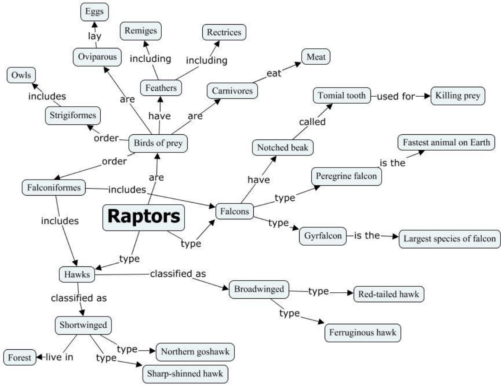
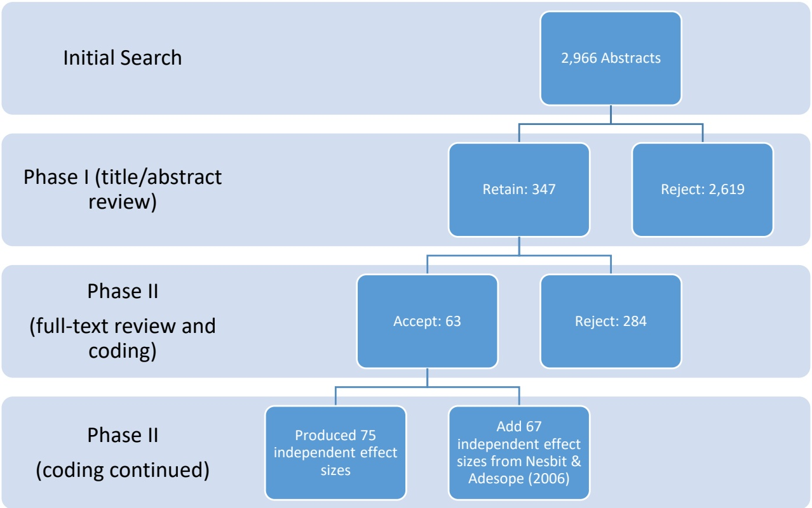

# Studying and Constructing Concept Maps: A Meta-Analysis

Noah L. Schroeder, John C. Nesbit, Carlos J. Anguiano, & Olusola O. Adesope.

Schroeder, N. L., Nesbit, J. C., Anguiano, C. J., & Adesope, O. O. (in press). Studying and constructing concept maps: A meta-analysis. Educational Psychology Review. DOI: 10.1007/s10648-017-9403-9

Published version: [http://link.springer.com/content/pdf/10.1007%2Fs10648-017-9403-9.pdf](http://link.springer.com/content/pdf/10.1007%2Fs10648-017-9403-9.pdf)

Abstract: A concept map is a node-link diagram in which each node represents a concept and each link identifies the relationship between the two concepts it connects. We investigated how using concept maps influences learning by synthesizing the results of 142 independent effect sizes $( n = 1 1 { , } 8 1 4 )$ . A random-effects model meta-analysis revealed that learning with concept and knowledge maps produced a moderate, statistically significant effect $( g = . 5 8 , p < . 0 0 1 )$ . A moderator analysis revealed that creating concept maps $( g = . 7 2 , p < . 0 0 1 )$ was associated with greater benefit relative to respective comparison conditions than studying concept maps $( g = . 4 3 ,$ $p < . 0 0 1 )$ . Additional moderator analyses indicated learning with concept maps was superior to other instructional comparison conditions, and was effective across science, technology, engineering, and math (STEM) and non-STEM knowledge domains. Further moderator analyses as well as implications for theory and practice, are provided.

Keywords: Concept map, knowledge map, meta-analysis, cmap, kmap

## Studying and Constructing Concept Maps: A Meta-Analysis

Concept maps are diagrams used in many educational settings to represent verbal or conceptual information (Figure 1). In this review we consider a concept map to be any node-link diagram in which each node represents a concept and each link identifies the relationship between the two concepts it connects. For example, if two nodes “ocean acidification” and “growth of coral reefs” are connected with a link labeled “slows” the assemblage can be read as the proposition “ocean acidification slows growth of coral reefs”. A concept map can include dozens of links and nodes, with each pair of linked nodes representing a proposition. Figure 1 shows a concept map created using CmapTools, one of the more widely used software tools for authoring concept maps (Cañas et al., 2004).

Diagrams similar to concept maps have been used by philosophers and logicians for centuries (Nesbit & Adesope, 2013), but the term concept map and the modern idea of the concept map as a tool for learning originated with Joseph Novak and his colleagues in the 1970s (Novak & Gowin, 1984). Novak advocates concept mapping, the construction of concept maps by learners, as a way to promote meaningful learning. He explains that concepts should be hierarchically arranged with more general concepts placed higher on the map and linked to more specific concepts placed lower in the map (Novak & Cañas, 2008). Novak further recommends that concept maps include horizontal cross-links to depict relationships other than generality/specificity.

Knowledge maps, featured in research by Dansereau and colleagues (O’Donnell, Dansereau, & Hall, 2002), are node-link diagrams we consider to be a type of concept map. Instead of representing a relation between concepts by a freely chosen word or phrase, links in knowledge maps must be selected from a fixed set of nine relational terms such as “type,

“example” and “leads to”. Unlike Novak’s emphasis on concept mapping by learners, much of the research conducted by Dansereau examined the use of knowledge maps as a medium for presenting new information to learners.

----Insert Figure 1 about here----

This review investigated research on the instructional efficacy of using diagrams that met our definition of concept map regardless of how they were identified in the primary studies. The review examined all instructional uses including constructing, studying, and editing concept maps. In reviewing research we gave particular attention to the mode of instruction used as a comparison treatment because we are interested in understanding the cognitive processes at work as learners use concept maps and how and under what conditions the use of concept maps should be selected instead of other means of learning.

Previous meta-analyses have found advantages for using concept maps in comparison with other modes of instruction. In a meta-analysis of 18 classroom-based studies, Horton et al. (1993) found that student concept mapping was associated with a mean effect size of .42 standard deviations and studying teacher-prepared concept maps was associated with a mean effect size of .59 standard deviations although with far fewer number of studies (3 studies). In a comprehensive meta-analysis of 67 effect sizes that included classroom-based and laboratorybased studies, Nesbit and Adesope (2006) found that both concept mapping $(g = .82)^{\mathrm{i}}$ and studying concept maps (g = .37) were associated with statistically significant advantages. They found that the advantage for constructing and studying concept maps extended over all grade levels and almost all school subjects investigated.

Perhaps the most interesting results presented by Nesbit and Adesope (2006) were for treatment comparisons appearing in only a small number of studies. They found a large effect size associated with studying animated concept maps $( g = . 7 4 , k = 2 ) ^ { \mathrm { i i } }$ . In addition, they found an advantage for studying concept maps rather than outlines or lists $( g = . 2 8 , k = 1 0 )$ , and, when engaged in cooperative learning with a partner, no significant advantage for studying concept maps rather than other materials $( g = . 1 9 , k = 8 )$

## Concept Maps as Learning Tools

Scholars have posited various reasons to explain why constructing and studying concept maps may be effective learning strategies, and we propose these reasons can be broadly categorized as promoting meaningful learning, reducing extraneous cognitive load, or both.

**Meaningful learning.** Novak and Cañas (2008) credit David Ausubel with the distinction between rote learning and meaningful learning. Rote learning can be regarded as focusing on verbatim memorization of presented information with little effort to connect it to prior knowledge and understand its meaning (Novak, 2002). In contrast, meaningful learning occurs when new knowledge is created or assimilated into existing interconnected knowledge structures through cognitive elaboration. Meaningful learning is sometimes referred to as knowledge elaboration (Kayuga, 2009) whereby learners use strategies such as self-explanation (Chi, Bassok, Lewis, Reimann, & Glaser, 1989) and elaborative interrogation (Dunlosky, Rawson, Marsh, Nathan & Willingham, 2013) to connect the new information to existing knowledge structures. Learning strategies that ‘make meaning’ are more effective than rote learning, and abundant research evidence demonstrates that cognitive elaboration is the process on which their success depends (Dunlosky, Rawson, Marsh, Nathan & Willingham, 2013).

According to Karpicke and Blunt (2011, p. 772), “concept mapping bears the defining characteristics of an elaborative study method: It requires students to enrich the material they are studying and encode meaningful relationships among concepts within an organized knowledge structure.” In order for meaningful learning to occur, Novak and Cañas (2008) describe three preconditions: the learning material must be relevant and conceptually understandable to the learners, the learners must have appropriate and relevant prior knowledge, and the learners must make an effort to meaningfully learn the materials. They argue that constructing concept maps can facilitate meeting the first criterion of meaningful learning as concept maps can both identify and properly sequence knowledge in relation to the learners’ prior knowledge. However, it is also the instructor’s responsibility to be conscientious of what information the students conceptually understand before preparing their concept maps, and they must use instructional techniques and evaluation procedures that encourage meaningful learning rather than rote learning (Novak & Cañas, 2008).

Studying concept maps instead of text can also be theorized to promote cognitive elaboration and meaningful learning. O’Donnell, Dansereau and Hall (2002, p. 75) claimed that “knowledge maps make the macrostructure of a body of information more salient.” If students more easily recognize in learning materials superordinate concepts they already know, then they are better able to subsume new subordinate concepts within their existing knowledge structures.

**Reducing extraneous cognitive load**. Using concept maps may lower some barriers students face compared with carrying out an equivalent learning task by writing or studying text. The grammatical structure of concept maps tends to be much simpler than sentences in natural language, and may require less extraneous processing to generate and interpret. Studying concept maps has greater benefits for students with lower domain knowledge or lower verbal ability

(Nesbit & Adesope, 2006; Haugwitz, Nesbit & Sandmann, 2010), a pattern that would be expected if concept maps reduce extraneous load. Researchers (e.g., Amadieu, van Gog, Paas, Tricot, Mariné, 2009; O’Donnell, Dansereau & Hall, 2002) have often claimed concept maps offer more salient presentation of key semantic features such as relationships between concepts, hierarchical relationships, centrality of concepts; and students do less extraneous cognitive processing to extract these features from concept maps than they do from texts.

## Purpose of the Present Meta-Analysis

In the decade since the meta-analysis by Nesbit and Adesope (2006) much new primary research has appeared. Researchers have continued to investigate the efficacy of using concept maps for learning and in doing so have extended the instructional contexts, map features, and comparison conditions represented in the research base. More recently, a few studies (Blunt & Karpicke, 2014; Karpicke & Blunt, 2011) found that retrieval practice by writing text is more effective than concept mapping while viewing source text as a means of studying text passages. Furthermore, new research has been published in categories represented by small sample sizes in the earlier meta-analysis. For example, research has since been published on the effects of animated concept maps (Adesope & Nesbit, 2013). A new meta-analysis is needed to determine whether the effects in such categories are overturned or strengthened by the more recent research.

It has been our impression the cognate research is dominated by studies that evaluate the learning effectiveness of particular uses of concept maps rather than investigate theories explaining their effectiveness. While theoretical conclusions can certainly be drawn from some evaluation studies, research designed expressly to test theories is a far more efficient route. We hoped to assess through the meta-analysis whether studies comparing the use of concept maps to other modes of learning have advanced understanding of the cognitive processes that explain how concept maps can help students to learn.

The plan for this review was to combine the previously analyzed (see Nesbit & Adesope, 2006) and recent studies in a single database and conduct a new meta-analysis. The review incorporated all relevant studies from the inception of concept maps in 1972 (Novak, 1990) to 2014.

**Research question.** The research questions investigated by the review stemmed from one overarching question:

What is the effect of using concept maps on learning?

We began by examining the overall influence of concept mapping and studying concept maps on learning outcomes compared to other instructional interventions. Next, we examined how this effect varied by (a) the mode of instruction used as the comparison treatment, (b) the subject area (science, technology, engineering, and math (STEM) or non-STEM), (c) the type of concept maps, (d) the duration of treatment, (e) whether the maps were studied or constructed, (f) where the research was conducted, (g) the level of schooling, and (g) whether learning was collaborative or individual. The examination of moderator variables can often indicate under which conditions an instructional treatment is effective or provide evidence for cognitive explanations of treatment effects, both of which have implications for designing more effective learning conditions. For example, it could be hypothesized that the visual complexity of static concept maps can be reduced by presenting the information in an animated format, resulting in the animated condition increasing learning due to the well-known limitations of working

memory. If the moderator analysis revealed that the effect size for studying animated concept maps is greater than the effect size for studying static concept maps, it would support the hypothesis that animating concept maps to reduce the visual complexity is an effective instructional strategy.

## Method

## Literature Search

Our literature search focused on studies published since 2005 when Nesbit and Adesope (2006) conducted their literature search. The keywords used to search the concept mapping literature for relevant studies were “concept map\* OR knowledge map\* OR node-link map\*” (Nesbit & Adesope, 2006, p. 422). On February 28, 2014 we searched the titles and abstracts of papers presented at the American Educational Research Association (AERA, 2006-2014)1and National Association for Research in Science Teaching (NARST, 2007-2013)2. Together, this search revealed 107 studies (AERA, 54 studies; NARST, 53 studies).

On March 6, 2014 the following databases were searched for studies published from 2005 until the date the search was conducted (with the number of studies returned indicated in parenthesis): Web of Science (1083), ERIC (815), Academic Search Complete (513), PsychINFO (292), Dissertation Abstracts (131), and PsychARTICLES (7). In sum, our search located 2,966 new studies for consideration.

## Inclusion Criteria

<small>1 For AERA papers only paper titles were examined. Programs for the years 2007 and 2008 were unavailable at the time of the initial literature search. The programs were retrieved in 2015 and added 8 and 10 abstracts for consideration, respectfully.</small>

<small>2 The program for the year 2006 was unavailable at the time of the literature search.</small>

This study used the same methodology as Nesbit and Adesope’s (2006) meta-analysis. In order to be considered for inclusion in this meta-analysis, studies must meet the following inclusion criteria:

(a) contrasted the effects of map study, construction, or manipulation with the effects of other learning activities; (b) measured cognitive or motivational outcomes such as recall, problem-solving transfer, learning skills, interest, and attitude; (c) reported sufficient data to allow an estimate of standardized mean difference effect size; (d) assigned participants to groups prior to differing treatments; (e) randomly assigned participants to groups, or used a pretest or other prior variable correlated with outcome to control for preexisting differences among groups. Studies reporting a pretest effect size outside the range −.40 < $d   <   4 0$ were excluded from the meta-analysis. (Nesbit & Adesope, 2006, p. 421-422).

## Coding Procedures

**Phase I coding.** In the first phase of the coding process, the titles and abstracts of each study were examined. Two coders examined the studies for possible inclusion. To ensure consistency, they completed a 300 study training set where they coded the same studies (as either retain or reject based on the abstract, i.e., a pseudo phase I coding) and then compared results. While there were a few discrepancies, the coders discussed the differences found, reached consensus, and no major concerns arose during the process. The coders then proceeded to code the remaining studies. As shown in Figure 2, this screening process revealed 347 studies which met the inclusion criteria.

**Phase II coding.** The second phase of the coding process consisted of the full-text examination of these studies and subsequent coding process. This process eliminated 284 studies, leaving 63 studies that met the inclusion criteria. These 63 studies were randomly distributed between the two coders for coding on the coding form.

**Final coding form.** The coding form and process were identical to Nesbit and Adesope’s (2006), but in some cases the variables for menu items were changed (e.g., rather than the domains specified by Nesbit and Adesope, we categorized studies as either science, technology, engineering, or mathematics (STEM) or non-STEM3). In these cases, the coding was updated for studies in the previous analysis. In order to extract effect sizes, consistent with process used by Nesbit and Adesope, we coded the most delayed knowledge test present in the study when measures were reported from multiple points in time. For example, if test scores were available from a test taken immediately after learning with the instructional materials and also from one week later, we coded the results from the test that occurred one week after the intervention took place.

Coding the 63 studies produced 75 independent effect sizes which were combined with the 67 independent effect sizes analyzed by Nesbit and Adesope (2006). Thus, the present metaanalysis examined 142 independent effect sizes.

----Insert Figure 2 about here---

**Analyses.** During the coding process we found that descriptive statistics were sometimes not reported, in which case effect sizes were calculated from the results of the reported statistical tests (e.g., a t statistic). In addition, if a study contained more than one treatment or control group relevant to the meta-analysis we calculated weighted means and pooled standard deviations

<small>3 We categorized studies as STEM or non-STEM due to the plethora of discipline-based research fields now prevalent in the scholarly community. We note that these coding categories are generally consistent with those used in Nesbit and Adesope’s (2006) analysis, which coded studies as physical science, general science (with subfields), or humanities (with subfields).</small>

across the two groups to maintain statistical independence. For example, if a study contained two experimental concept mapping groups and one non-mapping control group, the weighted means and pooled standard deviations would be calculated for the two experimental conditions and used to calculate an effect size compared to the non-mapping control condition. Finally, the effect sizes extracted from two studies $( g = 3 . 8 2 ;   g = 5 . 9 4 )$ were determined to be outliers $( - 3.3 \geq Z \geq$ $3 . 3 ; p < . 0 0 1 )$ . The effect sizes were adjusted $(g = 2.70; g = 2.75$ , respectively) to be closer to the next highest effect size $( g = 2 . 6 7 )$ as recommended by Tabachnick and Fidell (2013).

In the original analysis, Nesbit and Adesope (2006) reported an interrater agreement of 96.2%. In order to calculate the interrater reliability for the newly-coded studies that met all of the inclusion criteria, IBM SPSS version 23 was used to calculate Cohen’s Kappa. We randomly selected 20.6% of the sample to be coded by both coders. The Kappa coefficient was found to be $k = . 8 8 \; ( p < . 0 0 1 )$ , indicating a very strong consistency between coders.

After all of the data were coded and the interrater reliability was found to be sufficient, we used the Comprehensive Meta-Analysis (version 2.2.064) software to analyze the data.

## Results and Discussion

## Overall Results

Analysis of the 142 independent effect sizes produced a moderate overall random effect of $g = . 5 8 \; ( p < . 0 0 1 )$ across a large, diverse sample of participants $( n = 1 1 { , } 8 1 4 )$ . Further analysis indicated that significant heterogeneity $( Q _ { B }   ( 1 4 1 ) = 1 , 1 2 7 . 7 3 , p < . 0 0 1 )$ existed and there was high variability within the sample $( I ^ { 2 } = 8 7 . 5 0 )$ . Accordingly, moderator analysis was conducted.

## Alternative Treatments

As we explained earlier, focusing on the different types of comparison conditions can provide insights into why learning with concept maps can be an effective instructional technique. Our analysis revealed significant differences between the no concept map comparison conditions $( Q _ { B } ( 5 ) = 2 8 . 4 0 , p < . 0 0 1 )$ . Learning with concept maps was found to be considerably more effective than learning through discussion or lecture-based treatment conditions $( g = 1 . 0 5 , p <$.001) across a considerable number of studies (k = 37), and moderately more effective than creating or studying outlines or lists (Table 1). Learning with concept maps was also found to be more effective than both constructing and studying texts. Caution is warranted when interpreting the results in Table 1 because both the intervention and comparison conditions were highly varied across studies. The intervention conditions included constructing and studying concept maps, and within each type of control condition there were many variants. The discussion/lecture category was especially diverse as it included teacher-led discussions, non-interactive lectures, and indeed any kind of teacher-led, whole-class activity. What teaching styles were used and what students were actually doing in such whole-class activities was often not monitored or not reported.

----Insert Table 1 about here----

## Domain

Due to the consistent push towards improving teaching and learning in the STEM fields, we categorized the learning materials used within studies as either STEM or non-STEM relevant. Our analysis revealed no significant differences existed between groups $( Q _ { B } ( 2 ) = 3 . 0 0 , p = . 2 2 )$ Studies investigating both STEM and non-STEM relevant learning materials produced effect sizes consistent with the overall effect size found in this study (Table 2). Indeed, the results showed the beneficial effects of learning with concept maps regardless of the knowledge domain.

----Insert Table 2 about here----

We hypothesized that learning in the STEM domains, where the content often contains complex hierarchical, linear, cyclical, and interacting processes, would show more benefits from learning with concept maps than non-STEM domains. However, the results did not support this hypothesis and the confidence intervals between STEM and non-STEM domains are quite similar. Hence, it appears concept mapping can be used effectively in a wide variety of content domains.

## Map Type

Due to the variety of interactive software platforms that facilitate concept mapping, we were interested in the relative benefits of working with static, animated, or interactive concept maps (Table 3). We operationalized these different types of concept maps as follows: static concept maps did not move, nor were they interactive in anyway; animated concept maps typically had link(s) or node(s) appear as they were mentioned by accompanying narration or when the learner clicked a ‘next’ button; interactive concept maps required students to interact with the software in some way beyond a ‘next’ button (e.g., the learner added or removed nodes or links). Our analysis revealed no significant differences between groups $Q_{B}(3)=1.34,p=$.72).

----Insert Table 3 about here----

Based on Nesbit and Adesope’s (2006) analysis, we hypothesized that animated or interactive concept maps would be more effective than static concept maps. While the analysis of the results did not support this hypothesis, this could be due to unequal sample sizes. The vast majority (k = 105) of the sample learned with static concept maps, while considerably fewer (k =

24) utilized interactive concept maps. However, given that the confidence intervals are similar, one can infer that learning with interactive or animated concept maps may provide no significant benefits compared to static concept maps. We note that the animated concept mapping conditions had a wide confidence interval. Hence, additional research is needed to understand under what conditions animated concept maps are more or less effective.

## Duration

In this meta-analysis we examined the effect of learning with concept maps depending on the duration of the intervention. Our analysis indicated significant differences existed between studies in which students worked with concept maps for differing durations $( Q _ { B } ( 3 ) = 2 2 . 4 7 , p <$.001). As shown in Table 4, the longer a learner utilized concept maps, the more effective they were for learning outcomes. Concept mapping was found to have a large effect compared to non-mapping conditions when the study lasted for more than four weeks $( g = . 7 2 , p < . 0 0 1 )$

----Insert Table 4 about here----

Nesbit and Adesope’s (2006) results showed that when learners constructed concept maps for less than five weeks the strategy was more effective than when learners constructed concept maps for longer durations. These results suggest a novelty effect, where concept maps become less effective over time as learners get more familiar with the technique and the novelty of using concept maps wears off. However, the results of the present meta-analysis do not support this notion. Rather, learning with concept maps was most effective when the intervention was longer than four weeks in duration. Due to similar sample sizes across all three duration groups examined (less than one week, one to four weeks, and greater than four weeks), we conclude that learning with concept maps retains its effectiveness as an instructional strategy for several weeks. However, it could be beneficial for future researchers to conduct longitudinal studies to examine the efficacy of using concept maps for longer durations (e.g., one semester, one year, etc.) and to examine how the effectiveness of using concept maps varies over the duration of the study.

## Map Use

Nesbit and Adesope (2006) examined the results of their study by whether students constructed or studied concept maps. Analysis of our data revealed significant differences existed between studies in which students constructed concept maps compared to studies in which students studied concept maps $( Q _ { B } ( 1 ) = 7 . 0 6 , p = . 0 1 )$ . Table 5 shows that studies in which students constructed concept maps averaged significantly higher effect sizes than those in which students studied concept maps.

----Insert Table 5 about here----

Examining the data, we can see there are likely two factors which can account for these differences. The two factors are a) the process involved in constructing concept maps compared to studying concept maps, and b) the nature of the comparisons examined in the primary studies.

When creating a concept map, as when constructing a text, the learner must engage in elaborative cognitive processing by means such as self-questioning, reflection, and summarization. For example, the learner must not only know the major conceptual ideas, but also how they’re related and how to best visually and spatially represent them. This process of deciding how to spatially distribute the links and nodes (i.e., connections and relationships between conceptual ideas) plausibly requires high levels of elaborative processing.

When one studies a concept map, they typically see a series of noun-verb-noun propositions without the contextual details one may see in a text presentation. This lack of context requires the learner to invoke similar meta-cognitive prompts as when one constructs a concept map, although perhaps not the same extent. For instance, the proposition elk calf-runs from-bear requires the learner to think, why would an elk calf run from a bear? Through self-questioning and self-explanation, the learner can come to the rationale that bears occasionally predate on elk. This process may require more elaborative processing in order to create an accurate mental model than reading an elaborate expository text on the subject. However, it may not require the same level of elaborative processing of the content compared to if the learner were constructing the concept map.

The differences found between studying and constructing concept maps may also be partially explained through the control conditions in the primary studies. When constructing concept maps, the most prevalent control condition was discussion or lecture, compared to which concept mapping was especially effective (discussed later, see Table 9). Constructing concept maps, an activity which requires a learner to cognitively engage with the content, was most frequently compared to listening to a discussion or lecture, an activity which often does not. There is evidence that learners are more successful in active learning tasks than passive ones. Freeman et al.’s (2014) recent meta-analysis showed the benefits of active learning in STEM courses. It is noteworthy that in our data set only 10 comparisons had learners construct a text compared to constructing a concept map (i.e., both active learning activities), and in these cases the concept map was still moderately more effective. When studying concept maps, the most prevalent control condition was studying a text, in which case those in the concept map conditions outperformed those studying text, but to a much smaller effect. Hence, we interpret

our results as supporting recent literature in relation to the benefits of active learning compared to passive learning, and acknowledge that it is possible that the control conditions within the primary studies could have influenced our understanding of the overall effectiveness of constructing compared to studying concept maps.

To summarize, it appears that both constructing and studying concept maps are effective learning strategies. We surmise that, as hypothesized by Nesbit and Adesope (2013), this may be due to the types of processing invoked by learning with concept maps. However, in order to identify concretely the rationale why concept maps are effective, purposefully designed experimental studies would need to be conducted.

## Effect of Moderator Variables by Use of Concept Map (Constructed or Studied)

Next, we examined the influence of studying or constructing concept maps across various conditions and settings.

**Region.** The first variable under investigation was the region of the world in which the study took place. Our analyses indicated that significant differences existed between the regions of the world the studies were conducted in regardless if the concept maps were constructed $\langle \mathcal { Q } _ { B }$ $(5)=26.71,p<.001$ or studied $( Q _ { B } ( 4 ) = 2 6 . 4 6 , p < . 0 0 1 )$

As shown in Table $^ { 6 , }$ consistent with the findings of Nesbit and Adesope (2006), creating concept maps was found to be most effective in studies that took place in Africa, however our literature search did not locate any additional studies where learners created concept maps in African countries. Yet, our search did increase the number of studies located for other world regions. For example, we found that constructing concept maps was associated with a large effect size in both Asian $( g = . 7 8 , p = . 0 1 )$ and European countries $( g = . 8 2 , p < . 0 0 1 )$ . Similarly, creating concept maps was also associated with moderate to large effects in Middle Eastern countries $( g = . 7 5 , p < . 0 0 1 )$ . Our literature search nearly doubled the number of studies in which participants in the United States or Canada created concept maps, and the effect size was found to be nearly identical to that found in Nesbit and Adesope’s (2006) previous analysis $( g = . 4 9 , p$ $< . 0 0 1 )$

----Insert Table 6 about here----

Our analysis also indicated a large effect for studying concept maps for learners in Asian countries $( g = 1 . 0 4 , p < . 0 1 )$ . While the number of studies $( k = 2 )$ is small, large effects were also found for those studying concept maps in Middle Eastern countries $( g = . 9 6 , p < . 0 0 1 )$ . Studying concept maps was associated with a moderate effect in European countries $( g = . 4 6 , p < . 0 1 )$ , but again the number of studies was limited $( k = 3 )$ . Finally, studying concept maps was associated with a modest effect in the United States and Canada $( g = . 2 5 , p < . 0 0 1 )$ ; however we note that this is still a small, positive effect robust across a large number of participants $(n = 3,667)$ ).

It is difficult to posit why concept mapping or studying concept maps may be more or less effective in different regions of the world based on this meta-analysis. Nesbit and Adesope (2006) reported personal communication which implies that, in some cases, the effectiveness may be due to the inherent advantage of comparing a constructive activity like concept mapping with a traditional method of teaching in a specific respective location. However, we hesitate to make broad generalizations based on the results presented here. Rather, we believe it would be more fruitful for researchers to undertake systematic lines of research to examine why concept mapping may be more effective in some regions of the world. Is the impact of concept mapping in each region related to the typical types of instruction students’ experience? Do different

languages integrate into the concept map format more efficiently or effectively due to word length or grammatical variation?

**Field of instruction.** Nesbit and Adesope (2006) examined the differences between constructing and studying concept maps in different fields of study. In our analysis, we classified studies as either within the STEM fields or non-STEM fields. Interestingly, we found no significant differences in effectiveness depending on the field of study regardless if concept maps were constructed $Q_{B}(1) = .33, p = .57$ or studied $( Q _ { B } ( 2 ) = 1 . 2 9 , p = . 5 3 )$ . As shown in Table 7, and consistent with our overall analysis of constructing compared to studying concept maps, constructing concept maps was associated with moderate to large effects, while studying concept maps was associated with moderate effects.

----Insert Table 7 about here----

Due to the plethora of discipline-based education research fields, we did not examine the influence of constructing or studying concept maps by specific subfields. Hence, it is possible that particular subfields may find concept mapping more or less effective than others.

**Type of concept map.** Nesbit and Adesope (2006) found that studying animated concept maps was more effective than studying static concept maps, however there were only two animated concept map studies included in their analysis. Animated concept maps use the signaling principle (van Gog, 2014) to guide learners through a complex map. They have been theorized to eliminate some of the extraneous processing demanded as learners navigate through a complex static map (Nesbit & Adesope, 2011). Alternatively, it is plausible that when constructing concept maps, an interactive format could be more complex as the learner would need to know how to not only create the concept map, but also manipulate a software program

effectively. Hence, we sought to further investigate the differences between constructing or studying interactive, animated, and static concept maps.

When learners constructed concept maps, there was no significant difference between if the map was interactive, static, or a mixture of the two $( Q _ { B } ( 2 ) = . 0 2 , p = . 9 9 )$ . While small sample sizes are a limitation, examination of the effect sizes indicates moderate to large effects regardless of the type of concept map being constructed (Table 8). Similarly, when concept maps were studied by learners there was no significant difference between groups depending on whether they were studying interactive, animated, static concept maps, or any combination of the above $( Q _ { B } ( 3 ) = 0 . 7 7 , p = . 8 6 )$

----Insert Table 8 about here----

These results stand in contrast to the hypotheses of cognitive load theory. Research is needed to understand the conditions in which, and for whom, static, animated, or interactive concept maps may be most effectively employed.

**Comparison Treatment.** A very important comparison is examining the influence of concept mapping compared to non-mapping conditions. Nesbit and Adesope (2006) found that constructing concept maps was more effective than lecture $( g = . 7 4 , p < . 0 5 )$ and creating texts or outlines $( g = . 1 9 , p < . 0 5 )$ . Similarly, studying concept maps was more effective than studying texts $( g = . 3 9 , p < . 0 5 )$ and studying outlines or lists $( g = . 2 8 , p < . 0 5 )$

Including the new studies in our analysis presents a more sharply defined picture of these results and also shows the continuing strength of concept mapping as a learning strategy (Table 9). Significant differences were found between studies depending on the control condition when learners created concept maps $( Q _ { B } ( 4 ) = 1 5 . 2 5 , p < . 0 1 )$ . Constructing concept maps was highly effective compared to attending a discussion or lecture $( g = 1 . 0 5 , p < . 0 0 1 )$ , and was associated with moderate effects when compared to studying or constructing outlines $( g = . 4 0 , p = . 0 4 )$ constructing texts $( g = . 4 8 , p < . 0 1 )$ , or other interventions $( g = . 4 7 , p < . 0 0 1 )$ . All of these effects are considerably stronger than those extracted in Nesbit and Adesope’s (2006) meta-analysis, which, in part, demonstrates the benefit of updating meta-analyses.

----Insert Table 9 about here----

Significant differences were also found between control conditions when learners studied concept maps $( Q _ { B } ( 5 ) = 1 1 . 3 8 , p = . 0 4 )$ . Most of these studies compared studying concept maps to studying a text (k = 39), in which case studying concept maps was associated with a small, positive effect $( g = . 2 9 , p = . 0 0 1 )$ . When studying concept maps was compared to studying or constructing lists, we found a small to moderate effect favoring the concept map condition $( g =$ $. 4 3 , p = . 0 2 )$ . While studying concept maps was considerably more effective than studying or constructing outlines $( g = . 7 2 , p = . 0 3 )$ and discussion or lectures $( g = 1 . 0 9 , p < . 0 0 1 )$ , the sample sizes were small $(k = 2   and   k = 5)$ , respectively).

One classification of learning strategies that has recently been investigated in relation to concept mapping is retrieval practice. Retrieval practice can be defined as “having learners set aside the material they are learning and practice actively reconstructing it on their own” (Karpicke, Blunt, Smith, & Karpicke, 2014, p. 198). There are many types of retrieval practice, such as creating concept maps, free recall, or cued recall (Blunt & Karpicke, 2014; Karpicke et al., 2014). In our analysis, few studies contained retrieval practice activities in comparison to concept mapping. Those that did were coded into the appropriate comparison conditions based on the nature of the intervention (e.g, constructed text if they wrote a summary). Future research is needed to explore for whom and under what conditions concept mapping can be an effective form of retrieval practice compared to other retrieval practice activities.

**Grade level of the learner.** Nesbit and Adesope’s (2006) analysis showed that constructing concept maps was more effective for intermediate level students in grades 4 to 8 (g $= . 9 1 , p < . 0 5 )$ and postsecondary students $( g = . 7 7 , p < . 0 5 )$ than secondary students in grades 9 to $1 2 \: ( g = . 1 7 , p < . 0 5 )$ . However, Nesbit and Adesope found that studying concept maps was more effective for intermediate level students $( g = . 5 2 , p < . 0 5 )$ than postsecondary students $( g =$ $. 3 6 , p < . 0 5 )$

We sought to replicate this analysis with our expanded data set. Our analysis indicated that no significant differences existed between age levels when learners created concept maps $( Q _ { B } ( 2 ) = . 0 8 , p = . 9 6 )$ . As seen in Table 10, constructing concept maps was associated with moderate to large effects regardless of whether the learner was in intermediate, secondary, or postsecondary education. These results speak to the efficacy of creating concept maps as an instructional strategy.

Our analysis also examined the effects of studying concept maps depending on the learners’ grade level. We found that significant differences existed between the grade levels $( Q _ { B }$ $(2)=25.30,p<.001$ . Studying concept maps was found to be very effective for secondary students $( g = 1 . 2 4 , p < . 0 0 1 )$ and intermediate level students $( g = . 8 2 , p < . 0 0 1 )$ , although sample sizes were relatively limited for both groups $(k = 4   and   k = 7$ , respectively). We hypothesize that the spatially contiguous nature of concept maps may aid younger students by clearly delineating the relationships between concepts, without the need for selecting and organizing the information from an expository text. Based on this hypothesis, it makes sense that studying concept maps

produced smaller, yet statistically significant effects $( g = . 3 2 , p < . 0 0 1 )$ for postsecondary students since they are more experienced learners, as well as more experienced readers.

----Insert Table 10 about here----

**Level of collaboration.** In Nesbit and Adesope’s (2006) study, creating concept maps in a group while also having time to work individually produced a stronger effect $( g = . 9 6 , p < . 0 5 )$ than only working alone $( g = . 1 2 , p > . 0 5 )$ . Interestingly, the opposite pattern was found when learners studied concept maps; individually studying was more effective than studying in dyads (Nesbit & Adesope, 2006).

Our analysis revealed that no significant differences were found depending on if the learners collaborated or not during the construction of concept maps $( Q _ { B } ( 4 ) = 8 . 7 9 , p = . 0 7 )$ Examination of the data (Table 11) indicates that constructing concept maps was associated with moderate to large effects regardless of whether learners worked in groups, by themselves, or with some combination of the two.

A similar pattern was seen when learners studied concept maps. Again, no differences were found between groups $( Q _ { B } ( 3 ) = 1 . 4 7 , p = . 6 9 )$ . The data show that studying concept maps was associated with moderate effects regardless of whether learners learned alone or in groups.

----Insert Table 11 about here----

Due to the nature of meta-analysis, it is not possible to fully explain why collaborative use of concept maps was not significantly more effective than using them independently, but these findings raise important research questions. For example, does the nature of learning with concept maps require similar meta-cognitive strategies as collaborative learning entails? Future research can explore this type of question.

**Duration of the study.** According to Nesbit and Adesope’s (2006) analysis, constructing concept maps was found to be most effective $( g = . 7 0 , p < . 0 5 )$ when the study lasted less than five weeks. Longer duration studies were associated with smaller effects $( g = . 3 6 , p < . 0 5 )$ . We sought to examine if this trend continued with the larger sample size.

We found that there were significant differences depending on the length of the study when learners constructed concept maps $( Q _ { B } ( 3 ) = 2 2 . 3 2 , p < . 0 0 1 )$ . Interestingly, results from the present meta-analysis (see Table 12) contradicted Nesbit and Adesope’s (2006), who found that shorter duration interventions were associated with higher effects. With the larger sample size, our results show that studies one to four weeks in duration $( g = . 9 5 , p < . 0 0 1 )$ and more than four weeks in duration $( g = . 7 2 , p < . 0 0 1 )$ were considerably more effective than studies that lasted less than one week $( g = . 4 0 , p < . 0 1 )$ . We hypothesize that as learners gain experience concept mapping, the cognitive load associated with the format of the activity itself decreases, thus allowing the learner to focus their cognitive processing on the learning material rather than the format. This would explain why longer duration studies find greater benefits from concept mapping, however it would not explain why the studies exceeding four weeks have a slightly lower effect size than studies that lasted from one to four weeks. More research is needed to understand if the influence of concept mapping increases, decreases, or remains stable over longer periods of time.

----Insert Table 12 about here----

When learners studied concept maps, no significant differences were found depending on the duration of the study $( Q _ { B } ( 2 ) = 5 . 2 2 , p = . 0 7 )$ . Overall, moderate effects were associated with studying concept maps. However, while only four studies examined the impact of studying concept maps for more than four weeks, these studies showed a considerably high effect size $( g$ $= . 7 0 , p < . 0 0 1 )$ , similar to that of studies where learners constructed concept maps. We question if this effect size is true or simply an artifact of sample size. In other words, would the effect size be more consistent with the other studies in which learners studied concept maps had there been a larger sample?

## Publication Bias

Publication bias is an on-going concern in meta-analysis (Rosenthal, 1979). Accordingly, we conducted two tests to statistically examine the influence of publication bias on our results. First, we conducted the Classic fail safe N test to examine how many null effect studies would be needed to raise the $p$ value greater than .05. The results indicated 8,394 studies would be needed. The result of the classic fail-safe statistical test shows that the number of null or additional studies needed to nullify the overall effect size found in this meta-analysis is larger than the 5k + 10 limit suggested by Rosenthal (1995). Next we examined the results of Egger’s linear regression test (Egger, Smith, Schneider, & Minder, 1997). The results showed that publication bias was not present in the sample (intercept = .48, t(140) = .63, p = .53) at a level that would influence the interpretation of our results.

## Conclusion

Our meta-analysis, like those published earlier, supports the conclusion that constructing and studying concept maps are effective learning activities relative to a variety of other teaching and learning strategies. Constructing and studying concept maps are effective in group and individual activities, in STEM and non-STEM subjects, and at all levels of schooling. Although Nesbit and Adesope (2006) found differences in the efficacy of using concept maps in individual and cooperative tasks, and across different map types; the present review analyzed far more studies and found no such differences.

There are markers that distinguish theory-oriented and evaluation-oriented research. Theory-oriented research devotes space in the introductory section to alternative theories that explain an observed phenomenon. The design of theory-oriented research aims to ensure that all treatment conditions are the same except for the feature that distinguishes competing theories. In contrast, evaluation-oriented research typically discusses only a single theory thought to account for the efficacy of a treatment. The design of evaluation-oriented research often compares an intervention of interest to a control treatment presumed to represent common practice and has many unspecified features (often in the form of confounding variables) that differ from the intervention of interest. Much of the research included in this meta-analysis is evaluationoriented research designed to investigate if using concept maps is effective under some set of conditions, and very little is theory-oriented research designed to investigate why using concept maps may be effective.

Nesbit and Adesope (2013) proposed seven cognitively-oriented hypotheses that could explain the advantages of using concept maps for teaching and learning in comparison with reading text, listening to lectures, participating in discussions, writing summaries and other instructional activities. First, using concept maps may enable dual coding of information in verbal and visual components of longer-term memory and thereby support more effective retrieval. Second, in comparison with text, they may allow cognitive load to be distributed across the visual and verbal channels of working memory, thus avoiding an overload of verbal working memory. Third, concept maps tend to consolidate multiple references to a concept at a single point in space, while in text, audio or other sequential formats the references would be spread

over the sequence. Consolidating all relationships to a concept around a single point, a kind of spatial contiguity, may promote a more semantically integrated understanding of the concept. Fourth, in some types of concept maps, particularly those specified by Novak and Cañas (2008), superordinate and subordinate semantic relationships (e.g., mammal-squirrel) are signaled more strongly than they typically are in text. Fifth, the noun-verb-noun syntax used to express propositions in concept maps is much simpler and more accessible to poor readers and writers than the typical prose of expository text. Sixth, the decisions required to construct a concept map (e.g., determining which nodes should be placed close together) entail greater elaborative or germane processing than the decisions required to construct expository text. Finally, because concept maps take up more space than text, they may demand a greater degree of concision or summarization which in turn prompts greater elaborative processing.

All the forgoing hypotheses are amenable to investigation by theory-oriented research. For example, to investigate whether the simple syntax of concept maps accounts for their efficacy, researchers could compare studying (a) expository text, (b) a concept map representing the text, and (c) list of simple noun-verb-noun propositions semantically equivalent to the concept map. The simple syntax hypothesis predicts learners with lower verbal ability would benefit more from studying concept maps and lists of simple propositions, and they would receive equal benefit from these two representations.

Although the general principles of fostering meaningful learning and reducing extraneous cognitive load are often put forward to explain the beneficial effects of using concept maps, the empirical support for these explanations is sparse. There is very little research on the specific features of concept maps that promote cognitive elaboration or reduce extraneous load. To advance understanding of the cognitive processes underlying learning from concept maps much more theory-oriented research that examines these features is needed. Our meta-analysis only reviewed research that compared learning with concept maps to learning without them, but possibly the most illuminating theory-oriented research would compare the effects of learning with different types of concept maps. For example, research could compare the effects of learning with (1) a typical map design that consolidates all connections to a concept at a single node and (2) a degraded map design that has a separate node for each reference to a concept. Learning outcomes favoring the first type of design may be the best evidence that consolidating all references to a concept at a single point is a crucial feature explaining the advantages of using concept maps.

Research comparing different map designs may also be the best way to create more advanced types of concept maps. For example, visually signaling learners to attend to immediately relevant information can aid in learning (Mayer & Fiorella, 2014; van Gog, 2014), and map comparison research may be able to demonstrate advantages for concept maps that signal content using color, animation, or other visual cues.

In summary, this meta-analysis synthesizes 42 years of research around the efficacy of learning with concept maps compared to other instructional interventions. Analysis of the data highlights the continuing strengths of learning with concept maps across a variety of instructional contexts and in comparison to many instructional conditions. Research is needed to better understand the cognitive processes involved in learning with concept maps, as well as how to design more effective concept maps in order to create even more effective instructional interventions.

## References

## STUDYING AND CONSTRUCTING CONCEPT MAPS

\*indicates study included in the analysis.

\*Abayomi, B. I. (1988). The effects of concept mapping and cognitive style on science achievement (Doctoral dissertation, Georgia State University College of Education, 1988). Dissertation Abstracts International, 49, 1420.

\*Acat, M. B. (2008). Effectiveness of concept maps in vocabulary instruction. Egitim

Arastirmalari-Eurasian Journal of Educational Research, 33, 1-16.

\*Adesope, O. O., & Nesbit, J. C. (2013). Animated and static concept maps enhance learning from spoken narration. Learning and Instruction, 27, 1-10. [http://dx.doi.org/10.1016/j.learninstruc.2013.02.002](http://dx.doi.org/10.1016/j.learninstruc.2013.02.002)

\*Akay, S. Ö., Kaya, B., & Kiliҫ, S. (2012). The effects of concept maps on the academic success and attitudes of 11th graders while teaching urinary system. International Online Journal of Primary Education, 1(1), 23-30.

\*Akpinar, E., & Ergin, O. (2008). Fostering primary school students’ understanding of cells and other related concepts with interactive computer animation instruction accompanied by teacher and student-prepared concept maps. Asia-Pacific Forum on Science Learning and Teaching, 9(1). Retrieved from [http://www.ied.edu.hk/apfslt/v9\_issue1/akpinar/index.htm](http://www.ied.edu.hk/apfslt/v9_issue1/akpinar/index.htm)

\*Al khawaldeh, S. A., & Al Olaimat, A. M. (2010). The contribution of conceptual change texts accompanied by concept mapping to eleventh-grade students understanding of cellular respiration concepts. Journal of Science Education and Technology, 19, 115-125. [http://dx.doi.org/10.1007/s10956-009-9185-z](http://dx.doi.org/10.1007/s10956-009-9185-z)

Amadieu, F., van Gog, T., Paas, F., Tricot, A., & Mariné, C. (2009). Effects of prior knowledge

and concept-map structure on disorientation, cognitive load, and learning. Learning and

Instruction, 19(5), 376-386. doi:10.1016/j.learninstruc.2009.02.005

\*Amer, A. A. (1994). The effect of knowledge-map and underlining training on the reading comprehension of scientific texts. English for Specific Purposes, 13, 35–45.

\*Asan, A. (2007). Concept mapping in science class: A case study of fifth grade students.

Educational Technology & Society, 10(1), 186-195.

Ausubel, D. P. (1960). The use of advance organizers in the learning and retention of meaningful

verbal material. Journal of Educational Psychology, 51(5), 267-272.

[http://dx.doi.org/10.1037/h0046669](http://dx.doi.org/10.1037/h0046669)

\*Berry, J. L. (2011). The effects of concept mapping and questioning on students’ organization and retention of science knowledge while using interactive informational read-alouds. Doctoral Dissertation, Texas A&M University.

\*Bahr, G. S., & Dansereau, D. F. (2001). Bilingual knowledge maps (BiK-Maps) in secondlanguage vocabulary learning. Journal of Experimental Education, 70, 5–24. [http://dx.doi.org/10.1080/00220970109599496](http://dx.doi.org/10.1080/00220970109599496)

\*Bahr, G. S., & Dansereau, D. F. (2005). Bilingual knowledge maps (BiK-Maps) as a presentation format: Delayed recall and training effects. Journal of Experimental Education, 73, 101–118. [http://dx.doi.org/10.3200/JEXE.73.2.101-118](http://dx.doi.org/10.3200/JEXE.73.2.101-118)

\*Blankenship, J., & Dansereau, D. F. (2000). The effect of animated node-link displays on information recall. Journal of Experimental Education, 68, 293–308. [http://dx.doi.org/10.1080/00220970009600640](http://dx.doi.org/10.1080/00220970009600640)

Blunt, J. R., & Karpicke, J. D. (2014). Learning with retrieval-based concept mapping. Journal of Educational Psychology, 106(3), 849-858. [http://dx.doi.org/10.1037/a0035934](http://dx.doi.org/10.1037/a0035934)

\*Bodolus, J. E. (1986). The use of a concept mapping strategy to facilitate meaningful learning for ninth grade students in science (Doctoral dissertation, Temple University, 1986). Dissertation Abstracts International, 47, 3387.

\*BouJaoude, S., & Attieh, M. (2008). The effect of using concept maps as study tools on achievement in chemistry. Eurasia Journal of Mathematics, Science, & Technology Education, 4(3), 233-246.

\*Bramwell-Lalor, S., & Rainford, M. (2014). The effects of using concept mapping for improving advanced level biology students’ lower- and higher-order cognitive skills. International Journal of Science Education, 36(5), 839-864. [http://dx.doi.org/10.1080/09500693.2013.829255](http://dx.doi.org/10.1080/09500693.2013.829255)

Cañas, A. J., Hill, G., Carff, R., Suri, N., Lott, J., Gómez, G., Eskridge, T., Arroyo, M., & Carvajal, R. (2004, September). CmapTools: A knowledge modeling and sharing environment. In A. J. Cañas, J. D. Novak, & F. M. González (Eds.), Concept maps: Theory, methodology, technology. Proceedings of the First International Conference on Concept Mapping (Vol. I, pp. 125-133). Pamplona, Spain. Editorial Universidad Pública de Navarra.

\*Chape, E. A. (2005). Improving clinical reasoning of physical therapist assistant students: A comparison of concept mapping and discussion in case-based learning. Doctoral Dissertation, Capella University.

\*Chang, K., Sung, Y., & Chen, I. (2002). The effect of concept mapping to enhance text comprehension and summarization. Journal of Experimental Education, 71, 5–23. [http://dx.doi.org/10.1080/00220970209602054](http://dx.doi.org/10.1080/00220970209602054)

\*Chang, W. (1994). The effects of using concept mapping to supplement class notes on the biology test scores of seventh-grade students in Taiwan, R.O.C. (Doctoral dissertation, University of Iowa, 1994). Dissertation Abstracts International, 55, 3800.

Chi, M. T. H., Bassok, M., Lewis, M. W., Reimann, P., & Glaser, R. (1989). Self-explanations: How students study and use examples in learning to solve problems. Cognitive Science, 18, 145-182.

\*Chin, D. B., Dohmen, I. M., & Schwartz, D. L. (2013). Young children can learn scientific reasoning with teachable agents. IEEE Transactions on Learning Technologies, 6(3), 248-257. [http://dx.doi.org/10.1109/TLT.2013.24](http://dx.doi.org/10.1109/TLT.2013.24)

\*Chiou, C. C. (2008). The effect of concept mapping on students’ learning achievements and interests. Innovations in Education and Teaching International, 45(4), 375-387. [http://dx.doi.org/10.1080/14703290802377240](http://dx.doi.org/10.1080/14703290802377240)

\*Chiou, C. C. (2009). Effects of concept mapping strategy on learning performance in business and economics statistics. Teaching in Higher Education, 14(1), 55-69. [http://dx.doi.org/10.1080/13562510802602582](http://dx.doi.org/10.1080/13562510802602582)

\*Chou, P. N. (2009). The effect of varied concept maps and self-directed learning ability on students’ hypermedia learning. Doctoral Dissertation, The Pennsylvania State University.

\*Chou, P. N., Chen, W. F., & Dwyer, F. (2011). The effects of varied concept mapping on students’ hypermedia learning. International Journal of Instructional Media, 38(2), 177-186.

\*Chmielewski, T. L., & Dansereau, D. F. (1998). Enhancing the recall of text: Knowledge mapping training promotes implicit transfer. Journal of Educational Psychology, 90, 407–413. [http://dx.doi.org/10.1037/0022-0663.90.3.407](http://dx.doi.org/10.1037/0022-0663.90.3.407)

\*Chularut, P., & DeBacker, T. K. (2004). The influence of concept mapping on achievement, self-regulation, and self-efficacy in students of English as a second language. Contemporary Educational Psychology, 29, 248–263. [http://dx.doi.org/10.1016/j.cedpsych.2003.09.001](http://dx.doi.org/10.1016/j.cedpsych.2003.09.001)

\*Cliburn, J. W., Jr. (1985). An Ausubelian approach to instruction: The use of concept maps as advance organizers in a junior college anatomy and physiology class (Doctoral dissertation, University of Southern Mississippi, 1985). Dissertation Abstracts International, 47, 852.

\*Conklin, E. (2007). Concept mapping: Impact on content and organization of technical writing in science. Doctoral Dissertation, Walden University.

\*Czerniak, C. M., & Haney, J. J. (1998). The effect of collaborative concept mapping on elementary preservice teachers’ anxiety, efficacy, and achievement in physical science. Journal of Science Teacher Education, 9, 303–320. [http://dx.doi.org/10.1023/A:1009431400397](http://dx.doi.org/10.1023/A:1009431400397)

\*D'Antoni, A., Zipp, G., Olson, V., & Cahill, T. (2010). Does the mind map learning strategy facilitate information retrieval and critical thinking in medical students? BMC Medical Education, 10(1), 61-72. [http://dx.doi.org/10.1186/1472-6920-10-61](http://dx.doi.org/10.1186/1472-6920-10-61)

\*Dees, S. (1989). An analysis of the strategic processing of knowledge maps as text supplements and substitutes (Doctoral dissertation, Texas Christian University, 1989). Dissertation Abstracts International, 50, 4252.

Dunlosky, J., Rawson, K. A., Marsh, E. J., Nathan, M. J., & Willingham, D. T. (2013). Improving students’ learning with effective learning techniques: Promising directions from cognitive and educational psychology. Psychological Science in the Public Interest, 14(1), 4-58. doi:10.1177/1529100612453266

Egger, M., Smith, G.D., Schneider, M., & Minder, C. (1997). Bias in meta-analysis detected by a simple graphical test. British Medical Journal, 315, 629-634. [http://dx.doi.org/10.1136/bmj.315.7109.629](http://dx.doi.org/10.1136/bmj.315.7109.629)

\*Erdogan, Y. (2009). Paper-based and computer-based concept mappings: The effects on computer achievement, computer anxiety, and computer attitude. British Journal of Educational Technology, 40(5), 821-836. [http://dx.doi.org/10.1111/j.1467-8535.2008.00856.x](http://dx.doi.org/10.1111/j.1467-8535.2008.00856.x)

\*Esiobu, G. O., & Soyibo, K. (1995). Effects of concept and vee mappings under three learning modes on students, cognitive achievement in ecology and genetics. Journal of Research in Science Teaching, 32, 971–995. [http://dx.doi.org/10.1002/tea.3660320908](http://dx.doi.org/10.1002/tea.3660320908)

\*Foor, J. L. (2011). The effectiveness of an online knowledge map instructional presentation. Doctoral Dissertation, The Pennsylvania State University.

Freeman, S., Eddy, S. L., McDonough, M., Smith, M. K., Okoroafor, N., Jordt, H., & Wenderoth, M. P. (2014). Active learning increases student performance in science, engineering and mathematics. Proceedings of the National Academy of Sciences, 111(23), 8410-8415. [http://dx.doi.org/10.1073/pnas.1319030111](http://dx.doi.org/10.1073/pnas.1319030111)

\*Gijlers, H., & de Jong, T. (2013). Using concept maps to facilitate collaborative simulationbased inquiry learning. The Journal of the Learning Sciences, 22, 340-374. [http://dx.doi.org/10.1080/10508406.2012.748664](http://dx.doi.org/10.1080/10508406.2012.748664)

\*González, H. L., Palencia, A. P., Umaña, L. A., Galindo, L., & Villafrade M., L. A. (2008). Mediated learning experience and concept maps: A pedagogical tool for achieving meaningful learning in medical physiology students. Advances in Physiology Education, 32(4), 312-316. [http://dx.doi.org/10.1152/advan.00021.2007](http://dx.doi.org/10.1152/advan.00021.2007)

\*Guastello, E. F., Beasley, M., & Sinatra, R. C. (2000). Concept mapping effects on science content comprehension of low-achieving inner-city seventh graders. Remedial and Special Education, 21, 356–365. [http://dx.doi.org/10.1177/074193250002100605](http://dx.doi.org/10.1177/074193250002100605)

\*Gurlitt, J., & Renkl, A. (2008). Are high-coherent concept maps better for prior knowledge activation? Differential effects of concept mapping tasks on high school vs. university students. Journal of Computer Assisted Learning, 24, 407-419. [http://dx.doi.org/10.1111/j.1365-2729.2008.00277.x](http://dx.doi.org/10.1111/j.1365-2729.2008.00277.x)

\*Hagemans, M. G., van der Meij, H., & de Jong, T. (2013). The effects of a concept map-based support tool on simulation-based inquiry learning. Journal of Educational Psychology, 105(1), 1-24. [http://dx.doi.org/10.1037/a0029433](http://dx.doi.org/10.1037/a0029433)

\*Hall, R. H., Dansereau, D. F., & Skaggs, L. P. (1992). Knowledge maps and the presentation of related information domains. Journal of Experimental Education, 61, 5–18. [http://dx.doi.org/10.1080/00220973.1992.9943845](http://dx.doi.org/10.1080/00220973.1992.9943845)

\*Hall, R. H., & O’Donnell, A. M. (1996). Cognitive and affective outcomes of learning from knowledge maps. Contemporary Educational Psychology, 21, 94–101. [http://dx.doi.org/10.1006/ceps.1996.0008](http://dx.doi.org/10.1006/ceps.1996.0008)

\*Hall, R. H., & Sidio-Hall, M. A. (1994). The effect of color enhancement on knowledge map processing. Journal of Experimental Education, 62, 209–217. [http://dx.doi.org/10.1080/00220973.1994.9943841](http://dx.doi.org/10.1080/00220973.1994.9943841)

\*Haugwitz, M., Nesbit, J. C., & Sandmann, A. (2010). Cognitive ability and the instructional efficacy of collaborative concept mapping. Learning and Individual Differences, 20, 536-543. [http://dx.doi.org/10.1016/j.lindif.2010.04.004](http://dx.doi.org/10.1016/j.lindif.2010.04.004)

\*Hayati, A. M., & Shariatifar, S. (2009). Mapping strategies. Journal of College Reading and Learning, 39(2), 53-67.

Horton, P. B., McConney, A. A., Gallo, M., Woods, A. L., Senn, G. J., & Hamelin, D. (1993). An investigation of the effectiveness of concept mapping as an instructional tool. Science Education, 77, 95–111. [http://dx.doi.org/10.1002/sce.3730770107](http://dx.doi.org/10.1002/sce.3730770107)

\*Huang, H. S., Chiou, C. C., Chiang, H. K., Lai, S. H., Huang, C. Y., & Chou, Y. Y. (2012). Effects of multidimensional concept maps on fourth graders’ learning in web-based computer course. Computers & Education, 58, 863-873. [http://dx.doi.org/10.1016/j.compedu.2011.10.016](http://dx.doi.org/10.1016/j.compedu.2011.10.016)

\*Hwang, G. J., Kuo, F. R., Chen, N. S., & Ho, H. J. (2014). Effects of an integrated concept mapping and web-based problem-solving approach on students’ learning achievements, perceptions and cognitive loads. Computers & Education, 71, 77-86. [http://dx.doi.org/10.1016/j.compedu.2013.09.013](http://dx.doi.org/10.1016/j.compedu.2013.09.013)

\*Hwang, G. J., Shi, Y. R., & Chu, H. C. (2011). A concept map approach to developing collaborative mindtools for context-aware ubiquitous learning. British Journal of Educational Technology, 42(5), 778-789. [http://dx.doi.org/10.1111/j.1467-8535.2010.01102.x](http://dx.doi.org/10.1111/j.1467-8535.2010.01102.x)

\*Hwang, G. J., Yang, L. H., & Wang, S. Y. (2013). A concept map-embedded educational computer game for improving students’ learning performance in natural science courses. Computers & Education, 69, 121-130. [http://dx.doi.org/10.1016/j.compedu.2013.07.008](http://dx.doi.org/10.1016/j.compedu.2013.07.008)

\*Jia, J. (2007). The effects of concept mapping as advance organizers in instructional designs for distance learning programs. Doctoral Dissertation, Wayne State University.

\*Jegede, O. J., Alaiyemola, F. F., & Okebukola, P. A. (1990). The effect of concept mapping on students’ anxiety and achievement in biology. Journal of Research in Science Teaching, 27, 951–960. [http://dx.doi.org/10.1002/tea.3660271004](http://dx.doi.org/10.1002/tea.3660271004)

\*Johansson, K., Salanterä, S., & Katajisto, J. (2007). Empowering orthopaedic patients through preadmission education: Results from a clinical study. Patient Education and Counseling, 66, 84-91. [http://dx.doi.org/10.1016/j.pec.2006.10.011](http://dx.doi.org/10.1016/j.pec.2006.10.011)

\*Jolly, A. B. (1998). The effectiveness of learning with concept mapping on the science problem solving of sixth grade children (Doctoral dissertation, Indiana University of Pennsylvania, 1998). Dissertation Abstracts International, 59, 3356.

\*Kalhor, M., & Shakibaei, G. (2012). Teaching reading comprehension through concept map. Life Science Journal, 9(4), 725-731.

Kalyuga, S. (2009). Knowledge elaboration: A cognitive load perspective. Learning and Instruction, 19(5), 402-410.

Karpicke, J. D., & Blunt, J. R. (2011). Retrieval practice produces more learning than elaborative studying with concept mapping. Science, 331, 772-775. [http://dx.doi.org/10.1126/science.1199327](http://dx.doi.org/10.1126/science.1199327)

Karpicke, J. D., Blunt, J. R., Smith, M. A., & Karpicke, S. S. (2014). Retrieval-based learning: The need for guided retrieval in elementary school children. Cognition and Instruction, 3(3), 198-206. [http://dx.doi.org/10.1016/j.jarmac.2014.07.008](http://dx.doi.org/10.1016/j.jarmac.2014.07.008)

\*Keown, S. L. (2008). Effects of the use of thematic organizers in conjunction with concept mapping on learning, misconceptions, and retention in middle school science classes. Doctoral Dissertation, Tennessee State University.

\*Khajavi, Y., & Ketabi, S. (2012). Influencing EFL learners’ reading comprehension and self-efficacy beliefs: The effect of concept mapping strategy. Porta Linguarum, 17, 9-27.

\*Kim, P., & Olaciregui, C. (2008). The effects of a concept map-based information display in an electronic portfolio system on information procession and retention in a fifth-grade science class covering the Earth’s atmosphere. British Journal of Educational Technology, 39(4), 700-714. [http://dx.doi.org/10.1111/j.1467-8535.2007.00763.x](http://dx.doi.org/10.1111/j.1467-8535.2007.00763.x)

\*Kolloffel, B., Eysink, T. H. S., & de Jong, T. (2011). Comparing the effects of representational tools in collaborative and individual inquiry learning. Computer-Supported Collaborative Learning, 6, 223-251. [http://dx.doi.org/10.1007/s11412-011-9110-3](http://dx.doi.org/10.1007/s11412-011-9110-3)

\*Lambiotte, J. G., & Dansereau, D. F. (1992). Effects of knowledge maps and prior knowledge on recall of science lecture content. Journal of Experimental Education, 60, 189–201. [http://dx.doi.org/10.1080/00220973.1992.9943875](http://dx.doi.org/10.1080/00220973.1992.9943875)

\*Lambiotte, J. G., Skaggs, L. P., & Dansereau, D. F. (1993). Learning from lectures: Effects of knowledge maps and cooperative review strategies. Applied Cognitive Psychology, 7, 483–497. [http://dx.doi.org/10.1002/acp.2350070604](http://dx.doi.org/10.1002/acp.2350070604)

\*Lee, P. (1997). Integrating concept mapping and metacognitive methods in a hypermedia environment for learning science (Doctoral dissertation, Purdue University, 1997). Dissertation Abstracts International, 58, 3405.

\*Lee, J. W., & Segev, A. (2012). Knowledge maps for e-learning. Computers & Education, 59, 353-364. [http://dx.doi.org/10.1016/j.compedu.2012.01.017](http://dx.doi.org/10.1016/j.compedu.2012.01.017)

\*Lehman, J. D., Carter, C., & Kahle, J. B. (1985). Concept mapping, vee mapping, and achievement: Results of a field study with black high school students. Journal of Research in Science Teaching, 22, 663–673. [http://dx.doi.org/10.1002/tea.3660220706](http://dx.doi.org/10.1002/tea.3660220706)

\*Ling, Y., & Boo, H. K. Concept mapping and pupils’ learning in primary science. Asia-Pacific Forum on Science Learning and Teaching, 8(2). Retrieved from [http://www.ied.edu.hk/apfslt/v8\_issue2/lingy/index.htm](http://www.ied.edu.hk/apfslt/v8_issue2/lingy/index.htm)

\*Liu, P. L., Chen, C. J., & Chang, Y. J. (2010). Effects of a computer-assisted concept mapping learning strategy on EFL college students’ English reading comprehension. Computers & Education, 54, 436-445. [http://dx.doi.org/10.1016/j.compedu.2009.08.027](http://dx.doi.org/10.1016/j.compedu.2009.08.027)

\*Marée, T. J., van Bruggen, J. M., & Jochems, W. M. G. (2013). Effective self-regulated science learning through multimedia-enriched skeleton concept maps. Research in Science & Technological Education, 31(1), 16-30. [http://dx.doi.org/10.1080/02635143.2013.782283](http://dx.doi.org/10.1080/02635143.2013.782283)

\*Markow, P. G. (1996). The effects of student-constructed concept maps on achievement in a first-year college instructional chemistry laboratory (Doctoral dissertation, University of Connecticut, 1996). Dissertation Abstracts International, 56, 3900.

Mayer, R. E., & Fiorella, L. (2014). Principles for reducing extraneous processing in multimedia learning: Coherence, signaling, redundancy, spatial contiguity, and temporal contiguity principles. The Cambridge Handbook of Multimedia Learning (2nd ed.)(pp. 279-315). New York, NY: Cambridge University Press.

\*Meijerink, R., & van der Veen, J. (2010). Incidental use of concept maps and its effects on student understanding of optics. Proceedings of the 2010 NARST Annual Meeting.

\*Miller, S. M., Geng, Y., Zheng, R. Z., & Dewald, A. (2012). Presentation of complex medical information: Interaction between concept maps and spatial ability on deep learning. International Journal of Cyber Behavior, Psychology, and Learning, 2(1), 42-53. [http://dx.doi.org/10.4018/ijcbpl.2012010104](http://dx.doi.org/10.4018/ijcbpl.2012010104)

\*Moreland, J. L., Dansereau, D. F., & Chmielewski, T. L. (1997). Recall of descriptive information: The roles of presentation format, annotation strategy, and individual differences. Contemporary Educational Psychology, 22, 521–533.

[http://dx.doi.org/10.1006/ceps.1997.0950](http://dx.doi.org/10.1006/ceps.1997.0950)

\*Morey, J. T., & Dansereau, D. F. (2010). Decision-making strategies for college students.

Journal of College Counseling, 13, 155-168.

\*Nesbit, J. C., & Adesope, O. (2005). Dynamic concept maps. In P. Kommers & G. Richards

(Eds.), Proceedings of World Conference on Educational Multimedia, Hypermedia and

Telecommunications 2005 (pp. 4323–4329). Chesapeake, VA: Association for the

Advancement of Computing in Education.

Nesbit, J. C., & Adesope, O. O. (2006). Learning with concept and knowledge maps: A meta-

analysis. Review of Educational Research, 76(3), 413-448.

[http://dx.doi.org/10.3102/00346543076003413](http://dx.doi.org/10.3102/00346543076003413)

\*Nesbit, J. C., & Adesope, O. O. (2011). Learning from animated concept maps with concurrent

audio narration. The Journal of Experimental Education, 79, 209-230.

[http://dx.doi.org/10.1080/00220970903292918](http://dx.doi.org/10.1080/00220970903292918)

Nesbit, J. C., & Adesope, O. O. (2013). Concept maps for learning. Learning through visual

displays (pp. 303-328). Charlotte, NC: Information Age Publishing.

\*Nicoll, G., Francisco, J., & Nakhleh, M. (2001). An investigation of the value of using concept

maps in general chemistry. Journal of Chemical Education, 78, 1111–1117.

[http://dx.doi.org/10.1021/ed078p1111](http://dx.doi.org/10.1021/ed078p1111)

\*Novak, A. D. (1994). The effects of cooperative learning with concept mapping in a preservice teacher education course (Doctoral dissertation, Indiana University, 1994). Dissertation Abstracts International, 56, 895.

Novak, J. D. (1990). Concept maps and vee diagrams: Two metacognitive tools to facilitate learning. Instructional Science, 19, 29-52. [http://dx.doi.org/10.1007/BF00377984](http://dx.doi.org/10.1007/BF00377984)

Novak, J. D. (2002). Meaningful learning: The essential factor for conceptual change in limited or inappropriate propositional hierarchies leading to empowerment of learners. Science Education, 86(4), 548-571.

Novak, J. D. & Cañas, A. J. (2008). The theory underlying concept maps and how to construct and use them. Technical Report IHMC CmapTools 2006-01 Rev 01-2008, Florida Institute for Human and Machine Cognition. Retrieved on June 12, 2016 from [http://cmap.ihmc.us/Publications/ResearchPapers/TheoryUnderlyingConceptMaps.pdf](http://cmap.ihmc.us/Publications/ResearchPapers/TheoryUnderlyingConceptMaps.pdf)

Novak, J. D., & Gowin, D. B. (1984). Learning how to learn. Cambridge University Press.

O'Donnell, A. M., Dansereau, D. F., & Hall, R. H. (2002). Knowledge maps as scaffolds for cognitive processing. Educational Psychology Review, 14(1), 71-86.

\*Olgun, Ö. S. Ç. (2008). Examining the fifth graders’ understanding of heat and temperature concepts via concept mapping. Hacettepe Üniversitesi Eğitim Fakültesi Dergisi – H. U. Journal of Education, 34, 54-62.

\*Okebukola, P. A. (1990). Attaining meaningful learning of concepts in genetics and ecology: An examination of the potency of the concept-mapping technique. Journal of Research in Science Teaching, 27, 493–504. [http://dx.doi.org/10.1002/tea.3660270508](http://dx.doi.org/10.1002/tea.3660270508)

\*Okebukola, P. A. (1992). Concept mapping with a cooperative learning flavor. American Biology Teacher, 54, 218–221. [http://dx.doi.org/10.2307/4449458](http://dx.doi.org/10.2307/4449458)

\*Okebukola, P. A., & Jegede, O. J. (1988). Cognitive preference and learning-mode as determinants of meaningful learning through concept mapping. Science Education, 72, 489–500. [http://dx.doi.org/10.1002/sce.3730720408](http://dx.doi.org/10.1002/sce.3730720408)

\*Özmen, H., Demırcıoğlu, G., & Coll, R. K. (2009). A comparative study of the effects of a concept mapping enhanced laboratory experience on Turkish high school students’ understanding of acid-base chemistry. International Journal of Science and Mathematics Education, 7, 1-24. [http://dx.doi.org/10.1007/s10763-007-9087-6](http://dx.doi.org/10.1007/s10763-007-9087-6)

\*Pankratius, W. J. (1987). Building an organized knowledge base: Concept mapping and achievement in secondary school physics (Doctoral dissertation, Georgia State University College of Education, 1987). Dissertation Abstracts International, 49, 474.

\*Patterson, M. E. (1993). Conceptual analysis of spatial–semantic display processing (knowledge maps) (Doctoral dissertation, Texas Christian University, 1993). Dissertation Abstracts International, 55, 226.

\*Patterson, M. E., Dansereau, D. F., & Newbern, D. (1992). Effects of communication aids and strategies on cooperative teaching. Journal of Educational Psychology, 84, 453–461. [http://dx.doi.org/10.1037/0022-0663.84.4.453](http://dx.doi.org/10.1037/0022-0663.84.4.453)

\*Patterson, M. E., Dansereau, D. F., & Wiegmann, D. A. (1993). Receiving information during a cooperative episode: Effects of communication aids and verbal ability. Learning and Individual Differences, 5, 1–11. [http://dx.doi.org/10.1016/1041-6080(93)90022-K](http://dx.doi.org/10.1016/1041-6080%2893%2990022-K)

\*Potelle, H., & Rouet, J. (2003). Effect of content representation and readers’ prior knowledge on the comprehension of hypertext. International Journal of Human–Computer Studies, 58, 327–345. [http://dx.doi.org/10.1016/S1071-5819(03)00016-8](http://dx.doi.org/10.1016/S1071-5819%2803%2900016-8)

\*Pickens, C. L. (2007). Concept mapping: Methods to improve critical thinking. Doctoral Dissertation, Wayne State University.

\*Prater, D. L., & Terry, C. A. (1988). Effects of mapping strategies on reading comprehension and writing performance. Reading Psychology, 9, 101–120. [http://dx.doi.org/10.1080/0270271880090203](http://dx.doi.org/10.1080/0270271880090203)

\*Redford, J. S., Thiede, K. W., Wiley, J., & Griffin, T. D. (2012). Concept mapping improves metacomprehension accuracy among 7th graders. Learning and Instruction, 22, 262-270. [http://dx.doi.org/10.1016/j.learninstruc.2011.10.007](http://dx.doi.org/10.1016/j.learninstruc.2011.10.007)

\*Rewey, K. L., Dansereau, D., Dees, S., Skaggs, L., & Pitre, U. (1992). Scripted cooperation and knowledge map supplements: Effects on the recall of biological and statistical information. Journal of Experimental Education, 60, 93–107. [http://dx.doi.org/10.1080/00220973.1991.10806582](http://dx.doi.org/10.1080/00220973.1991.10806582)

\*Rewey, K. L., Dansereau, D. F., & Peel, J. L. (1991). Knowledge maps and information processing strategies. Contemporary Educational Psychology, 16, 203–214. [http://dx.doi.org/10.1016/0361-476X(91)90021-C](http://dx.doi.org/10.1016/0361-476X%2891%2990021-C)

\*Rewey, K. L., Dansereau, D. F., Skaggs, L. P., Hall, R. H., & Pitre, U. (1989). Effects of scripted cooperation and knowledge maps on the processing of technical material. Journal of Educational Psychology, 81, 604–609. [http://dx.doi.org/10.1037/0022-0663.81.4.604](http://dx.doi.org/10.1037/0022-0663.81.4.604)

\*Reynolds, S. B., & Dansereau, D. (1990). The knowledge hypermap: An alternative to hypertext. Computers in Education, 14, 409–416[. http://dx.doi.org/10.1016/0360-1315(90)90034-5](http://dx.doi.org/10.1016/0360-1315%2890%2990034-5)

\*Reynolds, S. B., Patterson, M. E., Skaggs, L. P., & Dansereau, D. F. (1991). Knowledge

hypermap and cooperative learning. Computers in Education, 16, 167–173.

[http://dx.doi.org/10.1016/0360-1315(91)90023-K](http://dx.doi.org/10.1016/0360-1315%2891%2990023-K)

Rosenthal, R. (1995). Critiquing Pygmalion: A 25-year perspective. Current Directions in

Psychological Science, 4, 171–172. [http://dx.doi.org/10.1111/1467-8721.ep10772607](http://dx.doi.org/10.1111/1467-8721.ep10772607)

Rosenthal, R. (1979). The “file drawer problem” and tolerance for null results.

Psychological Bulletin, 86(3), 638-641. [http://dx.doi.org/10.1037/0033-2909.86.3.638](http://dx.doi.org/10.1037/0033-2909.86.3.638)

\*Salata, M. A. (1999). Concept maps as organizers in an introductory university level biology

course (Doctoral dissertation, University of Virginia, 1999). Dissertation Abstracts

International, 60, 1969.

\*Sas, M. (2008). The effects of students’ asynchronous online discussions of conceptual errors

on intentionally flawed teacher-constructed concept maps. Doctoral Dissertation,

University of Nevada – Las Vegas.

\*Sawaya, M. A. (2010). Concept mapping as a teaching strategy on knowledge of

community/public health nursing among accelerated baccalaureate nursing students.

Doctoral Dissertation, University of Northern Colorado.

\*Scandrett, J. F. (2005). The efficacy of concept mapping in aural skills training. Doctoral

Dissertation, University of Pittsburgh.

\*Schmid, R. F., & Telaro, G. (1990). Concept mapping as an instructional strategy for high

school biology. Journal of Educational Research, 84, 78–85.

[http://dx.doi.org/10.1080/00220671.1990.10885996](http://dx.doi.org/10.1080/00220671.1990.10885996)\*Shaw, R. S. (2010). A study of learning performance of e-learning materials design with knowledge maps. Computers & Education, 54, 253-264. [http://dx.doi.org/10.1016/j.compedu.2009.08.007](http://dx.doi.org/10.1016/j.compedu.2009.08.007)

\*Shaw, R. S., Keh, H. C., Huang, N. C., & Huang, T. C. (2011). Information security awareness on-line materials design with knowledge maps. International Journal of Distance Education Technologies, 9(4), 41-56. [http://dx.doi.org/10.4018/978-1-4666-2032-2.ch021](http://dx.doi.org/10.4018/978-1-4666-2032-2.ch021)

\*Skaggs, L. P. (1988). The effects of knowledge maps and pictures on the acquisition of scientific information. Unpublished doctoral dissertation, Texas Christian University, Fort Worth.

\*Smith, B. E. (1992). Linking theory and practice in teaching basic nursing skills. Journal of Nursing Education, 31, 16–23. [http://dx.doi.org/10.3928/0148-4834-19920101-06](http://dx.doi.org/10.3928/0148-4834-19920101-06)

Smith, M. A., Blunt, J. R., Whiffen, J. W., & Karpicke, J. D. (2016). Does providing prompts during retrieval practice improve learning? Applied Cognitive Psychology, 30, 544-553.

\*Spaulding, D. T. (1989). Concept mapping and achievement in high school biology and chemistry (Doctoral dissertation, Florida Institute of Technology, 1989). Dissertation Abstracts International, 50, 1619.

\*Stanisavljevic, J., & Djuric, D. (2013). The application of programmed instruction in fulfilling the physiology course requirement. Journal of Biological Education, 47(1), 29-38. [http://dx.doi.org/10.1080/00219266.2012.753103](http://dx.doi.org/10.1080/00219266.2012.753103)

\*Su, Y., & Klein, J. D. (2006). Effects of navigation tools and computer confidence on performance and attitudes in a hypermedia learning environment. Journal of Educational Multimedia and Hypermedia, 15(1), 87-106.

\*Surapaneni, K. M., & Tekian, A. (2013). Concept mapping enhances learning of biochemistry. Medical Education Online, 18, 20157. [http://dx.doi.org/10.3402/meo.v18i0.20157](http://dx.doi.org/10.3402/meo.v18i0.20157)

Tabachnick, B. G., & Fidell, L. S. (2013). Using multivariate statistics (6th edition). Upper Saddle River, NJ: Pearson Education Inc.

\*Tastan, I., Dıkmenlı, M., & Cardak, O. (2008). Effectiveness of the conceptual change texts accompanied by concept maps about students’ understanding of the molecules carrying genetic information. Asia-Pacific Forum on Science Learning and Teaching, 9(1), 1-13.

\*Uzuntiryaki, E., & Geban, Ö. (2005). Effect of conceptual change approach accompanied with concept mapping on understanding of solution concepts. Instructional Science, 33, 311-339. [http://dx.doi.org/10.1007/s11251-005-2812-z](http://dx.doi.org/10.1007/s11251-005-2812-z)

\*Udupa, P. S. (1992). Concept Mapping/Cooperative Learning as a technique to improve the learning of “at-risk” and nondisabled students (Doctoral dissertation, University of Minnesota, 1992). Dissertation Abstracts International, 53, 2757.

\*Umar, I. N. (1999). A study of the effects of cognitive styles and learning strategies among Malaysian pre-college students in a hypermedia environment. (Doctoral dissertation, University of Pittsburgh, 1999). Dissertation Abstracts International, 61, 145.

Van Gog, T (2014). The signaling (or cueing) principle in multimedia learning. The Cambridge Handbook of Multimedia Learning (2nd ed.)(pp. 263-278). New York, NY: Cambridge University Press.

\*Veronese, C., Richards, J. B., Pernar, L., Sullivan, A. M., & Schwartzstein, R. M. (2013). A randomized pilot study of the use of concept maps to enhance problem-based learning among first-year medical students. Medical Teacher, 35(9), e1478-e1484. [http://dx.doi.org/10.3109/0142159X.2013.785628](http://dx.doi.org/10.3109/0142159X.2013.785628)

\*Wachter, L. N. (1993). An investigation of the effects of hierarchical concept mapping as a prefatory organizer on fourth-grade students’ comprehension and retention of expository prose (Doctoral dissertation, Pennsylvania State University, 1993). Dissertation Abstracts International, 54, 2106.

\*Wallace, D. S., West, S. C., Ware, A. M., & Dansereau, D. F. (1998). The effect of knowledge maps that incorporate gestalt principles on learning. Journal of Experimental Education, 67, 5–16. [http://dx.doi.org/10.1080/00220979809598341](http://dx.doi.org/10.1080/00220979809598341)

\*Wang, A. (2007). The effects of varied instructional aids and field dependence-independence on learners’ structural knowledge in a hypermedia environment. Doctoral Dissertation, Ohio University.

\*Wang, C. X., & Dwyer, F. M. (2006). Instructional effects of three concept mapping strategies in facilitating student achievement. International Journal of Instructional Media, 33(2), 135-151.

\*Wiegmann, D. A. (1992). On the dual processing of spatial–graphic and verbal information (Doctoral dissertation, Texas Christian University, 1992). Dissertation Abstracts International, 53, 3193.

\*Willerman, M., & Mac Harg, R. A. (1991). The concept map as an advance organizer. Journal of Research in Science Teaching, 28, 705–712. [http://dx.doi.org/10.1002/tea.3660280807](http://dx.doi.org/10.1002/tea.3660280807)

\*Yuruk, N., Beeth, M. E., & Andersen, C. (2009). Analyzing the effect of metaconceptual teaching practices on students’ understanding of force and motion concepts. Research in Science Education, 39, 449-475. [http://dx.doi.org/10.1007/s11165-008-9089-6](http://dx.doi.org/10.1007/s11165-008-9089-6)

\*Zittle, F. J. (2001). The effect of web-based concept mapping on analogical transfer (Doctoral dissertation, University of New Mexico, 2001). Dissertation Abstracts International, 62, 3695.

<small>i Hedges g is a commonly used mean difference effect size which represents the advantage of treatment expressed in standard deviations and adjusted for small sample sizes.</small>

<small>ii Throughout this article, k refers to the number of effect sizes averaged to calculate a weighted mean effect size.</small>

Table 1. Effect of learning with concept maps compared to alternative treatments.

| Condition | n | k | g | SE | 95% CI |
| --- | --- | --- | --- | --- | --- |
| Discussion/Lecture | 3,626 | 37 | 1.05* | .12 | [.81, 1.29] |
| Studied or Constructed Lists | 626 | 13 | .43* | .18 | [.07, .78] |
| Studied or Constructed Outlines | 870 | 8 | .48* | .16 | [.17, .79] |
| Studied Text | 3,375 | 44 | .29* | .08 | [.13, .45] |
| Constructed Text | 1,054 | 13 | .39* | .13 | [.14, .65] |
| Other | 2,263 | 27 | .57* | .11 | [.36, .78] |

$$
^* p <  . 05
$$

Table 2. Effect of learning with concept maps by knowledge domain.

| Domain | n | k | g | SE | 95% CI |
| --- | --- | --- | --- | --- | --- |
| STEM | 10,055 | 118 | .60* | .06 | [.47, .73] |
| Non-STEM | 1,725 | 23 | .51* | .10 | [.30, .71] |
| Not Reported | 34 | 1 | .05 | .34 | [-.61, .71] |

$$
^* p <  . 05
$$

Table 3. Effect of learning with concept maps by map type.

| Condition | n | k | g | SE | 95% CI |
| --- | --- | --- | --- | --- | --- |
| Animated | 520 | 7 | .47* | .19 | [.09, .84] |
| Interactive | 1,956 | 24 | .60* | .14 | [.33, .87] |
| Static | 8,855 | 105 | .60* | .07 | [.47, .73] |
| Mixed | 483 | 6 | .35 | .24 | [-.13, .82] |

$$
^* p <  . 05
$$

Table 4. Effects of learning with concept maps depending on the duration of concept map use.

| Duration | n | k | g | SE | 95% CI |
| --- | --- | --- | --- | --- | --- |
| &lt; 1 week | 4,102 | 47 | .36* | .08 | [.20, .53] |
| 1-4 weeks | 3,380 | 53 | .68* | .10 | [.48, .88] |
| > 4 weeks | 4,088 | 41 | .72* | .10 | [.53, .92] |
| Unknown | 244 | 1 | .06 | .13 | [-.19, .31] |

$$
^* p <  . 05
$$

Table 5. Effect of learning with concept maps by map use.

| Condition | n | k | g | SE | 95% CI |
| --- | --- | --- | --- | --- | --- |
| Constructed | 6,880 | 75 | .72* | .08 | [.56, .88] |
| Studied | 4,934 | 67 | .43* | .07 | [.29, .57] |

$$
^* p <  . 05
$$

Table 6. Influence of concept maps depending on the region of the world the study was conducted in.

<table><tr><td>Concept Map</td><td>Region</td><td>n</td><td>k</td><td>g</td><td>SE</td><td>95% CI</td></tr><tr><td colspan="7">Constructed</td></tr><tr><td rowspan="6"></td><td>Africa</td><td>1,388</td><td>7</td><td>1.44*</td><td>.15</td><td>[1.15, 1.74]</td></tr><tr><td>Asia</td><td>802</td><td>9</td><td>.78*</td><td>.30</td><td>[.19, 1.37]</td></tr><tr><td>Europe</td><td>589</td><td>9</td><td>.82*</td><td>.19</td><td>[.44, 1.19]</td></tr><tr><td>Middle East</td><td>786</td><td>13</td><td>.75*</td><td>.17</td><td>[.42, 1.09]</td></tr><tr><td>USA or Canada</td><td>2,775</td><td>33</td><td>.49*</td><td>.11</td><td>[.27, .71]</td></tr><tr><td>Other/Not Reported</td><td>540</td><td>4</td><td>.62*</td><td>.21</td><td>[.21, 1.03]</td></tr><tr><td colspan="7">Studied</td></tr><tr><td rowspan="5"></td><td>Asia</td><td>523</td><td>5</td><td>1.04*</td><td>.37</td><td>[.32, 1.76]</td></tr><tr><td>Europe</td><td>209</td><td>3</td><td>.46*</td><td>.17</td><td>[.13, .79]</td></tr><tr><td>Middle East</td><td>150</td><td>2</td><td>.96*</td><td>.17</td><td>[.62, 1.29]</td></tr><tr><td>USA or Canada</td><td>3,667</td><td>51</td><td>.25*</td><td>.07</td><td>[.12, .38]</td></tr><tr><td>Other/Not Reported</td><td>385</td><td>6</td><td>1.29*</td><td>.32</td><td>[.67, 1.91]</td></tr></table>

$$
^* p <  . 05
$$

Table 7. Influence of constructing or studying concept maps depending on the field of instruction.

<table><tr><td>Concept Map</td><td>Domain</td><td>n</td><td>k</td><td>g</td><td>SE</td><td>95% CI</td></tr><tr><td colspan="7">Constructed</td></tr><tr><td rowspan="2"></td><td>STEM</td><td>6,005</td><td>64</td><td>.73*</td><td>.09</td><td>[.55, .92]</td></tr><tr><td>Non-STEM</td><td>875</td><td>11</td><td>.62*</td><td>.17</td><td>[.28, .96]</td></tr><tr><td colspan="7">Studied</td></tr><tr><td rowspan="3"></td><td>STEM</td><td>4,050</td><td>54</td><td>.44*</td><td>.08</td><td>[.28, .60]</td></tr><tr><td>Non-STEM</td><td>850</td><td>12</td><td>.41*</td><td>.13</td><td>[.16, .66]</td></tr><tr><td>Not Reported</td><td>34</td><td>1</td><td>.05</td><td>.34</td><td>[-.61, .71]</td></tr></table>

$$
^* p <  . 05
$$

Table 8. The influence of constructing or studying concept maps depending on the type of concept map used.

| Concept Map Map Type | n | k | g | SE | 95% CI |
| --- | --- | --- | --- | --- | --- |
| Constructed |  |  |  |  |  |
| Interactive | 694 | 8 | .71* | .14 | [.44, .99] |
| Static | 6,109 | 66 | .72* | .09 | [.54, .90] |
| Mix | 77 | 1 | .75* | .25 | [.27, 1.24] |
| Studied |  |  |  |  |  |
| Interactive | 1,262 | 16 | .54* | .20 | [.16, .92] |
| Static | 2,746 | 39 | .40* | .08 | [.24, .57] |
| Animated | 520 | 7 | .47* | .19 | [.09, .84] |
| Mix | 406 | 5 | .27 | .28 | [-.28, .82] |

$$
^* p <  . 05
$$

Table 9. The influence of constructing or studying concept maps depending on the control condition.

<table><tr><td>Concept Map</td><td>Comparison</td><td>n</td><td>k</td><td>g</td><td>SE</td><td>95% CI</td></tr><tr><td colspan="7">Constructed</td></tr><tr><td rowspan="5"></td><td>Discussion/Lecture Studied or</td><td>3,272</td><td>32</td><td>1.05*</td><td>.13</td><td>[.78, 1.31]</td></tr><tr><td>Constructed Outline</td><td>650</td><td>6</td><td>.40*</td><td>.19</td><td>[.03, .77]</td></tr><tr><td>Studied Text</td><td>546</td><td>5</td><td>.33</td><td>.33</td><td>[-.32, .97]</td></tr><tr><td>Constructed Text</td><td>865</td><td>10</td><td>.48*</td><td>.15</td><td>[.18, .78]</td></tr><tr><td>Other</td><td>1,547</td><td>22</td><td>.47*</td><td>.10</td><td>[.27, .66]</td></tr><tr><td colspan="7">Studied</td></tr><tr><td rowspan="6"></td><td>Discussion/Lecture Studied or Constructed Lists</td><td>354</td><td>5</td><td>1.09*</td><td>.30</td><td>[.49, 1.68]</td></tr><tr><td>Constructed or Constructed Outline</td><td>626</td><td>13</td><td>.43*</td><td>.18</td><td>[.07, .78]</td></tr><tr><td>Studied Text</td><td>220</td><td>2</td><td>.72*</td><td>.34</td><td>[.06, 1.39]</td></tr><tr><td>Constructed Text</td><td>2,829</td><td>39</td><td>.29*</td><td>.08</td><td>[.13, .45]</td></tr><tr><td>Other</td><td>189</td><td>3</td><td>.10</td><td>.25</td><td>[-.38, .59]</td></tr><tr><td></td><td>716</td><td>5</td><td>.98*</td><td>.39</td><td>[.22, 1.74]</td></tr></table>

$$
^* p <  . 05
$$

Table 10. The influence of constructing or studying concept maps depending on the learners’ grade level.

<table><tr><td>Concept Map</td><td>Grade Level</td><td>n</td><td>k</td><td>g</td><td>SE</td><td>95% CI</td></tr><tr><td colspan="7">Constructed</td></tr><tr><td rowspan="3"></td><td>Intermediate</td><td>1,654</td><td>22</td><td>.68*</td><td>.17</td><td>[.35, 1.01]</td></tr><tr><td>Secondary</td><td>2,776</td><td>25</td><td>.74*</td><td>.13</td><td>[.48, 1.00]</td></tr><tr><td>Postsecondary and beyond</td><td>2,450</td><td>28</td><td>.73*</td><td>.14</td><td>[.46, 1.00]</td></tr><tr><td colspan="7">Studied</td></tr><tr><td rowspan="3"></td><td>Intermediate</td><td>521</td><td>7</td><td>.82*</td><td>.10</td><td>[.62, 1.02]</td></tr><tr><td>Secondary</td><td>216</td><td>4</td><td>1.24*</td><td>.23</td><td>[.79, 1.69]</td></tr><tr><td>Postsecondary and beyond</td><td>4,197</td><td>56</td><td>.32*</td><td>.08</td><td>[.17, .47]</td></tr></table>

$$
^* p <  . 05
$$

Table 11. The influence of constructing or studying concept maps depending on the level of collaboration between learners.

| Concept Map Interaction | n | k | g | SE | 95% CI |
| --- | --- | --- | --- | --- | --- |
| Constructed |  |  |  |  |  |
| In Groups | 1,609 | 14 | .91* | .19 | [.53, 1.29] |
| Individual | 2,788 | 32 | .55* | .12 | [.32, .78] |
| Mixed | 1,740 | 22 | .91* | .17 | [.58, 1.23] |
| Other | 115 | 2 | .95 | .51 | [-.05, 1.94] |
| Unknown | 628 | 5 | .29 | .19 | [-.09, .67] |
| Studied |  |  |  |  |  |
| In Groups | 476 | 10 | .48* | .22 | [.04, .92] |
| Individual | 4,296 | 55 | .41* | .08 | [.26, .57] |
| Other | 56 | 1 | .75* | .27 | [.22, 1.29] |
| Unknown | 106 | 1 | .47* | .20 | [.09, .86] |

$$
^* p <  . 05
$$

Table 12. The influence of constructing or studying concept maps depending on the duration of the intervention.

| Concept Map Duration | n | k | g | SE | 95% CI |
| --- | --- | --- | --- | --- | --- |
| Constructed |  |  |  |  |  |
| &lt; 1 week | 1,204 | 14 | .40* | .14 | [.13, .68] |
| 1-4 weeks | 1,662 | 23 | .94* | .18 | [.58, 1.30] |
| > 4 weeks | 3,770 | 37 | .72* | .11 | [.51, .94] |
| Unknown | 244 | 1 | .06 | .13 | [-.19, .31] |
| Studied |  |  |  |  |  |
| &lt; 1 week | 2,898 | 33 | .34* | .10 | [.14, .55] |
| 1-4 weeks | 1,718 | 30 | .48* | .11 | [.27, .70] |
| > 4 weeks | 318 | 4 | .70* | .12 | [.47, .92] |

$$
^* p <  . 05
$$

Figure 1. Simple concept map about raptors. Note that this map is not meant to strictly conform to any particular researcher’s standards.

Figure 2. Results of study review through the phases of the meta-analysis.