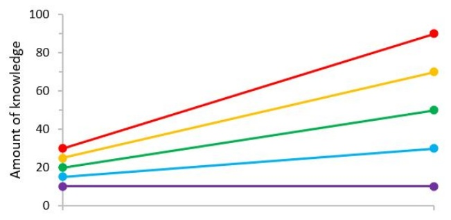
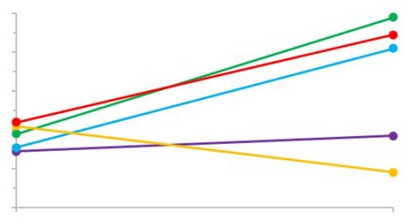
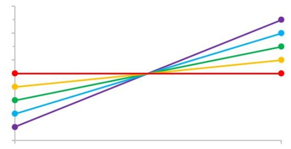
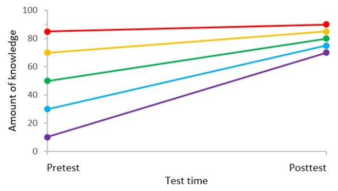
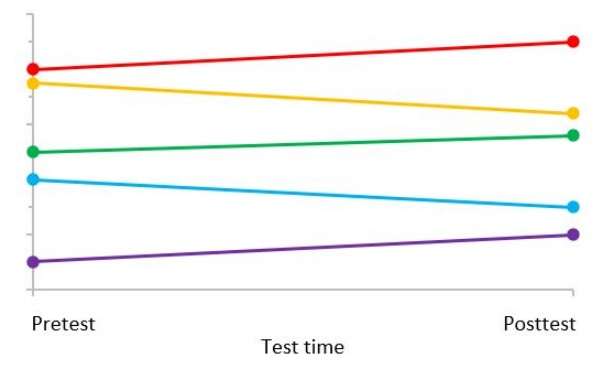
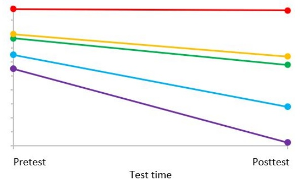
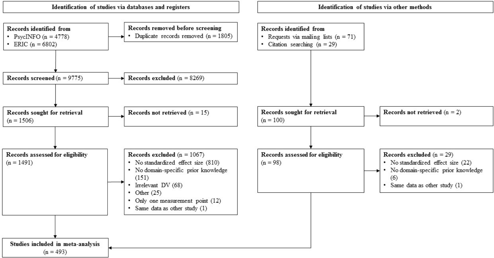
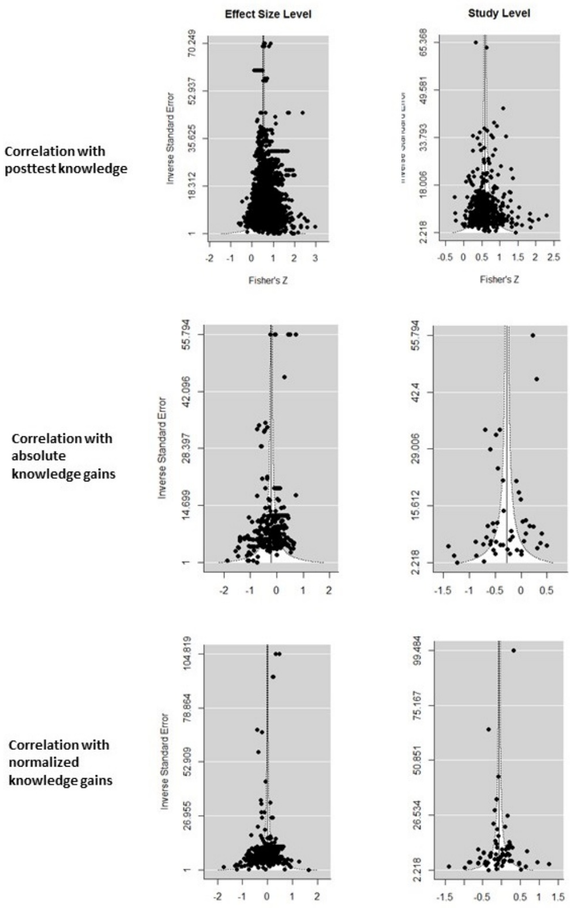
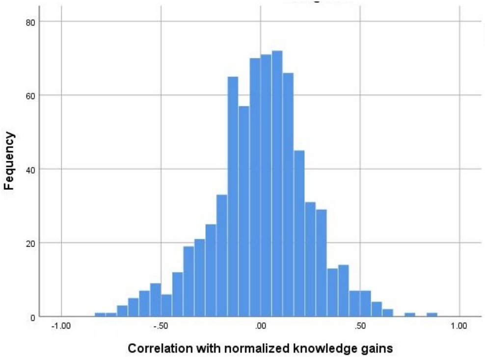
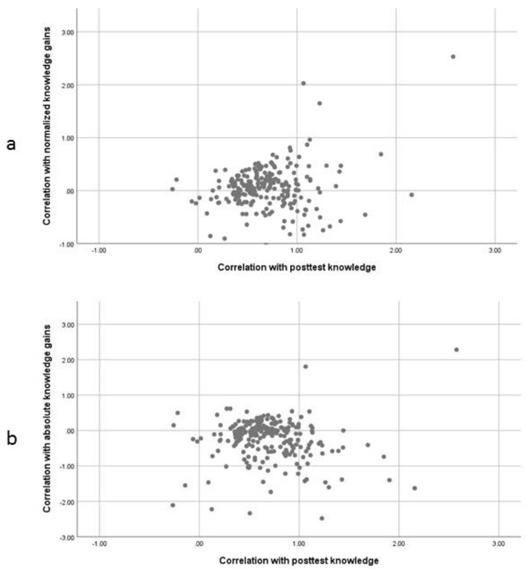

The study is currently in press as:

Simonsmeier, B. A., Flaig, M., Deiglmayr, A., Schalk, L., & Schneider, M. (2021). Prior knowledge and learning: A meta-analysis. Educational Psychologist. doi: 10.1080/00461520.2021.1939700

This document is the manuscript as it was accepted for publication by the journal. The final version published by the journal might differ in small details.

# Domain-Specific Prior Knowledge and Learning: A Meta-Analysis

Bianca A. Simonsmeier1\*, Maja Flaig2, Anne Deiglmayr3, Lennart Schalk4,5, Michael

Schneider1

1 Universität Trier, Germany

2 Universität Tübingen, Germany

3 Universität Leipzig, Germany

4 ETH Zurich, Switzerland

5 PH Schwyz, Switzerland

<small>\*Corresponding author</small>

<small>Dr. Bianca A. Simonsmeier</small>

<small>Abteilung für Pädagogische Psychologie</small>

<small>Universitätsring 15</small>

<small>54296 Trier</small>

<small>Germany</small>

<small>simonsm@uni-trier.de</small>

<small>+49 176 703 41207</small>

<small>https://orcid.org/0000-0002-2269-4838</small>

This research did not receive any specific grant from funding agencies in the public, commercial, or not-for-profit sectors.

## Acknowledgements

We thank Peter Edelsbrunner, ETH Zurich, for his invaluable methodological advice on the relation between gain scores and posttest scores.

## Abstract

It is often hypothesized that prior knowledge strongly determines learning. It can affect learning positively mediated through some processes and negatively mediated through others. We examined the relation between prior knowledge and learning in a meta-analysis of 8776 effect sizes. The stability of individual differences, i.e., the correlation between pretest and posttest knowledge, was high $( r _ { \mathrm { P } } ^ { + } = . 5 3 4 )$ . The predictive power of prior knowledge for learning, i.e., the correlation between pretest knowledge and normalized knowledge gains, was low $( r _ { \mathrm { N G } } { } ^ { + } = { } ^ { - }$.059), almost normally distributed, and had a large 95% prediction interval [-.688, .621]. This strong variability falsifies general statements such as “knowledge is power” or “prior knowledge is negligible”. It calls for systematic research on the conditions under which prior knowledge has positive, negative, or negligible effects on learning. This requires more experiments on the processes mediating the effects of prior knowledge and thresholds for useful levels of prior knowledge.

Keywords: prior knowledge; knowledge-is-power hypothesis; learning; achievement; gain scores

## Domain-Specific Prior Knowledge and Learning: A Meta-Analysis

The knowledge-is-power hypothesis (KiP) states that domain-specific knowledge (i.e., specialized knowledge of a topic; VandenBos & American Psychological Association, 2007) is among the strongest determinants of performance and learning (Greve et al., 2019; Hambrick & Engle, 2002; Möhring et al., 2018). As early as the 1960s, Ausubel, a pioneer of the learning sciences, claimed that “the most important single factor influencing learning is what the learner knows already” (Ausubel, 1968, p. vi). Since then, memory researchers have demonstrated that the content of long-term memory affects how new information is processed in working memory and encoded in long-term memory (Baddeley et al., 2009; Chase & Simon, 1973). Cognitive scientists have devised models of these mechanisms (Anderson et al., 2004; Gopnik & Wellman, 2012; Laird, 2012). Cognitive linguists have analyzed the role of knowledge in language learning and text comprehension (Kintsch, 1988; Rumelhart, 1994). Developmental psychologists have investigated the role of knowledge in cognitive development over the learner’s lifespan (Brod & Shing, 2019; Case, 1992; Piaget, 1971; Siegler, 1996; Wellman & Gelman, 1992). Educational psychologists have incorporated prior knowledge as a central component in theories of academic achievement (Biggs, 1993; Thompson & Zamboanga, 2003), expert performance (Ericsson & Charness, 1994), transfer (Barnett & Ceci, 2002; Singley & Anderson, 1989; Thorndike & Woodworth, 1901), multimedia learning (Mayer, 2001), and conceptual change (diSessa, 2008; Vosniadou, 1994). The idea that knowledge is power has been applied to public health education (Fogg-Rogers et al., 2015), medical education (Möhring et al., 2018), psychoeducation (Murray et al., 2011), school development (Macey et al., 2009), large-scale student assessment studies (Baumert et al., 2009), and many other fields.

The KiP holds the promise that knowledge acquisition can help learners with low intelligence or working memory capacity to overcome their cognitive processing limitations, because even these learners can acquire knowledge, which then helps them to acquire even more knowledge (Gobet, 2005; Grabner et al., 2003; Schneider et al., 1989). However, the idea that prior knowledge aids the acquisition of further knowledge also implies that learners with more prior knowledge learn more than their less knowledgeable peers, such that the gap between learners with low and high levels of prior knowledge widens over time. This socalled Matthew effect (e.g., Stanovich, 1986; Walberg & Tsai, 1983) can amplify small initial differences in knowledge between learners over time (e.g., Duff et al., 2015) and can stabilize social or ethnic inequalities among students in the educational system (e.g., Baumert et al., 2012). It is also possible that the gap between individuals with more knowledge and those with less closes over time. This has been termed the compensation effect (e.g., Baumert et al., 2012; Kalyuga et al., 2003; Schroeders et al., 2016). Given these far-reaching implications, Hambrick and Engle (2002) characterized the KiP as “one of the most influential ideas to emerge in cognitive psychology during the past 25 years” (p. 340). Dochy et al. (1999) concluded in a literature review that “it is difficult to overestimate the importance of prior knowledge” (p. 145). While the relevance of prior knowledge has been highlighted on a theoretical level, the existing empirical evidence has not been summarized yet. The present meta-analysis aims to investigate the effects of prior knowledge on later knowledge and learning and to analyze the source of potential differences in these associations.

A naïve version of the KiP would be that (relevant) prior knowledge always facilitates learning. A more plausible version of the KiP is that incorrect prior knowledge hinders learning and correct prior knowledge aids learning. The KiP thus predicts that a meta-analysis of prior-knowledge effects on learning will find a bimodal distribution of effect sizes with one peak far in the negative range, which indicates a negative effect of incorrect prior knowledge on learning, and one peak far in the positive range, which indicates a positive effect of correct prior knowledge on learning. There could also be a third peak around zero resulting from studies where prior knowledge that is irrelevant to the learning processes under investigation was assessed. The mean of such a bimodal or trimodal distribution would be largely

meaningless, because it would result from averaging over effect sizes that differ in their strength and interpretation.

For the purpose of our study, we define knowledge as information stored in memory (e.g., Anderson, 1983; de Jong & Ferguson-Hessler, 1996; Weinert, 1999). In line with how the term knowledge is typically used in the psychological and educational research literature, this definition includes declarative knowledge about abstract and relational concepts (Goldwater & Schalk, 2016) and about more isolated facts (Schneider & Grabner, 2012) as well as procedural knowledge about how to solve problems (Anderson et al., 2004). It also includes scientifically incorrect misconceptions as well as scientifically correct concepts (Shtulman & Valcarcel, 2012; Smith III. et al., 1993). Knowledge is domain specific when it relates to the key principles in a domain, such as the concept of equivalence in mathematics or the concept of force in physics (Carey & Spelke, 1994; Wellman & Gelman, 1992). Domainspecific knowledge is sometimes termed content knowledge (Chi & Ceci, 1987) and has been described as a central component of competence, academic achievement, expertise, and similar cognitive learning outcomes (Gobet, 2005; Hunter, 1986; OECD, 2016; Steinmayr et al., 2014). We define prior knowledge as the knowledge available in a person’s long-term memory at the onset of learning (cf. Alexander et al., 1991; Dochy & Alexander, 1995).

## How Does Prior Knowledge Influence Learning?

Prior knowledge cannot influence learning as long as it is stored only in long-term memory. Most learning theories assume that prior knowledge needs to be activated and needs to affect learning processes, which then influence the learning outcomes. From a methodological point of view, learning processes are mediators because they are influenced by prior knowledge and influence the learning outcomes. The research literature has shown that prior knowledge can affect learning through the positive mediation of some pathways and the negative mediation of others (e.g., Bodner et al., 2014; Jones & Pyc, 2014; Noveck et al.,

2001; Robidoux & Besner, 2011; Siegler et al., 2011; Sternberg, 1996; Sternberg & Frensch, 1992; Vamvakoussi & Vosniadou, 2004). Below, we give examples of these pathways.

## Mediators of Positive Effects of Prior Knowledge

There are at least six pathways with positive effects. First, prior knowledge can positively affect learning outcomes by guiding learners’ attention (e.g., Tanaka et al., 2008; Yu et al., 2012). Second, it facilitates the interpretation and encoding of new information (Brod et al., 2013; van Kesteren et al., 2014), as in text comprehension (Kintsch, 1994; Ozuru et al., 2009). Third, it allows for the bundling of new information into chunks that can be efficiently memorized, processed, and retrieved (Chase & Simon, 1973; Ericsson et al., 1980; Gobet et al., 2001). Fourth, prior knowledge about the effectiveness and efficiency of problem-solving strategies enables more exploration, more goal-directed behavior, and the construction of more advanced new strategies (Schneider et al., 2011; Siegler, 1996). Finally, prior knowledge helps learners evaluate the credibility of sources and the plausibility of new information (Lombardi et al., 2015).

## Mediators of Negative Effects of Prior Knowledge

Prior knowledge can negatively affect learning outcomes through the mediation of at least five other mental processes. First, misconceptions and incomplete correct knowledge in a domain (e.g., that the surface of the earth looks flat in everyday life) can give rise to incorrect conclusions (e.g., the earth is a disc; Vosniadou & Brewer, 1992) that hamper further learning. Second, learners with high correct prior knowledge in a domain tend to pay selective attention to the features of a situation they have found relevant for solving problems in the past. This selectivity can induce perceptual biases (Hecht & Proffitt, 1995; Lewandowsky & Kirsner, 2000) or prevent learners from finding new and better problem solutions (Einstellung effect; Bilalić et al., 2010; Luchins & Luchins, 1959). Third, the extended practice necessary to automatize procedural knowledge is another possible cause of inflexible behavior (Johnson, 2003; Müller, 1999). Fourth, having more knowledge elements about a topic increases the probability of intrusions or interferences involving these elements in the same domain (Arkes & Freedman, 1994; Castel et al., 2007). Finally, through negative transfer, correct knowledge in one domain can hamper learning in another (Woltz et al., 2000). For example, children’s highly automatized and correct knowledge about whole numbers can interfere with learning about fractions, which look similar but differ in terms of important mathematical characteristics, such as density (Siegler et al., 2013).

## Overall Net Effect of the Mediating Relations

The literature review of the mediation relations shows that the same piece of prior knowledge can affect learning through the positive mediation of some mechanisms and the negatively mediation of others. Even correct prior knowledge does not always help; it can sometimes hinder learning. The overall net effect of prior knowledge on learning results from the combination of the positive and negative mediation paths that might partially cancel each other out. Moreover, the relative strengths of the mediation paths might differ depending on characteristics of the knowledge to be learned, characteristics of the learners, and characteristics of the instruction. To the best of our knowledge, no theory has predicted the strength of the overall effect of prior knowledge on learning and how strongly it is moderated by third variables. However, many studies have empirically investigated aspects of these questions. Thus, we conducted a meta-analysis of the effect of prior knowledge on learning in order to summarize the previous empirical findings regarding (a) the average effect of prior knowledge on learning, (b) the distribution of the effect sizes (i.e., whether there are distinct groups of studies in which prior knowledge has a positive or negative effect), (c) the heterogeneity of the findings, and (d) moderators that can explain why prior knowledge has a stronger effect in some studies, populations, or domains compared to others. Below, we argue that two types of effect sizes need to be analyzed separately in this meta-analysis.

**Confusion About the Interpretation of Correlations Among Pretest, Posttest, and Knowledge Gains**

Many previous studies of prior knowledge used posttest knowledge as the outcome measure for learning; for example, they either analyzed the correlation between individual differences in prior knowledge and individual differences in posttest knowledge or they used group differences in prior knowledge to predict group differences in posttest knowledge. The majority of these studies found strong positive effect sizes (e.g., Bailey et al., 2015; Fyfe & Rittle-Johnson, 2016; Geary et al., 2017; Wagner et al., 1997). Many authors interpret these correlations as indicating the importance of prior knowledge for learning. However, from our point of view, this is a misinterpretation of the findings. The correct interpretation of the findings requires researchers to distinguish between posttest knowledge and knowledge gains as dependent variables.

## Prior Knowledge as a Predictor of Posttest Knowledge

A strong association between prior knowledge and posttest knowledge indicates the extent to which individual differences between learners’ amounts of knowledge remain stable from before to after learning. For example, a strong positive correlation implies that the rank order of learners with respect to the amount of their knowledge remains relatively unchanged. The correlation $r _ { \mathrm { P } }$ between individual differences at pretest and at posttest can thus be used to predict how well a learner will perform compared to other learners. However, if nobody learned anything between pretest and posttest, the learners’ rank order would not change and the correlation $r _ { \mathrm { P } }$ would also be high and positive. If, independently of the amount of their prior knowledge, all learners acquired the same amount of new knowledge between pretest and posttest, their rank order would also not change and the correlation $r _ { \mathrm { P } }$ would be strong and positive. Obviously, the correlation $r _ { \mathrm { P } }$ can be strong and positive even in cases where prior knowledge is completely unrelated to learning.

## Prior Knowledge as a Predictor of Knowledge Gains

In contrast to $r _ { \mathrm { P } } ,$ the correlation $r _ { \mathbf { G } }$ between prior knowledge and knowledge gains indicates the extent to which learners with a high amount of prior knowledge have smaller knowledge gains $( r _ { \mathrm { G } } < 0 )$ or larger knowledge gains $( r _ { \mathrm { G } }   >   0 )$ than their peers with less prior knowledge. For example, the correlation $r _ { \mathbf { G } }$ between prior knowledge and knowledge gains can be used to predict the extent to which learners with low prior knowledge fall behind more knowledgeable learners or catch up with them. As such, the correlation indicates the extent to which there is a Matthew effect or a compensatory effect. A positive correlation $r _ { \mathbf { G } }$ would empirically support the KiP.

## Individual and Group Differences in Prior-Knowledge Effects

Everything stated so far about individual differences in knowledge and their intercorrelations also applies to group differences in knowledge in experimental or quasi-experimental designs. For example, researchers can use a repeated-measures analysis of variance (ANOVA) to investigate how a between-subjects factor such as group (high-priorknowledge group vs. low-prior-knowledge group) and a within-subjects factor such as time (pretest vs. posttest) predict the dependent variable knowledge. In this case, a significant main effect of group would not indicate that prior knowledge affected learning. For example, it is possible that both groups’ amounts of knowledge remained unchanged, such that the posttest differences in knowledge are the same as the pretest differences in knowledge. Thus, there can be a significant main effect of (groups differing in) prior knowledge even in situations where participants did not learn anything. It is also possible that the knowledge differences between the groups are exactly the same at pretest and posttest, so that prior knowledge obviously did not affect how much was learned, despite the significant main effect of prior knowledge (group). Only a significant interaction effect between the factors knowledge and time would indicate that groups differing in their pretest knowledge also differed in how the amount of their knowledge change from pretest to posttest. Researchers would then need to look at the means to interpret whether there were relevant between-group differences in knowledge at pretest and whether these led to a Matthew effect or a compensatory effect. The explanation for why the same logic can be applied to correlations of individual differences (rP and $r _ { \mathrm { G } } )$ and to ANOVAs of group differences is that, under the general linear model, both ANOVAs and correlations can be reformulated as regression analyses (Warne, 2017). Accordingly, the three types of effect size indices – correlations, regression coefficients, and eta-squared values from ANOVAs – can be transformed into each other. In the remainder of the article, when we refer to the correlations $r _ { \mathrm { P } }$ and $r _ { \mathrm { G } }$ between individual differences, we always also mean effect sizes from group-level analyses of knowledge. We included effect sizes from analyses of individual differences and from group differences in our statistical analyses, and we expected similar patterns of findings from both types of study.

## Absolute and Normalized Gain Scores

Knowledge gains can be computed as either absolute gain scores (i.e., AG = posttest score – pretest score) or normalized gain scores (i.e., NG = (posttest score – pretest score) / (scale maximum – pretest score); Hake, 1998). Absolute gain scores have the disadvantage that learners with a high amount of prior knowledge have less room on the scale for improvements than learners with a low amount of prior knowledge. Normalized gain scores account for this problem by dividing the absolute learning gain by the maximal possible learning gain (Hake, 1998). However, there is an ongoing methodological debate about whether normalized knowledge gains might sometimes be biased against learners with low prior knowledge (Coletta & Steinert, 2020; Nissen et al., 2018). For example, both a learner improving their knowledge from 0% to 50% correctly solved items on a knowledge test and a learner improving their knowledge from 80% to 90% have a normalized knowledge gain of 50% even though one person acquired five times more knowledge than the other person in absolute terms. Thus, normalized knowledge gains might sometimes conceal relevant differences between learners (Burkholder et al., 2020). We conclude that neither absolute nor normalized knowledge gain scores are optimal. Both have advantages and disadvantages. We included both absolute and normalized gain scores in our meta-analysis and compared the

findings. We denote the correlation between prior knowledge and absolute knowledge gains as $r _ { \mathrm { A G } }$ and the correlation between prior knowledge and normalized knowledge gains as rNG. **Partial Independence of the Stability of Individual Differences and the Predictive Validity for Learning**

The correlation of prior knowledge with posttest knowledge is partly independent of the correlation of prior knowledge with normalized gains. This is shown in Figure 1. It depicts five fictional persons’ amount of knowledge before (pretest) and after (posttest) a learning phase. The figure shows that both correlations (rP and rNG) can be high and positive (top left), close to zero (top middle), or strong and negative (top right), but it is also possible that the correlation $r _ { \mathrm { P } }$ with posttest knowledge is strong and positive, whereas the correlation with knowledge gains $r _ { \mathrm { N G } }$ is strong and negative (bottom left) or close to zero (bottom middle). Only the combination of a null correlation with posttest knowledge and a strong positive correlation with knowledge gains is impossible, because the latter correlation increases and thus stabilizes differences between learners. The same combinations can be found and the graphs would look similar for absolute knowledge gains.

The correlations $r _ { \mathrm { P } } ,   r _ { \mathrm { A G } } ,$ and $r _ { \mathrm { N G } }$ do not indicate whether the sample, on average, gained knowledge or lost knowledge because correlations are invariant to transitions of the mean. For example, strong positive correlations $r _ { \mathrm { P } }$ and rNG can go along with pretest–posttest increases (Figure 1, top left) and pretest–posttest decreases (bottom right) of the average amount of knowledge in the sample.

The mathematical relation between pretest knowledge, posttest knowledge, and knowledge gains is well understood. For the correlation $r _ { \mathrm { A G } }$ between pretest knowledge and absolute knowledge gains, it has been shown that

$$
r _ {A G} = \frac {r _ {P} S D _ {Y} - S D _ {X}}{\sqrt {S D _ {X} ^ {2} + S D _ {Y} ^ {2} - 2 r _ {P} S D _ {X} S D _ {Y}}},\tag{1}
$$

Strong pos. correlation with posttest $(r_{\mathrm{p}} = 1.00),$ strong pos. correlation with norm. gains $(r_{\mathrm{NG}}=1.00)$

Weak correlation with posttest $(r_{\mathrm{P}} = .09),$ weak correlation with norm. gains $(r_{NG}=-02)$

Strong neg. correlation with posttest $(r_{\mathrm{p}} = -1.00),$ strong neg. correlation with norm. gains $(r_{NG}=-0.99)$

Strong pos. correlation with posttest $(r_{\mathrm{p}} = 1.00),$ strong neg. correlation with norm. gains $(r_{NG}=-0.92)$

Strong pos. correlation with posttest $(r_{\mathrm{P}} = .93),$ weak correlation with norm. gains $(r_{NG}=.03)$

Strong pos. correlations $(r_{\mathrm{p}}=1.00; r_{\mathrm{NG}}=1.00)$ deacreasing sample mean (Cohen's d = -1.00)

Figure 1. Six sets of correlations of prior knowledge with posttest knowledge $( r _ { p } )$ and normalized knowledge gains (rNG), visualized using five fictional persons’ amount of knowledge before (pretest) and after learning (posttest) as an example.

where $r _ { \mathrm { P } }$ is the correlation between pretest and posttest, $S D _ { \mathrm { X } }$ is the standard deviation of the pretest, and $S D _ { \mathrm { Y } }$ is the standard deviations of the posttest (Linn & Slinde, 1977, Equation 1). Because the denominator is always positive, the sign of $r _ { \mathrm { A G } }$ depends on the sign of the numerator. Because $r _ { \mathrm { p } }$ is smaller than one, $r _ { \mathrm { A G } }$ can be positive only when the standard deviation $S D _ { \mathrm { Y } }$ of the posttest values is larger than the standard deviation $S D _ { \mathrm { X } }$ of the pretest values. This is plausible, because it means that a positive correlation between prior knowledge and knowledge gains goes along with a Matthew effect, that is, with an increase in the standard deviations of learners’ knowledge over time (e.g., as shown in Figure 1, top left). When $r _ { \mathrm { P } }$ is small or when the standard deviations at pretest and posttest are similar, $r _ { \mathrm { A G } }$ becomes negative (Linn & Slinde, 1977). The formula implies that $r _ { \mathrm { P } }$ and $r _ { \mathrm { A G } }$ are not redundant with each other, because additional information (i.e., information about the standard deviations) is required to compute one from the other. Because the standard deviations as well as the values of $r _ { \mathrm { P } }$ differ between studies, it is ultimately an empirical question how strongly prior knowledge correlates with knowledge gains in research on knowledge acquisition processes. We know of no mathematical analyses of the relation between $r _ { \mathrm { P } }$ and $r _ { \mathrm { N G } }$ . Because $r _ { \mathrm { A G } }$ and $r _ { \mathrm { N G } }$ are similar in that both are computed with types of difference scores, we expected that $r _ { \mathrm { A G } }$ and $r _ { \mathrm { N G } }$ relate to $r _ { \mathrm { P } }$ in similar ways.

## Confusion About the Interpretation of the Effect Sizes

Many authors investigating prior knowledge seem to be unaware of the fact that the relations of prior knowledge with posttest knowledge and with knowledge gains are non-redundant, that they have different meanings, and that only the latter relation can facilitate the evaluation of the KiP. For example, many previous studies (e.g., Greene et al., 2010; Hailikari et al., 2008; Liu et al., 2014; Müller-Kalthoff & Möller, 2003; Shapiro, 2004; Shin et al., 1994), including some of our own (Schneider & Hardy, 2013), interpreted the correlation between prior knowledge and posttest knowledge as evidence for learning or as evidence in line with the KiP. That is, they interpreted the correlation $r _ { \mathrm { P } }$ with posttest knowledge as if it

were the correlation $r _ { \mathbf { G } }$ with knowledge gains. Additionally, many studies (e.g., Manolitsis & Tafa, 2011; Meltzer, 2002; Stavrova & Urhahne, 2010; Verhagen et al., 2008; Walpole et al., 2017) reported only one of the two types of correlation even though their data would have allowed them to report both. This indicates a lack of awareness that a value of $r _ { \mathrm { P } }$ can indicate quite different knowledge acquisition patterns depending on the value of $r _ { \mathbf { G } }$ (e.g., Figure 1, top left $\mathbf { V } \mathbf { S } ,$ bottom left) and that a value of $r _ { \mathbf { G } }$ can indicate different knowledge acquisition patterns depending on the value of $r _ { \mathrm { P } }$ (e.g., Figure 1, top left vs. top right). Thus, these correlations should always be reported and interpreted together. Only then does it become possible to distinguish between patterns of knowledge acquisition such as those shown in Figure 1.

## The Current Study

Even though many studies have investigated the processes by which prior knowledge affects learning, the overall net effect of these processes, that is, the overall effect of prior knowledge on learning, has not been investigated in a published meta-analysis. In the present meta-analysis, we investigated five research questions. First, how high is the stability of individual difference in knowledge over time averaged across studies (Research Question 1)? As explained above, this stability is indicated by the correlation $r _ { \mathrm { P } }$ between prior knowledge and knowledge at posttest. Many studies found this stability to be high. A high stability is plausible, because knowledge acquisition is a long-term process in which small individual differences in learning rates lead to large accumulated individual differences in the amounts of acquired knowledge over time (Ericsson & Charness, 1994; Siegler & Svetina, 2002). It is unlikely that these large accumulated individual differences change strongly over the course of an empirical study. Thus, we hypothesized that the correlation of prior knowledge with posttest knowledge is high (by the standards of Cohen, 1992, i.e. $r   \geq . 5 0 )$

Second, is the distribution of the correlations $r _ { \mathrm { N G } }$ between prior knowledge and knowledge gains bimodal or unimodal (Research Question 2)? We expected that prior knowledge, on average, would be weakly correlated with knowledge gains. In some studies, they might be lower and even range into the negative numbers; in other studies, they might be strong and positive. We expected that extreme negative and positive effect sizes will occur less frequently than average ones, leading to a unimodal distribution of effect sizes (Hypothesis 2). This is not self-evident, because it is also possible that prior knowledge either strongly helps or hinders learning, which would lead to a bimodal distribution with one peak in the negative range and one peak in the positive range.

Third, if the distribution of the correlations rNG between prior knowledge and knowledge gains is unimodal, then what is the mean of this distribution (Research Question 3)? On one hand, the KiP predicts that prior knowledge will strongly affect learning. On the other hand, prior knowledge can affect learning through the positive mediation of some mechanisms and the negative mediation of others. Combining these two views, we expected that the correlation $r _ { \mathrm { N G } }$ between prior knowledge and knowledge gains would be greater than zero, but much weaker than the correlation rP between prior knowledge and posttest knowledge $( 0 < r _ { \mathrm { N G } } < r _ { \mathrm { P } } ;$ Hypothesis 3).

Fourth, how are the stability of knowledge (rP) and the predictive power of prior knowledge for learning (rNG) related across studies (Research Question 4)? A central aim of our meta-analysis is to demonstrate the importance of distinguishing between the stability of knowledge (rP) and the predictive power of prior knowledge for learning (rNG). In the introduction, we demonstrated that on the statistical level, it is possible that the two correlations are similar in a study (e.g., rP = 1 and $r _ { \mathrm { N G } } = 1$ ; Figure 1, top left) but also possible that they differ strongly (e.g., rP = 1 and $r _ { \mathrm { N G } } = 0 ;$ Figure 1, bottom middle). From the perspective of research on knowledge acquisition, it does not seem plausible to assume that the stability of individual differences in knowledge should always be similar to the predictive power of prior knowledge for learning something new. We thus hypothesized that the correlation between the correlations rP and rNG would be small or maximally medium, but not large (Hypothesis 4). By the standards of Cohen (1992), this implies a correlation between (Fisher Z-transformed) rP and $r _ { \mathrm { N G } }$ that is smaller than $r = . 5 0 .$ . We expected the correlation between rP and $r _ { \mathrm { A G } }$ to be approximately as low as the correlation between rP and $r _ { \mathrm { N G } }$

Finally, is the average correlation $r _ { \mathrm { A G } }$ found with absolute knowledge gains smaller than the average correlation $r _ { \mathrm { N G } }$ found with normalized knowledge gains (Research Question 5)? As explained in the introduction, the correlation with absolute knowledge gains $r _ { \mathrm { A G } }$ is biased by the fact that learners with high prior knowledge have less room for improvement on the knowledge measure than learners with low prior knowledge. Normalized knowledge gains represent an attempt to correct for this bias. Thus, we hypothesized that the correlation between prior knowledge and absolute knowledge gains is smaller than the correlation between prior knowledge and normalized knowledge gains $( r _ { \mathrm { A G } } < r _ { \mathrm { N G } } ;$ Hypothesis 5).

In addition to testing these five hypotheses, we conducted a broad range of exploratory moderator analyses in order to examine the generalizability of the findings across, for example, knowledge types, content domains, and learner groups. All included moderators are listed in SM2. In conducting the meta-analysis, we followed the PRISMA standards (Page et al., 2020) as far as possible.

## Method

## Literature Search

Figure 2 summarizes the literature search process and inclusion criteria in a PRISMA flow diagram (Page et al., 2020). In May 2018, we searched the title, abstract, and keywords of all articles in the literature databases PsycINFO and ERIC. The search string (shown in Figure 2) was designed to include not only studies explicitly using the term prior knowledge but also other studies where knowledge was assessed in designs with at least two measurement points. We limited the PsycINFO search to quantitative empirical studies with non-disordered participants (i.e. excluding studies conduct with groups of participants who were diagnosed with physical or mental disorders or disabilities), written in the English

Figure 2. PRISMA flow diagram for the literature search.

## Running head: PRIOR KNOWLEDGE AND LEARNING

language, and published in a peer-reviewed journal and we limited the ERIC search to journal articles. In an additional exploratory search, we used internet search engines with various combinations of search words. We also sent out emails over AERA and EARLI mailing lists and made internet postings asking for any relevant published or unpublished studies missed by the standardized database search. This exploratory search yielded 29 additional studies. We accounted for publication bias using visual and statistical methods, which we describe in the results section.

## Inclusion of Studies

The three inclusion criteria were as follows: (1) The study included an assessment or an experimental manipulation of the amount of learners’ domain-specific prior knowledge as defined in the introduction. To facilitate the interpretation of the results, we excluded studies that manipulated the activation rather than the amount of prior knowledge (e.g., Amadieu et al., 2015) or that compared learning with familiar versus unfamiliar materials (e.g., Badham et al., 2016). We included only objective quantitative measures of domain-specific prior knowledge and excluded self-assessments, composite scores from more than one domain, and measures of crystallized intelligence, abilities, achievement, or meta-cognitive knowledge. (2) The study included a measure of knowledge or achievement after learning or of the knowledge gains made from one measurement point to another. Studies in which the domain of the prior-knowledge test and the learning-outcome test differed were included. We also included composite measures of learning outcomes in more than one domain (e.g., GPA). We excluded learners’ self-ratings of their learning outcomes. (3) The study reported the information required to compute at least one standardized effect size of the strength and the direction of the association between prior knowledge and posttest knowledge, absolute knowledge gains, or normalized knowledge gains.

After removing all duplicates, we screened the remaining 9,875 titles and abstracts and excluded studies that were obviously not relevant to our meta-analysis. The first author acted as the main coder and screened all titles and abstracts. Another trained coder independently screened a random sample of 100 titles and abstracts. The absolute intercoder agreement was 83%. Next, we obtained the full texts of the included titles and abstracts. The main coder and three trained student research assistants screened these full texts for inclusion. The absolute intercoder agreements of the three research assistants with the main coder were 82%, 72%, and 79%. Disagreements were resolved through discussion. The 493 studies finally included in the meta-analysis are listed in the Supplemental Materials (SM1).

Obviously, the field of research on prior knowledge includes many more than 493 studies. However, the majority of studies on prior knowledge that were not included here investigated questions outside the scope of this meta-analysis. They assessed knowledge qualitatively, quantified characteristics of knowledge other than its amount (e.g., automatization or integratedness), had only one measurement point, used prior knowledge to predict dependent variables other than knowledge or achievement, predicted knowledge acquisition by variables other than prior knowledge, etc. For these reasons, we could not include these studies in the present meta-analysis.

## Data Coding

Data coding was based on a review protocol that included predefined coding rules that were used for coder training and final coding of the articles. This meta-analysis has not been pre-registered. After coder training, the first author and three trained student research assistants independently coded the same 100 effect sizes and moderator information from the included full texts. The absolute agreements of the three research assistants with the main coder were 92%, 89%, and 90%, respectively. Disagreements were resolved through discussion. The main coder then coded about half of the studies and each research assistant about one-sixth of the studies individually. For studies with more than two measurement points, we coded the correlation between prior knowledge and posttest knowledge for each possible pair of measurement points (e.g., T1 with T2, T1 with T3, and T2 with T3). We

coded the correlation between prior knowledge and knowledge gains for all effect sizes, which included the pretest in the calculation of knowledge gain (e.g., the correlation of knowledge at T1 with knowledge gains from T1 to T2 but not the correlation of knowledge at T1 with knowledge gains from T2 to T3).

## Table 1.

Description of the included moderators

<table><tbody><tr><td>Moderator</td><td>Description</td></tr><tr><td>Knowledge characteristics</td><td></td></tr><tr><td>Knowledge type</td><td>Several cognitive learning theories distinguish between types of knowledge differing in their characteristics. We coded whether knowledge was declarative knowledge, procedural knowledge, or declarative and procedural mixed.</td></tr><tr><td>Knowledge subtype</td><td>We coded fourknowledge types: facts, conceptual knowledge, motor skill, and cognitive skill.</td></tr><tr><td>Broad content area</td><td>Content domains can differ in the types and organization of the knowledge. We coded six broad content areas: STEM, Language, Humanities, Social Sciences, Health Sciences, and Sports</td></tr><tr><td>Content domain</td><td>We coded the content domain of knowledgeas reported in the paper.</td></tr><tr><td>Similarity of prior</td><td>Similarity helps learners to see relations between knowledge</td></tr><tr><td>knowledge and learning outcome</td><td>structures. Thus, the more similar prior knowledge and knowledge to be learned are, the easier it might be for</td></tr><tr><td></td><td>learners to use their prior knowledge in learning. For seven dimensions, we coded whether the similarity between prior knowledgeand posttest knowledge was high or low: content area, knowledge type, physical context, temporal context, functional context, social context,and modality.</td></tr><tr><td>Learner characteristics</td><td></td></tr><tr><td>Age</td><td>We coded the sample mean ageof the learners(in years) at pretest.</td></tr><tr><td>Educational level</td><td>The educational level might moderate the relation between prior knowledge and learning, because educational levels</td></tr><tr><td></td><td>tend to differ in learner age, instructional methods, and learning goals. We coded learners' educational level at pretest as follows: daycare, kindergarten/preschool, primary education, secondary education, higher education, continued education, and several.</td></tr><tr><td colspan="2">Environmental characteristics</td></tr><tr><td>Intervention setting</td><td>To test whether the effects of prior knowledge differ between studies employing different interventions, we coded four different settings of the intervention: no intervention, school instruction only, school instruction and other intervention, or other intervention only.</td></tr><tr><td>Intervention duration</td><td>We coded the duration of the intervention to test whether prior knowledge has stronger effect sizes for longer learning processes than in shorter learning processes. For studies with an intervention, we categorized the duration into: 0-2 hours, 2-24 hours, 2-7 days, and more than one week.</td></tr><tr><td>Cognitive demands of intervention</td><td>Prior knowledge might have stronger positive effects when the cognitive demands of an instructional intervention are higher, because in that case the learners need to elaborate and infer more knowledge. Whenever studies employed two different experimental conditions differing in their cognitive demands, we coded the demands of the intervention as higher or lower.</td></tr><tr><td>Instructional methods in intervention</td><td>For studies with an intervention, we coded whether each of the following nine instructional methods were used in the intervention: written instruction, oral instruction, multimedia, practice, constructive activities, technology, feedback, collaborative learning, and problem-based learning.</td></tr><tr><td>Country</td><td>We coded the country in which the data were collected and the participants went to school.</td></tr><tr><td colspan="2">Methodological study characteristics</td></tr><tr><td>Randomized controlled trial</td><td>To test whether prior knowledge has a causal effect on learning or merely correlates with it we coded whether the effect size was obtained from a randomized controlled trial. We coded a study as randomized controlled trial when each participant was randomly assigned to one of two (or more) groups and group differences in (prior) knowledge were induced before a learning phase that was the same for all participants.</td></tr><tr><td>Publication Effect</td><td>We coded whether the effect size was reported in a</td></tr><tr><td>Size</td><td>publication or whether authors had sent it to us. This allowed us to assess the degree of publication bias in the published effect sizes.</td></tr><tr><td>Study design</td><td>We coded whether group differences or individual differences in knowledge were used as independent variable in the computation of the effect size. Group differenceswas coded for experiments and quasi-experiments. Individual differenceswas coded for continuous measures of prior knowledge, e.g., in longitudinal designs.</td></tr><tr><td>Number of items at pretest and posttest Response format</td><td>We coded the numbers of items inthe test of prior knowledge (i.e. the pretest) and in the posttest. We coded the response format ofthe items on the knowledge tests as follows: open,fill-in, single or multiple choice, rating, behaviour, other, andvarious.</td></tr><tr><td>Retention test</td><td>We coded whether the effect size pertained to a retention test (i.e. a test after the posttest) to investigate whether the effect of prior knowledge lasts beyond the intervention.</td></tr><tr><td>Same test for prior knowledge and learning outcome Measures at T2 Outcome</td><td>To test whether the test given to the participants affects the effect sizes, we coded whether the same test was used in the pre-and posttest or not. Wecoded whether the outcome was knowledgeor achievement.</td></tr><tr><td>Domain specificity</td><td>We coded whether the outcome assessed knowledge or achievement in a single domain(e.g., history) or averaged over several domains(e.g., a science achievement testwith items about physics, chemistry, and biology).</td></tr></tbody></table>

## Requesting Information Missing in the Publications

After coding the effect sizes from the included studies, we sent out 1,192 emails to authors of published studies that met the inclusion criteria but did not report a relevant effect size. The authors could email us original datasets or already computed effect sizes. Alternatively, they could enter effect sizes and moderator information in an online questionnaire, which guided them through the submission process and gave detailed instructions. Overall, researchers submitted unpublished effect sizes or data with which to

compute them for 71 studies (51 via email and 20 via the online survey), resulting in a total of 1,252 effect sizes. Among the 71 studies was one manuscript under review at a journal and one unpublished dataset. We screened the effect sizes and moderator information for correctness and plausibility before including them in the meta-analysis. In the moderator analyses, we compared the published and the unpublished effect sizes to test for publication bias.

## Preparation of Effect Sizes

The Supplemental Materials (SM3) list the equations for the preparation of the effect sizes for the meta-analytic integration. We used Pearson correlations (r) as the dependent variable of our meta-analysis because the majority of the included studies reported correlational results. Whenever a study compared a high- and a low-prior-knowledge group and reported the group means and standard deviations for at least two measurement points, we calculated the absolute and the normalized gain scores from this information. Absolute knowledge gains were computed as posttest score – pretest score, and normalized knowledge gains were computed as (posttest score – pretest score) / (scale maximum – pretest score) (Hake, 1998). We then computed group differences in these gain scores as Cohen’s d values, respectively. For studies reporting group differences for the posttest only, we computed Cohen’s d for this difference. We then converted the Cohen’s ds to Pearson correlations. Unless specified otherwise, all correlations were coded such that a positive value indicated that a higher quantity of (correct or incorrect) prior knowledge went along with a higher quantity of (correct or incorrect) posttest knowledge or positive pretest–posttest gains. All correlations were subjected to a Fisher Zr-transformation to approximate a normal sampling distribution (Lipsey & Wilson, 2001) before the meta-analytic integration.

We corrected the correlations for measurement error only when the original studies reported the reliabilities of the measures; such correction would otherwise make the correlation between two constructs appear smaller than it actually is (Schmidt & Hunter,

2015, p. 112). Some researchers measured prior knowledge as a continuous variable and then dichotomized the participants into a high- and a low-prior-knowledge group. We corrected for this loss of variance using the formula given by Schmidt and Hunter (2015, p. 134). We winsorized the corrected correlations and variances to less extreme values when they were smaller than -1 or larger than 1 due to the corrections. Throughout the manuscript, we use the symbol $r ^ { + }$ to refer to the corrected effect sizes.

We identified outlier effect sizes through Cook’s values (Cook & Weisberg, 1982; Viechtbauer & Cheung, 2010) using the metafor package (Viechtbauer, 2010) in R (R Core Team, 2014). We excluded two outliers found with posttest knowledge (Lonigan et al., 2000; Ree et al., 1995), six with absolute knowledge gains (Fyfe et al., 2012; Kruk et al., 2014; Webb & Chang, 2015; Zacharia et al., 2012), and four with normalized knowledge gains (Fyfe et al., 2012; Webb & Chang, 2015; Winters & Azevedo, 2005; Zacharia et al., 2012).

## Statistical Analysis

## Publication Bias

We visually and statistically tested for publication bias using funnel plots and Egger regressions for random-effects models (Egger et al., 1997). These tests were conducted using the metafor package (Viechtbauer, 2010) in R. In the moderator analyses, we also tested whether the published and the unpublished effect sizes systematically differed.

## Meta-Analytic Integration

The formulas for the meta-analytic integration of the effect sizes are provided in the Supplemental Materials (SM3). The majority of the included studies reported several effect sizes – for example, for various dependent measures or measurement points. These effect sizes are statistically dependent and thus violate a central assumption of classical metaanalytical models. To handle statistically dependent effect sizes, we employed robust variance estimation (Hedges et al., 2010; Tanner-Smith et al., 2016). Given the expected heterogeneity, we used random-effects models for the meta-analytic integration (cf. Raudenbush, 2009). The mean effect sizes and meta-regression models were estimated using a weighted least squares approach (cf. Hedges et al., 2010; Tanner-Smith & Tipton, 2014). The statistical analyses were performed using the robumeta package (Fisher & Tipton, 2014) in R. The data and statistical code used in this meta-analysis is available upon request.

## Moderators

We separately computed the mean effect size for every level within a moderator category. For levels with degrees of freedom smaller than four, we reported only the mean, not the confidence interval, because the results were not trustworthy due to the small number of observations (Fisher & Tipton, 2014). These levels were also excluded from the significance tests of the moderator analyses. Before performing the moderator analyses, continuous moderator variables (e.g., the learners’ age) were log-transformed to obtain normal distributions (Tabachnick & Fidell, 2014, pp. 120-123). Categorical moderator variables (e.g., knowledge type) were dummy coded using the moderator level with the lowest effect size as the reference level. The moderators were entered as predictors in regression models for the prediction of the effect sizes (see SM3 for details). To avoid multicollinearity due to the high number of potentially intercorrelated moderators, we investigated each moderator in a separate regression analysis unless stated otherwise. For dummy-coded variables, each predictor indicated whether the coded moderator level significantly differed from the reference level. We computed the overall significance for each regression analysis using the Wald-test function of the clubSandwich package (Pustejovsky, 2017; Tanner-Smith et al., 2016) in R. We computed the overall proportion of explained variance $R ^ { 2 }$ for each regression model as described in SM3.

**Results**

**Available Empirical Evidence**

**Characteristics of the Included Studies**

The 493 included studies reported findings from 685 independent samples and 126,050 participants in total. The studies presented (or allowed the computation of) 8,776 effect sizes. The publication year had a median of 2012. The oldest publication was from 1965. Of the 493 articles, 68% were published within the last 10 years. Forty-seven countries were represented in the meta-analysis. Most studies reported data from North America (45%), followed by Europe (33%), Asia (12%), the Middle East (4%), Australia/New Zealand (4%), Africa (1%), and South America (1%). The time between the measurement of prior knowledge (pretest) and of the learning outcome (posttest) varied between 0 and 3,780 days, with a median of 360 days. The learners’ sample mean age ranged from 7.5 months to 42.39 years, with an overall mean of 11.32 years (SD = 6.90).

## Characteristics of the Included Effect Sizes

The majority of the studies reported the correlation between prior knowledge and posttest knowledge. This relation was investigated in 476 of the included studies, reporting 7,772 effect sizes ranging between $r _ { p } { } ^ { + } = - . 5 6 5$ and $r _ { \mathrm { p } } { } ^ { + } = . 9 9 5$ . Of these, 45 effect sizes from nine studies were obtained in randomized controlled trials (RCTs). We categorized a study as an RCT when the participants were randomized into at least two groups and the levels of prior knowledge were manipulated to differ between these groups prior to learning. The nine included RCT studies framed their prior-knowledge manipulation as preteaching condition, pretraining intervention, provision of additional information, knowledge induction, or instruction on prerequisite knowledge. Of the nine studies, two performed the randomization on a class level and seven on an individual level. A manipulation check followed the priorknowledge manipulation in three of the nine studies. The experimental manipulation of prior knowledge before the actual instruction took between 5 and 180 minutes. For 45 studies with 1,898 effect sizes, it was possible to control the correlation between prior knowledge and posttest knowledge for intelligence using partial correlations.

The association between prior knowledge and knowledge gains was investigated in fewer studies. The correlation between prior knowledge and absolute knowledge gains could be computed for 50 studies with 307 effect sizes ranging from $r _ { \mathrm { A G } } { } ^ { + } = - . 9 5 4$ to $r _ { \mathrm { A G } } { } ^ { + } = . 6 2 3$ The correlation between prior knowledge and normalized knowledge gains could be computed for 69 studies with 697 effect sizes ranging from $r _ { \mathrm { N G } } { } ^ { + } = - . 9 4 3$ to $r _ { \mathrm { N G } } { } ^ { + } = . 9 2 9$ . None of these studies was an RCT. One study with absolute gains and three studies with normalized gains allowed controlling for intelligence.

No evidence for a publication bias, which is an underrepresentation of effect sizes close to zero, was found in our database. This held true for effect sizes found with posttest knowledge, absolute knowledge gains, and normalized knowledge gains, respectively, and it held true on the level of both individual effect sizes (Figure 3, left column) and study-average effect sizes (Figure 3, right column). Egger regressions did not indicate an underrepresentation of small effect sizes in any of the six cases depicted in Figure 3. In line with this, moderator analyses showed that the published and the unpublished effect sizes in the meta-analyses did not differ with statistical significance and had very similar values (see the Methodological Study Characteristics section in the Supplemental Materials SM4).

## Main Meta-Analytic Results

## Research Question 1: Stability of Differences in Knowledge Over Time

As expected, the stability of individual differences and group differences in knowledge from pretest to posttest was high. The average correlation was $r _ { \mathrm { P } } { } ^ { + } = . 5 3 1$ (95% CI [.509,.552], see Table 2). The correlation was statistically significantly greater than zero and strong according to the standards set by Cohen (1992). The small 95% confidence interval indicated a high precision of estimation, even though the heterogeneity of effect sizes was high $( I ^ { 2 } =$ 94.16). In line with this finding, the 95% prediction interval (Riley et al., 2011) was very large and ranged from -.067 to .848, indicating that, due to the presence of strong moderating

Correlation with absolute knowledge gains

Correlation with normalized knowledge gains

Figure 3. Funnel plots of the inverse of standard error and the effect size (corrected for artifacts and here transformed to Fisher’s Z) for the effect-size level (left) and the study level of aggregation (right) for posttest knowledge (top), absolute knowledge gains (middle), and normalized knowledge gains (bottom).

## Table 2

Overall Meta-Analytic Results for the Correlations of Prior Knowledge with Posttest Knowledge, Absolute Knowledge Gains, and Normalized Knowledge Gains

<table><tr><td rowspan="2"></td><td colspan="6">Correlation with posttest knowledge</td><td colspan="6">Correlation with absolute knowledge gains</td><td colspan="6">Correlation with normalized knowledge gains</td></tr><tr><td>j</td><td>k</td><td> $r_{\text{P}^+}$ </td><td>CI  $r_{\text{P}^+}$ 95%</td><td> $\tau^2$ </td><td> $I^2$ </td><td>j</td><td>k</td><td> $r_{\text{AG}^+}$ </td><td>CI  $r_{\text{AG}^+}$ 95%</td><td> $\tau^2$ </td><td> $I^2$ </td><td>j</td><td>k</td><td> $r_{\text{NG}^+}$ </td><td>CI  $r_{\text{NG}^+}$ 95%</td><td> $\tau^2$ </td><td> $I^2$ </td></tr><tr><td>Studies allowing the computation of at least one of the three types of effect sizes</td><td>476</td><td>7772</td><td>.531</td><td>[.509, .552]</td><td>.112</td><td>94.16</td><td>50</td><td>307</td><td>-.263</td><td>[-.370, -.149]</td><td>.224</td><td>98.05</td><td>69</td><td>697</td><td>-.059</td><td>[-.150, .034]</td><td>.120</td><td>96.94</td></tr><tr><td>Studies allowing the computation of all three types of effect sizes</td><td>28</td><td>238</td><td>.632</td><td>[.517, .724]</td><td>.145</td><td>93.72</td><td>28</td><td>238</td><td>-.277</td><td>[-.452, -.081]</td><td>.229</td><td>95.63</td><td>28</td><td>238</td><td>.001</td><td>[-.215, .217]</td><td>.179</td><td>94.47</td></tr><tr><td>Randomized controlled trial</td><td></td><td></td><td></td><td></td><td></td><td></td><td></td><td></td><td></td><td></td><td></td><td></td><td></td><td></td><td></td><td></td><td></td><td></td></tr><tr><td>No</td><td>467</td><td>7727</td><td>.533</td><td>[.512, .554]</td><td>.109</td><td>94.11</td><td>50</td><td>307</td><td>-.263</td><td>[-.370, -.149]</td><td>.224</td><td>98.05</td><td>69</td><td>697</td><td>-.059</td><td>[-.150, .034]</td><td>.120</td><td>96.94</td></tr><tr><td>Yes</td><td>9</td><td>45</td><td>.394</td><td>[.132, .605]</td><td>293</td><td>91.94</td><td>0</td><td>0</td><td>-</td><td>-</td><td>-</td><td>-</td><td>0</td><td>0</td><td>-</td><td>-</td><td>-</td><td>-</td></tr><tr><td>Controlling for intelligence</td><td></td><td></td><td></td><td></td><td></td><td></td><td></td><td></td><td></td><td></td><td></td><td></td><td></td><td></td><td></td><td></td><td></td><td></td></tr><tr><td>Before controlling</td><td>45</td><td>1898</td><td>.515</td><td>[.475, .553]</td><td>.058</td><td>89.19</td><td>-</td><td>-</td><td>-</td><td>-</td><td>-</td><td>-</td><td>-</td><td>-</td><td>-</td><td>-</td><td>-</td><td>-</td></tr><tr><td>After controlling</td><td>45</td><td>1898</td><td>.479</td><td>[.433, .523]</td><td>.078</td><td>91.78</td><td>-</td><td>-</td><td>-</td><td>-</td><td>-</td><td>-</td><td>-</td><td>-</td><td>-</td><td>-</td><td>-</td><td>-</td></tr></table>

Note. j – number of studies, k – number of effect sizes

effects, the results of future studies of knowledge stability can be predicted only with low precision.

The connection between prior knowledge and posttest knowledge was investigated in nine RCTs. These studies found evidence for a causal effect of prior knowledge on posttest knowledge, as evidenced by the significant positive effect size of $r _ { \mathrm { P } } ^ { + } = . 3 9 4$ . The correlation between prior knowledge and posttest knowledge was not statistically significantly different between RCTs (Randomized controlled trial: yes in Table 2) and studies with other designs (Randomized controlled trial: no in Table 2), $R ^ { 2 }   = . 0 0 1$ , p = .269. Controlling the correlation for intelligence across the 45 studies for which this was possible did not lead to a statistically significant decrease $( z = 0 . 2 1 9 , p = . 4 1 3 )$ . Therefore, the small number of studies investigating these questions found that the association of prior knowledge with posttest knowledge was rather causal and could not be attributed entirely to a confounding influence of intelligence. **Research Question 2: Distribution of Correlations Between Prior Knowledge and**

## Knowledge Gains

The distribution of the correlations $r _ { \mathrm { N G } }$ between prior knowledge and normalized knowledge gains is shown in Figure 4. The distribution was unimodal, with a single peak close to zero. The skewness of the effect size distribution was small, with a value of -0.230. The excess kurtosis was also small and had a value of 0.612. The mean of the distribution (-.059) and the median of the distribution (.010) were very close to each other. Thus, the distribution of effect sizes was almost symmetrical and was similar to a normal distribution. A Kolmogorov–Smirnov test still indicated a statistically significant deviation from normality $( p$ = .002), due to the high statistical power that comes with 697 effect sizes.

Figure 4. Distribution of the correlation $r _ { \mathrm { N G } }$ between prior knowledge and normalized knowledge gains.

## Research Question 3: Average Correlation Between Prior Knowledge and Normalized Knowledge Gains

Contrary to Hypothesis 3, the correlation between prior knowledge and normalized knowledge gains was not significantly different from zero. As shown in Table 2, the metaanalytically derived mean effect size was very small $r_{\mathrm{NG}^{+}}=-.059,95\%\ \mathrm{CI}[-.150,.034]$ , and the 95% confidence interval included zero. The confidence interval was small, indicating a high statistical power of the test. One reason for this was the large database of 697 effect sizes from 69 studies. The high heterogeneity index of $I ^ { 2 }   =   9 6 . 9 3$ indicated that a large proportion of the variance of effect sizes was due not to sampling error but to moderating influences of other variables (Borenstein et al., 2017). Accordingly, the 95% prediction interval (Riley et al., 2011) was large [-.688, .621], indicating that, without additional information on moderators, the outcomes of future studies can hardly be predicted.

## Research Question 4: Partial Independence of the Correlations Found with Posttest

## Knowledge and Knowledge Gains

The correlation $r \mathrm { p } ^ { + }$ found with posttest knowledge differed statistically significantly from the correlation ${ r _ { \mathrm { N G } } } ^ { + }$ found with normalized knowledge gains, $t ( 4 8 2 ) = 1 3 . 8 0 , p < . 0 0 0 \: ( d$ $= 1 . 2 6 )$ . The correlation $r \mathrm { p } ^ { + }$ also differed statistically significantly from the correlation ${ r _ { \mathrm { A G } } } ^ { + }$ found with absolute knowledge gains, $t ( 4 8 2 ) = 1 2 . 7 0 ,$ , p < .000 $( d = 1 . 1 6 )$ . We repeated the analyses with only those 28 studies that reported sufficient information to compute and compare all three types of dependent variables, thus holding study characteristics constant over the three types of dependent variables (Table 2, line 2). This increased the differences. The mean correlations $r _ { \mathrm { P } } { } ^ { + }$ and ${ r _ { \mathrm { N G } } } ^ { + }$ differed with statistical significance, $t(26)=5.74,p<.000$ $( d   =   2 . 2 5 )$ . The mean correlations $r \mathrm { p } ^ { + }$ and $r _ { \mathrm { A G } } { } ^ { + }$ also differed with statistical significance, t(26) $= 6.91, p < .000 (d = 2.71)$ . This showed that the differences between the correlations $r _ { \mathrm { P } }$ found with posttest knowledge and the correlations $r _ { \mathrm { N G } }$ or $r _ { \mathrm { A G } }$ found with knowledge gains were not due to confounding differences in study characteristics. These findings indicated that the correlation between prior knowledge and posttest knowledge tended to be much higher than the correlations between prior knowledge and knowledge gains.

We had also hypothesized that the correlations $r _ { \mathrm { P } }$ found with posttest knowledge and the correlations rNG and $r _ { \mathrm { A G } }$ found with knowledge gains are only weakly associated across studies (Hypothesis 4). From the studies included in the meta-analysis, 238 pairs of correlations $r \mathrm { p } ^ { + }$ and ${ r _ { \mathrm { N G } } } ^ { + }$ could be computed, such that the two correlations in the pair were computed with data from the same study, sample, measures, and measurement occasion, respectively. Figure $5 \mathbf { a }$ shows how weakly the two types of correlations were associated across studies. When the two correlations were Fisher $\mathbf { Z }$ standardized to bring them to a linea scale, their intercorrelation was $r = .216, p = 0.001$ . We performed the same analyses for the association between $r _ { \mathrm { P } } { } ^ { + }$ and $r _ { \mathrm { A G } } { } ^ { + }$ . Figure 5b shows how weakly they were associated across studies. Their intercorrelation was $r = - .051, p = .435$ . In line with Hypothesis 4, these

findings showed that the values from $r _ { \mathrm { N G } }$ and $r _ { \mathrm { A G } }$ cannot be inferred from the value of $r _ { \mathrm { P } }$ in a study. These results indicated that, independently of other study characteristics, the correlations of prior knowledge with posttest knowledge and with knowledge gains differed statistically significantly, captured partly independent aspects of learning, and needed to be analyzed separately.

Figure 5. Relation between (a) rP and rNG (both Fisher Z-transformed; Pearson’s $r = . 2 1 6 )$ and (b) $r _ { \mathrm { P } }$ and $r _ { \mathrm { A G } }$ (both Fisher Z-transformed; Pearson’s $r = - . 0 5 1 )$ ).

**Research Question 5: Difference Between Absolute and Normalized Knowledge Gains** We had expected the correlation $r _ { \mathrm { A G } }$ to be smaller than $r _ { \mathrm { N G } }$ , because it is likely to be biased by a ceiling effect for learners with high prior knowledge (Hake, 1998). Aggregated across studies, the correlation was $r_{ AG } = - .263 ( 95\% CI  [ - .370, - .149 ] )$ . As indicated by the confidence interval, this correlation was statistically significantly different from zero. The

correlation ${ r _ { \mathrm { A G } } } ^ { + }$ was smaller than ${ r _ { \mathrm { N G } } } ^ { + }$ (see Table 2). This difference was statistically significant, $t ( 8 9 ) = 2 . 7 4 ,$ $p = . 0 1 6$ (d = 0.58). We repeated the analyses with only those 28 studies that reported sufficient information to compute and compare all three types of dependent variables, thus holding study characteristics constant over the three types of dependent variables (Table 2, line 2). This increased the differences and led to mean effect sizes of $r _ { \mathrm { N G } ^ { + } }   = . 0 0 1$ for normalized knowledge gains and $r _ { \mathrm { A G } } { } ^ { + } = - . 2 7 7$ for absolute knowledge gains. This difference was statistically significant, $t ( 2 6 ) = 3 . 9 2$ $p = . 0 1 6$ 1 $( d = 1 . 5 4 )$ . The finding that ${ r _ { \mathrm { A G } } } ^ { + }$ is lower (i.e., more negative) than ${ r _ { \mathrm { N G } } } ^ { + }$ was expected, because ${ r _ { \mathrm { A G } } } ^ { + }$ is more distorted by ceiling effects than ${ r _ { \mathrm { N G } } } ^ { + }$

## Exploratory Moderator Analyses

We conducted exploratory moderator analyses to examine the generalizability of our findings and to investigate the extent to which the large heterogeneity of the effect sizes can be explained by moderators. We explored knowledge-related, learner-related, environmentrelated, and methodological moderators. Table S1 (SM4) shows how the overall effects were moderated by third variables. If the levels of moderators were coded but are not listed in Table S1, this indicates that no study or only one study reported the respective level of the moderator. If the confidence intervals or results of tests for moderator effects are not listed in Table S1, this indicates that the available evidence was too limited to permit the analysis.

Generally, the results of the moderator analyses reported in Table S1 indicated a high degree of generalizability of our findings. Even though there are some moderator effects, the correlation ${ r _ { \mathrm { N G } } } ^ { + }$ between prior knowledge and knowledge gains was close to zero for all investigated knowledge types, content domains, countries, etc., except for written instruction. Likewise, the stability $r \mathrm { p } ^ { + }$ of individual or group difference in knowledge from before to after learning was medium or strong for all investigated knowledge types, content domains, countries, etc.

## Knowledge-Related Moderators

The correlation between prior knowledge and posttest knowledge was moderated by the similarity of the dimensions knowledge type, content domain, functional context, social context, and modality of the two instances of knowledge. It was not moderated by the similarity of the physical or the temporal context. All similarity dimensions entered simultaneously in a multiple regression had a statistically significant moderating effect, which explained a variance proportion of $R ^ { 2 } = . 0 5 5$ of the effect sizes $r _ { \mathrm { P } } { } ^ { + }$ . For the correlation between prior knowledge and normalized knowledge gains, the distribution of effect sizes allowed testing of only the moderating effect of the similarity of the temporal context, which turned out to be unrelated to the effect sizes ${ r _ { \mathrm { N G } } } ^ { + }$

The knowledge type moderated the correlation with posttest knowledge $( R ^ { 2 } = . 0 2 5 )$ but not the correlation with knowledge gains. The correlation with posttest knowledge was lower (but still high, with $r _ { \mathrm { P } } ^ { + } = . 5 2 2 )$ for declarative knowledge than for procedural knowledge or a mix of declarative knowledge and procedural knowledge. Like knowledge type, the content domain moderated the correlation with posttest knowledge $( R ^ { 2 } = . 0 4 0 )$ but not the correlation with knowledge gains. The correlation with posttest knowledge was lowest $( r _ { \mathrm { P } } ^ { + } < . 5 0 )$ for chemistry, geosciences, and physics, and highest $( r _ { \mathrm { P } } ^ { + } > . 6 0 )$ for the category “other”, medicine and nursing, and mathematics. The broad content area had no moderating effect.

## Learner-Related Moderators

The correlation between prior knowledge and posttest knowledge was independent of learner age. The correlation with gain scores was also age-independent. Educational level was a statistically significant moderator $( R ^ { 2 } = . 0 4 4 )$ of knowledge stability $( \boldsymbol { r } _ { \mathrm { P } } ^ { + } )$ but not for knowledge gains $( { r _ { \mathrm { N G } } } ^ { + } )$ . The stability was lowest $( r _ { \mathrm { P } } ^ { + } < . 5 0 )$ for daycare, kindergarten, and higher education, and highest $( r _ { \mathrm { P } } ^ { + } > . 5 8 )$ for continued education, a mix of several educational levels, and primary education.

## Environment-Related Moderators

The cognitive demands of interventions were a statistically significant moderator, which explained a high proportion $( R ^ { 2 } = . 1 3 8 )$ of the variance of the effect sizes ${ r _ { \mathrm { N G } } } ^ { + }$ . On the descriptive level, there was a Matthew effect $( r _ { \mathrm { N G } } > 0 )$ for higher cognitive demands and a compensatory effect $( r _ { \mathrm { N G } } < 0 )$ for lower cognitive demands. However, both correlations barely missed the threshold for differing statistically significantly from zero, even though they differed statistically significantly from each other. The stability $r _ { \mathrm { P } } ^ { + }$ was significantly higher for higher cognitive demands than for lower cognitive demands $( R ^ { 2 } = . 0 7 3 )$

The stability of knowledge $r \mathrm { p } ^ { + }$ was significantly higher for instructional interventions including small constructive activities, technology, or feedback than for other instructional interventions. When the learning phase between the prior-knowledge test and the learningoutcome test included written instruction, the correlation between prior knowledge and knowledge gains was higher $( r _ { \mathrm { N G } } { } ^ { + } = . 2 1 9 )$ than when there was no written instruction $( { r _ { \mathrm { N G } } } ^ { + } =$ -.194). This statistically significant moderator explained a high variance proportion $( R ^ { 2 } =$.207), but only the positive correlation was significantly different from zero, thus indicating a Matthew effect for written instruction, whereas the negative correlation was only descriptively smaller than zero.

Only a few countries had more than five studies investigating prior-knowledge effects in the context of their school instruction. Among them, Hong Kong had the lowest stability $( r _ { \mathrm { P } } ^ { + } = . 3 9 8 )$ , and Canada, China, Taiwan, Germany, the Netherlands, and the United States had significantly higher stabilities, ranging from .407 to .762.

## Methodological Moderators

The effect sizes did not differ between published and unpublished effect sizes. The correlation $r \mathrm { p } ^ { + }$ (but not $\mathrm { r _ { N G } } ^ { + } )$ ) increased with the number of pretest and posttest items and was higher when the same test was used for both measurement occasions compared to when different tests were used $( R ^ { 2 } = . 0 7 3 )$ . The correlations $r _ { \mathrm { P } } ^ { + }$ and ${ r _ { \mathrm { N G } } } ^ { + }$ were independent of whether group differences or individual differences in knowledge were analyzed, which

response format was used in the tests, whether the posttest was a retention test, whether the posttest assessed knowledge or achievement, and whether the posttest assessed the learning outcomes in one domain or in various domains.

## Differences Between Correct and Incorrect Knowledge

In the analyses reported in Tables 1 and S1 (see SM 4), we tested how the amount of prior knowledge predicted the amount of subsequent knowledge and achievement, irrespective of the correctness of this knowledge. These results need to be interpreted with caution, because of the 8,489 effect sizes in the meta-analysis, only 287 (i.e., 3%) were from studies in which incorrect knowledge was measured at pretest and/or at posttest, and none of these studies reported the correlation $r _ { \mathrm { N G } }$ or $r _ { \mathrm { A G } }$ between prior knowledge and knowledge gains.

In separate analyses, we tested whether the correctness of knowledge (i.e., misconceptions and error rates vs. correct concepts and solution rates) influenced the direction of the correlation $r _ { \mathrm { P } } .$ We gave all scores quantifying the amount of incorrect knowledge a negative sign and all scores quantifying the extent of correct knowledge a positive sign and recoded all the effect sizes accordingly. Table 3 displays the results of the analyses. As expected, the amount of correct prior knowledge positively correlated with the amount of correct posttest knowledge and negatively correlated with the amount of incorrect posttest knowledge. The amount of incorrect prior knowledge positively correlated with the amount of incorrect posttest knowledge and negatively correlated with the amount of correct posttest knowledge. The correctness of knowledge explained a variance proportion of $R ^ { 2 } =$.235 of the effect sizes. We repeated the analysis with the absolute values of the effect sizes, thus ignoring the signs and comparing only the strength of the correlations. This analysis indicated significant differences between the four correlations $( R ^ { 2 } = . 0 0 6 , p = . 0 4 1 )$ . The correlations were higher when correct knowledge was used to predict correct knowledge or incorrect knowledge was used to predict incorrect knowledge. They were lower when correct knowledge was used to predict incorrect knowledge or incorrect knowledge was used to predict correct knowledge.

## Discussion

## Main Findings

To the best of our knowledge, our study represents the first meta-analysis of the relation between prior knowledge and learning. Our hypothesis tests yielded five main findings. First, in line with Hypothesis 1, relative differences in knowledge between persons were highly

Meta-Analytic Results for Measures of Correct vs. Incorrect Prior Knowledge and Posttest Knowledge (see Main Text for Details)

|  | j | k | rP+ | C 9I5r%P+ | τ2 | I2 | Moderator Sign. R2 |
| --- | --- | --- | --- | --- | --- | --- | --- |
| Overall | 453 | 7602 | .515 | [.493,.538] | .140 | 95.34 |  |
| Measures |  |  |  |  |  |  | ** .235 |
| Correct prior knowledge; correct posttest knowledge | 450 | 7315 | .533 | [.512,.553] | .117 | 94.48 | ** |
| Correct prior knowledge; incorrect posttest knowledge | 20 | 160 | -.438 | [-.551,-.310] | .076 | 89.21 | ns |
| Incorrect prior knowledge; correct posttest knowledge | 14 | 74 | -.472 | [-.552,-.385] | .045 | 87.35 | Ref |
| Incorrect prior knowledge; incorrect posttest knowledge | 12 | 53 | .571 | [.475,.653] | .106 | 93.49 | ** |

Note. j – number of studies, k – number of effect sizes, $p<.05; ** p<.01; ns-$ nonsignificant; Ref – used as reference category in dummy coding.

stable from before to after learning, with $r _ { \mathrm { P } } { } ^ { + } = . 5 3 1$ . Thus, prior knowledge is an excellent predictor of knowledge or achievement after learning. Second, as Hypothesis 2 predicted, the correlations ${ r _ { N G } } ^ { + }$ between prior knowledge and knowledge gains were unimodally and almost normally distributed (see Figure 4). This indicates that there were not two (or more) distinct groups of studies differing in how prior knowledge affected learning. Instead, prior knowledge had close to average strong effect sizes in most studies and more extreme positive or negative effect sizes in fewer studies. Third, contrary to Hypothesis 3, the average correlation between prior knowledge and knowledge gains was not weakly positive. It was virtually zero, and the prediction interval around this mean was very large. Thus, broad and general conclusions about prior knowledge being a strong or weak predictor of learning cannot be drawn. Our findings indicate that studies differed strongly in how prior knowledge affected learning.

Fourth, in line with Hypothesis $4 ,$ the average correlation $r _ { \mathrm { P } } { } ^ { + }$ between prior knowledge and posttest knowledge differed strongly from the average correlations ${ r _ { \mathrm { N G } } } ^ { + }$ and ${ r _ { \mathrm { A G } } } ^ { + }$ between prior knowledge and knowledge gains. The values of these correlations were virtually unrelated across studies (as visualized in Figure 5). Broadly speaking, the correlation $r _ { \mathrm { P } }$ with posttest knowledge indicates the stability of individual differences in knowledge, and the correlations with knowledge gains, rNG and $r _ { \mathrm { A G } } ,$ , indicate the predictive power of prior knowledge for learning something new. It might feel counterintuitive that the correlation with posttest knowledge is virtually unrelated with $r _ { \mathrm { N G } }$ and $r _ { \mathrm { A G } }$ across studies. However, it is possible, as shown by Figure 1 and the formula given by Linn and Slinde (1977), which we explained in the introduction section. A specific value of the correlation with posttest knowledge can go along with different patterns of knowledge acquisition depending on the value of the correlation with knowledge gains. Likewise, a value of the correlation with knowledge gains can go along with different patterns of knowledge acquisition depending on the value of the correlation with posttest knowledge. Thus, neither the correlation of prior

knowledge with posttest knowledge (rP) nor the correlation of prior knowledge with knowledge gains (rNG or rAG) alone but only the combination of these two sources of information allows for the distinction of the six knowledge acquisition patterns shown in Figure 1. The two types of indices did not correlate over the studies included in this metaanalysis. Thus, rP cannot be inferred from rNG or rAG (without additional information) and vice versa. Future studies need to report and interpret both rP and rNG or $r _ { \mathrm { A G } }$ whenever possible.

Finally, the correlation between prior knowledge and absolute knowledge gains was lower than the correlation between prior knowledge and normalized knowledge gains. This indicates that absolute knowledge gains might sometimes underestimate the influence of prior knowledge on learning, because they leave learners with high prior knowledge less room for improvement than learners with low prior knowledge (Coletta & Steinert, 2020; Hake, 1998). However, as explained in the introduction, normalized gain scores might sometimes conceal relevant differences between learners’ knowledge acquisition processes or be biased against learners with low prior knowledge (Nissen et al., 2018). Things are further complicated by the fact that there are other methods of controlling posttest scores for pretest scores, such as partial correlations and analyses of covariance. Each of these methods has specific advantages and disadvantages and leads to results that need to be interpreted differently. Therefore, we agree with the conclusion of recent literature reviews that researchers should deliberately choose among the methods, justify their choice, and discuss how it might have affected their results (Bonate, 2000; Burkholder et al., 2020; Jennings & Cribbie, 2016). In this metaanalysis, the results found with normalized and absolute gains scores were similar. In the remainder of the discussion, we focus on normalized gains, because they mitigate the problem of ceiling effects in learners with high prior knowledge.

## Moderator Variables

The moderator analyses were exploratory and served to examine the generalizability of our main findings as well as to identify potential moderators that can be further investigated

in more specific meta-analyses. The moderator analyses showed that the more similar the knowledge tests given before and after learning, the higher the predictive power of prior knowledge for knowledge after learning $r _ { \mathrm { P } } ^ { + }   ( R ^ { 2 } = . 0 5 5 )$ . It was also higher when the same test was used at both times than when two different tests were used $( R ^ { 2 } = . 0 7 3 )$ . This is a plausible finding because near transfer is much more common than far transfer (Sala & Gobet, 2017). The stability of knowledge was also higher for instruction with higher cognitive demands than for instruction with lower cognitive demands $( R ^ { 2 } = . 0 7 3 )$ . This finding is plausible because instruction with lower cognitive demands (i.e., with a high degree of instructional guidance) is more beneficial for learners with less prior knowledge than for learners with more prior knowledge (Kalyuga et al., 2003). Due to this expertise reversal effect, instruction with lower cognitive demands likely reduced the preexisting differences between learners and thus also likely reduced the stability of individual differences in knowledge over time as demonstrated by the results.

The average effect sizes also slightly differed between knowledge types, content domains, and educational levels, but these moderation effects explained only small proportions of the variance. These moderation effects should not be overinterpreted, as we know of no theory predicting them, the moderators were not systematically varied within studies, and between-study differences in these moderators might be confounded with between-study differences in other variables (e.g., there were studies in the content domain history in higher education, but no studies in the content domain history in kindergarten). As expected, the correctness of prior knowledge moderated the relation between prior knowledge and posttest knowledge. Correct prior knowledge was positively related to correct posttest knowledge, and incorrect prior knowledge was negatively related to correct posttest knowledge. Again, these findings need to be interpreted with caution, because the vast majority of studies in the meta-analysis measured correct prior knowledge and correct posttest knowledge.

The correlation ${ r _ { \mathrm { N G } } } ^ { + }$ between prior knowledge and knowledge gains was stable and not associated with characteristics of the respective knowledge, learners, or learning situations. There were just two exceptions. The correlation was significantly higher for instruction with higher cognitive demands than for instruction with lower cognitive demands (for more information on cognitive demands, see Boston & Smith, 2009). It was higher for instruction including written materials than for instruction not including written materials. Both moderation effects were moderate to strong. These results indicate that learners with high prior knowledge benefited more from demanding instruction than learners with low prior knowledge, such that demanding instruction led to a stronger Matthew effect (i.e., an increase in individual differences) than less demanding instruction. We know of no theory predicting that prior knowledge is more predictive of success when learning with written materials.

Our findings are robust in that both correlations, $r \mathrm { p } ^ { + }$ and ${ r _ { \mathrm { N G } } } ^ { + }$ , were independent of most methodological study characteristics. They were not moderated by whether group differences or individual differences in knowledge were analyzed, which response format was used in the tests, whether the posttest assessed knowledge or achievement, or whether the posttest assessed the learning outcomes in one domain or in various domains.

## Why Was Prior Knowledge Only a Weak Predictor of Learning in Many Studies?

The fact that, averaged over previous studies, prior knowledge did not predict learning should not be misinterpreted as indicating that prior knowledge generally does not predict learning. This inference cannot be drawn, because the effect sizes varied strongly around their common mean. One indicator of this variability was the very large prediction interval, which ranged from -.688 to .621. Ninety-five percent of the effect sizes found in past studies lay in this interval; it is therefore highly probable that the effect sizes of future studies will also lie in this interval. The very broad prediction interval found in our study indicates that all is possible. In some studies, prior knowledge was a strong negative predictor of learning; in some studies, prior knowledge was a strong positive predictor of learning; and in many other studies, prior knowledge barely predicted learning or did not predict it at all. Thus, the KiP is partly correct in the sense that prior knowledge can have strong positive or negative effects on learning. However, it is incorrect in the sense that the majority of correlations between prior knowledge and knowledge gains found in previous studies were small or zero. For example, in this meta-analysis, 37% of the effect sizes rNG were small or zero by the standards of Cohen (1992); that is, they lay between -.10 and .10. Only 6% of the effect sizes were large, that is, smaller than -.50 or greater than .50. There are a number of alternative hypothetical explanations for this finding. In our view, two alternative explanations are especially plausible. The meta-analytic data do not allow for tests of which of these two explanations holds true. Therefore, these two explanations need to be examined by subsequent research.

## The Multiple Mediations Hypothesis

We call the first plausible explanation the multiple mediations hypothesis. As explained in the introduction, prior knowledge can affect learning through the positive mediation of some pathways and the negative mediation of others. Some of these processes might happen at the same time. For example, the same piece of prior knowledge that aids the encoding of some new knowledge can simultaneously interfere with the acquisition of other pieces of knowledge. The same piece of knowledge that guides attention towards relevant features in a learning situation might simultaneously cause negative transfer to another domain. The overall net effect of prior knowledge on learning is the sum of all these positive and negative processes. The mediating processes do not have a constant strength. For example, negative transfer happens in some learning situations and between some knowledge elements, but not in all learning situations and for all knowledge elements. Therefore, the relative strengths of the mediating processes might differ between studies. As a result, the overall net effect of these positive and negative effects would also differ between studies. In many cases, the positive and negative influences would almost cancel each other out, leading to a high number of effect sizes rNG close to zero. In a few cases, the positive effects might

outweigh the negative effects or vice versa, leading to the broad distribution of effect sizes found in our meta-analysis.

Multiple mediation hypotheses can be tested by specifying and comparing several mediating paths in a structural equation model (for examples see Poulsen et al., 2012; Spurk & Abele, 2011). In such a model, one mediation path could go from prior knowledge over attention to learning outcomes. A second mediation path could go from prior knowledge over interference to learning outcomes. This allows testing of whether prior knowledge positively influences learning mediated through attention and simultaneously does so negatively through interference. It can also be tested to what extent the two mediation effects cancel each other out and let the relation between prior knowledge and learning outcomes appear weaker than it actually is in terms of the underlying causal pathways. The model can be estimated for posttest knowledge as learning outcome or, alternatively, for knowledge gains as learning outcome. The model can be extended to a multigroup model which allows testing of moderator effects on the mediation paths (Muller et al., 2005). For example, the multiple mediation model can be estimated for a high-cognitive-demands condition and a lowcognitive-demands condition. It can then be tested whether the path coefficients (here, the mediation effects of attention and interference) differ between the groups (here, high and low cognitive demands).

## The Knowledge Threshold Hypothesis

We call the second plausible explanation for the weak effects of prior knowledge on knowledge gains the knowledge threshold hypothesis. Most studies included in the metaanalysis convincingly argued that they assessed prior knowledge relevant for further learning. Most of the included studies also found strong individual differences in this prior knowledge. However, it is possible that only a certain amount of prior knowledge is a necessary condition for subsequent learning and that most participants lay above this threshold, such that their differences above this threshold were unrelated to learning. For example, one can understand numerical fractions or learn how to solve algebraic equations only if one has sound prior knowledge about whole numbers. However, a certain level of whole-number understanding might suffice for understanding fractions or algebra. As a consequence, individual differences above this threshold (e.g., small differences in the speed of children’s mental whole-number calculations) would be unrelated to learning. Likewise, one needs prior knowledge about how to spell words in order to learn how to write an essay. However, once children know how to spell most words, individual differences in their spelling competence beyond this threshold might be relatively unimportant for their learning of how to write high-quality essays. Thus, both are possible at the same time: Prior knowledge is an excellent predictor of learning (e.g., in that lack of knowledge about whole numbers strongly predicts that one cannot learn how to add fractions), and commonly found individual differences in prior knowledge do not predict learning (because one would teach fraction addition only to children who had passed the threshold of knowing about whole numbers).

The threshold hypothesis implies that prior knowledge correlates more strongly with knowledge gains in participants with below-average amounts of prior knowledge, because some of these learners might still lack knowledge that is indispensable for learning. Conversely, in learners with above-average amounts of prior knowledge, the correlation between prior knowledge and knowledge gains would be low or zero, because these learners have all the prior knowledge they need to learn effectively. Weiss et al. (2020) and Karwowski and Gralewski (2013) explain and give an examples of how threshold hypotheses can be tested and discussed the method for doing so.

## Alternative Explanations

At least seven alternative explanations of the high frequency of weak correlations between prior knowledge and knowledge gains in this meta-analysis might sound plausible at first but are implausible on further inspection. First, the null effect cannot be explained by a lack of statistical power, because it is based on several hundred effect sizes and because the

small confidence interval indicates a high precision of the estimation. Second, as explained above, the null effect cannot be explained by assuming that it resulted from averaging over a bimodal distribution of studies in which knowledge either had a strong positive effect or a strong negative effect (see Figure 4). Third, the results are not due to publication bias. Publication bias leads to an underestimation of negative effect sizes or an overestimation of positive effect sizes in meta-analyses, because statistically significantly negative or positive effect sizes are easier to publish than effect sizes not statistically differing from zero. We found the opposite pattern: many effect sizes close to zero and fewer larger ones. In line with this, histograms, funnel plots, and Egger regressions did not yield evidence for any publication bias. In response to our emails, researchers submitted 1,252 unpublished effect sizes to our meta-analysis. Published and unpublished effect sizes did not differ with statistical significance and were highly similar (as shown in SM4). Our checks for publication bias were limited in that we were unable to conduct a systematic literature search for grey literature for pragmatic reasons. However, based on the overall pattern of the findings, it is unlikely that this would have changed the meta-analytic results.

Fourth, the findings cannot be explained by assuming low reliability of the knowledge measures. The correlation rP between prior knowledge and posttest knowledge was strong, had a small confidence interval, and was statistically significant. Thus, the knowledge measures used in the studies included in the meta-analysis did not suffer from high degrees of random measurement error (i.e., low reliability). Fifth, the unexpected findings cannot be attributed to a high degree of random noise in the effect sizes due to a generally low reliability of gain scores. Whereas older studies suggested that gain scores tend to be unreliable, newer studies (e.g., Zimmermann & Williams, 1998) found these conclusions to be based on unrealistic statistical assumptions (e.g., the same variance at pretest and posttest, which is often not the case, as shown in Figure 1). Under more realistic assumptions, gain scores can have acceptable validities and reliabilities (Maris, 1998; May & Hittner, 2010).

Sixth, the null effect of prior knowledge on normalized gain scores cannot be explained by assuming that learners with high prior knowledge had less room for improvement on the scale of the knowledge test than learners with low prior knowledge, such that the learning gains of learners with high prior knowledge were underestimated due to ceiling effects. As explained, this is a problem for absolute gain scores but not for normalized gains scores, which indicate what proportion of the still-possible improvement from pretest to posttest actually happened (Hake, 1998).

Finally, the average effect size close to null cannot fully be explained by assuming that in most studies prior knowledge that was simply irrelevant to learning was investigated or by assuming that only the knowledge content but not the knowledge quantity investigated here predicts learning. In these cases, the independent variable in our meta-analysis (i.e., the measured amount of domain-specific prior knowledge) would have been unrelated to the dependent variable (knowledge gains), and most effect sizes in the meta-analysis would have been zero or almost zero. However, even though the overall mean effect size rNG was zero, many effect sizes were significantly below or above zero, leading to a large range of effect sizes, a large variance, a high prediction interval, and a high degree of heterogeneity in effect sizes. This variance of the effect sizes was not just random error, because moderators explained significant proportions of this variance. For example, the cognitive demands of the interventions explained 13.8% of the variance of the effect sizes. Many included studies (see SM1) also explained why they expected the amount of prior knowledge to be a predictor of learning outcomes. The assumption that only the qualitative content of knowledge but not its mere amount predicts learning is also not in line with our finding that the amount of prior knowledge is an excellent predictor of the amount of knowledge after learning. This is a robust finding that was consistently found for correlational studies and randomized controlled trials, studies using knowledge or achievement as outcome measure, and studies using the same or different knowledge test at pretest and posttest.

## Implications

## The Stability of Individual Differences in Knowledge

A main finding of our study is that individual differences in knowledge are highly stable over the course of learning. The effect size of $r _ { \mathrm { P } } { } ^ { + } = . 5 2 5$ found in our meta-analysis is equivalent to a Cohen’s d of 1.23. Hattie (2009) reported a meta-analytic rank order of 138 variables associated with academic achievement, which did not include domain-specific prior knowledge. If included, it would be among the strongest three effect sizes of all 138 effects in the rank order. This demonstrates that domain-specific prior knowledge predicts individual differences in knowledge and achievement after learning better than almost all other variables. This supports the KiP (Hambrick & Engle, 2002; Möhring et al., 2018). The results are also in line with evidence reported in previous reviews, concluding that prior knowledge is essential for later performance (e.g., Dochy et al., 1999). Assessments of prior knowledge in school entrance tests or in formative assessments, for example, can thus provide valuable information to teachers, parents, and learners themselves. The high stability of individual differences in domain-specific knowledge suggests that the differences are aggregated over months or years of learning and are thus hard to change during short time periods, such as in instructional interventions. This supports the theoretical approaches emphasizing the long-term nature of domain-specific knowledge acquisition, such as learning-trajectory approaches (Clements & Sarama, 2004) and theories of strategy change (Siegler & Svetina, 2002), skill building (Bailey et al., 2018), conceptual change or conceptual development (diSessa et al., 2004; Keil, 1996; Vosniadou et al., 2008), and the acquisition of expert performance (Ericsson & Charness, 1994; Ullén et al., 2015).

## Analyzing Posttest Knowledge and Knowledge Gains in Future Studies

The implications of our findings for future research on KiP are straightforward. Researchers need to distinguish between two versions of the KiP. Version 1 states that prior knowledge is an excellent predictor of knowledge and achievement after learning. This

question can be investigated with posttest knowledge or posttest achievement as dependent variable. Our results show that Version 1 of the KiP is fully correct and generally holds true for many types of knowledge, age groups, content domains, and countries. Future studies need to further investigate the causal mechanisms underlying the very high stability of individual and group differences in knowledge over time. Version 2 of the KiP states that prior knowledge is an excellent predictor of knowledge gains during a learning phase. This question can be investigated with gains knowledge as dependent variable. The meta-analytic results presented here show that Version 2 of the KiP is only partly true. Prior knowledge is an excellent predictor of knowledge gains in some situations, but is less relevant in many other situations. It remains an important task for future studies to more precisely define the conditions under which prior knowledge influences learning.

Researchers investigating Version 1 or Version 2 of the KiP need to make a number of other methodological decisions, for example, whether to investigate posttest differences or absolute or normalized knowledge gains, individual or group differences in knowledge, and experimentally induced or pre-existing differences. No general recommendations regarding these choices are possible, because they depend on the research question, study design, and further variables (e.g., Burkholder et al., 2020; Coletta & Steinert, 2020; Nissen et al., 2018), as explained in the introduction. An important general implication of our study for future research is that neither the correlation between pretest knowledge and posttest knowledge nor the correlation between pretest knowledge and knowledge gains allows distinguishing between patterns of knowledge acquisition, such as the ones depicted in Figure 1. Thus, as explained in the introduction, any comprehensive analysis of individual differences in prior knowledge needs to report and interpret at least (a) the correlation of prior knowledge with posttest knowledge, (b) the correlation with knowledge gains, (c) the change of the sample mean knowledge, and (d) at least the standard deviation of the knowledge test before or after learning. Studies investigating group differences in knowledge need to at least report the

means and standard deviations of the knowledge scores separately for all groups, conditions, and time points. Published studies on the KiP hypothesis so far have mainly used posttest knowledge as outcome and have analyzed pre-existing differences in knowledge in quasi-experimental or longitudinal designs. Thus, there is a need for more longitudinal studies investigating knowledge gains and for more RCTs that allow for testing causal hypotheses.

## Domain Specificity of Knowledge

Prior knowledge had medium to strong effects on posttest knowledge in all investigated content domains. However, these effects were domain specific; that is, the effect sizes were higher when prior knowledge and posttest knowledge were from the same domain than when they were from different domains. This finding converges with the widespread notion that the beneficial effects of domain-specific knowledge are domain specific and that cross-domain transfer is difficult to achieve (Detterman, 1993; Hirschfeld & Gelman, 1994; Sala & Gobet, 2017). However, the meta-analytic correlations were still significantly greater than zero when there was some dissimilarity between prior knowledge and posttest knowledge. Among the possible explanations for this finding are (a) near transfer, (b) confounding influence of third variables not controlled for (e.g., socioeconomic status or metacognition) on prior knowledge and posttest knowledge, and (c) the difficulty of quantifying the similarity of knowledge measures (i.e., the transfer distance) validly (cf. Barnett & Ceci, 2002; Sala & Gobet, 2017).

## Knowledge and Achievement

The meta-analytic results indicate that prior knowledge predicts subsequent achievement as well as it predicts subsequent knowledge. The strong correlation of $r _ { P } { } ^ { + } = . 4 5 4$ between knowledge before learning and achievement after learning demonstrates how closely the two constructs are related. However, the two constructs differ in that achievement measures assess the learning outcomes of instruction of months or years and usually include several subdomains, subskills, or competencies (OECD, 2016; Steinmayr et al., 2014). In

contrast, knowledge is a more homogeneous construct that can be changed within relatively short time frames through relatively simple interventions. This makes it easier to identify the sources of knowledge than it is to identify the sources of achievement in RCTs. Thus, it might be productive to trace achievement back to the underlying knowledge structures and to trace these knowledge structures back to the experiences and instructional practices that gave rise to their construction. In short, understanding knowledge acquisition can also improve the understanding of achievement.

## Matthew Effects and Compensatory Effects

Our results also shed light on the debate on the Matthew effect and the compensatory effect in learning. Some previous studies found evidence of a Matthew effect in learning (Duff et al., 2015; Pfost et al., 2011), whereas others found no such effect or even a compensatory effect (Baumert et al., 2012; Schroeders et al., 2016). Our moderator analyses can explain this heterogeneity. Specifically, they show that the correlation between prior knowledge and learning compensatory effect is lower (more in the direction of a compensatory effect) for instruction with lower cognitive demands, in which students memorize facts, follow known procedures, and practice routine problems. The correlation is higher (more in the direction of a Matthew effect) for instruction with higher cognitive demands. Overall, the way teachers design their instruction can influence the achievement gap between their students. The cognitive demands of the intervention moderated the effect sizes in our meta-analysis in a much stronger way than the actual instructional methods (oral instruction, collaborative learning, instructional technology, etc.). This demonstrates that cognitive demands are not inherent to instructional methods but that instructional methods can be implemented in more or less cognitively demanding ways.

## Conclusion

The present meta-analysis shows that the stability of differences in knowledge from before to after learning and the predictive power of prior knowledge for learning are partly independent and differ strongly in empirical studies. The stability of individual differences in knowledge has been investigated in many studies and is high. In this sense, prior knowledge is an excellent predictor of subsequent performance, and the KiP is correct. The predictive power of prior knowledge for learning was investigated in far fewer studies. It was low in most studies but reached very high positive or negative values in some studies. The prediction interval around the mean was so large that the mean value of zero could not be interpreted. Accordingly, statements about the effects of prior knowledge in general, such as “knowledge is power” or “prior knowledge has no effects,” are inadequate. More precise and systematic theories of what kinds of prior knowledge facilitate learning, and under what conditions, are needed. That is, future research should investigate the learning processes that mediate the effect of prior knowledge on learning and the possible thresholds for useful levels of prior knowledge. Despite the many studies of prior knowledge, there is a lack of randomized and controlled intervention studies on how experimentally induced differences in prior knowledge causally affect subsequent knowledge gains.

## References

Alexander, P. A., Schallert, D. L., & Hare, V. C. (1991). Coming to terms: How researchers in learning and literacy talk about knowledge. Review of Educational Research, 61, 315-343. [https://doi.org/10.3102/00346543061003315](https://doi.org/10.3102/00346543061003315)

Amadieu, F., Salmerón, L., Cegarra, J., Paubel, P.-V., Lemarié, J., & Chevalier, A. (2015). Learning from concept mapping and hypertext: An eye tracking study. Educational Technology & Society, 18(4), 100-112.

Anderson, J. R. (1983). The architecture of cognition. Harvard University Press.

Anderson, J. R., Bothell, D., Byrne, M. D., Douglas, S., Lebiere, C., & Qin, Y. (2004). An integrated theory of the mind. Psychological Review, 111(4), 1036-1060.

Arkes, H. R., & Freedman, M. R. (1994). A demonstration of the costs and benefits of expertise in recognition memory. Memory & Cognition, 12(1), 84-89.

Ausubel, D. P. (1968). Educational psychology: A cognitive view. Holt, Rinehart and Winston.

Baddeley, A., Eysenck, M. W., & Anderson, M. C. (2009). Memory. Psychology Press.

Badham, S. P., Hay, M., Foxon, N., Kaur, K., & Maylor, E. A. (2016). When does prior knowledge disproportionately benefit older adults' memory? Aging, Neuropsychology, and Cognition, 23(3), 338-365. [https://doi.org/10.1080/13825585.2015.1099607](https://doi.org/10.1080/13825585.2015.1099607)

Bailey, D. H., Duncan, G. J., Watts, T., Clements, D. H., & Sarama, J. (2018). Risky business: Correlation and causation in longitudinal studies of skill development. American Psychologist, 71, 81-94. [https://doi.org/10.1037/amp0000146](https://doi.org/10.1037/amp0000146)

Bailey, D. H., Zhou, X., Zhang, Y., Cui, J., Fuchs, L. S., Jordan, N. C., Gersten, R., & Siegler, R. S. (2015). Development of fraction concepts and procedures in u.S. And chinese

children. Journal of Experimental Child Psychology, 129, 68-83. [https://doi.org/https://doi.org/10.1016/j.jecp.2014.08.006](https://doi.org/https:/doi.org/10.1016/j.jecp.2014.08.006)

Barnett, S. M., & Ceci, S. J. (2002). When and where do we apply what we learn? A taxonomy for far transfer. Psychological Bulletin, 128(4), 612-637. [https://doi.org/10.1037//0033-2909.128.4.612](https://doi.org/10.1037/0033-2909.128.4.612)

Baumert, J., Lüdtke, O., Trautwein, U., & Brunner, M. (2009). Large-scale student assessment studies measure the results of processes of knowledge acquisition: Evidence in support of the distinction between intelligence and student achievement. Educational Research Review, 4(3), 165-176. [https://doi.org/10.1016/j.edurev.2009.04.002](https://doi.org/10.1016/j.edurev.2009.04.002)

Baumert, J., Nagy, G., & Lehmann, R. (2012). Cumulative advantages and the emergence of social and ethnic inequality: Matthew effects in reading and mathematics development within elementary schools? Child Development, 83, 1347-1367. [https://doi.org/10.1111/j.1467-8624.2012.01779.x](https://doi.org/10.1111/j.1467-8624.2012.01779.x)

Biggs, J. B. (1993). From theory to practice: A cognitive systems approach. Higher Education Research and Development, 12, 73-85. [https://doi.org/10.1080/0729436930120107](https://doi.org/10.1080/0729436930120107)

Bilalić, M., McLeod, P., & Gobet, F. (2010). The mechanism of the Einstellung (set) effect: A pervasive source of cognitive bias. Current Directions in Psychological Science, 19(2), 111-115. [https://doi.org/0.1177/0963721410363571](https://doi.org/0.1177/0963721410363571)

Bodner, G. E., Taikh, A., & Fawcett, J. M. (2014). Assessing the costs and benefits of production in recognition. Psychonomic Bulletin & Review, 21, 149-154. [https://doi.org/10.3758/s13423-013-0485-1](https://doi.org/10.3758/s13423-013-0485-1)

Bonate, P. L. (2000). Analysis of pretest-posttest designs. Chapman & Hall.

Borenstein, M., Higgins, J. P. T., Hedges, L. V., & Rothstein, H. R. (2017). Basics of metaanalysis: I2 is not an absolute measure of heterogeneity. Behavior Research Methods, 8(1), 5-18. [https://doi.org/10.1002/jrsm.1230](https://doi.org/10.1002/jrsm.1230)

Boston, M. D., & Smith, M. S. (2009). Transforming secondary mathematics teaching: increasing the cognitive demands of instructional tasks used in teachers' classrooms. Journal for Research in Mathematics Education, 40(2), 119-156.

Brod, G., & Shing, Y. L. (2019). A boon and a bane: comparing the effects of prior knowledge on memory across the lifespan. Developemental Psychology, 55(6), 1326-1337. [https://doi.org/10.1037/dev0000712](https://doi.org/10.1037/dev0000712)

Brod, G., Werkle-Bergner, M., & Shing, Y. L. (2013). The influence of prior knowledge on memory: A developmental cognitive neuroscience perspective. Frontiers in Behavioral Neuroscience, 7, 139. [https://doi.org/10.3389/fnbeh.2013.00139](https://doi.org/10.3389/fnbeh.2013.00139)

Burkholder, E., Walsh, C., & Holmes, N. G. (2020). Examination of quantitative methods for analyzing data from concept inventories. Physical Review Physics Education Research, 16, 010141. [https://doi.org/https://doi.org/10.1103/PhysRevPhysEducRes.16.010141](https://doi.org/https:/doi.org/10.1103/PhysRevPhysEducRes.16.010141)

Carey, S., & Spelke, E. S. (1994). Domain-specific knowledge and conceptual change. In L. Hirschfeld & S. Gelman (Eds.), Mapping the mind: Domain specificity in cognition and culture (pp. 169-200). Cambridge University Press.

Case, R. (1992). The mind's staircase: Exploring the conceptual underpinnings of children's thought and knowledge. Erlbaum.

Castel, A. D., McCabe, D. P., Roedinger, H. L., & Heitman, J. L. (2007). The dark side of expertise. Psychological Science, 18(1), 3-5. [https://doi.org/10.1111/j.1467-9280.2007.01838.x](https://doi.org/10.1111/j.1467-9280.2007.01838.x)

Chase, W. G., & Simon, H. A. (1973). Perception in chess. Cognitive Psychology, 4(1), 55-81. [https://doi.org/10.1016/0010-0285(73)90004-2](https://doi.org/10.1016/0010-0285%2873%2990004-2)

Chi, M. T. H., & Ceci, S. J. (1987). Content knowledge: Its role, representation, and restructuring in memory development. In H. W. Reese (Ed.), Advances in Child Development and Behavior (pp. 91-142). Academic Press.

Clements, D. H., & Sarama, J. (2004). Learning trajectories in mathematics education. Mathematical Thinking and Learning, 6, 81-89. [https://doi.org/10.1207/s15327833mtl0602\_1](https://doi.org/10.1207/s15327833mtl0602_1)

Cohen, J. (1992). A power primer. Psychological Bulletin, 112(1), 155-159. [https://doi.org/10.1037/0033-2909.112.1.155](https://doi.org/10.1037/0033-2909.112.1.155)

Coletta, V. P., & Steinert, J. J. (2020). Why normalized gain should continue to be used in analyzing preinstruction and postinstruction scores on concept inventories. Physical Review Physics Education Research, 16, 010108. [https://doi.org/https://doi.org/10.1103/PhysRevPhysEducRes.16.010108](https://doi.org/https:/doi.org/10.1103/PhysRevPhysEducRes.16.010108)

Cook, R. D., & Weisberg, S. (1982). Residuals and influence in regression. Chapman and Hall.

de Jong, T., & Ferguson-Hessler, M. G. M. (1996). Types and qualities of knowledge. Educational Psychologist, 31, 105-113. [https://doi.org/10.1207/s15326985ep3102\_2](https://doi.org/10.1207/s15326985ep3102_2)

Detterman, D. K. (1993). The case for the prosecution: Transfer as an epiphenomenon. In D. K. Detterman & R. J. Sternberg (Eds.), Transfer on trial: Intelligence, cognition, and instruction (pp. 1-24). Ablex.

diSessa, A. A. (2008). A bird's-eye view of the "pieces" vs. "coherence" controversy (from the "pieces" side of the fence). In S. Vosniadou (Ed.), International handbook of research on conceptual change (pp. 35-60). Routledge.

diSessa, A. A., Gillespie, N. M., & Esterly, J. B. (2004). Coherence versus fragmentation in the development of the concept of force. Cognitive Science, 28, 843-900.

Dochy, F., & Alexander, P. A. (1995). Mapping prior knowledge: A framework for discussion among researchers. European Journal of Psychology of Education, 10(3), 225-242. [https://doi.org/10.1007/BF03172918](https://doi.org/10.1007/BF03172918)

Dochy, F., Segers, M., & Buehl, M. M. (1999). The relations between assessment practices and outcomes of studies: The case of research on prior knowledge. Review of Educational Research, 69(2), 145-186. [https://doi.org/10.2307/1170673](https://doi.org/10.2307/1170673)

Duff, D., Tomblin, J. B., & Catts, H. (2015). The influence of reading on vocabulary growth: A case for a Matthew effect. Journal of Speech, Language, and Hearing Research, 58, 853-864. [https://doi.org/10.1044/2015\_JSLHR-L-13-0310](https://doi.org/10.1044/2015_JSLHR-L-13-0310)

Egger, M., Smith, G. D., Schneider, M., & Minder, C. (1997). Bias in meta-analysis detected by a simple, graphical test. British Medical Journal, 315, 629-634. [https://doi.org/10.1136/bmj.315.7109.629](https://doi.org/10.1136/bmj.315.7109.629)

Ericsson, K. A., & Charness, N. (1994). Expert performance: Its structure and acquisition. American Psychologist, 49(8), 725-747. [https://doi.org/0.1037/0003-066X.49.8.725](https://doi.org/0.1037/0003-066X.49.8.725)

Ericsson, K. A., Chase, W. G., & Faloon, S. (1980). Acquisition of a memory skill. Science, 208(4448), 1181-1182. [https://doi.org/10.1126/science.7375930](https://doi.org/10.1126/science.7375930)

Fisher, Z., & Tipton, E. (2014). Robumeta: Robust variance meta-regression. [http://cran.rproject.org/web/packages/robumeta/index.html](http://cran.rproject.org/web/packages/robumeta/index.html)

Fogg-Rogers, L., Bay, J. L., Burgess, H., & Purdy, S. C. (2015). Knowledge is power: A mixed-methods study exploring adult audience preferences for engagement and learning formats over 3 years of a health science festival. Science Communication, 37(4), 419-451. [https://doi.org/10.1177/1075547015585006](https://doi.org/10.1177/1075547015585006)

Fyfe, E. R., & Rittle-Johnson, B. (2016). Feedback both helps and hinders learning: The causal role of prior knowledge. Journal of Educational Psychology, 108(1), 82-97. [https://doi.org/10.1037/edu0000053](https://doi.org/10.1037/edu0000053)

Fyfe, E. R., Rittle-Johnson, B., & DeCaro, M. S. (2012). The effects of feedback during exploratory mathematics problem solving: Prior knowledge matters. Journal of Educational Psychology, 104, 1094-1108. [https://doi.org/10.1037/a0028389](https://doi.org/10.1037/a0028389)

Geary, D. C., Nicholas, A., Li, Y., & Sun, J. (2017). Developmental change in the influence of domain-general abilities and domain-specific knowledge on mathematics achievement: An eight-year longitudinal study. Journal of Educational Psychology, 109(5), 680-693. [https://doi.org/10.1037/edu0000159](https://doi.org/10.1037/edu0000159)

Gobet, F. (2005). Chunking models of expertise: implications for education. Applied Cognitive Psychology, 19(2), 183-204. [https://doi.org/10.1002/acp.1110](https://doi.org/10.1002/acp.1110)

Gobet, F., Lane, P. C. R., Croker, S., Cheng, P. C. H., Jones, G., Oliver, I., & Pine, J. M. (2001). Chunking mechanisms in human learning. Trends in Cognitive Sciences, 5(6), 236-243. [https://doi.org/10.1016/S1364-6613(00)01662-4](https://doi.org/10.1016/S1364-6613%2800%2901662-4)

Goldwater, M. B., & Schalk, L. (2016). Relational categories as a bridge between cognitive and educational research. Psychological Bulletin, 142(7), 729-757. [https://doi.org/10.1037/bul0000043](https://doi.org/10.1037/bul0000043)

Gopnik, A., & Wellman, H. M. (2012). Reconstructing constructivism: Causal models, Bayesian learning mechanisms and the theory theory. Psychological Bulletin, 138(6), 1085-1108. [https://doi.org/10.1037/a0028044](https://doi.org/10.1037/a0028044)

Grabner, R. H., Stern, E., & Neubauer, A. C. (2003). When intelligence loses its impact: neural efficiency during reasoning in a familiar area. International Journal of Psychophysiology, 49(2), 89-98. [https://doi.org/10.1016/S0167-8760(03)00095-3](https://doi.org/10.1016/S0167-8760%2803%2900095-3)

Greene, J. A., Costa, L.-J., Robertson, J., Pan, Y., & Deekens, V. M. (2010). Exploring relations among college students' prior knowledge, implicit theories of intelligence, and self-regulated learning in a hypermedia environment. Computers & Education, 55(3), 1027-1043. [https://doi.org/10.1016/j.compedu.2010.04.013](https://doi.org/10.1016/j.compedu.2010.04.013)

Greve, A., Cooper, E., Tibon, R., & Henson, R. N. (2019). Knowledge is power: Prior knowledge aids memory for both congruent and incongruent events, but in different ways. Journal of Experimental Psychology: General, 148, 325-341. [https://doi.org/10.1037/xge0000498](https://doi.org/10.1037/xge0000498)

Hailikari, T., Katajavuori, N., & Lindblom-Ylanne, S. (2008). The relevance of prior knowledge in learning and instructional design. American Journal of Pharmaceutical Education, 72(5). [https://doi.org/10.5688/aj7205113](https://doi.org/10.5688/aj7205113)

Hake, R. R. (1998). Interactive-engagement versus traditional methods: A six-thousandstudent survey of mechanics test data for introductory physics courses. American Journal of Physics, 66(1), 64-74. [https://doi.org/10.1119/1.18809](https://doi.org/10.1119/1.18809)

Hambrick, D. Z., & Engle, R. W. (2002). Effects of domain knowledge, working memory capacity, and age on cognitive performance: An investigation of the knowledge-is-power hypothesis. Cognitive Psychology, 44(4), 339-387. [https://doi.org/10.1006/cogp.2001.0769](https://doi.org/10.1006/cogp.2001.0769)

Hattie, J. (2009). Visible learning: A synthesis of over 800 meta-analyses relating to achievement. Routledge.

Hecht, H., & Proffitt, D. R. (1995). The price of expertise: Effects of experience on the waterlevel task. Psychological Science, 6(2), 90-95. [https://doi.org/10.1111/j.1467-9280.1995.tb00312.x](https://doi.org/10.1111/j.1467-9280.1995.tb00312.x)

Hedges, L. V., Tipton, E., & Johnson, M. C. (2010). Robust variance estimation in metaregression with dependent effect size estimates. Research Synthesis methods, 1(2), 39-65. [https://doi.org/10.1002/jrsm.5](https://doi.org/10.1002/jrsm.5)

Hirschfeld, L. A., & Gelman, S. A. (Eds.). (1994). Mapping the mind: Domain specificity in cognition and culture. Cambridge University Press.

Hunter, J. E. (1986). Cognitive ability, cognitive aptitudes, job knowledge, and job performance. Journal of Vocational Behavior, 29, 340-362. [https://doi.org/10.1016/0001-8791(86)90013-8](https://doi.org/10.1016/0001-8791%2886%2990013-8)

Jennings, M. A., & Cribbie, R. A. (2016). Comparing pre-post change across groups: Guidelines for choosing between difference scores, ANCOVA, and residual change scores. Journal of Data Science, 14, 205-229.

[https://doi.org/10.6339/JDS.201604\_14(2).0002](https://doi.org/10.6339/JDS.201604_14%282%29.0002)

Johnson, A. (2003). Procedural memory and skill acquisition. In I. B. Weiner (Ed.),

Handbook of Psychology (pp. 499-523). Wiley.

Jones, A. C., & Pyc, M. A. (2014). The production effect: Costs and benefits in free recall. Journal of Experimental Psychology: Learning, Memory, and Cognition, 40, 300-305. [https://doi.org/10.1037/a0033337](https://doi.org/10.1037/a0033337)

Kalyuga, S., Ayres, P., Chandler, P., & Sweller, J. (2003). The expertise reversal effect.

Educational Psychologist, 38(1), 23-31. [https://doi.org/10.1207/S15326985EP3801\_4](https://doi.org/10.1207/S15326985EP3801_4)

Karwowski, M., & Gralewski, J. (2013). Threshold hypothesis: fact or artifact? Thinking Skills and Creativity, 8, 25-33. [https://doi.org/10.1016/j.tsc.2012.05.003](https://doi.org/10.1016/j.tsc.2012.05.003)

Keil, F. C. (1996). Concepts, kinds, and cognitive development. MIT Press.

Kintsch, W. (1988). The use of knowledge in discourse comprehension: A constructionintegration model. Psychological Review, 95, 163-182. [https://doi.org/10.1037/0033-295X.95.2.163](https://doi.org/10.1037/0033-295X.95.2.163)

Kintsch, W. (1994). Text comprehension, memory, and learning. American Psychologist, 49(4), 294-303.

Kruk, R. S., Mayer, J., & Funk, L. (2014). The predictive relations between non-alphanumeric rapid naming and growth in regular and irregular word decoding in at-risk readers.

Journal of Research in Reading, 37(1), 17-35. [https://doi.org/10.1111/jrir.12005](https://doi.org/10.1111/jrir.12005)

Laird, J. E. (2012). The SOAR cognitive architecture. MIT Press.

Lewandowsky, S., & Kirsner, K. (2000). Knowledge partitioning: Context-dependent use of expertise. Memory & Cognition, 28(2), 295-305. [https://doi.org/10.3758/BF03213807](https://doi.org/10.3758/BF03213807)

Linn, R. L., & Slinde, J. A. (1977). The determination of the significance of change between pre- and posttesting periods. Review of Educational Research, 47, 121-150. [https://doi.org/10.3102/00346543047001121](https://doi.org/10.3102/00346543047001121)

Lipsey, M. W., & Wilson, D. B. (2001). Practical meta-analysis. Sage.

Liu, T.-C., Lin, Y.-C., & Paas, F. (2014). Effects of prior knowledge on learning from different compositions of representations in a mobile learning environment. Computers and Education, 72, 328-338. [https://doi.org/10.1016/j.compedu.2013.10.019](https://doi.org/10.1016/j.compedu.2013.10.019)

Lombardi, D., Nussbaum, E. M., & Sinatra, G. M. (2015). Plausibility judgments in conceptual change and epistemic cognition. Educational Psychologist, 51, 35-56. [https://doi.org/10.1080/00461520.2015.1113134](https://doi.org/10.1080/00461520.2015.1113134)

Lonigan, C. J., Burgees, S. R., & Anthony, J. L. (2000). Development of emergent literacy and early reading skills in preschool children: Evidence from a latent-variable longitudinal study. Developmental Psychology, 36(5), 596-613. [https://doi.org/10.1037/0012-1649.36.5.596](https://doi.org/10.1037/0012-1649.36.5.596)

Luchins, A. S., & Luchins, E. H. (1959). Rigidity of behavior: A variational approach to the effect of Einstellung. University of Oregon Press.

Macey, E., Decker, J., & Eckes, S. (2009). The Knowledge is Power Programm (KIPP): An analysis of one model's efforts to promote achievement in underserved communities. Journal of School Choice, 3, 212-241. [https://doi.org/10.1080/15582150903280656](https://doi.org/10.1080/15582150903280656)

Manolitsis, G., & Tafa, E. (2011). Letter-name letter-sound and phonological awareness: evidence from Greek-speaking kindergarten children [journal article]. Reading and Writing, 24(1), 27-53. [https://doi.org/10.1007/s11145-009-9200-z](https://doi.org/10.1007/s11145-009-9200-z)

Maris, E. (1998). Covariance adjustment versus gain scores - revisited. Psychological Methods, 3, 309-327. [https://doi.org/10.1037/1082-989X.3.3.309](https://doi.org/10.1037/1082-989X.3.3.309)

May, K., & Hittner, J. B. (2010). Reliability and validity of gain scores considered graphically. Perceptual and Motor Skills, 111, 399-406. [https://doi.org/10.2466/03.PMS.111.5.399-406](https://doi.org/10.2466/03.PMS.111.5.399-406)

Mayer, R. E. (2001). Multimedia learning. Cambridge University Press. [https://doi.org/10.1016/S0079-7421(02)80005-6](https://doi.org/10.1016/S0079-7421%2802%2980005-6)

Meltzer, D. E. (2002). The relationship between mathematics preparation and conceptual learning gains in physics: A possible “hidden variable” in diagnostic pretest scores.

American Journal of Physics, 70(12), 1259-1268. [https://doi.org/10.1119/1.1514215](https://doi.org/10.1119/1.1514215)

Möhring, A., Schroeders, U., & Wilhelm, O. (2018). Knowledge is power for medical assistants: Crystallized and fluid Intelligence as predictors of vocational knowledge.

Frontiers in Psychology, 9, 28. [https://doi.org/10.3389/fpsyg.2018.00028](https://doi.org/10.3389/fpsyg.2018.00028)

Müller-Kalthoff, T., & Möller, J. (2003). The effects of graphical overviews, prior knowledge, and self-concept on hypertext disorientation and learning achievement.

Journal of Educational Multimedia and Hypermedia, 12, 117-134.

Müller, B. (1999). Use specifity of cognitive skills: Evidence for production rules? Journal of Experimental Psychology: Learning, Memory, and Cognition, 25(1), 191-207. [https://doi.org/10.1037/0278-7393.25.1.191](https://doi.org/10.1037/0278-7393.25.1.191)

Muller, D., Judd, C. M., & Yzerbyt, V. Y. (2005). When moderation is mediated and mediation is moderated. Journal of Personality and Social Psychology, 89, 852-863. [https://doi.org/10.1037/0022-3514.89.6.852](https://doi.org/10.1037/0022-3514.89.6.852)

Murray, M. M., Ackerman-Spain, K., Williams, E. U., & Ryley, A. T. (2011). Knowledge is power: empowering the autism community through parent–professional training. The School Community Journal, 21(1), 19-36.

Nissen, J. M., Talbot, R. M., Thompson, A. N., & Dusen, B. V. (2018). Comparison of normalized gain and Cohen’s d for analyzing gains on concept inventories. Physical Review Physics Education Research, 14, 010115.

[https://doi.org/https://doi.org/10.1103/PhysRevPhysEducRes.14.010115](https://doi.org/https:/doi.org/10.1103/PhysRevPhysEducRes.14.010115)

Noveck, I. A., Bianco, M., & Castry, A. (2001). The costs and benefits of metaphor. Metaphor and Symbol, 16, 109-121. [https://doi.org/10.1080/10926488.2001.9678889](https://doi.org/10.1080/10926488.2001.9678889)

OECD. (2016). PISA 2015 assessment and analytical framework: Science, reading, mathematic and financial literacy. OECD Publishing. [https://doi.org/10.1787/9789264255425-en](https://doi.org/10.1787/9789264255425-en)

Ozuru, Y., Dempsey, K., & McNamara, D. S. (2009). Prior knowledge, reading skill, and text cohesion in the comprehension of science texts. Learning and Instruction, 19, 228-242. [https://doi.org/10.1016/j.learninstruc.2008.04.003](https://doi.org/10.1016/j.learninstruc.2008.04.003)

Page, M. J., Moher, D., Bossuyt, P. M., Boutron, I., Hoffmann, T. C., Mulrow, C. D., Shamseer, L., Tetzlaff, J. M., Akl, E. A., Brennan, S. E., Chou, R., Glanville, J., Grimshaw, J. M., Hróbjartsson, A., Lalu, M. M., Li, T., Loder, E. W., Mayo-Wilson, E., McDonald, S., McGuinness, L. A., Stewart, L. A., Thomas, J., Tricco, A. C., Welch, V. A., Whiting, P., & McKenzie, J. E. (2020). PRISMA 2020 explanation and elaboration: updated guidance and exemplars for reporting systematic reviews. British Medical Journal, 372:n160. [https://doi.org/10.1136/bmj.n160](https://doi.org/10.1136/bmj.n160)

Pfost, M., Dörfler, T., & Artelt, C. (2011). Reading competence development of poor readers in a German elementary school sample: an empirical examination of the Matthew effect model. Journal of Research in Reading, 35, 411-426. [https://doi.org/10.1111/j.1467-9817.2010.01478.x](https://doi.org/10.1111/j.1467-9817.2010.01478.x)

Piaget, J. (1971). Biology and knowledge. University of Chicago Press.

Poulsen, M., Juul, H., & Elbro, C. (2012). Multiple mediation analysis of the relationship between rapid naming and reading. Journal of Research in Reading, 38, 124-140. [https://doi.org/10.1111/j.1467-9817.2012.01547.x](https://doi.org/10.1111/j.1467-9817.2012.01547.x)

Pustejovsky, J. (2017). ClubSandwich: Cluster robust (sandwich) variance estimators with small-sample corrections. R package version 0.2.3.

R Core Team. (2014). R: A language and environment for statistical computing. Vienna: R Foundation for Statistical Computing. . [http://www.R-project.org/](http://www.r-project.org/)

Raudenbush, S. W. (2009). Analyzing effect sizes: Random-effects models. In H. Cooper, L. V. Hedges, & J. C. Valentine (Eds.), The handbook of research synthesis and metaanalysis (Vol. 2, pp. 295-315). Russell Sage Foundation.

Ree, M. J., Carretta, T. R., & Teachout, M. S. (1995). Role of ability and prior knowledge in complex training performance. Journal of Applied Psychology, 80(6), 721-730. [https://doi.org/10.1037/0021-9010.80.6.721](https://doi.org/10.1037/0021-9010.80.6.721)

Riley, R. D., Higgins, J. P. T., & Deeks, J. J. (2011). Interpretation of random effects metaanalyses. BMJ, 342, d549. [https://doi.org/10.1136/bmj.d549](https://doi.org/10.1136/bmj.d549)

Robidoux, S., & Besner, D. (2011). When benefits outweigh costs: Reconsidering “automatic” phonological recoding when reading aloud. Canadian Journal of Experimental Psychology, 65, 105-108. [https://doi.org/10.1037/a0021642](https://doi.org/10.1037/a0021642)

Rumelhart, D. E. (1994). Toward an interactive model of reading. In R. B. Ruddell, M. R. Ruddell, & H. Singer (Eds.), Theoretical models and processes of reading (pp. 864-894). International Reading Association.

Sala, G., & Gobet, F. (2017). Does far transfer exist? Negative evidence from chess, music, and working memory training. Current Directions in Psychological Science, 26, 515–520. [https://doi.org/10.1177/0963721417712760](https://doi.org/10.1177/0963721417712760)

Schmidt, F. L., & Hunter, J. E. (2015). Methods of meta-analysis: Correcting error and bias in research findings (3rd ed.). Sage.

Schneider, M., & Grabner, R. H. (2012). Fact learning. In N. M. Seel (Ed.), Encyclopedia of the sciences of learning (pp. 1264-1266). Springer. [https://doi.org/10.1007/978-1-4419-1428-6\_844](https://doi.org/10.1007/978-1-4419-1428-6_844)

Schneider, M., & Hardy, I. (2013). Profiles of inconsistent knowledge in children's pathways of conceptual change. Developmental Psychology, 49(9), 1639-1649. [https://doi.org/10.1037/a0030976](https://doi.org/10.1037/a0030976)

Schneider, M., Rittle-Johnson, B., & Star, J. R. (2011). Relations among conceptual knowledge, procedural knowledge, and procedural flexibility in two samples differing in prior knowledge. Developmental Psychology, 46, 1525-1538. [https://doi.org/10.1037/a0024997](https://doi.org/10.1037/a0024997)

Schneider, W., Körkel, J., & Weinert, F. E. (1989). Domain-specific knowledge and memory performance: A comparison of high- and low-aptitude children. Journal of Educational Psychology, 81(3), 306-312. [https://doi.org/10.1037/0022-0663.81.3.306](https://doi.org/10.1037/0022-0663.81.3.306)

Schroeders, U., Schipolowski, S., Zettler, I., Golle, J., & Wilhelm, O. (2016). Do the smart get smarter? Development of fluid and crystallized intelligence in 3rd grade. Intelligence, 59(November-December 2016), 84-95. [https://doi.org/10.1016/j.intell.2016.08.003](https://doi.org/10.1016/j.intell.2016.08.003)

Shapiro, A. M. (2004). How including prior knowledge as a subject variable may change outcomes of learning research. American Educational Research Journal, 41, 159-189. [https://doi.org/10.3102/00028312041001159](https://doi.org/10.3102/00028312041001159)

Shin, E. C., Schallert, D. L., & Savenye, W. C. (1994). Effects of learner control, advisement, and prior knowledge on young students' learning in a hypertext environment. Educational Technology Research and Development, 42, 33-46. [https://doi.org/10.1007/BF02298169](https://doi.org/10.1007/BF02298169)

Shtulman, A., & Valcarcel, J. (2012). Scientific knowledge suppresses but does not supplant earlier intuitions. Cognition, 124(2), 209-215.

Siegler, R. S. (1996). Emerging minds: The process of change in children's thinking. Oxford University Press.

Siegler, R. S., Fazio, L. K., Bailey, D. H., & Zhou, X. (2013). Fractions: The new frontier for theories of numerical development. Trends in Cognitive Sciences, 17(1), 13-19. [https://doi.org/10.1016/j.tics.2012.11.004](https://doi.org/10.1016/j.tics.2012.11.004)

Siegler, R. S., & Svetina, M. (2002). A microgenetic/cross-sectional study of matrix completion: Comparing short-term and long-term change. Child Development, 73(3), 793-809. [https://doi.org/10.1111/1467-8624.00439](https://doi.org/10.1111/1467-8624.00439)

Siegler, R. S., Thompson, C. A., & Schneider, M. (2011). An integrated theory of whole number and fractions development. Cognitive Psychology, 62, 273-296. [https://doi.org/10.1016/j.cogpsych.2011.03.001](https://doi.org/10.1016/j.cogpsych.2011.03.001)

Singley, M. K., & Anderson, J. R. (1989). The transfer of cognitive skill. Harvard University Press.

Smith III., J. P., diSessa, A. A., & Roschelle, J. (1993). Misconceptions reconceived: A constructivist analysis of knowledge in transition. Journal of the Learning Sciences, 3(2), 115-163. [https://doi.org/10.1207/s15327809jls0302\_1](https://doi.org/10.1207/s15327809jls0302_1)

Spurk, D., & Abele, A. E. (2011). Who earns more and why? A multiple mediation model from personality to salary. Journal of Business and Psychology, 26, 87-103. [https://doi.org/10.1007/s10869-010-9184-3](https://doi.org/10.1007/s10869-010-9184-3)

Stanovich, K. (1986). Matthew effects in reading: Some consequences of individual differences in the acquisition of literacy. Reading Research Quarterly, 21, 360-407. [https://doi.org/10.1598/RRQ.21.4.1](https://doi.org/10.1598/RRQ.21.4.1)

Stavrova, O., & Urhahne, D. (2010). Modification of a school programme in the deutsches museum to enhance students’ attitudes and understanding. International Journal of Science Education, 32(17), 2291-2310. [https://doi.org/10.1080/09500690903471583](https://doi.org/10.1080/09500690903471583)

Steinmayr, R., Meißner, A., Weidinger, A. F., & Wirthwein, L. (2014). Academic achievement. [http://www.oxfordbibliographies.com/view/document/obo-9780199756810/obo-9780199756810-0108.xml](http://www.oxfordbibliographies.com/view/document/obo-9780199756810/obo-9780199756810-0108.xml)

Sternberg, R. J. (1996). Costs of expertise. In K. A. Ericsson (Ed.), The road to excellence: The acquisition of expert performance in the arts and sciences, sports, and games (pp. 347-354). Erlbaum.

Sternberg, R. J., & Frensch, P. A. (1992). On being an expert: A cost-benefit analysis. In R. R. Hoffman (Ed.), The psychology of expertise: Cognitive research and empirical AI (pp. 191-204). Springer.

Tabachnick, B. G., & Fidell, L. S. (2014). Using multivariate statistics (6th ed.). Pearson Education Limited.

Tanaka, D., Kiyokawa, S., Yamada, A., Dienes, Z., & Shigemasu, K. (2008). Role of selective attention in artificial grammar learning. Psychonomic Bulletin & Review, 15(6), 1154-1159. [https://doi.org/10.3758/PBR.15.6.1154](https://doi.org/10.3758/PBR.15.6.1154)

Tanner-Smith, E. E., & Tipton, E. (2014). Robust variance estimation with dependent effect sizes: Practical considerations and a software tutorial in Stata and SPSS. Research Synthesis Methods, 5(1), 13-30. [https://doi.org/10.1002/jrsm.1091](https://doi.org/10.1002/jrsm.1091)

Tanner-Smith, E. E., Tipton, E., & Polanin, J. R. (2016). Handling complex meta-analytic data structures using robust variance estimates: A tutorial in R. Journal of Developmental and Life-Course Criminology, 2(1), 85-112. [https://doi.org/10.1007/s40865-016-0026-5](https://doi.org/10.1007/s40865-016-0026-5)

Thompson, R. A., & Zamboanga, B. L. (2003). Prior knowledge and its relevance to student achievement in introduction to psychology. Teaching of Psychology, 30(2), 96-101. [https://doi.org/10.1207/S15328023TOP3002\_02](https://doi.org/10.1207/S15328023TOP3002_02)

Thorndike, E. L., & Woodworth, R. S. (1901). The influence of improvement in one mental function upon the efficiency of other functions II: The estimation of magnitudes. Psychological Review, 8(4), 384-395. [https://doi.org/10.1037/h0071280](https://doi.org/10.1037/h0071280)

Ullén, F., Hambrick, D. Z., & Mosing, M. A. (2015). Rethinking expertise: A multifactorial gene-environment interaction model of expert performance. Psychological Bulletin, 142, 427-446. [https://doi.org/10.1037/bul0000033](https://doi.org/10.1037/bul0000033)

Vamvakoussi, X., & Vosniadou, S. (2004). Understanding the structure of the set of rational numbers: A conceptual change approach. Learning and Instruction, 14, 453-467. [https://doi.org/10.1016/j.learninstruc.2004.06.013](https://doi.org/10.1016/j.learninstruc.2004.06.013)

van Kesteren, M. T. R., Rijpkema, M., Ruiter, D. J., Morris, R. G. M., & Fernández, G. (2014). Building on prior knowledge: Schema-dependent encoding processes relate to academic performance. Journal of Cognitive Neuroscience, 26(10), 2250-2261.

VandenBos, G. R., & American Psychological Association. (2007). Domain-specific knowledge. In APA dictionary of psychology. [https://dictionary.apa.org/domain-specific-knowledge](https://dictionary.apa.org/domain-specific-knowledge)

Verhagen, W., Aarnoutse, C., & Leeuwe, J. v. (2008). Phonological awareness and naming speed in the prediction of dutch children's word recognition. Scientific Studies of Reading, 12(4), 301-324. [https://doi.org/10.1080/10888430802132030](https://doi.org/10.1080/10888430802132030)

Viechtbauer, W. (2010). Conducting meta-analysis in R with the metafor package. Journal of Statistical Software, 36(3), 1-48.

Viechtbauer, W., & Cheung, M. W.-L. (2010). Outlier and influence diagnostics for metaanalysis. Reserach Synthesis Methods, 1(2), 112-125. [https://doi.org/10.1002/jrsm.11](https://doi.org/10.1002/jrsm.11)

Vosniadou, S. (1994). Capturing and modeling the process of conceptual change. Learning and Instruction, 4(1), 45-69. [https://doi.org/10.1016/0959-4752(94)90018-3](https://doi.org/10.1016/0959-4752%2894%2990018-3)

Vosniadou, S., & Brewer, W. F. (1992). Mental models of the earth: A study of conceptual change in childhood. Cognitive Psychology, 24(4), 535-585. [https://doi.org/10.1016/0010-0285(92)90018-W](https://doi.org/10.1016/0010-0285%2892%2990018-W)

Vosniadou, S., Vamvakoussi, X., & Skopeliti, I. (2008). The framework theory approach to the problem of conceptual change. In S. Vosniadou (Ed.), International handbook of research on conceptual change (pp. 3-34). Routledge.

Wagner, R. K., Torgesen, J. K., Rashotte, C. A., Hecht, S. A., Barker, T. A., Burgess, S. R., Donahue, J., & Garo, T. (1997). Changing relations between phonological processing abilitiesand word-level reading as children develop from beginningto skilled readers:

Walberg, H. J., & Tsai, S.-L. (1983). Matthew effects in education. American Educational Research Journal, 20(3), 359-373. [https://doi.org/10.3102/00028312020003359](https://doi.org/10.3102/00028312020003359)

Walpole, S., McKenna, M. C., Amendum, S., Pasquarella, A., & Strong, J. Z. (2017). The promise of a literacy reform effort in the upper elementary grades. The Elementary School Journal, 118(2), 257-280. [https://doi.org/10.1086/694219](https://doi.org/10.1086/694219)

Warne, R. T. (2017). Statistics for the social sciences: A General Linear Model approach. Cambridge University Press.

Webb, S., & Chang, A. C.-S. (2015). How does prior word knowledge affect vocabulary learning progress in an extensive reading program? Studies in Second Language Acquisition, 37(04), 1-25 ( 651-675). [https://doi.org/10.1017/S0272263114000606](https://doi.org/10.1017/S0272263114000606)

Weinert, F. E. (1999). Definition and selection of competencies. Concepts of competence. [https://pdfs.semanticscholar.org/8b88/efa9dd5e0a4b605aea6e5e3b9ec640beb089.pdf](https://pdfs.semanticscholar.org/8b88/efa9dd5e0a4b605aea6e5e3b9ec640beb089.pdf)

Weiss, S., Steger, D., Schroeders, U., & Wilhelm, O. (2020). A reappraisal of the threshold hypothesis of creativity and intelligence. Journal of Intelligence, 8, 38. [https://doi.org/doi.org/10.3390/jintelligence8040038](https://doi.org/doi.org/10.3390/jintelligence8040038)

Wellman, H. M., & Gelman, S. A. (1992). Cognitive development: Foundational theories of core domains. Annual Review of Psychology, 43, 337-375.

Winters, F. I., & Azevedo, R. (2005). High school students' regulation of learning during computer-based science inquiry. Journal of Educational Computing Research, 33, 189-217. [https://doi.org/10.2190/F7HM-9JN5-JUX8-4BM9](https://doi.org/10.2190/F7HM-9JN5-JUX8-4BM9)

Woltz, D. J., Gardner, M. K., & Bell, B. G. (2000). Negative transfer errors in sequential cognitive skills: Strong-but-wrong sequence application. Journal of Experimental Psychology: Learning, Memory and Cognition, 26(3), 601-625. [https://doi.org/10.1037/0278-7393.26.3.601](https://doi.org/10.1037/0278-7393.26.3.601)

Yu, C., Zhong, Y., & Fricker, D. (2012). Selective attention in cross-situational statistical learning: Evidence from eyetracking. Frontiers in Psychology, 3, Article 148. [https://doi.org/10.3389/fpsyg.2012.00148](https://doi.org/10.3389/fpsyg.2012.00148)

Zacharia, Z. C., Loizou, E., & Papaevripidou, M. (2012). Is physicality an important aspect of learning through science experimentation among kindergarten students? Early Childhood Research Quartely, 27(3), 447-457. [https://doi.org/10.](https://doi.org/10) 1O16/j.ccrcsq.20 12.02.004

Zimmermann, D. W., & Williams, R. H. (1998). Reliability of gain scores under realistic assumptions about properties of pre-test and post-test scores. Mathematical and Statistical Psychology, 51, 343-351. [https://doi.org/10.1111/j.2044-8317.1998.tb00685.x](https://doi.org/10.1111/j.2044-8317.1998.tb00685.x)