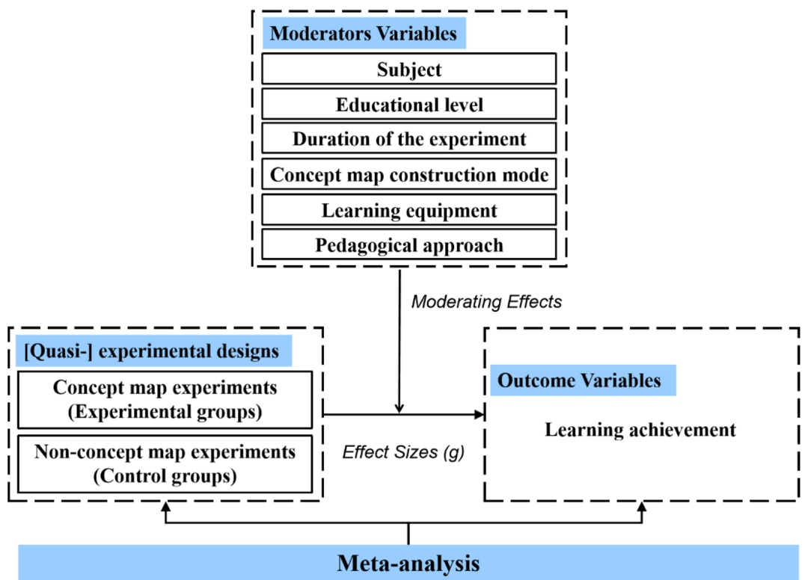
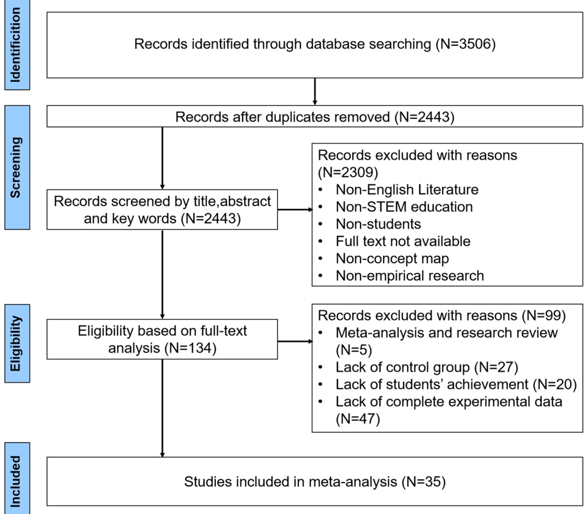
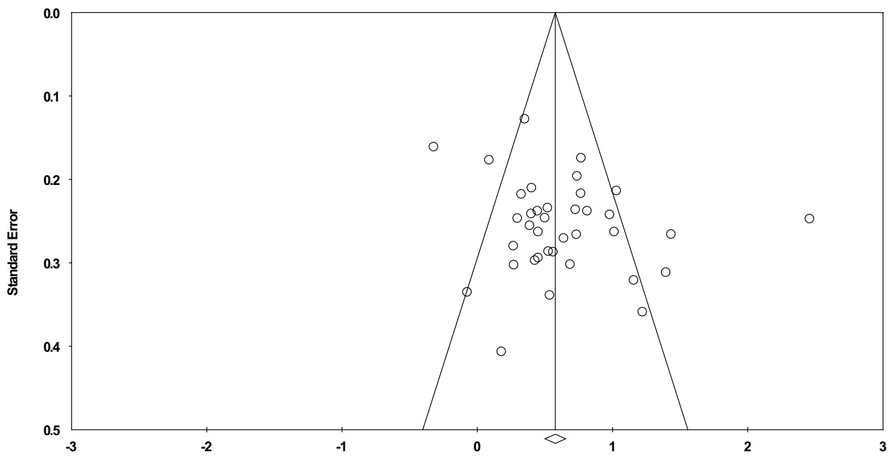
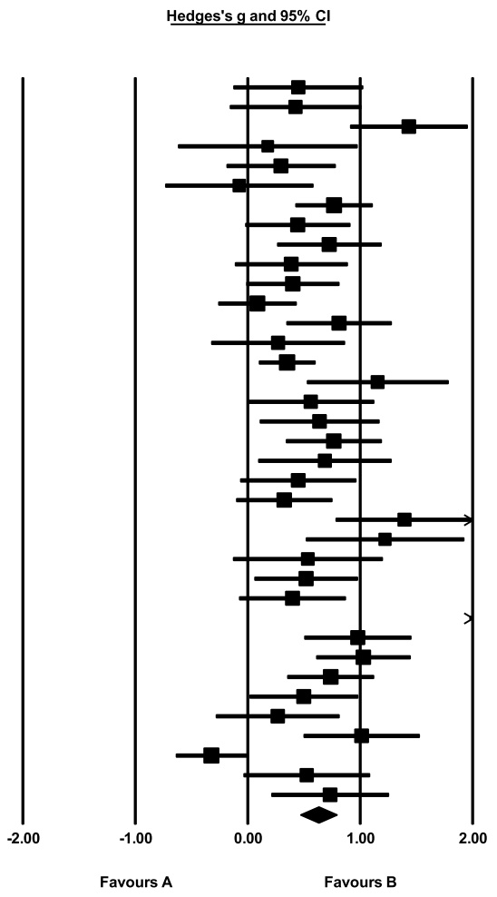

**REVIEW**

**Open Access**

# Concept mapping in STEM education: a meta‑analysis of its impact on students’ achievement (2004–2023)

Xiao‑Ming Wang1\*, Jing‑Lin Wang1, Shu‑Yan Xu1 and Si‑Jie Xu1

## Abstract

Concept mapping is a powerful educational tool that facilitates students’ organization and integration of knowledge, leading to improved understanding and retention. Numerous studies have highlighted the potential of concept mapping to enhance students’ achievement. However, comprehensive quantitative analyses focusing on its impact specifically in STEM education are limited. This meta-analysis synthesizes findings from 37 studies conducted between 2004 and 2023, identifying a moderate overall effect size of concept mapping on students’ achievement in STEM disciplines (ES = 0.630). The analysis of six moderating variables (subject, educational level, duration of the experiment, concept map construction mode, learning equipment, and pedagogical approach) reveals that concept mapping is particularly effective in science and technology, with the greatest impact observed at the secondary education level. Interventions lasting between one week and one month yielded the most significant improvements in learning outcomes, especially when students independently constructed their concept maps. Both digital and paper-based tools demonstrated moderate and comparable effects on students’ achievement. In addition, among various pedagogical approaches, contextual and inquiry-based pedagogical approaches are more effective when integrated into STEM education. This study provides recommendations for future research and practical implementation of concept map ping in educational contexts.

**Keywords** Concept mapping, STEM education, Students’ achievement, Meta-analysis

## Introduction

In the current era of globalization and digital transformation, STEM education has gained significant attention as a critical means of fostering students’comprehensive skills and innovative abilities. STEM education encompasses the four core disciplines of science, technology, engineering, and mathematics, as well as interdisciplinary combinations of these subjects (Li et al., 2020; Wang et  al., 2022). Its primary goal is to transcend traditional subject boundaries, encouraging students to explore the world and solve problems from an integrated, holistic perspective. As such, educational researchers and practitioners have consistently focused on finding more effective ways to enhance students’achievement and unlock their inherent potential for innovation and practical application in STEM education (Gong et al., 2024; Micari et al., 2010; Selcen Guzey et al., 2017).

Concept mapping, developed by Cornell scholars Novak and Gowin (1984), is a pedagogical tool designed to facilitate schema learning. As a teaching strategy, it employs diagrams or maps to organize and represent concepts, along with their meanings, throughout the learning process (Inomiesa & Unuero, 2003). Concept maps enable both teachers and students to meaningfully observe, infer, classify, and construct hierarchical understandings of concepts. In addition, concept maps are effective in enhancing students’motivation, reducing cognitive load, and significantly improving students’classroom engagement (Cheng et al., 2022; Chou et al., 2022). The recent studies have further emphasized the significant role of concept maps in enhancing self-efficacy. For example, Semilarski et  al. (2022) pointed out that using concept maps as a visual cognitive tool enables students to establish more interdisciplinary connections and effectively enhance their ability to create meaningful links, thereby significantly boosting their self-efficacy. Due to its potential to significantly enhance learning outcomes, concept mapping has garnered considerable interest from educators and researchers, particularly within STEM disciplines (Bot & Eze, 2016; Disch et al., 2023; Dmoshinskaia et al., 2022; Fang et al., 2023).

<small>\*Correspondence: Xiao‑Ming Wang zsdwxm@126.com 1 Zhejiang Key Laboratory of Intelligent Education Technology and Application, Zhejiang Normal University, Jinhua, China</small>

Despite the growing interest in the use of concept mapping in STEM education, the existing literature on their impact on students’achievement (i.e., how students perform in academic assessments, exams, or learning outcomes) presents a mixed picture. While many studies have highlighted the positive impact of concept mapping on improving students’achievement (Hwang et al., 2023; Lee et al., 2022), there are also reports that concept mapping fails to improve students’achievement (Balım, 2013; Van Orman et  al., 2022). This inconsistency in results suggests that a more comprehensive understanding of the effectiveness of concept mapping is needed to inform educational policy and practice. Therefore, clear data must be obtained from novel quantitative perspectives to assess the comprehensive impact of concept mapping on students’achievement. The aim of this study is to explore the impact of concept maps as a teaching intervention on students’achievement. We pay particular attention to studies that use concept maps as the main intervention tool rather than as an assessment tool.

This study has two major contributions. First, it is the first to quantitatively explore the impact of concept mapping on students’achievement in STEM education. Second, this study delves into a variety of factors that may influence the impact of concept mapping on students’achievement in STEM education and incorporates instructional methods as moderator variables that have yet to be addressed in previous meta-analyses. By exploring a range of moderator variables, this study addresses the inconsistencies found in previous studies. It reveals more clearly how different factors affect the effectiveness of concept mapping in educational settings, thereby providing a strong impetus and support for the future development of STEM education.

## Literature review

## Concept mapping in STEM education

Meaningful learning, as advocated by Ausubel (1963), is an ideal learning method that emphasizes the connection between learning materials and students’existing cognitive structures but needs concrete practical paths. It is in this context that Novak and Gauvin (1984) introduced the method of’concept mapping,’which combines meaningful learning with cognitive assimilation theory and graphically presents the learner’s thinking process or results, i.e., describes the relationship between different concepts through the conceptual mapping of statements. A statement is two or more concepts connected by an associated word. For example, in the statement’A dog is an animal,’’dog’and’animal’are concepts, and’is’belongs to the concept of’animal.’The word’is’belongs to the category of associated words. Over the past decades, concept mapping has become a knowledge construction tool (Farrokhnia et al., 2019), an assessment tool (Hwang et al., 2011), and an educational tool (Sciarrone & Temperini, 2024). Research has shown that concept mapping not only helps students clarify the relationships between concepts, especially linking newly learned concepts to prior knowledge and stimulating deep and meaningful learning (Cui & Yu, 2019), but also significantly improves students’achievement, motivation, and attitudes in different learning areas (Almulla & Alamri, 2021; Su & Zou, 2024).

The use of concept mapping in STEM education to improve students’achievement has been a concern of researchers (Chou et  al., 2022; Huynh & Yang, 2024; Hwang et al., 2020). For example, Al Khawaldeh and Al Olaimat (2010) demonstrated its effectiveness in biology education, while Dmoshinskaia et  al. (2022) highlighted its benefits in teaching environmental protection concepts in chemistry. Furthermore, a study by Bot and Eze (2016) noted that concept mapping was more significant in improving achievement in teaching mathematics in high school than cooperative learning strategies, and both were superior to the traditional mode of teaching. Concept mapping was significantly more helpful to girls than to boys.  Cheng et  al. (2022) innovatively developed a web article retrieval agent system incorporating dynamically linked concept mapping, which was able to generate concept mapping in real time and automatically. The results showed that students using this system had higher  achievement, lower cognitive load, and retrieved a greater number of relevant articles compared to those using the Google search engine. Disch et al.’s (2023) study explored the impact of progressively presenting concept mapping on students’cognitive processes of knowledge construction during the reading of engineering texts and found that it promoted students’achievement. The use of concept maps in STEM education initially focused on the sciences (Asan, 2007; Kim & Olaciregui, 2008), but in the recent years, their use in technology, engineering, and mathematics has become increasingly widespread (Cheng et al., 2022; Kamble & Tembe, 2013; Van Orman et al., 2022). With the rapid development of information technology, the form of combining concept mapping has expanded from traditional books (Uzuntiryaki & Geban, 2005) to computer platforms (Kwon & Cifuentes, 2007) and further incorporated emerging technologies such as augmented reality (AR) (Chen et  al., 2016). The choice of concept map construction mode, that is, whether students should construct concept maps individually or collaboratively (Aşıksoy, 2019; Fang, 2023), and whether the construction process is student- or teacher-led (Huang et al., 2022; Hwang et al., 2023), are still hot topics in the current research and urgently need to be explored and answered in greater depth.

Although the use of concept mapping in STEM education shows great potential, the impact of concept mapping on students’achievement in STEM is not uniformly positive. Balım (2013), in a study on physics topics such as"light and sound,"found that concept mapping had a negative effect on student cognition. Similarly, Van Orman et al. (2022) reported a detrimental impact in their study of algebra in mathematics education. Given these mixed findings, a systematic review and meta-analysis of the effects of concept maps on students’achievement in STEM is warranted. A comprehensive analysis of the various factors influencing the use of concept mapping, alongside the implementation of targeted improvement strategies, can more effectively meet the diverse learning needs of students. By maximizing the positive outcomes of concept mapping, educators can foster a more substantial improvement in students’achievement.

## Previous systematic reviews and meta‑analyses

Numerous systematic reviews have examined the use of concept mapping in education. Among them, three specifically focus on the impact of concept mapping on students’achievement. Hartmeyer et  al. (2018) analyzed nine studies from databases such as ERIC, revealing that concept mapping is most frequently utilized in secondary education, with biology emerging as the dominant subject area. The analysis also highlighted that most interventions lasted between one to two months.  The study also pointed out that the use of concept mapping  by students alone is conducive to stimulating individual understanding. At the same time, the collaborative model can promote valuable knowledge exchange and discussion.  Chang et  al. (2022) reviewed 59 studies on K-12 education published between 2000 and 2020, finding that concept mapping is primarily utilized as a cognitive tool in primary education, particularly in science subjects. Much of this research was conducted using desktop computers. This study emphasized that concept mapping  is not only a learning tool in K-12 education but also a powerful means of facilitating students’cognitive exploration and thinking development, which profoundly affects the process of knowledge construction. Jackson et al. (2023) reviewed 53 papers on concept mapping in higher education engineering disciplines, also from 2000 to 2020. Their findings revealed that concept maps focus mainly on specific STEM topics rather than entire subject, and that the most common method was for students to construct their own concept maps from scratch.

In the recent years, several meta-analyses have explored the impact of concept mapping applications (Anastasiou et al., 2024; Izci & Akkoc, 2024; Schroeder et al., 2018). Nesbit and Adesope (2006) analyzed 55 studies across fields like science, psychology, statistics, and nursing. They conducted multiple moderator variables in detailed analyses, such as subject and educational level. They found that creating concept maps was more effective than merely learning from them and that concept maps positively correlated with knowledge retention. Similarly, Yeşilyurt (2012) conducted a meta-analysis of 25 studies from 2001 to 2008, concluding that concept mapping outperformed traditional teaching methods. Schroeder et  al. (2018) synthesized 37 studies from 1972 to 2014, reporting an overall effect size of 0.58, with the creation of concept mapping (ES = 0.72) having a stronger effect than pre-made maps (ES = 0.43). Izci and Akkoc (2024) reviewed 78 studies from 2005 to 2017 and reported a high average effect size of 1.08. Anastasiou et  al. (2024) analyzed 55 studies on science performance from 1980 to 2020, finding an average effect size of 0.776.

Previous academic research, including systematic reviews and meta-analyses, has thoroughly explored the application of concept mapping  in various subject areas and has yielded many insights of academic value. Researchers have systematically sorted out various moderator variables  that affect the application of concept maps, such as subject, educational level, experiment duration, concept map construction mode, and learning equipment  (Anastasiou et  al., 2024; Nesbit & Adesope, 2006).

## Moderator variables

A moderator variable is a discrete or continuous variable that affects the direction and/or strength of the relation between an independent (or predictor) variable and a dependent (or criterion) variable (Baron & Kenny, 1986). From a data analysis perspective, moderator variables in meta-analysis differ from those in the usual (statistical) sense (Lipsey & Wilson, 2001). Specifically, moderator variables in meta-analysis are based on differences between studies and are used to describe and explain the heterogeneity between studies, whereas those in the usual (statistical) sense are based on the differences within individuals or samples (Cooper et  al., 2019). This study endeavors to specify a set of moderator variables that will serve as a direct reference for educators using concept mapping to improve students’achievement in STEM education. The selection of moderator variables is based on the existing empirical research literature (Asan, 2007; Disch et al., 2023), drawing extensively on previous systematic reviews and meta-analyses (Anastasiou et  al., 2024; Chang et al., 2022). In addition, given that the pedagogical approach  is  widely recognized as a key factor influencing students’achievement (Wang et  al., 2024), it was necessary to include it as a moderator variable in the analysis. In this study, subject, educational level, experiment duration, concept map construction mode, learning equipment, and pedagogical approach were used as moderator variables. These variables were chosen because their selected literature is frequently found in experimental designs and is relatively easy to quantify. All moderator variables in this study are defined below.

## Subject

This variable is defined as the identification of specific STEM education subjects in the context of the concept mapping application, following the established classification system (Chang et  al., 2022; Wang et  al., 2022), which includes the four main areas of science, mathematics, technology, and engineering. At the same time, the refinement criteria of Xu et al. (2022) were adopted to divide the science domain deeply into four branches: physics, chemistry, biology, and earth science, in order to reflect the specific disciplines more precisely.

## Educational level

The diversity of knowledge levels in the student population is one of the major sources of heterogeneity in the experimental results (Fu et  al., 2011), and this difference was highlighted as the key moderator  variable  in the meta-analysis, namely educational level. Specifically, educational level was meticulously divided into four levels (Izci & Akkoc, 2024): primary education, lower secondary education, upper secondary education, and higher  education, which not only reflects the different stages of students’cognitive development but also maintains a high degree of consistency with the standardized sectoral settings in the current schooling system; thus, ensuring that the results of the study are accurate and comparable.

## Duration of the experiment

The duration of the experiment is a dimension that cannot be ignored when assessing students’achievement (Ibáñez & Delgado-Kloos, 2018). Based on previous research (Nesbit & Adesope, 2006), this study refined the experiment duration into five coded categories: (a) less than 1  week; (b) between 1  week and 1  month; (c) between 1 and 3 months; (d) 3 months and more; and (e) not specified.

## Concept map construction mode

Concept map construction mode in experimental teaching refers to the subject attribution of concept map construction (Fang et  al., 2023; Hwang et  al., 2023), that is, the dominant player (student or teacher) and the mode of cooperation (alone or together) in construction, which considers the guiding role of the teacher and the depth of student learning collaboration (Anastasiou et  al., 2024). Based on this, the present study refined the concept map construction mode into four types: (a) teacher/researcher constructed, (b) student constructed, (c) student-collaborative, and (d) teachers/researchers  and students  construct.  This categorization is intended to provide a comprehensive exploration of the potential impact of different construction modes on students’achievement.

## Learning equipment

The concept map learning equipment is a non-negligible element of teaching that determines how concept mapping is presented to students. Traditionally, this equipment has been divided into two categories: paperand-pen and electronic devices (Anastasiou et al., 2024). In addition, with the rapid development of modern technology, electronic devices have become increasingly diverse and popular (Tufekčić, 2016). Therefore, following the segmentation of electronic devices in Chang et al. (2022), this study further refined electronic devices into personal mobile devices (e.g., smartphones, tablets) and personal computers in order to more comprehensively explore the unique effects of different learning equipment on students’comprehension and mastery of concept map content.

## Pedagogical approach

In this study, with reference to the categorization of pedagogical approach in previous studies (Garzón et al., 2020; Wang et  al., 2024) and in conjunction with the inclusion of studies in this meta-analysis (Disch et  al., 2023; Olgun, 2008; Safdar et  al., 2012), pedagogical approach is categorized as collaborative learning, inquiry-based learning, problem-based learning, contextual learning, game-based learning, and multimedia learning.

## Purpose of this meta‑analysis

Despite the potential of concept mapping  to improve students’achievement in STEM, existing research on the impact of concept maps on students’achievement in STEM presents inconsistent results. Even more unfortunate is the fact that few studies have specifically explored the impact of concept maps on students’achievement in STEM education. It is a significant blank in the literature, and this state of affairs not only reveals the limitations of the current research but also further emphasizes the urgent need to conduct a comprehensive and systematic meta-analysis in order to explore and advance the development of STEM education deeply.

Therefore, this study will use meta-analysis as a methodology to comprehensively examine the magnitude of the impact of concept mapping on students’STEM achievement throughout 2004–2023. In addition, moderator  variables were analyzed in depth to reveal the complex associations between underlying variables and students’STEM achievement. The interaction among the independent, dependent, and moderator variables in the meta-analysis is illustrated in Fig.  1. This study aims to address the following research questions:

1) What is the overall effect of concept mapping on students’achievement in STEM education?

2) To what extent do factors such as subject, educational level, experiment duration, concept map construction mode, learning equipment, and pedagogical approach  moderate the impact of concept mapping on students’achievement in STEM education?

## Methods

Meta-analysis is a statistical technique for quantitatively and comprehensively analyzing a large body of prior research on a given topic (Glass, 1976). It employs rigorous literature screening mechanisms and standards (Noble, 2006), combining various outcomes (e.g., R-values, means) from multiple studies into a unified effect size. It enables researchers to determine the cumulative effect across independent studies, effectively resolving conflicts that arise from inconsistent empirical findings (Paré et al., 2015).

## Literature search

The study employed the Preferred Reporting Items for Systematic Reviews and Meta-Analyses (PRISMA) framework (Moher et al., 2010) to guide the search process. Six online databases were utilized: Web of Science, ERIC, ProQuest, Springer, Scopus, and Wiley. The inclusion criteria specified that studies must be written in English and published in peer-reviewed journals. Three groups of search terms were used: (1) terms related to concept mapping, such as"concept map\*,""knowledge map\*,"or"node-link map\*"(Nesbit & Adesope, 2006); (2) STEM-related keywords, including"STEM,""interdisci plinary,""science,""technology,""engineering,"and"mat hematics"; and (3) education-related terms like"educat ion"and"learning."These search terms were combined using Boolean operators (AND, OR). Articles published between 2004 and 2023 were included in the review, consistent with Hwang and Tu’s (2021) recommendation to examine research trends over the past two decades.

Fig. 1 Meta-analysis mechanism framework

## Inclusion and exclusion criteria

The literature screening process involved four stages to meet the objectives of this meta-analysis. In the first stage, an initial search using the defined string yielded 3,506 studies. Automatic screening was applied to limit the results to English-language, peer-reviewed journal articles, excluding conference papers, early access articles, dissertations, editorials, revision papers, and reviews. This process reduced the number of articles to 2,443 after removing duplicates. In the second stage, titles, abstracts, and keywords were screened based on criteria (a), (b), (c), (d), and (e) from Table  1, resulting in the selection of 134 articles. The third stage involved full-text screening according to criteria (e), (f),  (g), and (h), excluding 99 articles. Ultimately, 35 articles were included in the final analysis. The detailed screening process is illustrated in Fig. 2.

## Data extraction and coding

The 35 studies that met the inclusion criteria were coded into three sections: basic information, main content, and statistical data for the meta-analysis. The basic information includes details such as the author’s name, year of publication, and sample size. The main content consisted of six moderator variables, i.e., subject, educational level, experiment duration, concept map construction mode, learning equipment, and pedagogical approach.

Two independent researchers extracted and coded the study characteristics separately. The inter-coder reliability was measured using Cronbach’s alpha, yielding a high-reliability coefficient of 0.882. Inconsistencies in the coded items were resolved through discussion between the two researchers. Table in Appendix provides detailed information on all moderator variables included in this study.

## Data analysis

Standardized mean differences were calculated as effect sizes using Comprehensive Meta-Analysis (CMA) 3.0 software, with Hedges’g (Hedges, 1981) employed to correct for bias related to small sample sizes (Hedges & Olkin, 1985). Heterogeneity testing conducted via CMA software indicated the need for moderation analyses to explore potential sources of variability further. To ensure the reliability of the findings, a rigorous assessment of publication bias was performed. In addition, sensitivity analyses were conducted to thoroughly evaluate the robustness and stability of the study’s results.

## Calculating effect sizes

To calculate effect sizes, the difference between pre-test and post-test means (or only post-test data) was used to determine the effect size difference between the experimental and control groups. The effect size (ES) was standardized using the post-test standard deviation. The ES for each study was calculated using the following formula (Lipsey & Wilson, 2001):

$$
E S = \frac{X_T - X_C}{SD_{\text{pooled.post}}}
$$

In this equation, $X _ { T }$ represents the difference between the pre-and post-test means for the experimental group, $X _ { C }$ represents the same for the control group, and $S D _ { p o o l e d . p o s t }$ is the pooled standard deviation of the post-test measurements for both groups. After calculating the standardized mean differences, the values of $\langle g$ were computed using the formula:

Table 1 Inclusion and exclusion criteria

| Criteria | Inclusion | Exclusion |
| --- | --- | --- |
| (a). Language | English | Languages other than English |
| (b). Subject | STEM subjects | Non-STEM subjects |
| (c). Participants | K-16 students | Preservice teachers, student teachers, or employees |
| (d). Accessibility | Full-text access to the study | Inaccessible full text or inability to contact the author via the Internet |
| (e). Comparison | Concept map vs. non-concept map | No control group |
| (f). Independent variables | Use of"concept maps"as a teaching tool in the study | Failure to use"concept maps"or use of"concept maps"solely for assessment |
| (g). Dependent variable | Academic performance | Cognitive, motivational, affective outcomes |
| (h).Data | Sufficient data available to calculate effect sizes | Case studies lacking empirical data or insufficient data for effect size calculation |

Fig. 2 A diagrammatic representation of the PRISMA review process

$$
g = \left(1 - \frac {3}{4 \cdot d f - 1}\right) \cdot E S
$$

where df is the degrees of freedom for each study. Finally, the g values from the individual studies were aggregated to produce the overall effect size estimate (Hedges’g).

The effect sizes were extracted and calculated for this study according to the following principles: (a) if students’achievement data were reported for more than one time period, final performance data were used to calculate effect sizes (Bernard et  al., 2004); and (b) when a study had effect sizes for more than one independent comparison group, the effect sizes for each group were considered to be those of an independent study (Borenstein et  al., 2021). Two of the 35 studies (Adesope et  al., 2017; Kwon & Cifuentes, 2007) contributed four effect sizes by extracting data from two independent comparison groups. Thus, a total of 37 effect sizes were ultimately extracted from 35 studies.

## Heterogeneity test

Heterogeneity analysis is used to test whether there are significant differences between the individual effect sizes and the mean effect size in a meta-analysis (Vemer et  al., 1989). The Q-test is to detect whether the effect sizes are evenly distributed across studies. The $I ^ { 2 }$ value reflects the percentage of variation in the total effect size that is due to the heterogeneous component. The I2 test complements the Q-test by overcoming the inefficiency of the Q-test, which is affected by the sample size and the number of included studies. It is a method for jointly determining the percentage of inter-study variation that is truly heterogeneous across studies rather than sampling (Higgins et  al., 2003). According to Huedo-Medina et  al. (2006), $I ^ { 2 }$ values ranging from

0 to 25% indicate low heterogeneity, 25–75% indicate moderate heterogeneity, and 75–100% suggest high heterogeneity.

## Results

## Overall effectiveness

## Publication bias test

Publication bias in meta-analysis arises when studies reporting positive or significant findings are more likely to be published than those with non-significant or negative results (Borenstein et  al., 2021). Funnel plots and the fail-safe N test were initially employed to assess publication bias in this study (Khoury et al., 2013). Egger’s linear regression and Begg and Mazumdar’s rank correlation tests were also conducted to provide further validation.

## Heterogeneity test

A higher $I ^ { 2 }$ value corresponds to greater heterogeneity. In this study, the $I ^ { 2 }$ statistic $I^{2}=76.145, Q=150.909,$ $p   <   0 . 0 0 1 )$ indicates significant heterogeneity in the effect of concept mapping on students’STEM achievement across studies. Given this high level of heterogeneity, a random effects model was applied to account for variability between studies and to calculate an overall effect size. In addition, a moderation analysis was conducted to investigate factors contributing to the observed heterogeneity.

## Publication bias test

As shown in Fig. 3, the funnel plot appears symmetrical, with most data points located near the upper-middle section of the plot. This symmetry suggests that there is no substantial publication bias (Garzón & Acevedo, 2019). The fail-safe N value, which indicates the number of missing studies needed to render the p-value non-significant, was calculated using Rosenthal’s (1979) formula. If the fail-safe N exceeds $5 ~ \mathrm { k }   +   1 0$ (where k is the number of studies in the meta-analysis), it is unlikely that unpublished studies would substantially alter the overall effect size. In this analysis, the fail-safe N was 2,184, which is much greater than $5 \; \text{° } 37   +   10,$ indicating that the effect size is robust to potential unpublished studies.

Further tests for publication bias, including Egger’s test $( p   =   0 . 0 7 5   >   0 . 0 5 , t   =   1 . 8 4   <   1 . 9 6 )$ and Begg and Mazumdar’s rank correlation test $p = 0.680 > 0.05$ $Z   =   0 . 4 1 2   <   1 . 9 6 )$ , confirmed that the likelihood of publication bias is low (Begg & Mazumdar, 1994; Egger et al., 1997).

## Sensitivity test

Sensitivity analysis was conducted to detect any potential outliers that might influence the overall effect size (Higgins & Thompson, 2002). After excluding individual studies one by one, the 95% confidence interval for the effect size using the fixed-effects model remained between 0.500 and 0.654, while the interval for the random-effects model ranged from 0.469 to 0.790. These results indicate that no single study had a disproportionate influence on the overall effect size, affirming the robustness and stability of the findings in this meta-analysis.

Fig. 3 Funnel diagram (trimming and filling method)

## Overall effect of concept mapping on students’STEM achievement

Based on Cohen’s (1988) guidelines for interpreting effect sizes (Hedges’g), an effect size smaller than 0.2 is considered negligible, 0.2–0.5 is small, 0.5–0.8 is moderate, and greater than 0.8 is large. This meta-analysis of 37 studies revealed a moderate overall effect of concept mapping on students’STEM achievement, with an effect size of g= 0.630 (95% CI [0.469–0.790], p < 0.001). Figure  4 presents the forest plot of effect sizes (Hedges’g) for all included studies.

Fig. 4 Forest plots with all effect sizes in the original study

<table><tr><td rowspan="2">Study name</td><td colspan="7">Statistics for each study</td></tr><tr><td>Hedges&#x27;s g</td><td>p-Value</td><td>Variance</td><td>Lower limit</td><td>Upper limit</td><td>Standard error</td><td>Z-Value</td></tr><tr><td>Adesope et al. 1 (2017)</td><td>0.450</td><td>0.126</td><td>0.086</td><td>-0.126</td><td>1.026</td><td>0.294</td><td>1.530</td></tr><tr><td>Adesope et al. 2 (2017)</td><td>0.425</td><td>0.152</td><td>0.088</td><td>-0.157</td><td>1.007</td><td>0.297</td><td>1.432</td></tr><tr><td>Al Khawaldeh &amp; Al Olaimat(2010)</td><td>1.433</td><td>0.000</td><td>0.071</td><td>0.913</td><td>1.954</td><td>0.266</td><td>5.394</td></tr><tr><td>Asan(2007)</td><td>0.178</td><td>0.661</td><td>0.165</td><td>-0.618</td><td>0.975</td><td>0.406</td><td>0.439</td></tr><tr><td>Asiksoy(2019)</td><td>0.297</td><td>0.229</td><td>0.061</td><td>-0.186</td><td>0.780</td><td>0.247</td><td>1.203</td></tr><tr><td>Balim(2013)</td><td>-0.075</td><td>0.824</td><td>0.112</td><td>-0.731</td><td>0.582</td><td>0.335</td><td>-0.223</td></tr><tr><td>Bot &amp; Eze(2016)</td><td>0.767</td><td>0.000</td><td>0.030</td><td>0.426</td><td>1.109</td><td>0.174</td><td>4.404</td></tr><tr><td>Chen et al.(2016)</td><td>0.445</td><td>0.061</td><td>0.057</td><td>-0.021</td><td>0.911</td><td>0.238</td><td>1.872</td></tr><tr><td>Cheng et al.(2022)</td><td>0.726</td><td>0.002</td><td>0.056</td><td>0.263</td><td>1.188</td><td>0.236</td><td>3.073</td></tr><tr><td>Chou et al.(2022)</td><td>0.388</td><td>0.129</td><td>0.065</td><td>-0.113</td><td>0.888</td><td>0.255</td><td>1.518</td></tr><tr><td>Disch et al.(2023)</td><td>0.401</td><td>0.056</td><td>0.044</td><td>-0.010</td><td>0.813</td><td>0.210</td><td>1.910</td></tr><tr><td>Dmoshinskaia et al.(2022)</td><td>0.087</td><td>0.623</td><td>0.031</td><td>-0.259</td><td>0.433</td><td>0.177</td><td>0.491</td></tr><tr><td>Fang(2023)</td><td>0.812</td><td>0.001</td><td>0.057</td><td>0.347</td><td>1.278</td><td>0.238</td><td>3.418</td></tr><tr><td>Gijlers &amp; Jong(2013)</td><td>0.270</td><td>0.372</td><td>0.091</td><td>-0.323</td><td>0.863</td><td>0.302</td><td>0.893</td></tr><tr><td>Haugwitz et al.(2010)</td><td>0.351</td><td>0.006</td><td>0.016</td><td>0.100</td><td>0.601</td><td>0.128</td><td>2.748</td></tr><tr><td>Huang et al.(2022)</td><td>1.156</td><td>0.000</td><td>0.103</td><td>0.528</td><td>1.785</td><td>0.321</td><td>3.605</td></tr><tr><td>Hwang et al.(2011)</td><td>0.561</td><td>0.051</td><td>0.082</td><td>-0.002</td><td>1.123</td><td>0.287</td><td>1.954</td></tr><tr><td>Hwang et al.(2013)</td><td>0.639</td><td>0.018</td><td>0.073</td><td>0.109</td><td>1.169</td><td>0.270</td><td>2.364</td></tr><tr><td>Hwang et al.(2020)</td><td>0.766</td><td>0.000</td><td>0.047</td><td>0.341</td><td>1.190</td><td>0.217</td><td>3.533</td></tr><tr><td>Hwang et al.(2021)</td><td>0.686</td><td>0.023</td><td>0.091</td><td>0.095</td><td>1.278</td><td>0.302</td><td>2.274</td></tr><tr><td>Hwang et al.(2023)</td><td>0.450</td><td>0.087</td><td>0.069</td><td>-0.065</td><td>0.965</td><td>0.263</td><td>1.712</td></tr><tr><td>Kamble &amp; Tembe(2013)</td><td>0.325</td><td>0.136</td><td>0.047</td><td>-0.102</td><td>0.751</td><td>0.218</td><td>1.492</td></tr><tr><td>Kim &amp; Olaciregui(2008)</td><td>1.395</td><td>0.000</td><td>0.097</td><td>0.784</td><td>2.005</td><td>0.311</td><td>4.479</td></tr><tr><td>Kwon and Cifuentes 1 (2007)</td><td>1.221</td><td>0.001</td><td>0.129</td><td>0.518</td><td>1.924</td><td>0.359</td><td>3.404</td></tr><tr><td>Kwon and Cifuentes 2 (2007)</td><td>0.535</td><td>0.114</td><td>0.115</td><td>-0.129</td><td>1.199</td><td>0.339</td><td>1.580</td></tr><tr><td>Lee et al.(2022)</td><td>0.520</td><td>0.026</td><td>0.055</td><td>0.061</td><td>0.979</td><td>0.234</td><td>2.222</td></tr><tr><td>Marée et al.(2013)</td><td>0.399</td><td>0.098</td><td>0.058</td><td>-0.074</td><td>0.871</td><td>0.241</td><td>1.653</td></tr><tr><td>Martínez et al.(2013)</td><td>2.458</td><td>0.000</td><td>0.061</td><td>1.973</td><td>2.942</td><td>0.247</td><td>9.942</td></tr><tr><td>OLGUN et al.(2008)</td><td>0.979</td><td>0.000</td><td>0.059</td><td>0.504</td><td>1.454</td><td>0.242</td><td>4.043</td></tr><tr><td>Safdar et al.(2012)</td><td>1.029</td><td>0.000</td><td>0.046</td><td>0.611</td><td>1.448</td><td>0.214</td><td>4.819</td></tr><tr><td>Stanisavjevic et al.(2017)</td><td>0.738</td><td>0.000</td><td>0.038</td><td>0.353</td><td>1.122</td><td>0.196</td><td>3.763</td></tr><tr><td>Stewart(2012)</td><td>0.499</td><td>0.043</td><td>0.061</td><td>0.017</td><td>0.981</td><td>0.246</td><td>2.028</td></tr><tr><td>Tastan et al.(2008)</td><td>0.267</td><td>0.340</td><td>0.078</td><td>-0.281</td><td>0.815</td><td>0.280</td><td>0.954</td></tr><tr><td>Uzuntiryaki &amp; Geban(2005)</td><td>1.013</td><td>0.000</td><td>0.069</td><td>0.498</td><td>1.528</td><td>0.263</td><td>3.856</td></tr><tr><td>Van et al.(2022)</td><td>-0.322</td><td>0.045</td><td>0.026</td><td>-0.638</td><td>-0.007</td><td>0.161</td><td>-2.004</td></tr><tr><td>Yang &amp; Wang(2014)</td><td>0.525</td><td>0.067</td><td>0.082</td><td>-0.036</td><td>1.086</td><td>0.286</td><td>1.834</td></tr><tr><td>Yang et al.(2013)</td><td>0.733</td><td>0.006</td><td>0.071</td><td>0.211</td><td>1.254</td><td>0.266</td><td>2.755</td></tr><tr><td></td><td>0.630</td><td>0.000</td><td>0.007</td><td>0.469</td><td>0.790</td><td>0.082</td><td>7.673</td></tr></table>

## Moderator variables analysis

The above analyses revealed a great deal of heterogeneity among the findings, thus requiring moderator variable analyses. A random effects model was used to explore the following moderator variables that could lead to differences in effect sizes: subject, educational level, duration of the experiment, concept map construction mode, learning equipment, and pedagogical approach. Table  2 shows the effect sizes of the moderator variables on students’achievement in STEM education.

## Subject

The analysis found no significant differences in the effect size of concept mapping across STEM subjects (Q = 3.145, p = 0.790). For science subjects, effect sizes were moderate for physics, chemistry, biology, and earth science, with the highest effect in physics (g= 0.782, p < 0.001), followed by earth science $(g = 0.679, p < 0.001)$ biology (g= 0.632, p < 0.001), and chemistry (g= 0.514, p = 0.138). Mathematics had a small effect size (g= 0.217, p = 0.512), while technology showed a moderately high

Table 2 Effect sizes by moderator variables on students’achievement in STEM education

<table><tbody><tr><td>Moderator variables Subject Science Biology</td><td>N13</td><td>Hedges'g0.632***</td><td>95% CI[0.358, 0.906]</td><td>Q B3.145</td></tr><tr><td>Chemistry</td><td>2</td><td>0.514</td><td rowspan="33">[-0.165, 1.192][0.321, 1.037][0.413, 1.151][0.080, 1.458][-0.311, 1.038][-0.432, 0.866][0.312, 0.839][0.373, 1.138][0.324, 1.237][0.238, 0.866][0.261, 0.805][0.488, 1.049][0.270, 0.975][-0.484, 1.482][-0.207, 1.206][0.373, 0.933][0.552, 1.315][0.136, 0.895][0.203, 0.786][0.373, 0.857][0.307, 1.067][0.339, 0.900][0.136, 0.972][0.468, 1.023][-0.004, 1.027][0.137, 1.609][-0.194, 1.282][0.176, 0.870]</td><td rowspan="33">1.2321.6243.6350.1071.837</td></tr><tr><td>Earth science</td><td>8</td><td>0.679***</td></tr><tr><td>Physics</td><td>8</td><td>0.782***</td></tr><tr><td>Technology</td><td>2</td><td>0.769*</td></tr><tr><td>Engineering</td><td>2</td><td>0.363</td></tr><tr><td>Mathematics</td><td>2</td><td>0.217</td></tr><tr><td>Educational level</td><td></td><td></td></tr><tr><td>Primary education</td><td>15</td><td>0.576***</td></tr><tr><td>Lower secondary education</td><td>7</td><td>0.755***</td></tr><tr><td>Upper secondary education</td><td>5</td><td>0.780**</td></tr><tr><td>Higher education</td><td>10</td><td>0.552**</td></tr><tr><td>Duration ofexperiment</td><td></td><td></td></tr><tr><td>&lt;1week</td><td>13</td><td>0.533***</td></tr><tr><td>1week 1month</td><td>13</td><td>0.768***</td></tr><tr><td>1month 3months</td><td>8</td><td>0.622***</td></tr><tr><td>&gt;3months</td><td>1</td><td>0.499</td></tr><tr><td>Not specified</td><td>2</td><td>0.500</td></tr><tr><td>Concept map construction mode</td><td></td><td></td></tr><tr><td>Teacher/researcher constructed</td><td>12</td><td>0.653***</td></tr><tr><td>Student constructed</td><td>7</td><td>0.933***</td></tr><tr><td>Student collaborative</td><td>7</td><td>0.515**</td></tr><tr><td>Teachers/Researchers andStudents construct</td><td>11</td><td>0.494**</td></tr><tr><td>Learning media</td><td></td><td></td></tr><tr><td>Electronic Personal computer</td><td>18</td><td>0.615***</td></tr><tr><td>Personal mobile device</td><td>7</td><td>0.687***</td></tr><tr><td>Paper andPen</td><td>12</td><td>0.619***</td></tr><tr><td>Pedagogical approach</td><td></td><td></td></tr><tr><td>Collaborative learning</td><td>6</td><td>0.554**</td></tr><tr><td>Inquiry based learning</td><td>14</td><td>0.746***</td></tr><tr><td>Problem based learning</td><td>4</td><td>0.511</td></tr><tr><td>Contextual learning</td><td>2</td><td>0.873*</td></tr><tr><td>Game based learning</td><td>2</td><td>0.544</td></tr><tr><td>Multimedia learning</td><td>9</td><td>0.523**</td></tr></tbody></table>

N the number of effect sizes, $Q _ { \mathsf { B } }$ between-group homogeneity, CI confidence interval \*p<0.05; \*\*p<0.01; \*\*\*p<0.001

effect $( g   =   0 . 7 6 9 ,   p   =   0 . 0 2 9 )$ , and engineering exhibited a small effect size $( g   =   0 . 3 6 3 , p   =   0 . 2 9 1 )$

## Educational level

The impact of concept mapping in STEM education is moderately small for students’achievement in primary education $(g = 0.576, p < 0.001)$ and higher education (g= 0.552, $p   =   0 . 0 0 1 )$ and moderately large for students’achievement in lower secondary education $(g=0.755, p<0.001)$ and upper secondary education $( g   =   0 . 7 8 0 , p   =   0 . 0 0 1 )$ . The between-group analysis $( Q { = } 1 . 2 3 2 ,   p { = } 0 . 7 4 5 )$ suggests no statistically significant differences, indicating that the effectiveness of concept maps across educational levels in STEM remains stable.

## Duration of the experiment

The analysis of the effect sizes across different experiment duration $( Q { = } 1 . 6 2 4 , p { = } 0 . 8 0 4 )$ showed no statistically significant differences. The effect size was highest for experiments lasting between 1  week to 1  month $(g=0.768, p<0.001)$ , followed by the duration of 1 to 3 months $( g   =   0 . 6 2 2 ,   p   =   0 . 0 0 1 )$ and less than

1  week $(g = 0.533,   p < 0.001)$ , all of which fell within the medium effect size range. Experiments lasting not specified $( g   =   0 . 5 0 0 ,   p   =   0 . 1 6 6 )$ and those lasting longer than 3 months $( g   =   0 . 4 9 9 , p   =   0 . 3 2 0 )$ were less effective.

## Concept map construction mode

The effect sizes associated with different concept map construction modes revealed no statistically significant differences $(Q=3.635, p=0.304)$ . Students who constructed concept mapping independently achieved the highest effect size $(g = 0.933, p < 0.001)$ . In comparison, the effect size for teacher-constructed maps was moderate $(g = 0.653,   p < 0.001)$ . Collaborative concept mapping $( g   =   0 . 5 1 5 , p   =   0 . 0 0 8 )$ and co-construction by teachers and students $(g=0.494,   p=0.001)$ yielded similar, medium– low effect sizes.

## Learning equipment

The group effect $( Q { = } 0 . 1 0 7 ,   p { = } 0 . 9 4 8 )$ indicates no significant differences in the impact of concept mapping on students’achievement in STEM education across various learning equipment. Whether students use traditional paper-and-pen $(g=0.619, p<0.001)$ , personal computers $(g=0.615, p<0.001)$ , or mobile devices $\left( g   =   0 . 6 8 7 \right.$ $p   <   0 . 0 0 1 )$ , similar moderate learning gains are observed.

## Pedagogical approach

The analysis of group effects $( Q   =   1 . 8 3 7 ,   p   =   0 . 8 7 1 )$ suggests that there is no statistically significant difference in the impact of concept mapping on students’achievement in STEM education across different pedagogical approaches. Among these, contextual learning demonstrated the largest effect size $(g = 0.873, p = 0.020)$ Inquiry-based learning followed with a moderately high effect size $(g=0.746, p<0.001)$ . Collaborative learning $( g   =   0 . 5 5 4 ,   p   =   0 . 0 0 9 )$ , problem-based learning (g= 0.511, p = 0.052), game-based learning (g= 0.544, p = 0.149), and multimedia learning (g= 0.523, p = 0.003) showed similar effect sizes, all falling within a medium–low range.

## Discussion

## Concept mapping has a moderate positive impact on students’STEM achievement overall

This meta-analysis integrates 37 independent studies and systematically shows that concept mapping has a certain promoting effect on students’STEM achievement, providing strong evidence to support the effective supplementary application of concept mapping in the STEM education system.

Further analysis of the studies included in the metaanalysis shows that over the past 20  years, scholars in many countries and regions around the world have continued to focus on the practical exploration of concept map teaching in STEM education (Adesope et al., 2017; Hwang et  al., 2023; Marée et  al., 2013; Uzuntiryaki & Geban, 2005). This research interest has shown a steady trend, highlighting the important influence of concept map teaching in promoting innovation and optimization of STEM education. This phenomenon not only reflects the urgent need for effective teaching strategies in the field of education but also indicates that concept map teaching has broad development prospects and profound practical value in improving the quality of education and enhancing students’STEM literacy.

## Concept maps differently influence students’achievement in STEM education across moderator variables Subject

Within subject categories, this study found that concept mapping had the largest impact on science subjects, followed by technical and engineering subjects, with mathematics being relatively less affected. Within the sciences, the overall effect was moderate, with physics in particular showing the most prominence in enhancing students’achievement, followed by earth science, followed by biology, and chemistry, demonstrating a relatively weak boost.

In earth science, concept mapping enhances students’spatial cognition and conceptual understanding, facilitating mastery of complex scientific principles (Hwang et  al., 2023; Yang & Wang, 2014). Consistent with findings of Anastasiou et  al. (2024), who reported a stronger effect of concept mapping in physics compared to biology and chemistry, which may reflect differences in subject-specific challenges. It is worth noting that the sample of chemistry studies in this analysis was small (n = 2), suggesting that further research is needed to validate these results. Biology often involves organizing complex systems (e.g., cellular respiration, circulatory systems) across multiple levels of biological organization (Al Khawaldeh & Al Olaimat, 2010; Haugwitz et al., 2010). Concept mapping in biology reduces cognitive load and enhances knowledge integration by clearly depicting hierarchical relationships (Anastasiou et  al., 2024).

In this study, concept maps are most effective in improving students’achievement in physics, which may be because physics is highly logical and structured, and concept maps can clearly demonstrate the causal relationships between concepts, helping students to better integrate knowledge, such as heat transfer and temperature change (Asan, 2007), and fields and forces in electromagnetism (Gijlers & de Jong, 2013), and optics and material particles (Martínez et  al., 2013). However, the effectiveness of concept maps in physics is not significant in all cases. For example, Balım (2013) found that although the experimental group used technologyassisted concept maps, it did not show significant learning effects compared to the traditional teaching method. The study focused on sixth-grade students who used a computer platform to collaboratively construct concept maps to learn about physics. However, computer operation, concept map construction, and the complexity of physics knowledge all posed challenges for students of this age, and these factors may have combined to increase the cognitive load on students. In addition, it was difficult to ensure the full participation of each student during collaborative concept map construction, which was also a potential factor affecting the performance of the experimental group. These findings suggest that researchers should avoid blindly piling on variables in the research design and instead make careful and reasonable design arrangements based on students’actual cognitive levels and specific course content.

The recent research in the field of technology (Cheng et al., 2022; Fang et al., 2023) has revealed the effectiveness of concept maps as an innovative learning tool in improving students’achievement. Similarly, in the context of engineering education, concept maps are not only effective in improving students’achievement but also, through their inherent visualization capabilities, have been shown to develop students’logical thinking and problem-solving skills (Disch et al., 2023; Kamble & Tembe, 2013). These findings from both technology and engineering disciplines suggest a positive impact of concept maps on students’achievement, although the effect size in the engineering field is lower than in the technology field. This discrepancy may be because, in the two technology-related studies, concept maps are often combined with advanced technical tools, such as integrating concept maps with web article retrieval agents or self-regulated learning systems, which may have further enhanced their effectiveness. However, in the two engineering-related studies, concept maps have not yet been combined with engineering tools, which may limit their full potential. Future research could explore this area further. It is worth noting that the current research is still limited, with only two studies available for each subject area. Therefore, the reliability of these conclusions still needs to be further verified through more empirical studies.

The two mathematics studies included in this analysis revealed mixed results. Bot and Eze (2016) found that the concept mapping method can significantly improve students’achievement, especially that of boys, when teaching trigonometry. This gender difference may be caused by differences in learning strategy preferences: research has shown that boys are more dominant in spatial visualization tasks (Lee et  al., 2019), and concept mapping relies on spatial and logical thinking skills; in addition, sociocultural factors may also affect girls’confidence and participation in mathematics learning (Kirkham & Chapman, 2022). Researchers should pay more attention to disadvantaged groups during the experimental process. In contrast, Van Orman et  al. (2022) found that concept maps were less effective than exemplar-based learning when teaching the algebra skill’Completing the Square’. The difference between the two studies may be related to the different forms of knowledge representation: trigonometric functions belong to declarative knowledge, and concept maps can be used to visualize and sort out the connections between trigonometric functions; while’Completing the Square’belongs to procedural knowledge, which requires students to follow the steps to find the corresponding solution. Therefore, the effect of the example learning method is inferior to that of the concept map method. However, there are only two studies related to mathematics, and the sample sizes are small, so the conclusions are somewhat limited.

## Educational level

In this study, concept maps had a larger positive impact on students’achievement in secondary STEM education (including lower and upper secondary education). In contrast, the positive impact of concept mapping in primary education and higher education was smaller, which is consistent with the findings of Izci and Akkoc (2024).

In primary education, concept maps are favored by the education sector because of their unique dual coding properties, which simultaneously integrate linguistic and visual elements. This teaching method closely follows the principles of dual coding theory, which can fully mobilize the memory system capabilities of students so that they can store and organize what they have learned in a more interrelated and flexible manner (Kirschner & Hendrick, 2020). Although concept maps have significant advantages in terms of improving the efficiency and depth of learning for primary school students, as their abstract thinking is still developing, learning and mastering this tool is undoubtedly a challenge that requires patient guidance and careful instruction from teachers. At this stage, although students have begun to experiment with concept maps, their potential functions have not yet been fully utilized. Furthermore, in this study, concept maps in primary education are mainly applied in science but are underutilized in technology, engineering, and mathematics. This limited disciplinary scope may introduce bias and affect the generalizability of the findings.

Secondary school students, who are typically in the formal operations stage of cognitive development, are better equipped for abstract and systematic thinking, making them more adept at utilizing concept maps (Haris, 2014). Additionally, the growing prevalence of student-centered learning strategies at the secondary level (Planting-Bergloo & Orlander, 2024) supports the effectiveness of concept maps in these settings. It is through the visual presentation of abstract connections between knowledge points that concept mapping accurately fits the cognitive profile of students at this stage of life, thereby effectively contributing to academic achievement.

Higher education students have transitioned from childhood to early adulthood, a process accompanied by the maturation of their independent thinking skills and the solid construction of a self-aware framework (Ergashevna, 2022). At the same time, their abstract thinking and system integration skills have gradually improved, which is reflected in their decreasing reliance on external knowledge organization tools such as concept maps. Instead, they can logically organize and systematically construct what they have learned in their internal cognitive structure autonomously and efficiently (Kamble & Tembe, 2013; Marée et  al., 2013). In addition, the application of concept maps in STEM subjects in higher education in the present study is mainly within less than 1  week (accounting for 60% of the application time), and this shorter duration may also affect the effectiveness of concept maps. Therefore, these factors may explain why the effectiveness of concept maps diminishes at the higher education level.

## Duration of the experiment

The trend suggests that the effectiveness of concept mapping initially increases with the length of the experiment but eventually diminishes. Novice users of concept mapping may need to be more focused on the technical aspects of the concept map, detracting from core learning objectives (Adesope et al., 2017). Results suggest that interventions lasting between 1 week and 1 month significantly enhance students’achievement, a finding consistent with Nesbit and Adesope (2006). As the duration of the experiment increased, students became more familiar with concept maps, and the advantages of concept maps could be better utilized. However, as the experimental period extends beyond 1 month, the novelty effect begins to wane, leading to diminished impact (Schroeder et al., 2018).

Most studies included in this meta-analysis assessed short-term effects (Disch et  al., 2023; Haugwitz et  al., 2010; Yang et  al., 2013), a limitation that may be attributed to the fact that the duration of the experiment in the classroom setting is strictly limited by various objective factors (Dmoshinskaia et  al., 2022; Lee et  al., 2022). Although short-term experiments inevitably have limitations, such as the novelty effect, researchers have taken some precautions to mitigate its impact on the results. For example, in the study by Kwon and Cifuentes (2007), computers and Inspiration software were introduced as auxiliary tools, which were undoubtedly novel learning equipment for students. For this reason, the experimental design included a three-day training session, which aimed to help students become familiar with the concept map construction process and the tools used, thereby reducing the interference of the novelty effect to some extent.

Although the effect of long-term experiments on improving grades may not be as significant as that of short-term experiments, it is worth noting that a study lasting longer than 3  months (Stewart, 2012) found that while concept mapping had a limited direct effect on students’achievement, it substantially improved students’thinking coherence. Therefore, future research should actively create conditions to implement longerterm interventions to explore and verify the long-term pedagogical value and practical significance of concept maps. At the same time, combining concept maps with other pedagogical approaches may unleash more lasting and significant pedagogical benefits (Wang et al., 2024).

## Concept map construction mode

The results of the study indicated that students’achievement was greatest when they constructed concept mapping independently, followed by teacher or researcher construction for direct student use, and least effective when students constructed collaboratively or when teachers and students constructed together. These results contrast with the findings of Anastasiou et  al. (2024), who reported that the most substantial intervention effects occurred when teachers or researchers participated in concept mapping.

Independent mapping helps students to systematically organize their knowledge through concept maps, significantly enhancing students’achievement (Kwon & Cifuentes, 2007; Olgun, 2008). In cases where teachers or researchers construct maps for students, a systematic framework of knowledge is presented. However, if students use these maps passively without engaging in autonomous construction, it can negatively impact students’achievement (Van Orman et  al., 2022). In this study, approximately 66% of the experiments (where concept maps were teacher/researcher—generated) lasted less than one week. Such short durations may have compromised the effectiveness of concept mapping. Collaborative mapping, on the other hand, may result in some students relying on their peers, potentially leading to a disparity in students’achievement, where stronger students benefit while weaker students lag (Balım, 2013). In the co-construction of maps by teachers and students, potential conflicts can arise if students’contributions do not align with the teacher’s preconceptions, which may hinder knowledge integration (Tastan et  al., 2008). Although co-construction holds promise, it also introduces challenges that require careful coordination to optimize the learning experience (Hwang et al., 2021).

## Learning equipment

In this study, students achieved similar achievements  using traditional paper-and-pen or electronic devices. This result is consistent with the conclusions of Anastasiou et al. (2024) and may be related to the function of concept maps themselves. As an intuitive pedagogical tool, concept maps provide a clear picture of complex knowledge structures and intrinsic connections, thus motivating students to independently construct their knowledge systems (Stanisavljević et  al., 2017). Although some students may find the operation of electronic concept mapping software unfamiliar and confusing, preferring the intuitive and familiar paper-and-pen experience (Hwang et  al., 2021), the core strengths of concept mapping in facilitating student learning remain the same no matter how the medium changes.

When explored in depth, this difference may hide individual choices and preferences in teaching practice. Particularly at this stage of primary education, students are often overwhelmed by the lack of skills when faced with electronic concept mapping software and turn to paper-and-pen as an intuitive and intimate way of creation (Stanisavljević et al., 2017; Yang & Wang, 2014). This choice is, in fact, a natural reflection of the adaptability of learning tools and maps out the differences in the suitability of different media in a particular learning stage.

While using electronic devices, some studies also involve emerging technologies such as augmented reality and AI-assisted concept mapping. Augmented reality (AR) technology combined with concept mapping provides students with an immersive learning experience through 3D virtual models and real-time interactive functions. It enhances learning interest, helps students understand complex conceptual relationships more clearly, reduces cognitive load, improves students’achievement and motivation, and is especially suitable for mobile learning environments (Chen et  al., 2016; Chou et  al., 2022). At the same time, AI-assisted concept mapping significantly improves learning efficiency and knowledge understanding through dynamic generation and realtime updating. Cheng et al. (2022) used text mining and the Apriori algorithm to generate dynamically associated concept maps to help students quickly understand the association of keywords and reduce cognitive load, providing strong support for online learning and knowledge construction. Xu and Ouyang (2022) noted that the potential of AI technology in enhancing STEM education is an area worthy of further exploration, and we look forward to the further integration of concept maps and generative AI in the future.

## Pedagogical approach

Within the classification framework of this study, contextual learning has the most prominent intervention effect on concept mapping in terms of students’achievement. However, due to the fact that it is only supported by the data of two studies, the robustness of the results needs to be improved. In contrast, inquiry-based learning showed high stability and reliability with a medium-to-high effect size and a solid foundation based on 14 studies. As for collaborative learning, problem-based learning, gamebased learning, and multimedia learning, the effect of these teaching interventions was generally at a mediumto-low level, and further exploration is needed to optimize their effectiveness.

Contextual learning emphasizes the construction of knowledge within specific situational contexts (Anderson et  al., 1996; Mattar, 2018). This meta-analysis includes studies employing both ubiquitous learning through concept mapping in a virtual context, such as the’Magic School’environment (Yang et  al., 2013), and real-world content-enhanced instruction (Uzuntiryaki & Geban, 2005), both of which have provided positive learning experiences. In this study, concept maps combined with contextual learning are implemented only in earth science and chemistry. The effectiveness of this approach could be further explored in the future by applying it to other disciplines, potentially revealing broader educational benefits. Concept mapping is also frequently employed in inquiry-based learning, fostering communication throughout experimentation, explanation, and conclusion-building processes, which significantly enhance students’ability to integrate information and reach consensus (Gijlers & de Jong, 2013; Marée et  al., 2013).

Other pedagogical approaches also present advantages. Collaborative learning has been shown to be particularly effective for students with lower cognitive abilities (Haugwitz et  al., 2010). When problem-based learning incorporates active questioning guided by concept mapping, students’achievement  significantly improves (Hwang et  al., 2021). However, this approach is currently applied primarily to biology (75% of the cases), and future research could consider extending its application to other subjects. Additionally, the integration of concept mapping into game-based learning not only enhances students’achievement but also reduces cognitive load (Hwang et  al., 2013). Furthermore, concept mapping can effectively stimulate students’emotional resonance and curiosity within multimedia environments, such as immersive virtual reality (IVR); thereby, amplifying students’achievement (Lee et al., 2022).

## Recommendations and implications

Based on the findings of this study, the following recommendations are proposed for enhancing future research design, policies, and practices related to concept mapping in STEM education.

First, the application of concept mapping should be closely aligned with the unique characteristics and instructional needs of each discipline. For example, technology disciplines can combine concept maps with online learning methods; engineering fields may benefit from progressive learning approaches; mathematics can integrate multiple instructional strategies; and science subjects can adopt differentiated teaching practices. Additionally, concept mapping has primarily been applied within individual disciplines, with limited use in interdisciplinary teaching. Therefore, researchers are encouraged to explore the use of concept mapping in interdisciplinary projects to leverage their potential effectiveness fully.

Second, the use of concept mapping should be tailored to students’cognitive development at various educational levels. In primary education, concept mapping should be introduced gradually, with the support of guided examples. In secondary education, they should be widely implemented to help students build comprehensive knowledge frameworks. At the higher educational level, students should be encouraged to create concept mapping independently, supplemented with diverse instructional strategies to enhance learning outcomes.

Third, the effective application of concept mapping requires careful planning of the experimental duration and thorough preparation. Researchers should allow learners sufficient time to become familiar with the concept mapping process and to minimize any novelty effects. Furthermore, if the experimental cycle is extended, it is essential to select instructional topics suited for longer periods and to enhance the support provided for teaching activities. Simultaneously, extraneous variables should be strictly controlled to ensure an accurate assessment of the pedagogical impact of concept mapping.

Fourth, the use of concept mapping should be adaptable, with the creation method tailored to students’abilities. For younger students, it is recommended that researchers provide high-quality, pre-designed concept maps to facilitate learning. For older students or those capable of independent work, it is advisable to encourage them to create their own maps, promoting deeper thinking and self-constructed knowledge. When students collaborate with peers or teachers in creating concept mapping, it is crucial to ensure active participation from all students to avoid reliance on others and to foster individual engagement.

Fifth, when applying the concept map, educators can choose the most convenient learning equipment based on actual conditions. This study shows that there is no significant difference between the effects of paper and pencil and electronic tools on students’achievement. Therefore, the choice of device should be based on usability and convenience, rather than the expected difference in students’achievement.

Sixth, the integration of multiple instructional strategies should be considered alongside the use of concept mapping. In STEM education, concept mapping can be employed not only to organize and present multimedia content but also in conjunction with other pedagogical approaches, such as problem-based learning and inquiry-based learning. This integrated approach not only promotes active student participation but also fully leverages the positive effects of concept mapping on students’achievement, helping to achieve broader instructional goals.

## Conclusions and limitations

This meta-analysis, synthesizing 37 independent studies from 35 papers, concludes that the overall effect of concept mapping on student’achievement in STEM education is moderate. Analyzing six moderator variables, the study finds that concept mapping has the most pronounced positive effect on learning achievement in the fields of science and technology and is especially effective at the secondary education level. The greatest impact on students’achievement occurred when the duration of the intervention ranged from one week to one month. Furthermore, independent concept map generation by students yielded the highest effect size. Both digital and paper-based learning equipment have moderate and similar effects on students’achievement. The findings also suggest that contextual learning and inquiry-based learning approaches are particularly effective when paired with concept mapping.

Despite the achievements of this study, there are also some limitations, and we have also proposed a perspective on future research directions. First, only 35 papers were included, spanning two decades, which averages fewer than two studies per year. This relatively small sample size may limit the generalizability of the results. Future studies could expand the scope of the included literature to draw more generalizable conclusions. Second, the meta-analysis only included studies published in English. Future studies could include literature in multiple languages in order to generalize the results to student populations in different countries and regions. Third, studies that did not provide sufficient data for effect size calculations were excluded, potentially impacting the outcome/results. Fourth, the current study has an unbalanced disciplinary distribution, focusing mainly on the field of science. Fifth, although the application of augmented reality, AI-assisted mapping, and Generative AI in combination with concept maps was discussed in the learning equipment section, it was not analyzed in detail as a specific moderator variable due to the lack of relevant articles. Future research could combine the study of concept maps with augmented reality, AI-assisted mapping, and Generative AI research, which may lead to new discoveries. Sixth, unlike moderator variables in traditional statistical analyses, meta-analytic moderator variables typically represent fixed study-level characteristics (e.g., predefined subject categories). These analyses can only demonstrate associations between variables rather than establishing causal moderation effects. Future research should employ randomized controlled trial designs to further examine these potential moderating mechanisms. Finally, this study focuses on students’achievement and only mentions briefly the effects of concept maps on learning motivation, cognitive load, and engagement. Future research could further explore these important factors to provide a more comprehensive research perspective on the advantages of concept maps.

## Appendix

See Table 3.

Table 3 Information on all moderator variables of the included studies

| Authors (Year) | N | Subject | Educational level | Duration of experiment | Concept map construction mode | Learning media | Pedagogical approach |
| --- | --- | --- | --- | --- | --- | --- | --- |
| Adesope et al. 1 (2017) | 46 | Earth science | Higher education | &lt;1 week | Teacher/researcher-constructed | Personal computer | Multimedia learning |
| Adesope et al. 2 (2017) | 45 | Earth science | Higher education | &lt;1 week | Teacher/researcher-constructed | Personal computer | Multimedia learning |
| Al Khawaldeh &amp; Al Olaimat (2010) | 70 | Biology | Upper secondary education | 1 week-1 month | Student-constructed | Paper and Pen | Inquiry-based learning |
| Asan (2007) | 23 | Physics | Primary education | &lt;1 week | Student-constructed | Personal computer | Inquiry-based learning |
| Asiksoy (2019) | 65 | Physics | Higher education | 1 month-3 months | Teacher/researcher and student-collaborative | Personal computer | Inquiry-based learning |
| Balim (2013) | 34 | Physics | Primary education | 1 week-1 month | Student-collaborative | Personal computer | Multimedia learning |
| Bot and Eze (2016) | 140 | Mathematics | Upper secondary education | 1 week-1 month | Student-constructed | Paper and Pen | Collaborative learning |
| Chen et al. (2016) | 71 | Biology | Primary education | Not specified | Teacher/researcher-constructed | Personal mobile device | Multimedia learning |
| Cheng et al. (2022) | 75 | Technology | Higher education | &lt;1 week | Teacher/researcher-constructed | Personal computer | Inquiry-based learning |
| Chou et al. (2022) | 61 | Biology | Primary education | 1 week-1 month | Teacher/researcher and student-collaborative | Personal mobile device | Multimedia learning |
| Disch et al. (2023) | 91 | Engineering | Higher education | &lt;1 week | Teacher/researcher-constructed | Personal computer | Multimedia learning |
| Dmoshinskaia et al. (2022) | 127 | Chemistry | Primary education | &lt;1 week | Teacher/researcher and student-collaborative | Personal computer | Collaborative learning |
| Fang et al. (2023) | 80 | Technology | Lower secondary education | 1 month-3 months | Student-collaborative | Personal mobile device | Inquiry-based learning |
| Authors (Year) | N | Subject | Educational level | Duration of experiment | Concept map construction mode | Learning media | Pedagogical approach |
| Gijlers and Jong (2013) | 44 | Physics | Upper secondary education | &lt;1 week | Student-collaborative | Personal computer | Inquiry-based learning |
| Haugwitz et al. (2010) | 248 | Biology | Lower secondary education | &lt;1 week | Student-collaborative | Paper and Pen | Collaborative learning |
| Huang etal. (2022) | 44 | Biology | Upper secondary education | 1month 3months | Student collabo-rative | Personal mobile device | Inquiry based learning |
| Hwang etal. (2011) | 49 | Biology | Primary education | Not specified | Student collabo-rative | Personal mobile device | Collaborative learn-ing |
| Hwang etal. (2013) | 56 | Biology | Primary education | 1week 1month | Teacher/researcherconstructed | Personal computer | Gamed based learning |
| Hwang etal. (2020) | 90 | Biology | Primary education | 1week 1month | Teacher/researcher andStudent collab-orative | Personal mobile device | Problem based learning |
| Hwang etal. (2021) | 45 | Biology | Primary education | 1month 3months | Teacher/researcher andStudent collab-orative | Personal computer | Problem based learning |
| Hwang etal. (2023) | 62 | Earth science | Lower secondary education | 1month 3months | Teacher/researcherconstructed | Personal computer | Gamed based learning |
| Kamble andTembe | 84 | Engineering | Higher education | 1month 3months | Teacher/researcher | Paper andPen | Problem based |
| (2013) |  |  |  |  | andstudent collab-orative |  | learning |
| Kim andOlaciregui | 50 | Earth science | Primary education | 1week 1month | Student constructed | Personal computer | Multimedia learning |
| (2008) |  |  |  |  |  |  |  |
| Kwon andCifuentes | 43 | Physics | Lower secondary | 1week 1month | Student constructed | Personal computer | Collaborative learn- |
| 1 (2007) |  |  | education |  |  |  | ing |
| Kwon andCifuentes | 43 | Physics | Lower secondary | 1week 1month | Student collabo- | Personal computer | Collaborative learn- |
| 2 (2007) |  |  | education |  | rative |  | ing |
| Authors (Year) | N | Subject | Educational level | Duration of experiment | Concept map construction mode | Learning media | Pedagogical approach |
| Lee etal. (2022) | 74 | Biology | Primary education | &lt;1week | Teacher/researcherconstructed | Personal computer | Multimedia learning |
| Marée etal. (2013) | 69 | Biology | Higher education | 1week 1month | Teacher/researcher andStudent collab-orative | Personal computer | Inquiry based learning |
| Martínez etal. (2013) | 114 | Physics | Higher education | &lt;1week | Teacher/researcherconstructed | Personal computer | Inquiry based learning |
| Olgun (2008) | 75 | Earth science | Primary education | 1week 1month | Student constructed | Paper andPen | Inquiry based learning |
| Safdar etal. (2012) | 98 | Physics | Lower secondary education | 1month 3months | Teacher/researcherconstructed | Paper andPen | Inquiry based learning |
| Stanisavljevic etal. | 110 | Biology | Primary education | &lt;1week | Teacher/researcher | Paper andPen | Multimedia learning |
| (2017) |  |  |  |  | andStudent collab-orative |  |  |
| Stewart (2012) | 69 | Earth science | Higher education | >3months | Student constructed | Paper andPen | Inquiry based learning |
| Tastan etal. (2008) | 50 | Biology | Upper secondary education | 1month 3months | Teacher/researcher andStudent collab-orative | Paper andPen | Problem based learning |
| Uzuntiryaki andGeban | 64 | Chemistry | Lower secondary | 1week 1month | Teacher/researcher | Paper andPen | Contextual learning |
| (2005) |  |  | education |  | andStudent collab-orative |  |  |
| Van Orman etal. | 155 | Mathematics | Higher education | &lt;1week | Teacher/researcher | Paper andPen | Inquiry based learning |
| (2022) |  |  |  |  | constructed |  |  |
| Yang andWang (2014) | 49 | Earth science | Primary education | 1week 1month | Teacher/researcher andStudent collab-orative | Paper andPen | Inquiry based learning |
| Yang etal. (2013) | 59 | Earth science | Primary education | &lt;1week | Teacher/researcherconstructed | Personal mobile device | Contextual learning |

## Author contributions

XMW designed the research, interpreted the data and drafted the work; JLW participated in the acquisition, analysis and interpretation of data and drafted the work; SYX and SJX took part in the acquisition and analysis of data. All authors read and approved the final manuscript.

## Funding

This study is supported by the Higher Education Teaching Reform Project of Zhejiang Province under contract numbers JG-2022–0146.

## Data availability

No datasets were generated or analysed during the current study.

## Declarations

## Competing interests

The authors declare no competing interests.

Received: 30 November 2024 Accepted: 14 June 2025 Published online: 21 June 2025

## References

Adesope, O. O., Cavagnetto, A., Hunsu, N. J., Anguiano, C., & Lloyd, J. (2017). Comparative effects of computer-based concept maps, refutational texts, and expository texts on science learning. Journal of Educational Computing Research, 55(1), 46–69. [https://doi.org/10.1177/0735633116654163](https://doi.org/10.1177/0735633116654163)

Al Khawaldeh, S. A., & Al Olaimat, A. M. (2010). The contribution of conceptual change texts accompanied by concept mapping to eleventh-grade students understanding of cellular respiration concepts. Journal of Science Education and Technology, 19, 115–125. [https://doi.org/10.1007/s10956-](https://doi.org/10.1007/s10956-009-9185-z)​[009-](https://doi.org/10.1007/s10956-009-9185-z)​[9185-z](https://doi.org/10.1007/s10956-009-9185-z)

Almulla, M. A., & Alamri, M. M. (2021). Using conceptual mapping for learning to affect students’ motivation and academic achievement. Sustainability, 13(7), 4029. [https://doi.org/10.3390/su13074029](https://doi.org/10.3390/su13074029)

Anastasiou, D., Wirngo, C. N., & Bagos, P. (2024). The effectiveness of concept maps on students’ achievement in science: A meta-analysis. Educational Psychology Review, 36(2), 39. [https://doi.org/10.1007/s10648-](https://doi.org/10.1007/s10648-024-09877-y)​[024-](https://doi.org/10.1007/s10648-024-09877-y)​[09877-y](https://doi.org/10.1007/s10648-024-09877-y)

Anderson, J. R., Reder, L. M., & Simon, H. A. (1996). Situated learning and educa tion. Educational Researcher, 25(4), 5–11. [https://doi.org/10.3102/0013189x025004005](https://doi.org/10.3102/0013189x025004005)

Asan, A. (2007). Concept mapping in science class: A case study of fifth grade students. Journal of Educational Technology & Society, 10(1), 186–195.

Aşıksoy, G. (2019). Computer-based concept mapping as a method for enhancing the effectiveness of concept learning in technologyenhanced learning. Sustainability, 11(4), 1005. [https://doi.org/10.3390/su11041005](https://doi.org/10.3390/su11041005)

Ausubel, D. P. (1963). The psychology of meaningful verbal learning. Grune & Stratton.

Balım, A. G. (2013). Use of technology-assisted techniques of mind mapping and concept mapping in science education: A constructivist study. Irish Educational Studies, 32(4), 437–456. [https://doi.org/10.1080/03323315.2013.862907](https://doi.org/10.1080/03323315.2013.862907)

Baron, R. M., & Kenny, D. A. (1986). The moderator–mediator variable distinction in social psychological research: Conceptual, strategic, and statistical considerations. Journal of Personality and Social Psychology, 51(6), 1173. [https://doi.org/10.1037/0022-](https://doi.org/10.1037/0022-3514.51.6.1173)​[3514.51.6.1173](https://doi.org/10.1037/0022-3514.51.6.1173)

Begg, C. B., & Mazumdar, M. (1994). Operating characteristics of a rank correlation test for publication bias. Biometrics. [https://doi.org/10.2307/2533446](https://doi.org/10.2307/2533446)

Bernard, R. M., Abrami, P. C., Lou, Y., Borokhovski, E., Wade, A., Wozney, L., & Huang, B. (2004). How does distance education compare with classroom instruction? A meta-analysis of the empirical literature. Review of Educational Research, 74(3), 379–439. [https://doi.org/10.3102/00346543074003379](https://doi.org/10.3102/00346543074003379)

Borenstein, M., Hedges, L. V., Higgins, J. P., & Rothstein, H. R. (2021). Introduction to meta-analysis. John Wiley & Sons. [https://doi.org/10.1002/9780470743386](https://doi.org/10.1002/9780470743386)

Bot, T. D., & Eze, J. E. (2016). Comparative effects of concept mapping and cooperative learning strategies on senior secondary school students’ achievement in mathematics-trigonometry in Kano State, Nigeria. European Journal of Science and Mathematics Education, 4(1), 56–66. [https://doi.org/10.3093/scimath/9453](https://doi.org/10.3093/scimath/9453)

Chang, C. C., Hwang, G. J., & Tu, Y. F. (2022). Concept mapping in technologysupported K-12 education: A systematic review of selected SSCI publications from 2001 to 2020. Journal of Educational Computing Research, 60(7), 1637–1662. [https://doi.org/10.1177/07356331211073798](https://doi.org/10.1177/07356331211073798)

Chen, C. H., Chou, Y. Y., & Huang, C. Y. (2016). An augmented-reality-based concept map to support mobile learning for science. The Asia-Pacific Education Researcher, 25, 567–578. [https://doi.org/10.1007/s40299-](https://doi.org/10.1007/s40299-016-0284-3)​[016-](https://doi.org/10.1007/s40299-016-0284-3)​[0284-3](https://doi.org/10.1007/s40299-016-0284-3)

Cheng, Y. P., Cheng, S. C., & Huang, Y. M. (2022). An internet articles retrieval agent combined with dynamic associative concept maps to implement online learning in an artificial intelligence course. International Review of Research in Open and Distributed Learning, 23(1), 63–81. [https://doi.org/10.1917/irrodl.v22i4.5437](https://doi.org/10.1917/irrodl.v22i4.5437)

Chou, Y. Y., Wu, P. F., Huang, C. Y., Chang, S. H., Huang, H. S., Lin, W. M., & Lin, M. L. (2022). Effect of digital learning using augmented reality with multidimensional concept map in elementary science course. The Asia-Pacific Education Researcher, 31(4), 383–393. [https://doi.org/10.1007/s40299-](https://doi.org/10.1007/s40299-021-00580-y)​[021-](https://doi.org/10.1007/s40299-021-00580-y)​[00580-y](https://doi.org/10.1007/s40299-021-00580-y)

Cohen, J. (1988). Statistical power analysis for the behavioral sciences. Lawrence Erlbaum Associates. [https://doi.org/10.1016/c2013-0-](https://doi.org/10.1016/c2013-0-10517-x)​[10517-x](https://doi.org/10.1016/c2013-0-10517-x)

Cooper, H., Hedges, L. V., & Valentine, J. C. (Eds.). (2019). The handbook of research synthesis and meta-analysis. Russell Sage Foundation.

Cui, J., & Yu, S. (2019). Fostering deeper learning in a flipped classroom: Effects of knowledge graphs versus concept maps. British Journal of Educational Technology, 50(5), 2308–2328. [https://doi.org/10.1111/bjet.12841](https://doi.org/10.1111/bjet.12841)

Disch, L., Fessl, A., Franza, S., Kimmerle, J., & Pammer-Schindler, V. (2023). Using knowledge construction theory to evaluate learning processes: A randomized controlled trial on showing gradually built-up concept maps alongside a scientific text. International Journal of Human-Computer Interaction. [https://doi.org/10.1080/10447318.2023.2289296](https://doi.org/10.1080/10447318.2023.2289296)

Dmoshinskaia, N., Gijlers, H., & de Jong, T. (2022). Does learning from giving feedback depend on the product being reviewed: Concept maps or answers to test questions? Journal of Science Education and Technology, 31(2), 166–176. [https://doi.org/10.1007/s10956-](https://doi.org/10.1007/s10956-021-09939-8)​[021-](https://doi.org/10.1007/s10956-021-09939-8)​[09939-8](https://doi.org/10.1007/s10956-021-09939-8)

Egger, M., Smith, G. D., Schneider, M., & Minder, C. (1997). Bias in metaanalysis detected by a simple, graphical test. BMJ, 315(7109), 629–634. [https://doi.org/10.1136/bmj.315.7109.629](https://doi.org/10.1136/bmj.315.7109.629)

Ergashevna, B. K. (2022). The role of student independent thinking in education. Asian Journal of Multidimensional Research, 11(10), 61–63. [https://doi.org/10.5958/2278-](https://doi.org/10.5958/2278-4853.2022.00249.x)​[4853.2022.00249.x](https://doi.org/10.5958/2278-4853.2022.00249.x)

Fang, J. W., He, L. Y., Hwang, G. J., Zhu, X. W., Bian, C. N., & Fu, Q. K. (2023). A concept mapping-based self-regulated learning approach to promoting students’ learning achievement and self-regulation in STEM activities. Interactive Learning Environments, 31(10), 7159–7181. [https://doi.org/10.1080/10494820.2022.2061013](https://doi.org/10.1080/10494820.2022.2061013)

Farrokhnia, M., Pijeira-Díaz, H. J., Noroozi, O., & Hatami, J. (2019). Computersupported collaborative concept mapping: The effects of different instructional designs on conceptual understanding and knowledge co-construction. Computers & Education, 142, 103640. [https://doi.org/10.1016/j.compedu.2019.103640](https://doi.org/10.1016/j.compedu.2019.103640)

Fu, R., Gartlehner, G., Grant, M., Shamliyan, T., Sedrakyan, A., Wilt, T. J., & Trikalinos, T. A. (2011). Conducting quantitative synthesis when comparing medical interventions: AHRQ and the effective health care program. Journal of Clinical Epidemiology, 64(11), 1187–1197. [https://doi.org/10.1016/j.jclinepi.2010.08.010](https://doi.org/10.1016/j.jclinepi.2010.08.010)

Garzón, J., & Acevedo, J. (2019). Meta-analysis of the impact of augmented reality on students’ learning gains. Educational Research Review, 27, 244–260. [https://doi.org/10.1016/j.edurev.2019.04.001](https://doi.org/10.1016/j.edurev.2019.04.001)

Garzón, J., Baldiris, S., Gutiérrez, J., & Pavón, J. (2020). How do pedagogical approaches affect the impact of augmented reality on education? A meta-analysis and research synthesis. Educational Research Review, 31, 100334. [https://doi.org/10.1016/j.edurev.2020.100334](https://doi.org/10.1016/j.edurev.2020.100334)

Gijlers, H., & de Jong, T. (2013). Using concept maps to facilitate collaborative simulation-based inquiry learning. Journal of the Learning Sciences, 22(3), 340–374. [https://doi.org/10.1080/10508406.2012.748664](https://doi.org/10.1080/10508406.2012.748664)

Glass, G. V. (1976). Primary, secondary, and meta-analysis of research. Educational Researcher, 5(10), 3–8. [https://doi.org/10.2307/1174772](https://doi.org/10.2307/1174772)

Gong, J., Cai, S., & Cheng, M. (2024). Exploring the effectiveness of flipped classroom on STEM student achievement: A meta-analysis. Technology, Knowledge and Learning, 29(2), 1129–1150. [https://doi.org/10.1007/s10758-](https://doi.org/10.1007/s10758-023-09700-7)​[023-](https://doi.org/10.1007/s10758-023-09700-7)​[09700-7](https://doi.org/10.1007/s10758-023-09700-7)

Haris, A. (2014). Understanding the differences of learners and learning needs through the development of cognitive, language, social, moral and personal. International Journal of Advanced Research.

Hartmeyer, R., Stevenson, M. P., & Bentsen, P. (2018). A systematic review of concept mapping-based formative assessment processes in primary and secondary science education. Assessment in Education: Principles, Policy & Practice, 25(6), 598–619. [https://doi.org/10.1080/0969594x.2017.1377685](https://doi.org/10.1080/0969594x.2017.1377685)

Haugwitz, M., Nesbit, J. C., & Sandmann, A. (2010). Cognitive ability and the instructional efficacy of collaborative concept mapping. Learning and Individual Differences, 20(5), 536–543. [https://doi.org/10.1016/j.lindif.2010.04.004](https://doi.org/10.1016/j.lindif.2010.04.004)

Hedges, L. V. (1981). Distribution theory for Glass’s estimator of effect size and related estimators. Journal of Educational Statistics, 6(2), 107–128. [https://doi.org/10.2307/1164588](https://doi.org/10.2307/1164588)

Hedges, L. V., & Olkin, I. (1985). Statistical methods for meta-analysis. Academic Press. [https://doi.org/10.1016/c2009-0-](https://doi.org/10.1016/c2009-0-03396-0)​[03396-0](https://doi.org/10.1016/c2009-0-03396-0)

Higgins, J. P., & Thompson, S. G. (2002). Quantifying heterogeneity in a metaanalysis. Statistics in Medicine, 21(11), 1539–1558. [https://doi.org/10.1002/sim.1186](https://doi.org/10.1002/sim.1186)

Higgins, J. P., Thompson, S. G., Deeks, J. J., & Altman, D. G. (2003). Measuring inconsistency in meta-analyses. BMJ, 327(7414), 557–560. [https://doi.org/10.1136/bmj.327.7414.557](https://doi.org/10.1136/bmj.327.7414.557)

Huang, H. L., Hwang, G. J., & Chen, P. Y. (2022). An integrated concept mapping and image recognition approach to improving students’ scientific inquiry course performance. British Journal of Educational Technology, 53(3), 706–727. [https://doi.org/10.1111/bjet.13177](https://doi.org/10.1111/bjet.13177)

Huedo-Medina, T. B., Sánchez-Meca, J., Marín-Martínez, F., & Botella, J. (2006). Assessing heterogeneity in meta-analysis: Q statistic or I2 index? Psychological Methods, 11(2), 193. [https://doi.org/10.1037/1082-](https://doi.org/10.1037/1082-989x.11.2.193)​[989x.11.2.193](https://doi.org/10.1037/1082-989x.11.2.193)

Huynh, Q. T., & Yang, Y. C. (2024). Impact of fill-in-the-nodes concept maps on low prior-knowledge students learning chemistry: A study on the learning achievements and attitude toward concept maps. Chemistry Education Research and Practice, 25(1), 360–374. [https://doi.org/10.1039/d3rp00238a](https://doi.org/10.1039/d3rp00238a)

Hwang, G. J., Chang, S. C., Song, Y., & Hsieh, M. C. (2021). Powering up flipped learning: An online learning environment with a concept map-guided problem-posing strategy. Journal of Computer Assisted Learning, 37(2), 429–445. [https://doi.org/10.1111/jcal.12499](https://doi.org/10.1111/jcal.12499)

Hwang, G. J., Lin, Y. C., & Lin, H. C. (2023). Associating spatial knowledge with concept maps to facilitate learning in digital gaming contexts. Educational Technology Research and Development, 71(6), 2221–2241. [https://doi.org/10.1007/s11423-](https://doi.org/10.1007/s11423-023-10274-5)​[023-](https://doi.org/10.1007/s11423-023-10274-5)​[10274-5](https://doi.org/10.1007/s11423-023-10274-5)

Hwang, G. J., Shi, Y. R., & Chu, H. C. (2011). A concept map approach to developing collaborative Mindtools for context-aware ubiquitous learning. British Journal of Educational Technology, 42(5), 778–789. [https://doi.org/10.1111/j.1467-](https://doi.org/10.1111/j.1467-8535.2010.01102.x)​[8535.2010.01102.x](https://doi.org/10.1111/j.1467-8535.2010.01102.x)

Hwang, G. J., & Tu, Y. F. (2021). Roles and research trends of artificial intelligence in mathematics education: A bibliometric mapping analysis and systematic review. Mathematics, 9(6), 584. [https://doi.org/10.3390/math9060584](https://doi.org/10.3390/math9060584)

Hwang, G. J., Yang, L. H., & Wang, S. Y. (2013). A concept map-embedded educational computer game for improving students’ learning performance in natural science courses. Computers & Education, 69, 121–130. [https://doi.org/10.1016/j.compedu.2013.07.008](https://doi.org/10.1016/j.compedu.2013.07.008)

Hwang, G. J., Zou, D., & Lin, J. (2020). Effects of a multi-level concept mappingbased question-posing approach on students’ ubiquitous learning performance and perceptions. Computers & Education, 149, 103815. [https://doi.org/10.1016/j.compedu.2020.103815](https://doi.org/10.1016/j.compedu.2020.103815)

Ibáñez, M. B., & Delgado-Kloos, C. (2018). Augmented reality for STEM learning: A systematic review. Computers & Education, 123, 109–123. [https://doi.org/10.1016/j.compedu.2018.05.002](https://doi.org/10.1016/j.compedu.2018.05.002)

Inomiesa, E. A., & Unuero, J. U. (2003). Concept mapping: A radical paradigm to guided discovery method in the teaching of science in Nigeria. Journal of Educational Research and Development, 2(1), 111–119.

Izci, E., & Akkoc, E. A. (2024). The impact of concept maps on academic achievement: A meta-analysis. Heliyon. [https://doi.org/10.1016/j.heliyon.2023.e23290](https://doi.org/10.1016/j.heliyon.2023.e23290)

Jackson, A., Barrella, E., & Bodnar, C. (2023). Application of concept maps as an assessment tool in engineering education: Systematic literature review. Journal of Engineering Education. [https://doi.org/10.1002/jee.20548](https://doi.org/10.1002/jee.20548)

Kamble, S. K., & Tembe, B. L. (2013). The effect of use of concept maps on problem solving performance and attitude in mechanical engineering course. Procedia-Social and Behavioral Sciences, 83, 748–754. [https://doi.org/10.1016/j.sbspro.2013.06.141](https://doi.org/10.1016/j.sbspro.2013.06.141)

Khoury, B., Lecomte, T., Fortin, G., Masse, M., Therien, P., Bouchard, V., & Hofmann, S. G. (2013). Mindfulness-based therapy: A comprehensive meta-analysis. Clinical Psychology Review, 33(6), 763–771. [https://doi.org/10.1016/j.cpr.2013.05.005](https://doi.org/10.1016/j.cpr.2013.05.005)

Kim, P., & Olaciregui, C. (2008). The effects of a concept map-based information display in an electronic portfolio system on information processing and retention in a fifth-grade science class covering the Earth’s atmosphere. British Journal of Educational Technology, 39(4), 700–714. [https://doi.org/10.1111/j.1467-](https://doi.org/10.1111/j.1467-8535.2007.00763.x)​[8535.2007.00763.x](https://doi.org/10.1111/j.1467-8535.2007.00763.x)

Kirkham, J., & Chapman, E. (2022). Gender, achievement level and sociocultural factors in the mathematics course choices of Year 10 students in Western Australia. The Australian Educational Researcher, 49(1), 97–114. [https://doi.org/10.1007/s13384-](https://doi.org/10.1007/s13384-020-00425-5)​[020-](https://doi.org/10.1007/s13384-020-00425-5)​[00425-5](https://doi.org/10.1007/s13384-020-00425-5)

Kirschner, P. A., & Hendrick, C. (2020). How learning happens: Seminal works in educational psychology and what they mean in practice. Routledge. [https://doi.org/10.4324/9780429061523](https://doi.org/10.4324/9780429061523)

Kwon, S. Y., & Cifuentes, L. (2007). Using computers to individually-generate vs. collaboratively-generate concept maps. Journal of Educational Technology & Society, 10(4), 269–280.

Lee, S. W. Y., Hsu, Y. T., & Cheng, K. H. (2022). Do curious students learn more science in an immersive virtual reality environment? Exploring the impact of advance organizers and epistemic curiosity. Computers & Education, 182, 104456. [https://doi.org/10.1016/j.compedu.2022.104456](https://doi.org/10.1016/j.compedu.2022.104456)

Lee, Y., Capraro, R. M., & Bicer, A. (2019). Gender difference on spatial visualiza tion by college students’ major types as STEM and non-STEM: A metaanalysis. International Journal of Mathematical Education in Science and Technology, 50(8), 1241–1255. [https://doi.org/10.1080/0020739x.2019.1640398](https://doi.org/10.1080/0020739x.2019.1640398)

Li, Y., Wang, K., Xiao, Y., & Froyd, J. E. (2020). Research and trends in STEM educa tion: A systematic review of journal publications. International Journal of STEM Education, 7, 1–16. [https://doi.org/10.1186/s40594-](https://doi.org/10.1186/s40594-020-00207-6)​[020-](https://doi.org/10.1186/s40594-020-00207-6)​[00207-6](https://doi.org/10.1186/s40594-020-00207-6)

Marée, T. J., Van Bruggen, J. M., & Jochems, W. M. (2013). Effective self-regulated science learning through multimedia-enriched skeleton concept maps. Research in Science & Technological Education, 31(1), 16–30. [https://doi.org/10.1080/02635143.2013.782283](https://doi.org/10.1080/02635143.2013.782283)

Martínez, G., Pérez, Á. L., Suero, M. I., & Pardo, P. J. (2013). The effectiveness of concept maps in teaching physics concepts applied to engineering education: Experimental comparison of the amount of learning achieved with and without concept maps. Journal of Science Education and Technology, 22, 204–214. [https://doi.org/10.1007/s10956-](https://doi.org/10.1007/s10956-012-9386-8)​[012-](https://doi.org/10.1007/s10956-012-9386-8)​[9386-8](https://doi.org/10.1007/s10956-012-9386-8)

Mattar, J. (2018). Constructivism and connectivism in education technology: Active, situated, authentic, experiential, and anchored learning. RIED-Revista Iberoamericana De Educación a Distancia. [https://doi.org/10.5944/ried.21.2.20055](https://doi.org/10.5944/ried.21.2.20055)

Micari, M., Pazos, P., Streitwieser, B., & Light, G. (2010). Small-group learning in undergraduate STEM disciplines: Effect of group type on student achievement. Educational Research and Evaluation, 16(3), 269–286. [https://doi.org/10.1080/13803611.2010.520860](https://doi.org/10.1080/13803611.2010.520860)

Moher, D., Liberati, A., Tetzlaff, J., & Altman, D. G. (2010). Preferred reporting items for systematic reviews and meta-analyses: The PRISMA statement. International Journal of Surgery, 8(5), 336–341. [https://doi.org/10.1016/j.ijsu.2010.02.007](https://doi.org/10.1016/j.ijsu.2010.02.007)

Nesbit, J. C., & Adesope, O. O. (2006). Learning with concept and knowledge maps: A meta-analysis. Review of Educational Research, 76(3), 413–448. [https://doi.org/10.3102/00346543076003413](https://doi.org/10.3102/00346543076003413)

Noble, J. H., Jr. (2006). Meta-analysis: Methods, strengths, weaknesses, and political uses. Journal of Laboratory and Clinical Medicine, 147(1), 7–20. [https://doi.org/10.1016/j.lab.2005.08.006](https://doi.org/10.1016/j.lab.2005.08.006)

Novak, J. D., & Gowin, B. D. (1984). Learning how to learn. Cambridge University Press.

Olgun, Ö. S. Ç. (2008). Examining the fifth graders’ understanding of heat and temperature concepts via concept mapping. Hacettepe Üniversitesi Eğitim Fakültesi Dergisi, 34(34), 54–62.

Paré, G., Trudel, M. C., Jaana, M., & Kitsiou, S. (2015). Synthesizing information systems knowledge: A typology of literature reviews. Information & Management, 52(2), 183–199. [https://doi.org/10.1016/j.im.2014.08.008](https://doi.org/10.1016/j.im.2014.08.008)

Planting-Bergloo, S., & Orlander, A. A. (2024). How materialities and space–time travellings in class can breathe new life into Swedish secondary school natural science sexuality education. Cultural Studies of Science Education. [https://doi.org/10.1007/s11422-](https://doi.org/10.1007/s11422-024-10227-1)​[024-](https://doi.org/10.1007/s11422-024-10227-1)​[10227-1](https://doi.org/10.1007/s11422-024-10227-1)

Rosenthal, R. (1979). The file drawer problem and tolerance for null results. Psychological Bulletin, 86(3), 638. [https://doi.org/10.1037/0033-](https://doi.org/10.1037/0033-2909.86.3.638)​[2909.86.3.638](https://doi.org/10.1037/0033-2909.86.3.638)

Safdar, M., Hussain, A., Shah, I., & Rifat, Q. (2012). Concept maps: An instructional tool to facilitate meaningful learning. European Journal of Educational Research, 1(1), 55–64. [https://doi.org/10.1297/eu-](https://doi.org/10.1297/eu-jer.1.1.55)​[jer.1.1.55](https://doi.org/10.1297/eu-jer.1.1.55)

Schroeder, N. L., Nesbit, J. C., Anguiano, C. J., & Adesope, O. O. (2018). Studying and constructing concept maps: A meta-analysis. Educational Psychology Review, 30, 431–455. [https://doi.org/10.1007/s10648-](https://doi.org/10.1007/s10648-017-9403-9)​[017-](https://doi.org/10.1007/s10648-017-9403-9)​[9403-9](https://doi.org/10.1007/s10648-017-9403-9)

Sciarrone, F., & Temperini, M. (2024). A sentence-embedding-based dashboard to support teacher analysis of learner concept maps. Electronics, 13(9), 1756. [https://doi.org/10.3390/electronics13091756](https://doi.org/10.3390/electronics13091756)

Selcen Guzey, S., Harwell, M., Moreno, M., Peralta, Y., & Moore, T. J. (2017). The impact of design-based STEM integration curricula on student achievement in engineering, science, and mathematics. Journal of Science Education and Technology, 26, 207–222. [https://doi.org/10.1007/s10956-](https://doi.org/10.1007/s10956-016-9673-x)​[016-](https://doi.org/10.1007/s10956-016-9673-x)​[9673-x](https://doi.org/10.1007/s10956-016-9673-x)

Semilarski, H., Soobard, R., Holbrook, J., & Rannikmäe, M. (2022). Expanding disciplinary and interdisciplinary core idea maps by students to promote perceived self-efficacy in learning science. International Journal of STEM Education, 9(1), 57. [https://doi.org/10.1186/s40594-](https://doi.org/10.1186/s40594-022-00374-8)​[022-](https://doi.org/10.1186/s40594-022-00374-8)​[00374-8](https://doi.org/10.1186/s40594-022-00374-8)

Stanisavljević, J. D., Bunijevac, M. M., & Stanisavljević, L. Ž. (2017). The application of concept maps in the teaching of pollination and pollinators in elementary school. Journal of Baltic Science Education, 16(5), 746. [https://doi.org/10.3322/jbse/17.16.746](https://doi.org/10.3322/jbse/17.16.746)

Stewart, M. (2012). Joined up thinking? Evaluating the use of conceptmapping to develop complex system learning. Assessment & Evaluation in Higher Education, 37(3), 349–368. [https://doi.org/10.1080/02602938.2010.534764](https://doi.org/10.1080/02602938.2010.534764)

Su, F., & Zou, D. (2024). Students’ attitude and motivation towards concept mapping-based prewriting strategies. International Review of Applied Linguistics in Language Teaching, 62(2), 651–673. [https://doi.org/10.1515/iral-](https://doi.org/10.1515/iral-2022-0134)​[2022-](https://doi.org/10.1515/iral-2022-0134)​[0134](https://doi.org/10.1515/iral-2022-0134)

Tastan, I., Dikmenli, M., & Cardak, O. (2008). Effectiveness of the conceptual change texts accompanied by concept maps about students’ understanding of the molecules carrying genetical information. Asia-Pacific Forum on Science Learning and Teaching, 9(1), 311–339.

Tufekčić, A. (2016). Popularisation of traditional children’s games through information-communication technology in contemporary education. Edutainment, 1(1), Article 1.

Uzuntiryaki, E., & Geban, Ö. (2005). Effect of conceptual change approach accompanied with concept mapping on understanding of solution concepts. Instructional Science, 33, 311–339. [https://doi.org/10.1007/s11251-](https://doi.org/10.1007/s11251-005-2812-z)​[005-](https://doi.org/10.1007/s11251-005-2812-z)​[2812-z](https://doi.org/10.1007/s11251-005-2812-z)

Van Orman, D. S., Wong, R. M., Carbonneau, K. J., & Adesope, O. O. (2022). Effects of concept maps and worked examples in learning skills in mathematics. School Science & Mathematics. [https://doi.org/10.1111/ssm.12524](https://doi.org/10.1111/ssm.12524)

Vemer, E., Coleman, M., Ganong, L. H., & Cooper, H. (1989). Marital satisfaction in remarriage: A meta-analysis. Journal of Marriage and the Family. [https://doi.org/10.2307/352170](https://doi.org/10.2307/352170)

Wang, L. H., Chen, B., Hwang, G. J., Guan, J. Q., & Wang, Y. Q. (2022). Effects of digital game-based STEM education on students’ learning achievement: A meta-analysis. International Journal of STEM Education, 9(1), 26. [https://doi.org/10.1186/s40594-](https://doi.org/10.1186/s40594-022-00344-0)​[022-](https://doi.org/10.1186/s40594-022-00344-0)​[00344-0](https://doi.org/10.1186/s40594-022-00344-0)

Wang, X. M., Yu, D. D., Yu, X. H., Hwang, G. J., & Li, F. (2024). Impacts of augmented reality-supported STEM education on students’ achievement: A meta-analysis of selected SSCI publications from 2010 to 2023. Education and Information Technologies. [https://doi.org/10.1007/s10639-](https://doi.org/10.1007/s10639-024-12641-y)​[024-](https://doi.org/10.1007/s10639-024-12641-y)​[12641-y](https://doi.org/10.1007/s10639-024-12641-y)

Xu, W., & Ouyang, F. (2022). The application of AI technologies in STEM education: A systematic review from 2011 to 2021. International Journal of STEM Education, 9(1), 59. [https://doi.org/10.1186/s40594-](https://doi.org/10.1186/s40594-022-00377-5)​[022-](https://doi.org/10.1186/s40594-022-00377-5)​[00377-5](https://doi.org/10.1186/s40594-022-00377-5)

Xu, W. W., Su, C. Y., Hu, Y., & Chen, C. H. (2022). Exploring the effectiveness and moderators of augmented reality on science learning: A meta-analysis. Journal of Science Education and Technology, 31(5), 621–637. [https://doi.org/10.1007/s10956-](https://doi.org/10.1007/s10956-022-09982-z)​[022-](https://doi.org/10.1007/s10956-022-09982-z)​[09982-z](https://doi.org/10.1007/s10956-022-09982-z)

Yang, C. C., Hwang, G. J., Hung, C. M., & Tseng, S. S. (2013). An evaluation of the learning effectiveness of concept map-based science book reading via mobile devices. Journal of Educational Technology & Society, 16(3), 167–178.

Yang, H. T., & Wang, K. H. (2014). A teaching model for scaffolding 4th grade students’ scientific explanation writing. Research in Science Education, 44, 531–548. [https://doi.org/10.1007/s11165-](https://doi.org/10.1007/s11165-013-9392-8)​[013-](https://doi.org/10.1007/s11165-013-9392-8)​[9392-8](https://doi.org/10.1007/s11165-013-9392-8)

Yeşilyurt, M. (2012). The meta-analysis of the studies measuring the effect of the concept map technique on the success. Energy Education Science and Technology Part B-Social and Educational Studies, 4(1), 31.

## Publisher’s Note

Springer Nature remains neutral with regard to jurisdictional claims in published maps and institutional affiliations.