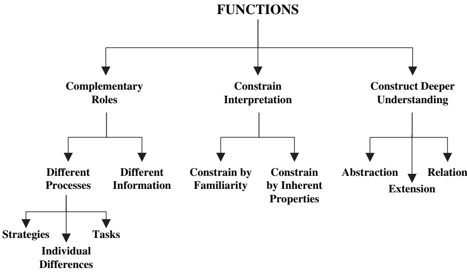

[www.elsevier.com/locate/learninstruc](http://www.elsevier.com/locate/learninstruc)

# DeFT: A conceptual framework for considering learning with multiple representations

Shaaron Ainsworth\*

School of Psychology and Learning Sciences Research Institute, University of Nottingham, University Park, Nottingham, NG7 2RD, UK

## Abstract

Multiple (external) representations can provide unique benefits when people are learning complex new ideas. Unfortunately, many studies have shown this promise is not always achieved. The DeFT (Design, Functions, Tasks) framework for learning with multiple representations integrates research on learning, the cognitive science of representation and constructivist theories of education. It proposes that the effectiveness of multiple representations can best be understood by considering three fundamental aspects of learning: the design parameters that are unique to learning with multiple representations; the functions that multiple representations serve in supporting learning and the cognitive tasks that must be undertaken by a learner interacting with multiple representations. The utility of this framework is proposed to be in identifying a broad range of factors that influence learning, reconciling inconsistent experimental findings, revealing under-explored areas of multi-representational research and pointing forward to potential design heuristics for learning with multiple representations.  2006 Elsevier Ltd. All rights reserved.

Keywords: Multiple representations; Diagrams; Pictures; Multimedia

## 1. Introduction

Research on learning with representations has shown that when learners can interact with an appropriate representation their performance is enhanced. Recently, attention has been focused on learning with more than one representation, seemingly predicated on the notion ‘that two representations are better than one’. Yet, as research on learning with multiple external representations (MERs) has matured, it is increasingly recognised that the issue is not whether MERs are effective but rather concerns the circumstances that influence the effectiveness of MERs (see Goldman, 2003).

The most common approach to considering the effectiveness of representations emphasises the sensory channel and/or the modality of the representations (i.e. either auditory/visual, or textual/pictorial). Two theories that are particularly associated with this approach are the Cognitive Theory of Multimedia Learning (e.g., Mayer, 1997) and Cognitive Load theory (e.g., Sweller, van Merrienboer, & Paas, 1998). They share a focus on the nature of working memory (and its relation to long term memory) with its multiple, modality-specific limited capacity subsystems. Presenting information in multiple modalities is advantageous to learners who actively process such information. Schnotz (2002; Schnotz & Bannert, 2003) focuses not on pictures and text per se, but on depictive (iconic) and descriptive (symbolic) representations. In this approach, mapping happens at the level of mental model construction and what results is not an integrated representation but complementary representations that can communicate with one another.

<small>\* Tel.: þ44 115 9515314; fax: þ44 115 9515324.</small>

<small>E-mail address: [shaaron.ainsworth@nottingham.ac.uk](mailto:shaaron.ainsworth@nottingham.ac.uk)</small>

The purpose of this paper is to present an alternative approach addressing different aspects of learning with representations. Instead of focusing on the form of the representational system, it suggests that there are a number of additional design factors that should be considered. Given its wider scope it is premature to advance design principles. So instead of proposing predictive guidance, it aims to suggest a complementary set of factors that should guide research into the design of effective multi-representational software. Thus, this paper serves as a review of research on MERs, an argument about the importance of acknowledging a wide range of factors that influence learning with MERs and some proposed applications of this approach.

The DeFT (Design, Functions, Tasks) framework suggests that many dimensions combine to influence whether someone will be able to benefit from learning with a particular combination of representations. The dimensions considered in DeFT are the design parameters that are unique to learning with more than one representation, the different pedagogical functions that MERs can play, and the cognitive tasks that must be undertaken by a learner when interacting with MERs. This framework has been developed by reviewing a broad range of current research from a variety of perspectives (e.g., cognitive psychology/science, education, artificial intelligence, and curriculum studies), addressing methodologies such as case studies, experiments and computational modelling, and from empirical work conducted in domains such as mathematics, physics, biology, and alchemy.

Understanding the role played by MERs first requires understanding how external representations influence learning. Consequently, this paper begins by briefly describing the design factors that DeFT addresses before turning to the advantages of employing the right representation (the functions aspect of the framework) and cognitive tasks associated with learning with a single external representation (tasks). Then these same issues are reconsidered addressing learning with multiple representations. The final section reviews how DeFT might be applied to increase understanding of the impact of different designs on learning with MERs.

## 2. Design parameters in DeFT

There are a number of ways to design multi-representational systems that influence the processes and outcomes of learning. Systems differ in their content, in the target users of the system and in the teaching strategies they employ. Often there are specific reasons to use a particular representation. An external representation consists of (1) the represented world, (2) the representing world, (3) what aspects of the represented world are being represented, (4) what aspects of the representing world are doing the modelling and (5) the correspondence between the two worlds (Palmer, 1977). So when considering the effectiveness of a representation both the information provided in the representation (represented world) and the way it is presented (representing world) must be considered. Consequently, designing effective representations is substantial endeavour in its own right. However, there are a set of design dimensions that uniquely apply to multi-representational systems and it is these that are reviewed here: (a) number of representations; (b) the way that information is distributed; (c) form of the representational system; (d) sequence of representations; and (e) support for translation between representations.

Number: Multi-representational systems employ at least two representations, but commonly many more are available, either simultaneously or at some point during a learner’s interaction with a system.

Information: Multi-representational systems allow flexibility in the way that information is distributed over representations, impacting both upon the complexity of each representation and the redundancy of information between representations. At one extreme, each representation can convey completely different content (refer to different represented worlds). In this case, there is no redundancy across representations. Distributing information in this way simplifies each representation but at the cost of requiring additional representations, which learners may then be required to integrate. Systems can also be partially redundant, so that some of the information is constant across (some of) the representations. Finally, each representation can express the same information and so the only difference between representations is in their computational properties (representing worlds).

Form: A typical multi-media system can display pictures, text, animations, sound, equations, and graphs e a key question is whether it should. Much research has focussed on heterogeneous systems e ones that combine text and graphics (Mayer, 1997; Schnotz, 2002) or multi-sensory systems such as written text or pictures presented with spoken narration (Kalyuga, 2000). However, form can refer to many different aspects of representations such as dimensionality, abstraction or dynamism. Consequently, much is still unknown about how the form of a representational system influences learning. Unfortunately, it is not sufficient to consider each type of representation in isolation e representations interact with one another in a form of ‘‘representational chemistry’’. As a result, there is a potentially vast space to explore.

Sequence: If not all representations are drawn upon simultaneously, a number of further issues arise. The first issue is the sequence in which the representations should be presented or constructed and even if this is known, the learner or the system still needs decide at what point to add a new representation or switch between the representations.

Translation: Computerised environments have a wide variety of ways to indicate the relation between representations. Two dimensions have received some attention. Firstly, how active a role the environment plays in supporting learners. Secondly, whether support is provided at the syntactic level or the semantic level (also called surface and deep levels, or representation and domain levels (Seufert & Brünken, 2004).

In the next sections, the pedagogical functions and cognitive tasks associated with learning with one representation and then with multiple representations are considered. Subsequently, these dimensions are reconsidered to examine if considering learning in this way helps designers with these complex decisions.

## 3. Learning with an external representation

## 3.1. The functions of an appropriate representation

There is abundant evidence showing the advantages that external representations play in supporting learning. Much research has shown that matching the type of representation to the learning demands of the situation can significantly improve performance and understanding. Scaife and Rogers (1996) proposed that external representations differ in their advantages for learning by varying the extent to which they support computational offloading, re-representation or graphical constraining. Consequently, combinations of representations can play a number of functions in supporting learning (discussed in detail in Section 5).

Computational offloading is the extent to which different external representations reduce the amount of cognitive effort required to solve equivalent problems. Larkin and Simon (1987) argue that representations that are informationally equivalent still differ in their computational properties. For example, diagrams can exploit perceptual processes by grouping together relevant information so making search and recognition easier.

Re-representation refers to the way that external representations that have the same abstract structure differentially influence problem solving. Zhang and Norman (1994) showed that problem solving with isomorphic versions of the Towers of Hanoi was enhanced when representations externalised more information. By utilizing external perceptual processes rather than cognitive operations, graphical representations can often be more effective.

Graphical constraining describes the limits on the range of inferences that can be made about the represented concept. Stenning and Oberlander (1995) argue that text permits expression of ambiguity in a way that graphics cannot easily accommodate. It is this lack of expressiveness that makes diagrams more effective for solving determinate problems. Schnotz (2002) makes a similar point when emphasising the distinction between descriptive (symbolic) and depictive (iconic) representations. Thus, depictive representations are most useful to provide concrete information and are often efficient as specific information can just be read off. Alternatively, descriptive representations can more easily express abstract information as well as more general negations and disjunctions.

## 3.2. Cognitive tasks involved in learning with an external representations

Unfortunately, the benefits of an appropriate representation do not come for free. Learners are faced with complex learning tasks when they are first presented with a novel representation. They must understand how it encodes information and how it relates to the domain it represents. In addition, learners may need to select an appropriate representation or to construct one for themselves, which can provide advantages but also new cognitive tasks. The following sections describe these cognitive tasks and the problems learners can face in mastering them. It should be noted that although these cognitive tasks are presented in sequence, it is not meant to imply that learners would approach the task of understanding a new representation in this same order.

## 3.2.1. Learners should understand the form of representation

Learners must know how a representation encodes and presents information (the ‘format’). In the case of a graph, the format would be attributes such as lines, labels, and axes. They must also learn what the ‘operators’ are for a given representation. For a graph, operators to be learnt include how to find the gradients of lines, maxima and minima, and intercepts.

A number of studies have shown how complex this is (e.g., Friel, Curcio, & Bright, 2001). Children have difficulty in applying and understanding the format and operators of graphs. They may have trouble with reading and plotting points, interpret intervals as points, or confuse gradients with maxima and minima. Petre and Green (1993) describe some similar effects with adults using a visual interface. Novices lacked proficiency in secondary notation (i.e., perceptual cues that are not described by the formal semantics of a representation) and found navigation of graphica representations difficult as they don’t have the required reading and search strategies.

Additionally, the operators of one representation are often used inappropriately to interpret a different representation e for example, when graphs are interpreted iconically, learners use the operators for pictures (e.g., Leinhardt, Zaslavsky, & Stein, 1990). When learners are given a velocityetime graph of a cyclist travelling over a hill, they should select a U shaped graph, yet many show a preference for graphs with a hill shaped curve. Elby (2000) proposes that in many of these cases learners tend to rely on an intuitive knowledge element, what-you-see-is-what-you-get, and that this is cued by the most compelling visual attribute of a representation (e.g., straight lines mean constancy, hill shape means hill). Learning to interpret a representation can involve learning to ignore this intuition.

## 3.2.2. Learners should understand the relation between the representation and the domain

Interpretation of representations is an inherently contextualised activity (Roth & Bowen, 2001) as learners must also come to understand the relation between the representation and the domain that it represents. This task will be particularly difficult for learning, as opposed to problem solving or professional practise, as this understanding must be forged upon incomplete domain knowledge. Learners need to determine which operators to apply to a representation to retrieve the relevant domain information. For example, when attempting to read the velocity of an object from a distanceetime graph, children often examine the height of line, rather than its gradient (Leinhardt et al., 1990). These problems do not only arise with abstract representations. Boulton-Lewis and Halford (1990) point out that even concrete representation such as Dienes blocks and fingers still need to be mapped to domain knowledge. Processing loads may be too high for children to obtain the anticipated benefits of such apparently simple representations.

## 3.2.3. Learners may need to understand how to select an appropriate representation

In some situations learners select a representation that they find most appropriate, and so they may have to consider factors such as the representation and task characteristics as well as individual preferences. There is evidence that learners can select effective representations. Zacks and Tversky (1999) found that people were successful at choosing bar graphs to represent discrete comparisons between data points and line graphs to depict trends. Novick, Hurley, and Francis (1999) found that students were able to choose which of hierarchical, matrix or network representations was most appropriate to represent the structure of a story problem. diSessa (2004) argues that students often have a deep meta-representational competence which includes their abilities to judge the value of representations along such dimensions as epistemic fidelity, compactness, parsimony, systematicity and conventionality. However, there may well be individual differences in insight into the effectiveness of representations (Roberts, Gilmore, & Wood, 1997). Selecting appropriate representations will be more difficult for novices than experts as they can lack understanding of the deep nature of the tasks they are trying to solve (Chi, Feltovich, & Glaser, 1981). Indeed one characteristic of expertise is the knowledge of what representations are appropriate for what tasks (Kozma & Russell, 1997). One key unsolved issue is how explicitly these skills should be taught; with some researchers arguing that teaching is crucial (McKendree, Small, Stenning, & Conlon, 2002).

## 3.2.4. Learners may need to understand how to construct an appropriate representation

In many situations learners may construct or even invent a representation rather than interpret a presented representation. Indeed, diSessa (2004) argues that learners are often strikingly good at designing their own representations. Furthermore, even if learners construct their representations inaccurately, they sometimes still draw the correct inference even so (Cox & Brna, 1995). There is evidence that creating representations can lead to a better understanding of the situation. Grossen and Carnine (1990) found that children learned to solve logic problems more effectively if they drew their responses to problems rather than selected a pre-drawn diagram. This may in part be due to the support they were provided with during the construction process. Van Meter (2001) found that drawing was most helpful in learning from science texts when students were prompted with guidance questions whilst creating diagrams. However, there is unlikely to be a simple relationship between interpretation and construction of a representation. Cox and Brna gave students reasoning problems which could be solved with Euler diagrams. They found six students made errors in constructing representations but not in interpreting them, and four students made errors in interpreting diagrams but not in constructing them.

## 4. Learning with multiple representations

Early research on learning with MERs concentrated on the ways that presenting pictures alongside text could improve readers’ memory for text comprehension (e.g., Levin, Anglin, & Carney, 1987). In the last two decades, the explosive increase in multi-media learning environments have widened the debate to include combinations of representations such as diagrams, equations, tables, text, graphs, animations, sound, video, and dynamic simulations. Furthermore, a number of influential educational theories discuss the importance of MERs. For example, Dienes (1973) argues that perceptual variability (the same concepts represented in varying ways) provides learners with the opportunity to build abstractions about mathematical concepts. In cognitive flexibility theory, the ability to construct and switch between multiple perspectives of a domain is fundamental to successful learning (Spiro & Jehng, 1990). Research on analogical reasoning shows how comparison processes help people make new inferences (Gentner & Markman, 1997). However, research on the benefits of providing learners with more than one representation has produced mixed results. For example, a number of studies have found that learners benefit from MERs (e.g., Cox & Brna, 1995; Mayer & Sims, 1994; Tabachneck, Koedinger, & Nathan, 1994), but unfortunately, just as many studies fail to find these benefits (e.g., Chandler & Sweller, 1992; Van Someren, Reimann, Boshuizen, & de Jong, 1998).

In the next sections, the benefits that MERs can bring to learning situations are reviewed. The functions aspect of the DeFT framework proposes that there are many advantages of MERs and that these should be clearly identified as they often have different design implications. These functions of MERs are only possible if learners master the cognitive tasks associated with their use. Learning to use MERs requires learners to understand each individual representation. This is a complex process in its own right (see Section 3.2). But, in addition, when interacting with MERs, learners must often understand the relationship between representations and many studies have shown that learners tend to treat representations in isolation and find it difficult to integrate information from more than one source.

Fig. 1. A functional taxonomy of multiple representations.

## 5. Functions

Ainsworth (1999) suggest there are three key functions of MERs: to complement, constrain and construct (see Fig. 1).

## 5.1. Complementary functions

When MERs complement each other they do so because they differ either in the processes each supports or in the information each contains. By combining representations that differ in these ways, it is hoped that learners will benefit from the advantages of each of the individual representations.

## 5.1.1. Complementary processes

Representations that theoretically contain the same information still differ in their advantages for learning in certain situations due to the extent to which they support computational offloading, re-representation or graphical constraining. Consequently, by providing MERs complementary processes can be supported. This can be advantageous for a number of reasons.

Individual differences: Theorists following a learning styles approach argue that if learners are presented with a choice of representations, they can choose to work with the representation that best suits their needs (e.g., Dunn & Dunn, 1993). There is limited evidence that this can improve learning. For example, Plass, Chun, Mayer, and Leutner (1998) found that students comprehended a story in a second language better when they had the opportunity to receive their preferred mode of annotation (visual/verbal/both). However, the assumption that ‘visualisers’ will necessarily do better with visual representations is not always warranted (Coffield, Moseley, Hall, & Ecclestone, 2004; Klein, 2003; Roberts et al., 1997). Alternative accounts of the individual differences effect emphasise differing expertise with the subject studied or with the representations. For example, Stenning, Cox, and Oberlander (1995) found that high performing students benefited from graphical instruction of logic but lower performing students performed better when given traditional textual instructions. ChanLin (2001) found novices learning physics benefited from the use of still graphics rather than text but found no differences between formats for experienced students.

Task: Performance is most likely to be facilitated when the structure of information required by the problem matches the form provided by the representational notation (Gilmore & Green, 1984). Learners given MERs can benefit from choosing the best representation for the current task. For example, Tapiero (2001) found that when subjects were given textual descriptions of a city, they performed spatial judgement tasks more accurately than those given a map of the city. However, when presented with a transfer task of a map of a modified city, the reverse was true e map subjects performed better than text subjects.

Strategy: Different forms of representation can encourage learners to use more or less effective strategies (Ainsworth & Loizou, 2003). MERs encourage learners to try more than one strategy to solve a problem. Tabachneck et al. (1994) examined the representations that learners created to solve algebra word problems and found that each representation was associated with a different strategy. The use of MERs and hence multiple strategies was about twice as effective as any strategy used alone. As each strategy had inherent weaknesses, switching between strategies made problem solving more successful by compensating for this.

## 5.1.2. Complementary information

Multiple representations are used to provide complementary information when each representation in the system contains (some) different information. This may occur if a single representation would be very complicated if it pre-sented all the information or if the information is on radically different scales.

## 5.2. Constraining functions

A second advantage of using MERs is that certain combinations of representations can help learning when one representation constrains interpretation of a second representation. This can be achieved in two ways. Firstly, learners familiarity with one representation can constrain interpretation of a less familiar one. For example, concrete animations are often employed in simulations alongside complex and unfamiliar representations such as graphs. Secondly, these constraints can be achieved by taking advantages of inherent properties of representations. Graphical representations are generally more specific than textual representations (Stenning & Oberlander, 1995). The phrase ‘the cat is by the dog’, is ambiguous about which side of the dog the cat is sitting, but in a picture, the cat must be either on the left or the right of the dog. So, when these two representations are presented together, interpretation of the first (ambiguous) representation may be constrained by the second (specific) representation. Depictions can perform this same role for descriptions (Schnotz, 2002).

## 5.3. Constructing functions

Multiple representations support the construction of deeper understanding when learners integrate information from MERs to achieve insight that would be difficult to achieve with only a single representation. Furthermore, insight achieved in this way increases the likelihood that it will be transferred to new situations (Bransford & Schwartz, 1999).

Abstraction is the process by which learners create mental entities that serve as the basis for new procedures and concepts at a higher level of organization. Learners can construct references across MERs that then expose the underlying structure of the domain represented. Schwartz (1995) showed that the representations that emerge with collaborating peers are more abstract than those created by individuals e abstracted representation may emerge as a consequence of requiring a single representation that could bridge both individuals’ representations.

Extension can be considered as a way of extending knowledge that a learner has from a known to an unknown to representation, but without fundamentally reorganizing the nature of that knowledge. For example, learners may know how to interpret a velocityetime graph in order to determine whether a body is accelerating. They can subsequently extend their knowledge to such representations as tables or accelerationetime graphs.

Relational understanding is the process by which two representations are associated again without reorganization of knowledge. The goal of teaching relation between representations can sometimes be an end in itself. For example, much mathematical education concerns how to construct a graph given an equation. On other occasions, it may serve as the basis for abstraction.

It should also be noted that the functions that representations serve often depend upon learners’ knowledge and goals not system designer’s intent. For example, one learner may be familiar with tables and extend his or her knowledge to graphs (extension), another may already be familiar with both but not have considered their relationship (relation). The differences between these functions of MERs are subtle and all may be present at some stage in the life cycle of encouraging deeper understanding with a multi-representational environment.

## 5.4. Functions summary

MERs can play many advantageous roles in learning complex material and these different roles fall into three distinct categories. However, the picture is complicated by the need to acknowledge that MERs can support more than one of these roles simultaneously. For example, Ainsworth, Wood, and O’Malley (1998) found that a combination of table and place-value representations in a primary maths environment provided different information and supported complementary processes, constrained interpretation in two alternative ways and might also have supported abstraction.

## 6. Cognitive task: learners may need to understand how to relate representations

Many of the proposed benefits of MERs result from the integration and coordination of more than one source of information and a characteristic of expertise is the ability to integrate different representational formats. Unfortunately, a very large number of studies have observed that learners find translating between representations difficult (e.g., Anzai, 1991; Schoenfeld, Smith, & Arcavi, 1993). Learners can fail to notice regularities and discrepancies between representations (Dufour-Janvier, Bednarz, & Belanger, 1987) and in the worst cases this can even completely inhibit learning. Ainsworth, Bibby, and Wood (2002) compared children learning estimation with two representations, either mathematical, pictorial or a mixed system of one pictorial and mathematical representation. They showed that whilst pictorial and mathematical representations helped learning, the combination of pictorial with mathematical representations inhibited learning of the task. It was possible to isolate the problem as resulting from relating representations. Each representation in the mixed system was present in either mathematical or pictorial systems where it was used successfully, so it is known that learners could understand the form of representations and their relation to domain, just not how they relate to each other.

Teaching learners to coordinate MERs has also been found to be a far from trivial activity. Yerushalmy (1991) provided students with an intensive three-month course with multi-representational software that taught functions. In total, only 12% of students gave answers that involved both visual and numerical considerations and those who used two representations were just as error prone as those who used a single representation. Resnick and Omanson (1987) gave children instructions about the correspondence between Dienes blocks and written numerals to help them master the symbolic subtraction procedures. They were disappointed by how little children referred to the blocks and found, for the most part, they were not helpful.

Consequently, it is important to understand the factors that influence the difficulty of relating representations. Here the characteristics of the representations and characteristics of the learner are considered.

## 6.1. Representation characteristics

A reasonable heuristic for considering how the representational system will impact upon how learners integrate information from multiple sources is to suggest that the more the formats of the representations and the operators that act upon them differ, the more difficult it will be for learners to translate between them. There are a number of dimensions that are likely to maximise these differences between representations.

The sensory channel of the representation: A common combination of representations is one that combines an auditory with a visual representation. A number of researchers working in the cognitive tradition (e.g., Kalyuga, 2000; Mayer, 1997) propose that referential connections between these types of representations are facilitated because combining both auditory and visual stimuli take maximum advantage of short-term memory and so facilitate translation between representations. However, Gyselinck, Ehrlich, Cornoldi, de Beni, and Dubois (2000) show that visuale spatial working memory can still be heavily loaded in such situations.

The modality of the representations: A heterogeneous system is one that contains both a text based representation and a graphical/diagrammatic representation. These representations are known to have very different computational proprieties (Larkin & Simon, 1987) and some researchers also consider them to be processed separately in the brain (e.g., Mayer, 1997; Tabachneck-Schijf, Leonardo, & Simon, 1997). Learners may find it difficult to see the relationship between such different forms of representation.

The level of abstraction: Peirce (1906) distinguishes between a symbol, which has an arbitrary structure (a description in Schnotz’s terminology), and an icon (depiction) that does not. Bruner (1966) adds an extra mode, enactive, to represent events through motor responses. Purchase (1998) further adapts Bruner’s scheme by dividing the iconic category in two: concreteeiconic, which has a direct perceptual relationship to the object, and abstracteiconic, which has a related but non-direct relation. Blackwell and Engelhardt (1998) identify eight schemes that consider level of abstraction. There seems little agreement about the granularity of the dimension but its importance is widely recognised.

The specificity of representations: Specificity determines the extent to which a representation permits expression of abstraction (Stenning & Oberlander, 1995). Learners will interpret and act upon representations of different levels of specificity in unlike ways, so they may find integrating information across representations that differ in specificity more difficult.

The type of representation (e.g., histogram, equation, table, line graph, narrative text, picture): There are many schemes proposed for categorising representations into different types (e.g., Cox & Brna, 1995; Lohse, Biolsi, Walker, & Rueler, 1994). For example, Lohse et al. identified 11 major clusters: graphs, numerical and graphical tables, time charts, cartograms, icons, pictures, networks, structure diagrams, process diagrams and map clusters. These taxonomies have been created by a variety of methods (e.g., intuition, analysis of domain properties and card sorts) and although there is some overlap between the taxonomies, no one classification is universally accepted. They differ in the domains addressed, the granularity with which representations were described and the task for which they were created.

Integrated presentations of representations: When presenting textual and graphical representations learners find it easy to understand physically integrated material rather than separately presented material (Chandler & Sweller, 1992).

Whether representations are static or dynamic: Dynamic representations such as animations, dynamic graphs and spoken text require different operators to interpret them and have different formats than their static equivalents and consequently learners draw different inferences from pictures and animations (Jones, 1998; Lowe, 2003). Thus, representational systems that combine static and dynamic representations may be particularly complex. Furthermore, different types of dynamic representations also have different format and operators (Ainsworth & Van Labeke, 2004).

Dimensionality: With the mounting availability of virtual reality and other visualisation tools, learners are increasingly being placed in situations where they must integrate information from both two-dimensional and threedimensional representations. There is evidence that learners can fail to build such links easily (Moher, Johnson, Ohlsson, & Gillingham, 1999).

## 6.2. Individual characteristics

How well individuals cope with the relating different representations is likely to depend upon a number of learner characteristics. Probable candidates include familiarity with the representations and domain, age and cognitive style.

Representational familiarity: If learners are already familiar with the representations, then they should understand (to some degree) the format and operators of representation and the relation between the representations and the domain. The lower the learning demands are on other parts of the task, the more resource for translating between representations should be available. Furthermore, if learners are less likely to misinterpret the representations, this should enhance the possibility of recognising the similarity between them.

Domain familiarity: Generally, novices tend to characterise problem representations by their surface features, not their deep structure (Chi et al., 1981). Therefore, as learners generally lack expertise either in the domain or in the representations they are using, they are likely to be hampered in recognising deep structural relations between representations due to their surface dissimilarity. This lack of domain knowledge interferes with their ability to transfer knowledge across representations appropriately (Stern, Aprea, & Ebner, 2003).

Age: A learner’s age may also affect his or her abilities to translate between representations. Often children’s performance can be seen as characteristic of novices in a domain. Nevertheless, there are likely to be developmental factors that affect integration of MERs. Moore and Scevak (1997) found developmental differences in children’s use of text and accompanying visual aids with explicit linking of text and visual aid by older students that was not as evident in the younger students. A number of researchers have proposed that information-processing capacity such as shortterm memory span or processing speed increases with age (e.g., Case, 1985). For example, Halford (1993) defines dimensionality as the number of independent items of information that must be processed in parallel. He proposed that it is not until children reach 11 years of age that they can process four-dimensional structures. If MERs exceed this capacity then children would need to re-represent the problem, for example, by chunking. This suggests that younger children would require considerable experience with the representations in order to relate them successfully.

Individual differences: There has been much research relating both personality and cognitive factors to learning with external representations (see Section 5.1.1). There is less research into aptitudeetreatment interactions and MERs. An exception is that of Oberlander, Cox, Monaghan, Stenning, and Tobin (1996). They suggest that a distinguishing characteristic of people who were classified as diagrammatic reasoners was their ability to translate information across representations more successfully.

## 6.3. Representation and individual characteristics

These two levels come together in the way that individual factors and representation factors influence the strategies that learners use. Using MERs can encourage learners to try different strategies (e.g., Tabachneck et al., 1994; Watson, Campbell, & Collis, 1993). This is often advantageous as by switching between representations learners can compensate for weaknesses in their strategy. However, if learners are attempting to relate different representations, then this may provide a source of difficulty. Ainsworth et al. (2002) hypothesised that one of the reasons why learners did not integrate information across pictorial and mathematical representations is that the pictorial representation encouraged the development of a perceptual strategy and the mathematical one encouraged the generation of a rule based upon symbol manipulation.

## 7. Applying DeFT to explore different designs

In Section 2, the (implicit or explicit) design parameters of multi-representational software were identified. In this section, I return to these parameters to explore if considering the functions and cognitive tasks of learning with MERs can help someone make these design decisions. It is fair to say that at this stage DeFT raises far more questions than it answers. However, it may still be useful if it helps to identify those aspects of multi-representational design that are under-explored. DeFT may also encourage researchers to describe in more detail the design parameters of their systems and the pedagogical functions they intend to their systems to play. Although, research might initially be considered as addressing one question (e.g., simultaneous versus sequential presentation), other researchers interested in alternative questions (e.g., redundancy) are often unable to draw conclusions about their interests if this aspect of the system is not described.

## 7.1. Number

Given the research reviewed on the cognitive tasks associated with adding representations to a system, it seems wise to use the minimum number of representations consistent with the pedagogical function of the system. In many cases it may not be appropriate to use MERs at all, since one representation may be sufficient and will minimise the split attention affect. However, there are many circumstances where MERs are appropriate. The decision about the number of representations often depends upon the informational (Section 7.2) and computational (Section 7.3) properties of the desired representational system.

## 7.2. Information

Information can be distributed in multiple ways over MERs which may simplify individual representations and impact upon the redundancy of the representational system. Consequently, there may be a way of distributing information that best supports learning (for a particular task and a particular type of learner). One possibility is that it is easier to learn complex ideas when each part is represented separately in a simpler representation. Alternatively, it may be easier to learn from complex representation(s) as all the information is presented together.

Kalyuga, Chandler, and Sweller (1998) report a number of studies that showed that less experienced learners benefit from redundant text but for those with more experience adding text interfered with performance with a diagram. Learners who can benefit from a diagram in isolation do not need text and so eliminating it reduces cognitive load. This suggests that redundancy should be reduced as expertise grows. However, Ainsworth, Bibby, and Wood (1997) gave students two representations to describe their performance on computational estimation tasks e these were either non-redundant where each representation provides one dimension of information each or completely redundant with both representations displaying two dimensions of information. They found that learners given non-redundant representations understood aspects of estimation accuracy faster than those given fully redundant representations. Examining the apparent contradiction between these experiments, it seems likely that the conflicting results are due to different functions of the MERs. The text in Kalyuga et al.’s studies seems to have been used by novices to constrain interpretation of an unfamiliar diagram, whereas in Ainsworth et al.’s study, the representations were used to complement each other.

Furthermore, the impact of the way that information is distributed may be modified by the form of the representation. Ainsworth and Peevers (2003) examined the interaction between the form (tables, diagrams or text) and number (four simple or one complex one) of representations. Participants were provided with instructions about how to operate a complex device using these representations. Problem-solving based on tables or diagrams was equally effective with one complex or four simple representations. However, those participants given a single text spent much longer studying representations than those who saw four texts, but were also more likely to find the ideal solution to the task.

It is apparent that whilst one of the advantages of using MERs is that information can be distributed to simplify individual representations, little research has directly addressed that question. Most of the experimentation holds informational equivalence across representations constant in order to explore computational non-equivalence. Furthermore, describing the information in a representation is problematic as information differs in how explicitly it is represented (Kirsh, 1991). One possibility is to base it on a theoretical description assuming a perfect information processor with unlimited resources and knowledge. However, people are not perfect information processors, and they differ in their background knowledge, skills, and cognitive capacities. More research is needed to explore these issues.

## 7.3. Form

This aspect of designing for effective learning has received the most attention and there is consistent evidence that differences in the form of representational systems strongly impact upon learning processes and outcomes. However, the majority of research has concentrated on modality and sensory aspects of representations. This focus has meant that other forms of representational system remained significantly under-explored (Reimann, 2003) and one role that DeFT can play is to draw attention to that fact. Furthermore, a number of studies have found contradictions in the apparent usefulness of specific combinations of representations. For example, whether simultaneous presentation of written and spoken text is beneficial (e.g., Kalyuga, 2000; Mayer & Sims, 1994). From a DeFT perspective, one key reason for these differences is that MERs play different pedagogical functions. If MERs are used to support different computational properties and one of the representations is not needed by the learner, then simultaneous presentation of both representations it is not likely to aid learning. However, this is not the case if the first representation is needed to constrain understanding of the second representation or if both representations are needed to encourage deeper understanding. One strong prediction of DeFT, which requires empirical validation, is that different design principles will apply for different pedagogical functions (see Section 8).

## 7.4. Sequence

The approaches to deciding upon a sequence of representations can be placed on a continuum ranging from domain-specific to domain-general. Some researchers start with an analysis of the properties of the domain to be taught in order to identify any representational consequences. Only in the absence of any particular constraints arising from this domain analysis are more general representational factors considered. Alternatively, a representational perspective can be taken that favours a domain-general approach.

An example of a domain-specific approach can be seen in MathsCar, a multi-representational system to teach introductory calculus (Kaput, 1994). Kaput argues that when teaching calculus, introducing integration before differentiation best supports understanding and so velocityetime graphs should be introduced before positionetime graphs. At a mid-point on the continuum lies the approach of Plötzner (1995), who analyses one-dimensional motion in classical physics problems to argue that qualitative knowledge should be taught before quantitative knowledge and consequently qualitative representations should be introduced before quantitative ones. Evidence for this proposal is provided by a cognitive model and by the performance of collaborating pairs taught with different sequences of qualitative and quantitative representations (Plötzner, Fehse, Kneser, & Spada, 1999).

At the other end of the continuum, a more domain-general approach can be seen in Kulhavy’s model of text learning with organized spatial displays, which suggests that graphical representations should precede text. Verdi, Johnson, Stock, Kulhavy, and Whitman (1997) showed that learners presented with a visual display before related text recalled significantly more information than when presented with text and then the visual display. Another domain-general approach is to introduce representations in such a way as to increase their abstraction. For example, COPPERS (Ainsworth et al., 1998) presents coin problems to children first as pictures but then through increasingly abstract representations such as mixed text and pictures and then text only and finally as algebra. This approach can be seen in many systems, but its validity has rarely been evaluated. It does seem reasonable to start by offering learners the least complex available representations. This may be the most concrete/least expressive representation that the increasing abstraction route suggests. However, in some situations, concrete and realistic representations can actually be more complex for learners (Lowe, 2003).

The question of whether learners make strategic decisions about when to change a representation or introduce a new one has been addressed by Cox and Brna (1995) who allow users to move at will between their self-created representations. They found mixed success with some learners switching effectively but others choosing new representations which did not help them move nearer the goal. Another possibility is that learners should switch when they have exhausted all of the information available in the representation they are currently using. For example, Graphs and

Tracks (Trowbridge, 1989) suggest that users should switch from a velocityetime to a distanceetime graph in order to gain information about the represented object’s starting position.

Alternatively, the system may take responsibility for determining when to change the representation. In this case, the task for the system is to determine when users have learnt all they can about the domain with the given representations, but not switch so soon (or so often) that the learning demands of the new representations overburden the user. Unfortunately, as Resnick and Omanson (1987) observe, it is possible to introduce new representations too late. In their study of children learning to subtract using the standard written symbols, Dienes blocks were introduced to help children understand this task in a more conceptual way. The researchers were disappointed by how little children referred to the blocks and suggest that once children had reached automated performance with symbolic manipulation, it does not easily allow for application of principled knowledge. This suggests that a new representation should be introduced before learners have achieved automated performance with an existing representation. This raises the question of what aspects of learners’ behaviour would need to be captured by a system and interpreted in a student model to be able to switch representations appropriately.

It is apparent that there are many questions about sequencing representations, but that few of them have comprehensive answers. Deciding on a specific order of representations will almost always require a domain analysis, which could be supplemented with general representational principles. However, decisions about when to switch representations have received little attention and await systematic experimentation.

## 7.5. Translation

Computers can automatically support translation between representations and have variety of ways to indicate the connection between representations. Learning environments differ in how actively they support learning and whether this support is provided at the syntactic level or the semantic level.

The least active way that environments (computational or not) provide support for relating representations is in the use of implicit cues. For example, the relation between representations is easier to identify if they have consistent labels. Dufour-Janvier et al. (1987) suggest that children have a tendency to recognise that two representations concern the same problem only when they contain the same numbers. Other cues include using the same colours to represent the same objects over different representations.

More active support is seen when learners can select part of a first representation and see how this corresponds to a second representation. For example, in Brünken, Plass, and Leutner (2003) learners can click on a hyperlink and arrows point to equivalent part of an accompanying picture.

Sometimes, learners act on one representation and see the results of those actions in another. This is commonly referred to as dyna-linking. For example, graphical calculators present dyna-linked algebraic expressions and graphs. Dynamic linking of representations is assumed to reduce the cognitive load upon the student e as the computer performs translation activities, students are freed to concentrate upon their actions on representations and their consequences in other representations. Kaput (1992) argues that this is particularly beneficial when the representations involved are expressing actions sequences rather than just final outcomes as previous research has shown just how difficult this task is for learners. However, direct empirical support for the benefits of dyna-linking is not easy to find. For example, van der Meij and de Jong (2003) found no difference in learning between separate and dyna-linked representations.

Finally, some systems require learners to actively integrate representations and monitor students’ success in so doing. Bodemer, Ploetzner, Feuerlein, and Spada (2004) gave learners spatially separated pictorial and symbolic representations of statistics concepts and asked them to drag the symbols and dropping them within the pictures. Compared to split source or integrated representations, learners did better when required to integrate representations.

Only a few systems can vary the amount of help for relating representations that they offer to learners. However, this is probably the ideal. For example, there are reasons to hesitate about the invariable dynamically linking of representations. If we aim to encourage users to understand the mapping between representations, then we may be in danger of over-automating the process. This over-automation may not encourage users to reflect upon the nature of the connection and could in turn lead learners to fail to construct the required deep understanding. Alternatively, dyna-linking may encourage learners to attempt to relate concepts that are beyond their level of understanding. Seufert (2003) provides support for varying the amount of support according to a learner’s expertise. She found that high prior knowledge learners did not benefit from help relating representations, as presumably they could make these links for themselves. Low prior knowledge students also did not benefit because they became overwhelmed. It was only learners with an intermediate level of prior knowledge who benefited from this help.

The level at which help is provided has received less direct research. Seufert provided help at a deeper level whereas most other researches (particular with computers) have used more surface strategies. Van Labeke and Ainsworth (2003) report a case study of three learners working with complex multi-representational software for up to 8 h and found that they differed in their strategy for relating representations. One learner without relevant background knowledge used dyna-linking to support his surface level strategy for relating representations, whereas the two learners with more background knowledge used dyna-linking less and attempted to relate representations using deeper structural features. Consequently, it may be the case that both the degree of support and the level at which this help is provided should vary depending on learners’ expertise.

## 8. Design heuristics

One key purpose of DeFT is to help delimitate the complex demands faced by learners when interacting with MERs. It adds to the substantial literature on cognitive load accounts of learning with MERs (e.g., Kalyuga, Chandler, & Sweller, 1999; Kirschner, 2002; Mayer & Moreno, 2002) by identifying factors that add to cognitive load in these situations. Thus, it can help explain the intermittent success of learning with MERs by examining which cognitive tasks learners mastered and which they did not. In addition, by emphasising the pedagogical functions of MERs and their implications for the cognitive tasks associated with MERs, DeFT provides an alternative way to consider how multi-representational systems might be designed to support learning. These proposals should be read as heuristics for guiding experimentation not as cast-in-stone principles.

When MERs are used to support complementary functions, learners need to understand each representation in isolation, how to select appropriate representations but need not understand the relation between them. The main design consideration therefore becomes one of selecting appropriate representations for the situation and the learners, rather than supporting learners in mastering the complex task of relating representations. Consequently, systems could provide dyna-linked representations and/or minimise co-presence of representations as learners often attempt to translate between co-present representations even if they do not need to do so to achieve the task.

When MERs are used to constrain interpretation it is imperative that the learner understands the constraining representation. Thus, using concrete representations with simple format and operators is ideal. But, in addition and in contrast to the first use of MERs, designers need also to ensure that learners understand how the constraining representation relates to the constrained representation. Consequently, a way must be found to signal the mapping between representations without over-burdening learners by making translation complex. DeFT predicts that these representations should be co-present. Factors that increase the perceived similarity between representations should be applied, as could dyna-linking where appropriate.

The third function is when MERs are designed to allow learners to construct a deeper understanding of a domain. This goal provides designers with hard choices. If users fail to translate across representations, then abstraction and extension cannot occur. Learners find it difficult to translate over-representations that are superficially dissimilar, but if made too easy, for example, by providing representations that do not provide sufficiently different views on a domain, then abstraction of invariances does not occur. However, if the system performs all the translation activities for students, then students are not afforded the opportunity to actively construct this knowledge for themselves. Approaches such as those of Bodemer et al. (2004) may provide one solution to this issue. Although little research has addressed the way that that information distribution influences translation, Ainsworth et al. (1997) found tentative evidence that increasing the redundancy of information between (simple) representations increased learners’ abilities to reconcile representations that differ in format. In addition, to maximise opportunities for learners to build cognitive links over representations, then representations should be co-present. Although, much is still left to uncover, researchers are beginning to specify the factors that encourage or discourage deeper understanding with multiple representations.

## 9. Conclusion

This paper has illustrated the DeFT framework that describes some of the important aspects of learning with MERs. It clarifies the pedagogical functions that MERs serve, the often-complex learning demands that are associated with their use and in so doing aims to consider the ways that different designs of multi-representational systems impact upon the process of learning. It is hoped that DeFT will prove to be helpful to other researchers analysing learning with MERs by highlighting areas of study that are relatively under-investigated, providing an explanation for apparently opposing findings, offering a common language for describing aspects of system design allowing generalisations across studies to be more easily achieved and ultimately aiding in the development of design heuristics and principles for learning with more than one representation.

## Acknowledgments

A number of people have helped shape the ideas presented in this paper. My thanks to the members of the ESF-LHM taskforce on multiple representations, members of the ‘‘Learning from Multiple Representations’’ symposium at the 9th EARLI conference, Pete Bibby, Martin Oliver, Mike Scaife, Tina Seufert, as well as three anonymous reviewers.

## References

Ainsworth, S. (1999). The functions of multiple representations. Computers and Education, 33(2e3), 131e152.

Ainsworth, S., Bibby, P., & Wood, D. (2002). Examining the effects of different multiple representational systems in learning primary mathematics. Journal of the Learning Sciences, 11(1), 25e61.

Ainsworth, S., Bibby, P.A., & Wood, D.J. (1997). Evaluating principles for multi-representational learning environments. Paper presented at the 7th European conference for Research on Learning and Instruction, 1997, August, Athens.

Ainsworth, S. E., & Loizou, A. T. (2003). The effects of self-explaining when learning with text or diagrams. Cognitive Science, 27(4), 669e681.

Ainsworth, S. E., & Peevers, G. J. (2003). The interaction between informational and computational properties of external representations on problem-solving and learning. In R. Altmann, & D. Kirsch (Eds.), Proceedings of 25th annual conference of the Cognitive Science Society, 2003, August, Mahwah, New Jersey: LEA.

Ainsworth, S. E., & Van Labeke, N. (2004). Multiple forms of dynamic representation. Learning and Instruction, 14(3), 241e255.

Ainsworth, S. E., Wood, D., & O’Malley, C. (1998). There is more than one way to solve a problem: Evaluating a learning environment that supports the development of children’s multiplication skills. Learning and Instruction, 8(2), 141e157.

Anzai, Y. (1991). Learning and use of representations for physics expertise. In K. Anders-Ericsson, & J. Smith (Eds.), Towards a general theory of expertise: Prospects and limits. Cambridge: Cambridge University Press.

Blackwell, A.F., & Engelhardt, Y. (1998). A taxonomy of diagram taxonomies. Paper presented at the Thinking with diagrams, 1998, August, Aberystwyth.

Bodemer, D., Ploetzner, R., Feuerlein, I., & Spada, H. (2004). The active integration of information during learning with dynamic and interactive visualisations. Learning and Instruction, 14(3), 325e341.

Boulton-Lewis, G.M., & Halford, G.S. (1990). An analysis of the value and limitation of mathematical representations used by teachers and young children. Paper presented at the 14th international conference for the Psychology of Mathematics Education, 1990, July.

Bransford, J. D., & Schwartz, D. L. (1999). Rethinking transfer: A simple proposal with multiple implications. Review of Research in Education, 24, 61e100.

Bruner, J. (1966). Towards a theory of instruction. New York: W.W. Norwood & Company.

Brünken, R., Plass, J., & Leutner, D. (2003). How instruction guides attention in multimedia learning. In H. Niegemann, R. Brünken, & D. Leutner (Eds.), Instructional design for multimedia learning. Proceedings of the EARLI SIG 6 Biannual Workshop 2002, Erfurt.

Case, R. (1985). Intellectual development. Orlando, FL: Academic Press.

Chandler, P., & Sweller, J. (1992). The split-attention effect as a factor in the design of instruction. British Journal of Educational Psychology, 62(2), 233e246.

ChanLin, L. (2001). Effects of formats and prior knowledge on learning in a computer-based lesson. Journal of Computer Assisted Learning, 17(4), 409e419.

Chi, M. T. H., Feltovich, P. J., & Glaser, R. (1981). Categorization and representation in physics problems by experts and novices. Cognitive Science, 5(2), 121e152.

Coffield, F., Moseley, D., Hall, E., & Ecclestone, K. (2004). Learning styles and pedagogy in post-16 learning: A systematic and critical review. Learning and Skills Research Centre. Retrieved May 8, 2004. <[http://www.lsda.org.uk/pubs/dbaseout/download.asp?code](http://www.lsda.org.uk/pubs/dbaseout/download.asp?code=1543)¼[1543](http://www.lsda.org.uk/pubs/dbaseout/download.asp?code=1543)>.

Cox, R., & Brna, P. (1995). Supporting the use of external representations in problem solving: The need for flexible learning environments. Journal of Artificial Intelligence in Education, 6(2/3), 239e302.

Dienes, Z. (1973). The six stages in the process of learning mathematics. Slough, UK: NFEReNelson.

Dufour-Janvier, B., Bednarz, N., & Belanger, M. (1987). Pedagogical considerations concerning the problem of representation. In C. Janvier (Ed.), Problems of representation in the teaching and learning of mathematics. Hillsdale, NJ: LEA.

Dunn, R., & Dunn, K. (1993). Teaching secondary students through their individual learning styles: Practical approaches for grades 7e12. Boston: Allyn & Bacon.

Elby, A. (2000). What students’ learning of representations tells us about constructivism. Journal of Mathematical Behavior, 19(4), 481e502.

Friel, S. N., Curcio, F. R., & Bright, G. W. (2001). Making sense of graphs: Critical factors influencing comprehension and instructional implications. Journal for Research in Mathematics Education, 32(2), 124e158.

Gentner, D., & Markman, A. B. (1997). Structure mapping in analogy and similarity. American Psychologist, 52(1), 45e56.

Gilmore, D. J., & Green, T. R. G. (1984). Comprehension and recall of miniature programs. International Journal of ManeMachine Studies, 21(1), 31e48.

Goldman, S. R. (2003). Learning in complex domains: When and why do multiple representations help? Learning and Instruction, 13(2), 239e244.

Grossen, B., & Carnine, D. (1990). Diagramming a logic strategy e Effects on difficult problem types and transfer. Learning Disability Quarterly, 13(3), 168e182.

Gyselinck, V., Ehrlich, M. F., Cornoldi, C., de Beni, R., & Dubois, V. (2000). Visuospatial working memory in learning from multimedia systems. Journal of Computer Assisted Learning, 16(2), 166e176.

Halford, G. S. (1993). Children’s understanding: The development of mental models. Hillsdale, NJ: LEA.

Jones, S. (1998). Diagram representation: a comparison of animated and static formats. Unpublished PhD thesis, School of Computing and Cognitive Sciences, University of Sussex, UK.

Kalyuga, S. (2000). When using sound with a text or picture is not beneficial for learning. Australian Journal of Educational Technology, 16(2), 161e172.

Kalyuga, S., Chandler, P., & Sweller, J. (1998). Levels of expertise and instructional design. Human Factors, 40(1), 1e17.

Kalyuga, S., Chandler, P., & Sweller, J. (1999). Managing split-attention and redundancy in multimedia instruction. Applied Cognitive Psychology, 13(4), 351e371.

Kaput, J. (1994). Democratizing access to calculus: New routes using old roots. In A. Schoenfeld (Ed.), Mathematical thinking and problem solving (pp. 77e156). Hillsdale, NJ: LEA.

Kaput, J. J. (1992). Technology and mathematics education. In D. A. Grouws (Ed.), Handbook of teaching and learning mathematics. New York: Macmillan.

Kirschner, P. A. (2002). Cognitive load theory: Implications of cognitive load theory on the design of learning. Learning and Instruction, 12(1), 1e10.

Kirsh, D. (1991). When is information explicitly represented. In P. P. Hanson (Ed.), Information, language and cognition (pp. 340e365). New York: OUP.

Klein, P. D. (2003). Rethinking the multiplicity of cognitive resources and curricular representations: Alternatives to ‘learning styles’ and ‘multiple intelligences’. Journal of Curriculum Studies, 35(1), 45e81.

Kozma, R. B., & Russell, J. (1997). Multimedia and understanding: Expert and novice responses to different representations of chemical phenomena. Journal of Research in Science Teaching, 34(9), 949e968.

Larkin, J. H., & Simon, H. A. (1987). Why a diagram is (sometimes) worth ten thousand words. Cognitive Science, 11(1), 65e99.

Leinhardt, G., Zaslavsky, O., & Stein, M. M. (1990). Functions, graphs, and graphing: Tasks, learning and teaching. Review of Educational Research, 60, 1e64.

Levin, J. R., Anglin, G. J., & Carney, R. N. (1987). On empirically validating functions of pictures in prose. In D. M. Willows, & H. A. Houghton (Eds.), The psychology of illustration: I. Basic research (pp. 51e85). New York: Springer.

Lohse, G. L., Biolsi, K., Walker, N., & Rueler, H. (1994). A classification of visual representations. Communications of the A.C.M., 37(12), 36e49.

Lowe, R. K. (2003). Animation and learning: Selective processing of information in dynamic graphics. Learning and Instruction, 13(2), 157e176.

Mayer, R. E. (1997). Multimedia learning: Are we asking the right questions? Educational Psychologist, 32(1), 1e19.

Mayer, R. E., & Moreno, R. (2002). Aids to computer-based multimedia learning. Learning and Instruction, 12(1), 107e119.

Mayer, R. E., & Sims, V. K. (1994). For whom is a picture worth 1000 words e Extensions of a dual-coding theory of multimedia learning. Journal of Educational Psychology, 86(3), 389e401.

McKendree, J., Small, C., Stenning, K., & Conlon, T. (2002). The role of representation in teaching and learning critical thinking. Educational Review, 54(1), 57e67.

van der Meij, J., & de Jong, T., (2003). Supporting students’ translation between representations in a simulation-based learning environment. Paper presented at the 10th EARLI conference, 2003, August, Padova, Italy.

Moher, T., Johnson, A., Ohlsson, S., & Gillingham, M. (1999). Bridging strategies for VR-based learning. Paper presented at CHI ‘99, 1999, May, Pittsburgh, PA.

Moore, P. J., & Scevak, J. J. (1997). Learning from texts and visual aids: A developmental perspective. Journal of Research in Reading, 20(3), 205e223.

Novick, L. R., Hurley, S. M., & Francis, M. (1999). Evidence for abstract, schematic knowledge of three spatial diagram representations. Memory & Cognition, 27(2), 288e308.

Oberlander, J., Cox, R., Monaghan, P., Stenning, K., & Tobin, R. (1996). Individual differences in proof structures following multimodal logic teaching. Proceedings of the eighteenth annual meeting of the Cognitive Science Society (pp. 201e206).

Palmer, S. E. (1977). Fundamental aspects of cognitive representation. In E. Rosch, & B. B. Lloyd (Eds.), Cognition and categorization. Hillsdale, NJ: LEA.

Peirce, C. S. (1906). Prolegomena to an apology for pragmaticism. The Monist, 16, 492e546.

Petre, M., & Green, T. R. G. (1993). Learning to read graphics: Some evidence that ‘seeing’ an information display is an acquired skill. Journal of Visual Languages and Computing, 4(1), 55e70.

Plass, J. L., Chun, D. M., Mayer, R. E., & Leutner, D. (1998). Supporting visual and verbal learning preferences in a second-language multimedia learning environment. Journal of Educational Psychology, 90(1), 25e36.

Plötzner, R. (1995). The construction and coordination of complementary problem representations in physics. Journal of Artificial Intelligence in Education, 6(2/3), 203e238.

Plötzner, R., Fehse, E., Kneser, C., & Spada, H. (1999). Learning to relate qualitative and quantitative problem representations in a model-based setting for collaborative problem solving. Journal of the Learning Sciences, 8(2), 177e214.

Purchase, H. C. (1998). Defining multimedia. IEEE Multimedia, 5(1), 8e15.

Reimann, P. (2003). Multimedia learning: beyond modality. Learning and Instruction, 13(2), 245e252.

Resnick, L. B., & Omanson, S. (1987). Learning to understand arithmetic. In R. Glaser (Ed.), Advances in instructional psychology (pp. 41e95). Hillsdale, NJ: LEA.

Roberts, M. J., Gilmore, D. J., & Wood, D. J. (1997). Individual differences and strategy selection in reasoning. British Journal of Psychology, 88, 473e492.

Roth, W.-M., & Bowen, G. M. (2001). Professionals read graphs: A semiotic analysis. Journal for Research in Mathematics Education, 32, 159e194.

Scaife, M., & Rogers, Y. (1996). External cognition: How do graphical representations work? International Journal of HumaneComputer Studies, 45(2), 185e213.

Schnotz, W. (2002). Commentary e Towards an integrated view of learning from text and visual displays. Educational Psychology Review, 14(1), 101e120.

Schnotz, W., & Bannert, M. (2003). Construction and interference in learning from multiple representations. Learning and Instruction, 13(2), 141e156.

Schoenfeld, A. H., Smith, J. P., & Arcavi, A. (1993). Learning: The microgenetic analysis of one student’s evolving understanding of a complex subject matter domain. In R. Glaser (Ed.), Advances in instructional psychology, Vol. 4. Hillsdale, NJ: LEA.

Schwartz, D. L. (1995). The emergence of abstract representations in dyad problem solving. The Journal of the Learning Sciences, 4(3), 321e354.

diSessa, A. A. (2004). Metarepresentation: Native competence and targets for instruction. Cognition and Instruction, 22(3), 293e331.

Seufert, T. (2003). Supporting coherence formation in learning from multiple representations. Learning and Instruction, 13(2), 227e237.

Seufert, T., & Brünken, R. (2004). Coherence formation e A basic strategy in multimedia learning. Proceedings of the EARLI SIG 6 and SIG 7 Meeting, Tübingen, Germany.

Spiro, R. J., & Jehng, J.-C. (1990). Cognitive flexibility and hypertext: Theory and technology for nonlinear and multi-dimensional traversal of complex subject matter. In D. Nix, & R. J. Spiro (Eds.), Cognition, education and multi-media: Exploring ideas in high technology. Hillsdale, NJ: LEA.

Stenning, K., Cox, R., & Oberlander, J. (1995). Contrasting the cognitive effects of graphical and sentential logic teaching: Reasoning, representation and individual differences. Language and Cognitive Processes, 10, 254e333.

Stenning, K., & Oberlander, J. (1995). A cognitive theory of graphical and linguistic reasoning: Logic and implementation. Cognitive Science, 97e140.

Stern, E., Aprea, C., & Ebner, H. G. (2003). Improving cross-content transfer in text processing by means of active graphical representation. Learning and Instruction, 13(2), 191e203.

Sweller, J., van Merrienboer, J. J. G., & Paas, F. (1998). Cognitive architecture and instructional design. Educational Psychology Review, 10(3), 251e296.

Tabachneck, H. J. M., Koedinger, K. R., & Nathan, M. J. (1994). Towards a theoretical account of strategy use and sense making in mathematical problem solving. Paper presented at the 16 annual conference of the Cognitive Science Society, 1994, July, Atlanta, GA.

Tabachneck-Schijf, H. J. M., Leonardo, A. M., & Simon, H. A. (1997). CaMeRa: A computational model of multiple representations. Cognitive Science, 21(3), 305e350.

Tapiero, I. (2001). The construction and updating of a spatial mental model from text and map: Effect of imagery and anchor. In J.-F. Rouet, J. J. Levonen, & A. Biardeau (Eds.), Multimedia learning: Cognitive and instructional issues (pp. 45e57). Amsterdam: Pergamon.

Trowbridge, D. (1989). Graphs and Tracks [computer software]. Department of Physics, University of Washington.

Van Labeke, N., & Ainsworth, S. E. (2003). A microgenetic approach to understanding the processes of translating between representations. Paper presented at the 10th EARLI conference, 2003, August, Padova, Italy.

Van Meter, P. (2001). Drawing construction as a strategy for learning from text. Journal of Educational Psychology, 93(1), 129e140.

Van Someren, M. W., Reimann, P., Boshuizen, H. P. A., & de Jong, T. (Eds.). (1998). Learning with multiple representations. Amsterdam: Pergamon.

Verdi, M. P., Johnson, J. T., Stock, W. A., Kulhavy, R. W., & Whitman, P. (1997). Organized spatial displays and texts: Effects of presentation order and display type on learning outcomes. Journal of Experimental Education, 65(4), 303e317.

Watson, J. M., Campbell, K. J., & Collis, K. F. (1993). Multimodal functioning in understanding fractions. Journal of Mathematical Behaviour, 12, 45e62.

Yerushalmy, M. (1991). Student perceptions of aspects of algebraic function using multiple representation software. Journal of Computer Assisted Learning, 7, 42e57.

Zacks, J., & Tversky, B. (1999). Bars and lines: A study of graphic communication. Memory & Cognition, 27(6), 1073e1079.

Zhang, J. J., & Norman, D. A. (1994). Representations in Distributed Cognitive Tasks. Cognitive Science, 18(1), 87e122.