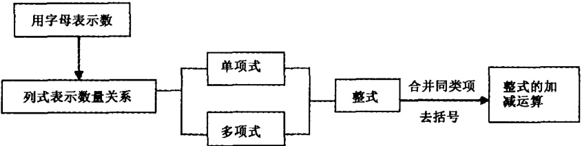
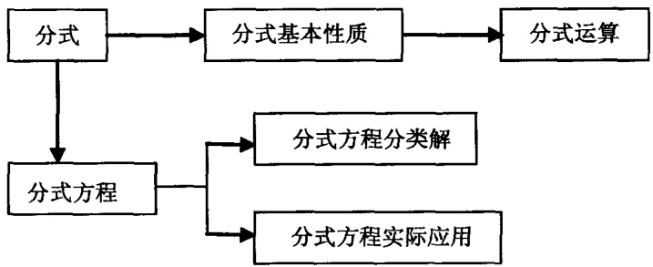
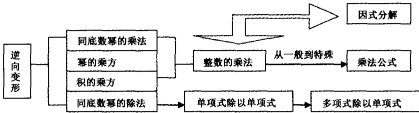

文章编号:1001-4918(2010)03-0267-273

中图分类号:G442

文献标识码:A

# 学科领域知识与数学学习的知识表征研究\*

李长虹 蔡笑岳 何伯锋

(广州大学教育学院, 广东 广州 510006)

摘要:根据领域知识的结构特点对初中数学学科知识作出改编和重组,形成数学学科领域知识单元进行教学实验,以215名普通初中二年级学生为被试,通过自编问卷和深度访谈考察学科领域知识对知识表征的影响,并探讨了知识表征与数学学业成绩之间的关系。研究发现:(1)学科领域知识可以显著提高学生数学陈述性知识表征全面性和总体水平;(2)学科领域知识可以显著提高学生的程序性知识表征全面性、自动化、组织性和总体水平;(3)认知结构三要素、陈述性知识表征及程序性知识表征与数学成绩显著相关;(4)学优生的陈述性知识表征准确性、总体水平和程序性知识表征组织性、总体水平显著高于中等生和学困生。

关键词:学科领域知识;领域知识教学;数学学习;知识表征;认知结构

## 1 问题提出

信息加工心理学认为能力的形成、发展与知识的获得、积累相辅相成，个体间智能的差异主要源于知识表征上的差异，具体体现在知识的结构和知识的使用两个方面。知识表征的特点是专家领域特长形成和发展的主要原因。专家不仅拥有数量丰富、结构严谨并呈现“模块化”的陈述性知识，还拥有高度整合的程序性知识和特殊的策略知识，这使其能够保持足够的专业敏感并使用特殊的加工机制对某些认知任务进行自动化操作，从而形成领域特长（李同吉，吴庆麟，胡谊，2006；曾近荣，2008）。

Alexander 受人工智能和专家特长研究的启发，在 Gagne(1985) 和 Anderson(1986) 关于知识表征分类的基础上，借鉴了计算机科学研究中的领域知识概念，在认知学习研究中引入并界定了领域知识的概念。她指出，领域知识 (domain knowledge) 是个体拥有的关于某个特定领域的所有知识，其结构涵盖了某个特定领域的陈述性 (declarative)、程序性 (procedural) 和条件性 (conditional) 知识这三个部分。个体在知识学习过程中的变化实质上是其领域知识的变化（Alexander, Kulikowich, & Jetton, 1995; Alexander, Schallert, & Hare, 1991; Alexander & Murphy, 1998)。

研究发现,领域知识对个体的知识学习有积极影响。领域知识在记忆系统中形成一种特殊的检索结构(retrieval structure),这种由领域知识高度整合和抽象化后形成的知识图式能提高知识表征的水平,能一定程度上弥补工作记忆容量的不足(Ackerman, Beier, & Boyle, 2002; Hambrick & Engle, 2002; 蔡笑岳,苏静,2008)。领域知识能引导个体的注意指向特定的元素,帮助个体对信息进行判断和评价,迅速提取有效信息(Chen, Fan, & Macredie, 2006; Lawless & Kulikowich, 2006; Shapiro, 2004)。高领域知识的个体在认知任务中能使用高级的认知策略,并能提高元认知监控水平(Moos & Azevedo, 2008; Winne, 1996)。

领域知识是一种完整的知识表征形态,兼具内隐和外显的特性,有助于个体构建某个特定领域的基础性知识体系,能加速对新知识的同化和吸收。过去的研究主要集中在领域特长方面或把领域知识作为一个整体来考查其对认知学习的影响,较少关注在学科学习当中领域知识及其结构与知识表征的关系研究。自 Mayer(1992)指出认知心理学与数学教育之间的研究需要更紧密联系以来,关于数学学习心理机制方面出现了大量的研究,但这些研究主要是从问题表征、问题解决等角度来进行探讨，而从知识表征的角度来探讨数学学习心理机制的研究相对较少。初中的代数学习是个体从“具体的数学”转向“抽象的数学”的一个关键时期，是为更高级的数学学习打基础的重要阶段，对初中数学学习的知识表征进行研究对教师的有效教学与学生的自主学习有一定的价值。

<small>\* 基金项目: 国家社会科学基金“十一五”规划教育学课题(BBA080049); 广州市人文社会科学(发展与教育心理学)重点研究基地研究成果.</small>

<small>通讯作者:蔡笑岳,E-mail:guxycai@tom.com</small>

因此，本研究利用领域知识对初中数学学科知识重新表征，形成学科领域知识，通过教学实验，采用认知结构三要素、陈述性知识表征全面性、准确性和总体水平，程序性知识表征自动化、可逆性、全面性、组织性和总体水平等作为指标考察学科领域知识对学生知识表征的影响，同时从知识表征的角度分析初中生数学学业成绩的影响因素以及不同学业水平学生的知识表征的特点。

## 2 研究方法

## 2.1 被试

选取广东省潮州市某中学八年级4个平行班，实验组和对照组各两个班，以上学期期末考试成绩作为指标，实验组和对照组学生的成绩无显著差异 $(t=1.51,p>0.05)$ ，可认为实验组和对照组同质。

4个班的被试共227人，男生110人，女生117人。因实验过程中部分被试的测量问卷无效，确定最终有效被试为215人，被试有效率为94.71%。采用上学期期末考试成绩排名的75百分等级和25百分等级的分数为临界点，将被试分为学业水平不同的三个组别，即学优生、中等生和学困生，被试的具体分布如表1。

对三组被试的成绩进行方差分析显示,他们的学业成绩存在显著差异 $(F_{(2,212)}=21.96,P<0.01)$ ，即三个组别的被试在学业水平上显著不同，可以作为三个独立的小组在实验中进行比较分析。

表 1 被试分布

<table><tr><td rowspan="2">学业水平</td><td colspan="2">实验组</td><td colspan="2">对照组</td><td rowspan="2">合计</td></tr><tr><td>男</td><td>女</td><td>男</td><td>女</td></tr><tr><td>学困生</td><td>18</td><td>18</td><td>24</td><td>17</td><td>77</td></tr><tr><td>中等生</td><td>19</td><td>12</td><td>20</td><td>24</td><td>75</td></tr><tr><td>学优生</td><td>18</td><td>16</td><td>15</td><td>14</td><td>63</td></tr><tr><td>合计</td><td>55</td><td>46</td><td>59</td><td>55</td><td>215</td></tr></table>

## 2.2 学科领域知识的编制及教学实验的实施

## 2.2.1 学科领域知识的改组

根据学科领域知识的核心理念,课堂教学不仅要关注教学内容是否层次分明,重点是否突出和主题是否鲜明,还要关注知识结构的完整性,知识组块与组块之间的联系等。Hutchinson(1993)的研究指出,学习不良学生一方面对基本的数学概念和运算不能熟悉掌握,另一方面不能将这些知识和运算规则正确运用到问题情境中。因此,在利用改组后的学科领域知识进行领域知识教学时既要注重概念、规则等陈述性知识和运算过程、解题步骤等程序性知识的讲解,又要注重条件性知识的讲解,即教会学生在什么条件下如何使用什么样的知识的限定性知识。

研究以人教版《代数》教科书八年级下册第二章《分式》单元为实验材料，组织实验教师和富有经验的教师根据学科领域知识的结构和教学理念进行改编，然后供实验教师进行教学。经过改编后的分式教学单元包括了以下三个知识组块，如图所示。

图 1 分式单元知识组块(一)

学科领域知识的改编主要从两个方面进行,第一是要确保知识结构的完整性,由于《分式》是属于《整式》中的一部分内容,因此在《分式》学习过程中首先引入《整式》中部分与《分式》相关的基础知识有助于帮助学生补充相关领域知识的不足。第二是在教学过程中加强程序性知识和条件性知识的训练,帮助学生将“静态”的知识变成能够在适当时候

易于调用的“动态”知识。

## 2.2.2 教学实验的实施

研究采用2(教学类型)×3(学业水平)混合设计在教学情境中进行教学实验。教学类型为组间变量,学业水平为组内变量;认知结构三要素、陈述性知识表征水平和程序性知识表征水平为因变量。

教学实验是由同一名教师分别使用两种实验材料按照相同的教学进度同时在实验班和控制班进行教学。教学时间为期3周，每周5次课，每次课为45分钟。对照组使用人教版《代数》教科书八年级下册，教师按照学校统一的教案和教学目的进行教学。实验组使用经过改编而形成的领域知识单元组块为教学材料，教师以帮助学生建立完整和动态的知识体系为目的进行教学设计和教学。在课堂教学以外，教师布置相同的练习题作为课外作业。

图 2 分式单元知识组块(二)

图 3 分式单元知识组块(三)

## 2.3 测量工具的编制

## 2.3.1 认知结构测量问卷

参考 Ausubel 和王美丽等对认知结构三因素的划分(王美丽, 2005; Ausubel, 1994)。以认知结构广度, 深度和关联度为三个维度, 通过对初中数学教师进行深度访谈, 参考教材和历年中考试题, 以基础题、深度题和广度题基本为 7:2:1 的比例编制成《认知结构测量问卷》。

问卷由五位长期从事代数教学的教师在操作性定义的范围内编制测量题目，并由教育心理学专家进行评价和修订，以使问卷具有较好的内容效度。预测中，以学生上学期的数学期末考试成绩作为效标，计算本测验分数与效标之间的相关系数，$r = 0.974, P$ 值小于0.01。正式施测中，认知结构全卷认知结构广度、深度和关联度的内部一致性信度系数分别为0.66、0.60、0.74和0.85，$P$ 值均小于0.01。

## 2.3.2 陈述性知识表征测量问卷

参考教科书中的陈述性知识内容,根据教师对题目作出的评价,形成《陈述性知识表征测量问卷》。问卷包括表征全面性和准确性两部分,陈述性知识表征全面性指学生能准确陈述出的与具体学科知识相关的基本概念和符号公式的数量；陈述性知识表征准确性指学生能理解以各种形式出现的概念、规则和其他知识要点（姚元锦，张辅，孟世才，2007）。

问卷由五位长期从事代数教学的教师在操作性定义范围内编制测量题目，由教育心理学专家评价和修订，以使问卷具有较好的内容效度。预测中，陈述性知识表征全面性和准确性的分半信度分别为0.82和0.81，P值均小于0.01；在正式施测中，陈述性知识表征全卷、全面性和准确性的内部一致性系数分别为0.65、0.97和0.66，P值均小于0.01。

## 2.3.3 程序性知识表征测量问卷

程序性知识由程序性知识自动化、全面性、可逆性和组织性四个部分组成（Gagne，1985；Gagne & Glaser，1987）。程序性知识自动化是指学生在有限的时间内能准确使用单一规则的数量，测量项目由简单的单一规则应用的题目组成。程序性知识全面性是指在一定时间内能够准确使用单一规则的数量，测量项目由与某个知识点相关的所有规则组成。程序性知识的可逆性是指方向使用规则的水平，测量则由规则方向逆用的题目组成。程序性知识组织性是指根据问题类型提取出的相关知识的数量和各知识点之间的逻辑性，测量是要求学生对与某类型题目相关的知识点的逻辑性和恰当性进行评价，对评价的准确性进行记分。

《程序性知识表征测量问卷》由五位长期从事代数教学的教师在操作性定义的范围内编制测量题目，并由教育心理学专家进行评价和修订，以使问卷具有较好的内容效度。预测中，程序性知识的自动化、可逆性、全面性和组织水平的分半信度系数分别为0.84、0.79、0.76和0.80，P值均小于0.01。程序性知识表征全卷、自动化、全面性、可逆性和组织性的内部一致性系数分别0.69、0.69、0.82、0.74、0.94，P值均小于0.01。

## 3 结果与分析

## 3.1 实验组和对照组的陈述性知识表征和程序性知识表征水平比较

通过学科领域知识教学提高学生的知识表征水平是教学实验的主要目的。统计结果表明（见表2），进行教学实验后，实验组的陈述性知识表征全面性和总体水平显著高于对照组，即实验组能陈述出的与分式知识相关的基本概念和基本规则比对照组多,实验组陈述性知识的知识结构优于对照组。

表 2 不同教学类型下的陈述性知识表征水平比较

<table><tr><td rowspan="2"></td><td colspan="2">陈述全面性</td><td colspan="2">陈述准确性</td><td colspan="2">陈述总水平</td></tr><tr><td>M</td><td>SD</td><td>M</td><td>SD</td><td>M</td><td>SD</td></tr><tr><td>实验组</td><td>64.28</td><td>23.01</td><td>85.36</td><td>19.10</td><td>149.64</td><td>36.10</td></tr><tr><td>对照组</td><td>52.58</td><td>22.73</td><td>79.85</td><td>20.13</td><td>132.42</td><td>37.01</td></tr><tr><td>t</td><td colspan="2">2.97**</td><td colspan="2">1.63</td><td colspan="2">2.74**</td></tr></table>

程序性知识表征方面,除了程序性知识表征可逆性没有显著差异外,实验组的程序性知识表征全面性、自动化、组织性和总水平均显著高于对照组(见表3)。由此可以推断,经过领域知识教学后,实验组能准确地使用更多规则,能更好地组织与问题相关的知识用于问题解决。

表 3 不同教学类型下的程序性知识表征水平比较

<table><tr><td rowspan="2"></td><td colspan="2">程序全面性</td><td colspan="2">程序可逆性</td><td colspan="2">程序组织性</td><td colspan="2">程序自动化</td><td colspan="2">程序总水平</td></tr><tr><td>M</td><td>SD</td><td>M</td><td>SD</td><td>M</td><td>SD</td><td>M</td><td>SD</td><td>M</td><td>SD</td></tr><tr><td>实验组</td><td>62.61</td><td>26.33</td><td>42.75</td><td>41.37</td><td>60.14</td><td>40.89</td><td>74.56</td><td>24.90</td><td>240.27</td><td>85.96</td></tr><tr><td>对照组</td><td>52.27</td><td>28.97</td><td>31.82</td><td>34.68</td><td>44.39</td><td>42.18</td><td>62.87</td><td>28.34</td><td>191.64</td><td>85.95</td></tr><tr><td>t</td><td colspan="2">2.17*</td><td colspan="2">1.66</td><td colspan="2">2.20*</td><td colspan="2">2.58*</td><td colspan="2">3.29**</td></tr></table>

## 3.2 数学学业成绩影响因素的分析

采用学生参加学校统一进行的《分式》单元测试的成绩作为学生的数学学业成绩,采用逐步回归分析对所有被试进行考察,探讨数学学业成绩与知识表征的关系。

统计显示(表4)，学生的数学认知结构广度、认知结构深度和认知结构关联度依次进入回归方程，说明学生的数学认知结构三要素与学生的数学成绩显著相关。此外(表5)，陈述性知识表征水平水平和程序性知识表征水平两个变量也依次进入了回归方程，表明陈述性知识表征水平和程序性知识表征

表 4 数学认知结构三要素对数学成绩的逐步回归分析

| 进入回归方程的变量 | B | t | $R^{2}$ | $\Delta R^{2}$ |
| --- | --- | --- | --- | --- |
| 认知结构广度 | 0.95 | 587.73 ** | 0.56 | 0.56 |
| 认知结构深度 | 0.19 | 56.64 ** | 0.63 | 0.07 |
| 认知结构关联度 | 0.12 | 21.46 ** | 0.67 | 0.04 |

表 5 陈述性与程序性知识表征对

学习成绩的逐步回归分析

| 进入回归方程的变量 | B | t | $R^{2}$ | $\Delta R^{2}$ |
| --- | --- | --- | --- | --- |
| 陈述性知识表征 | 0.03 | 0.68* | 0.08 | 0.08 |
| 程序性知识表征 | 0.02 | 1.39* | 0.24 | 0.16 |

水平与数学学习成绩显著相关。

## 3.3 不同学业水平的学生的陈述性知识表征和程

## 序性知识表征水平的比较

将全体被试划分为学优生、中等生和学困生三个水平，考察不同学业水平学生的知识表征差异，统计结果发现，不同学业水平的学生的知识表征水平显著差异(见表6和表7)。

陈述性知识表征方面,学优生的陈述性知识表征准确性和总体水平显著高于中等生和学困生。程序性知识表征方面,学优生的程序性知识表征组织性和总体水平显著高于学困生和中等生。

表 6 不同学业水平学生的陈述性知识表征水平比较

<table><tr><td rowspan="2"></td><td colspan="3">陈述全面性</td><td colspan="3">陈述准确性</td><td colspan="3">陈述总水平</td></tr><tr><td>M</td><td>SD</td><td>F</td><td>M</td><td>SD</td><td>F</td><td>M</td><td>SD</td><td>F</td></tr><tr><td>学困生</td><td>54.61</td><td>25.81</td><td></td><td>76.54</td><td>22.04</td><td></td><td>131.15</td><td>43.31</td><td></td></tr><tr><td>中等生</td><td>57.64</td><td>23.40</td><td>1.13</td><td>82.92</td><td>21.36</td><td>4.12*</td><td>140.57</td><td>38.64</td><td>3.08*</td></tr><tr><td>学优生</td><td>63.26</td><td>21.24</td><td></td><td>87.91</td><td>13.24</td><td></td><td>151.16</td><td>26.94</td><td></td></tr></table>

表 7 不同学业水平的程序性知识表征水平比较

<table><tr><td rowspan="2"></td><td colspan="2">程序全面性</td><td colspan="2">程序可逆性</td><td colspan="2">程序组织性</td><td colspan="2">程序自动化</td><td colspan="2">程序总水平</td></tr><tr><td>M</td><td>SD</td><td>M</td><td>SD</td><td>M</td><td>SD</td><td>M</td><td>SD</td><td>M</td><td>SD</td></tr><tr><td>学困生</td><td>54.36</td><td>29.72</td><td>30.77</td><td>35.57</td><td>48.72</td><td>42.19</td><td>61.46</td><td>27.71</td><td>195.38</td><td>100.13</td></tr><tr><td>中等生</td><td>53.96</td><td>30.28</td><td>40.57</td><td>38.05</td><td>41.89</td><td>42.16</td><td>69.57</td><td>27.19</td><td>205.98</td><td>84.98</td></tr><tr><td>学优生</td><td>64.88</td><td>22.19</td><td>39.53</td><td>41.63</td><td>68.84</td><td>37.68</td><td>74.44</td><td>25.81</td><td>248.60</td><td>75.36</td></tr><tr><td>F</td><td colspan="2">2.92</td><td colspan="2">0.22</td><td colspan="2">5.90**</td><td colspan="2">0.62</td><td colspan="2">3.38*</td></tr></table>

## 4 讨论

## 4.1 学科领域知识教学显著提高学生的陈述性知识和程序性知识表征水平

从表 2 和表 3 的统计结果看出,实验组的陈述性知识和程序性知识表征水平有显著提高。表 2 显示,接受领域知识教学的学生,其陈述性知识表征全面性和总水平均显著高于对照组。这说明实验组能准确陈述出与分式知识相关的基本概念和基本规则的数量比对照组多,同时也反映了实验组对概念、原理、规则等知识掌握得比对照组好。

在普通教学条件(对照组)下,学生接触到的是由文字描述的概念和规则,它们是相对孤立的。在领域知识教学条件(实验组)下,学生在教师的授课下不断通过命题网络和图式进行归纳,需要回到概念和规则学习,这样的反复过程促使学生去反思,重新认识概念和规则。经过这样的学习,学生习得的就不再是孤立的概念,而是一个有领域化的概念规则系统,相关领域的材料越多,对概念和规则的认识也就越全面。在陈述性知识表征准确性的维度上,两组没有显著性差异,说明实验组和对照组的学生对概念、规则等陈述性知识本质含义的理解力无显著差别,表明了领域知识教学并不影响学生对陈述性知识的理解力。

程序性知识表征方面,领域知识教学显著提高学生的程序性知识表征全面性、组织性、自动化和总水平(见表3)。在实验过程中对学生的学习状态进行观察发现,对于一道习题,有些学生长时间审题仍无法作答,但若对解题方法稍做指导,他们就能顺利地解决问题,说明学生具备解题所需要的陈述性知识,但不知道如何将这些灵活运用于问题解决当中。

Alexander 等(1997)指出“知识”(knowledge)不等于“知识的使用”(knowledge use)。领域知识教学注重知识的整体性和交互性,强调知识的有机联系并灵活运用到问题解决中。结果显示,采用改组后的分式领域知识教学,学生对概念和规则的运用能力显著提高。接受领域知识教学的学生,其程序性知识表征全面性显著优于接受普通教学的学生，说明其对于某类型问题所提取出的相关知识的数量比接受普通教学的学生多，在有限时间内能够使用的单一规则更多。此外，前者的程序性知识表征自动化和组织水平也显著高于后者，说明了学生在程序性知识表征上，各知识点之间的逻辑性更加严密，学生知识体系的结构化程度更高，这对于认知图式的构建具有关键意义。

但研究发现,实验组和控制组的认知结构广度 $(t=1.82,p>0.05)$ ,认知结构深度 $(t=0.43,p>0.05)$ 和认知结构关联度 $(t=0.31,p>0.05)$ 无显著差异,说明学科领域知识教学对学生数学认知结构没有产生显著的影响。对此,原因可能来自认知结构的特性和学生思维特点两个方面。首先,数学认知结构是学习者头脑的数学知识按照自己的理解深度、广度,结合自己的感觉、知觉、记忆、思维和联想等认知特点组合成的一个具有内部规律的整体结构(Anderson, Reder, & Simon, 1996; Bonder, 1986)。本次研究只是抽取了代数中的一个单元进行实验,无论时间还是知识量方面都是比较有限,因此可能不足以引起学生认知结构的变化。其次,认知结构的构建需要良好的抽象和逻辑思维对习得的知识进行重组表征,而初中生处于从形象思维向抽象思维过度的阶段,不能很好地胜任这项任务,这从认知结构深度和关联度对数学成绩变异的解释度小于认知结构广度可以得到印证(表4)。

## 4.2 数学认知结构和知识表征是影响学生数学成绩的重要因素

研究表明,数学认知结构与数学成绩显著相关。从表4可以看到,认知结构广度对学生数学成绩变异的解释度最大。认知结构的广度即学生是否知道这个知识点以及知识点的多少,即我们平时所说的基础性知识。认知结构的广度是认知结构的深度和关联度的前提和基础,是学生整个认知结构的原材料。近年来,中考命题严格按照数学教学大纲的要求,以初中数学教学目标为依据,考察的重点是基础知识、基本技能,因而教师、学生都重视这部分知识。

数学认知结构的深度和关联度对学生数学成绩的解释度小于数学认知结构的广度,其中一个重要的原因是传统的数学教学忽视学生的数学认知结构及其特点,容易造成向学生机械地灌输知识,使学生头脑中的知识成为孤立的概念堆积,知识在记忆系统中难以系统地表征,所以灵活、综合应用知识的能力较差,学生的数学能力得不到很好地培养。

除了数学认知结构,陈述性知识表征和程序性知识表征与学生的数学成绩显著相关(表5),即知识表征的水平高低直接影响着学生的数学成绩。关于知识的智力观的研究表明,个体间的智能发展的差异主要体现在知识表征上的差异,而专家领域专长的优势也主要体现在其知识表征的优势之上。

## 4.3 不同学业水平的学生,其陈述性知识表征和程序性知识表征水平存在不同

统计结果显示(表6与表7)，学优生和中等生及学困生之间的差异可以通过知识表征水平区分开来。学优生的陈述性知识表征准确性、总体水平和程序性知识表征组织性、总体水平均显著高于中等生和学困生，这一结果验证了Gagne的观点。Gagne认为，程序性技能的掌握需要具备一定的前提条件，如概念、规则和高级规则这些陈述性知识（Gagne, 1985；Gagne & Glaser, 1987）。学优生在程序性知识组织性方面显著高于其他学生，表明学生能够根据问题需要提取出更多相关信息，这一认知操作的成功与否跟学生能否准确理解相关概念、规则紧密相关。Anderson(1982)也指出，陈述性知识表征和程序性知识表征之间是存在交互作用的，所以学生在知识表征方面的优势应该同时来自于陈述性知识表征和程序性知识表征方面的优势。

此外,研究也跟辛自强(2006)的研究结论相似,他在研究中指出,学困生或中等生的认知结构中拥有更多的样例,而学优生的知识体系中具有更多的图式。样例是一种静态认知结构,图式则为一种动态的、高度结构化的认知结构,比样例更加灵活。在认知任务中,图式比样例显示出更佳的知识组织性,因此学优生的组织水平较学困生和中等生高。

造成这种区别的原因很可能是学生虽然掌握了较丰富的知识(例如概念性知识和程序性知识)，但是不知道如何选择合适的知识点将其联系起来，学生可能缺乏“条件性知识”，即不知道在什么条件下使用所掌握的数学概念和解题程序等。领域知识作为一种区别于以往“二元”（即陈述性和程序性）知识表征的知识表征形态，是因为它指出了在陈述性和程序性知识以外还应该存在一个用于调节前两者知识的条件性知识,因此重视条件性知识在教学中的作用是领域知识教学思想的一个突出之处。

## 4.4 对研究的思考和展望

研究探讨了学科领域知识对初中生数学学习的知识表征影响,并考查了知识表征与数学学业成绩的关系。回顾整个研究,在以下两个方面应该完善和值得探讨:

(1) 增加教学实验的时间。研究过程中并未发现学科领域知识对认知结构产生显著影响，也没有发现教学类型和学生学业水平的交互作用效应和简单主效应，与原来的假设不符，这可能跟教学实验的实施时间较为仓促有关。认知结构和知识结构的改变往往需要较长的时间，特别是程序性知识和条件性知识的掌握需要较长的时间才能产生变化。

(2) 考查领域知识三维结构与知识表征之间的微观关系。本次研究作为学科领域知识改组和教学的一次尝试，并未深入探讨领域知识特有的三维结构与知识表征之间的微观关系，因此在往后的研究中应该进一步探讨。

## 5 结论

(1)学科领域知识显著提高学生数学陈述性知识表征全面性和总体水平。

(2)学科领域知识显著提高学生的程序性知识表征全面性、自动化、组织性和总体水平。

(3)认知结构三要素、陈述性知识表征及程序性知识表征水平与数学成绩显著相关。

(4) 不同学业水平学生的知识表征水平存在显著差异, 学优生的陈述性知识表征准确性、总体水平和程序性知识表征组织性、总体水平显著高于中等生和学困生。

## 参考文献:

Ackerman, P. L., Beier, M. E., & Boyle, M. O. (2002). Individual Differences in Working Memory Within a Nomological Network of Cognitive and Perceptual Speed Abilities. Journal of Experimental Psychology, 131(4), 567–589.

Alexander, P. A., Kulikowich, J. M., & Jetton, T. L. (1995). Interrelationship of Knowledge, Interest, and Recall: Assessing a Model of Domain Learning. Journal of Educational Psychology, 87(4), 559–575.

Alexander, P. A., Murphy, P. K., Woods, B. S., Duhon, K. E., & Parker, D. (1997). College Instruction and Concomitant Changes in Students' Knowledge, Interest, and Strategy Use: A Study of Domain Learning. Contemporary Educational Psychology, 22(2), 125–146.

Alexander, P. A., Schallert, D. L., & Hare, V. C. (1991). Coming to terms: How researchers in learning and literacy talk about knowledge. Review of Educational Research, 61(3), 315-343.

Alexander, P. A., & Murphy, P. K. (1998). Profiling the Differences in Students' Knowledge, Interest, and Strateic Processing. Journal of Educational Psychology, 90(3), 435–447.

Anderson, J. R. (1982). Acquisition of cognitive skill. Psychological Review, 89(4), 369–406.

Anderson, J. R. (1986). Knowledge compilation: The general learning mechanism. In R. Michalski, J. Carbonell, & T. Mitchell (Eds.), Machine Learning, Volume 2. Los Altos, CA: Morgan Kaufmann.

Anderson, J. R., Reder, L. M., & Simon, H. A. (1996). situated learning and education. Educational Researcher, 25(4), 5–11.

Bonder, G. M. (1986). Constructivism: A theory of knowledge. Journal of Chemical Education, 63, 873-878.

Chen, S. Y., Fan, J., & Macredie, R. D. (2006). navigation in hypermedia learning systems: experts vs. novices. Computers in Human Behavior, 22, 251–266.

Gagne, E. D. (1985). The cognitive psychology of school learning.
Boston: Little Brown.

Hutchinson, N. L. (1993). effects of cognitive strategy instruction on algebra problems solving of adolescents with learning disabilities. Learning Disability Quarterly, 16, 34–63.

Hambrick, D. Z., & Engle, R. W. (2002). Effects of Domain Knowledge, Working Memory Capacity, and Age on Cognitive Performance: An Investigation of the Knowledge - Is - Power Hypothesis. Cognitive Psychology, 44(4), 339-387.

Lawless, K. A., & Kulikowich, J. M. (2006). Domain knowledge and individual interest: The effects of academic level and specialization in statistics and psychology. Contemporary Educational Psychology, 31 (1), 30 - 43.

Gagn'e, R. M., & Glaser, R. (1987). Foundations in learning research. In R. M. Gagn'e (Ed.), Instructional Technology: Foundations. Hillsdale, NJ: Lawrence Erlbaum Associates.

Mayer, R. E. (1992). Cognition and instruction: Their historic meeting within educational psychology. Journal of Educational Psychology, 84(4), 405–412.

Moos, D. C., & Azevedo, R. (2008). Monitoring, planning, and self-efficacy during learning with hypermedia: the impact of conceptual scaffolds. Computers in Human Behavior, 24, 1686-1706.

Shapiro, A. M. (2004). How Including Prior Knowledge As a Subject Variable May Change Outcomes of Learning Research. American Educational Research journal, 41(1), 159–189.

Winne, P. H. (1996). A metacognitive view of individual differences in self-regulated learning. Learning and Individual Difference, 8, 327–353.

蔡笑岳，苏静.（2008）.工作记忆与领域知识在个体认知行为中的作用.心理与行为研究(4)，306-310.

李同吉，吴庆麟，胡谊.（2006）.学科领域专长发展的阶段观评述.上海教育科研(1)，43-46.

王美丽. (2005). 数学认知结构变量对初中生数学成绩影响的实验研究. 南京师范大学硕士学位论文, 南京.

辛自强. (2006). 知识建构研究: 从主义到实证. 北京: 教育科学出版社.

姚元锦，张辅，孟世才.（2007）.中学数学问题的代数表征与几何表征.西南师范大学学报(自然科学版)，32(1)，154-157.

曾近荣. (2008). 超越碎片: 专长研究的教学启示. 基础教育 (6), 55-58.

【美】Ausubel 著, 余星, 南宋钧译. (1994). 教育心理学. 北京: 人民教育出版社.

# The Research on the Knowledge Representation of Disciplinary Domain Knowledge and Mathematics Learning

LI Chang-hong, CAI Xiao-yue, HE Bo-feng
(Educational college of Guangzhou university, Guangzhou Guangdong 510006)

Abstract: Teaching experiments can be carried out with units of the disciplinary domain knowledge which are adapted and reorganized from the disciplinary knowledge in mathematics, on the basis of structural characteristics of domain knowledge. Some questionnaires and in-depth interviews which contained 215 students at second year at middle school were used to investigate the effect which is caused by disciplinary domain knowledge in knowledge representation and also did some research on the relationship between knowledge representation and mathematical achievements. The results are as follows: (1) disciplinary domain knowledge can significantly improve the comprehensive and overall level of declarative knowledge representation; (2) disciplinary domain knowledge can significantly improve students' procedural knowledge representation in comprehensive, automation, organization and overall level; (3) the three elements of cognitive structure, declarative knowledge representation and procedural knowledge representation are significantly correlated with students' mathematics achievements; (4) excellent students are significantly better than average students and poor students with respect to the accuracy and overall level of declarative representation and the organization and overall level of procedural knowledge representation.

Key words: disciplinary domain knowledge; domain knowledge teaching; mathematics learning; knowledge representation; cognitive structure