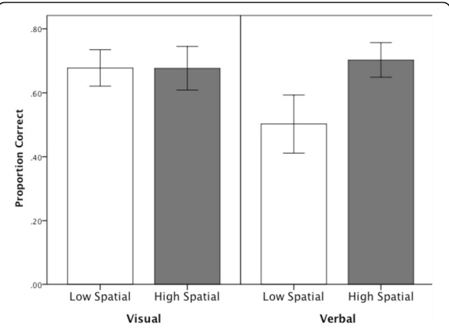
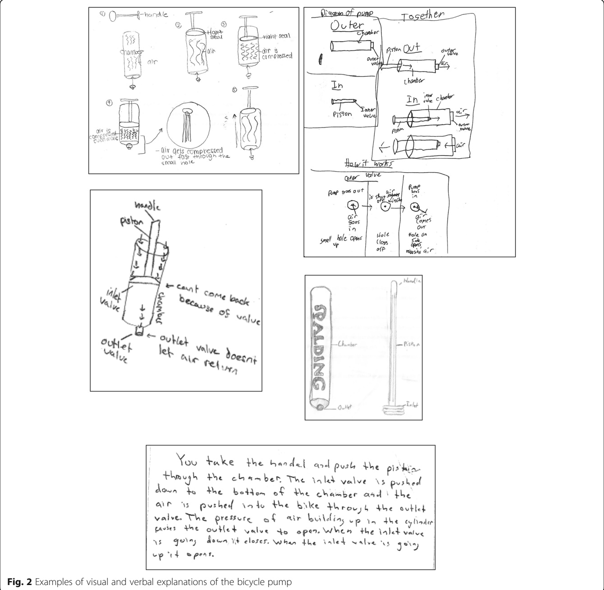
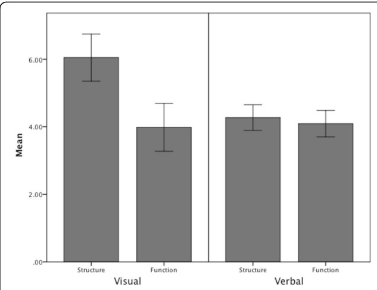
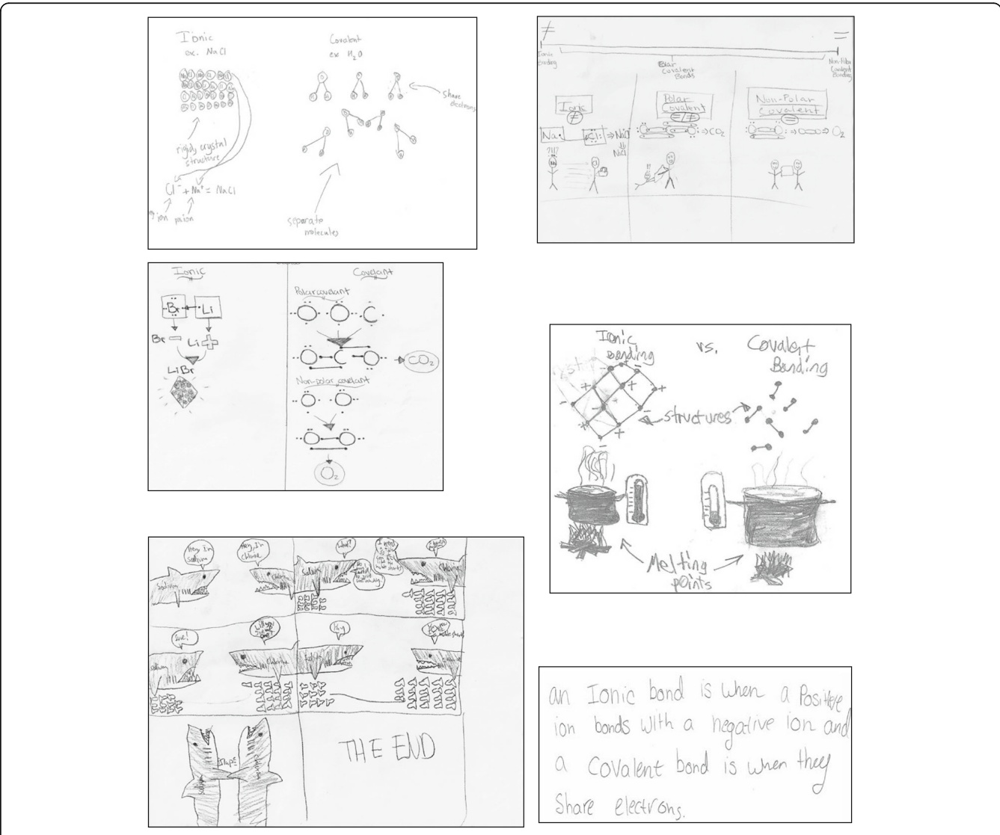
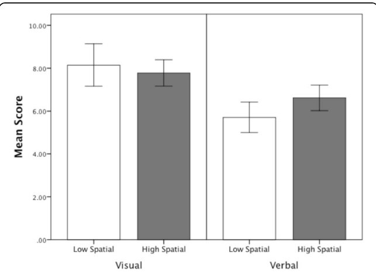
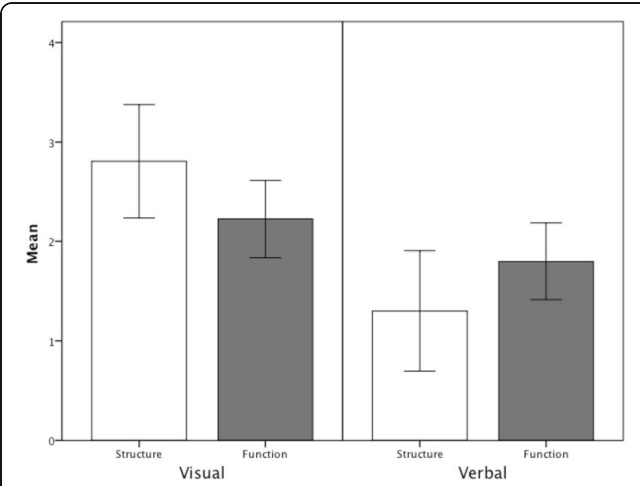
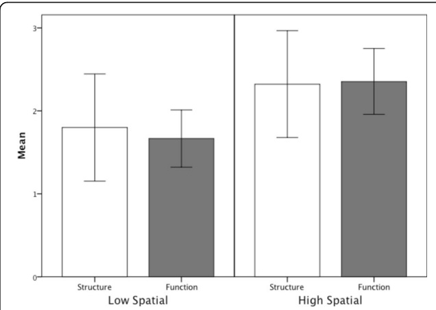

# 研究笔记：创制视觉化解释促进学习（Creating visual explanations improves learning）

> 本笔记由 MinerU 解析原始 PDF 后整理，公式按原文逐条收录。

## 一、基本信息（Basic Information）

| 项目 | 内容 |
| --- | --- |
| 英文标题 | Creating visual explanations improves learning |
| 中文译名 | 创制视觉化解释促进学习 |
| 作者 | Eliza Bobek1、Barbara Tversky2 |
| 机构 | 1University of Massachusetts Lowell, Lowell, MA, USA；2Stanford University / Columbia University Teachers College, New York, NY, USA |
| 发表 venue 与年份 | 开放获取（Open Access）原创论文；在线发表日期 2016-12-07（Received 2016-01-12，Accepted 2016-11-15）。原文未明确说明期刊全名，仅标注 ORIGINAL ARTICLE 与 Open Access。 |
| 代码链接 | 原文未提供；实验材料见 Additional file 1（Post-tests, DOC 44 kb） |
| 任务 | 教育心理学 / 学习科学实验：比较"学生自创视觉化解释（画图）"与"自创言语解释（写作）"对 STEM 领域复杂、不可见系统学习成效的影响 |
| 关键词 | Learning（学习）、Visual communication（视觉沟通）、STEM、Spatial ability（空间能力）、Dynamic system（动态系统）、Diagrammatic reasoning（图解推理）、Structure（结构）、Process（过程）、Complex system（复杂系统） |

## 二、一句话概括（One-sentence Summary）

让学习者在接触实际物体或课堂讲授后，自己"画出来"解释一个含有不可见部件的系统（自行车打气筒、化学成键），比"写下来"解释更能促进理解；其中视觉化解释对低空间能力学习者的助益尤为显著，且即便不增加新教学也能通过"生成—测验"效应提升成绩。

## 三、研究问题与动机（Problem and Motivation）

**问题背景。** 科学与工程中大量动态系统（dynamic system）及其机制、过程往往超出学生日常经验，且常包含宏观不可见、亚微观或抽象的成分，因此极难学习（Chi et al., 1994；Hmelo-Silver & Pfeffer, 2004；Johnstone, 1991；Perkins & Grotzer, 2005）。学习者既要掌握系统的各个组成部件（结构，structure），又要理解部件之间的交互与机制（功能，function），而功能常常是不可见的。

**教学上的矛盾。** 尽管 STEM 教学普遍依赖可视化（图片、图表、示意图等）——视觉表征能直接呈现结构与行为属性、帮助推断（Larkin & Simon, 1987）、箭头可表达作用力与时间变化（Heiser & Tversky, 2002）——但学习成效通常仍以言语（口头或书面）来检验。言语因其符号性与意义对应是纯约定的，从描述建构心理表征更费力且易错（Glenberg & Langston, 1992；Hegarty & Just, 1993）。由此引出核心问题：**让学习者自己创制视觉化解释（visual explanations），能否比创制言语解释更有效地促进学习？**

**生成性解释与测验效应的铺垫。** 生成活动（generative activities，如自创标题、摘要、图画、类比）能深化理解（Wittrock, 1990；Chi, 2009）。已有研究支持画图优于写作/总结（Gobert & Clement, 1999；Hall et al., 1997；Edens & Potter, 2003；Van Meter, 2001），但也有反例（Wilkin, 1997；Alesandrini, 1981；Leutner et al., 2009），提示"学习者是否获得支架"与"学习者的空间能力"是调节变量。与此同时，创制解释可被视为一种"测验"（testing）：提取并整合材料即可增强学习（Roediger & Karpicke, 2006；Hausmann & Vanlehn, 2007 证明"产出解释"这一加工过程本身是关键）。

**本研究拟回答的三个问题。**
1. 视觉化解释 vs. 言语解释，谁更促进学习？预期视觉化更优（因其鼓励完整性与结构—功能整合）。
2. 解释中结构与功能信息的纳入量是否与后测成绩相关？预期信息量（尤其不可见与功能信息）越多，成绩越高。
3. 空间能力是否预测解释中的信息量及后测成绩？预期高空间能力者信息更多、成绩更高。

**两个实验的领域选择。** 实验 1 用自行车打气筒（机械系统，部件可见但 inlet/outlet 阀门与空气运动不可见）；实验 2 用化学成键（亚微观、尺度上不可观察的抽象系统），以检验结论能否推广到更抽象、不可见程度更高的领域。

## 四、记号与预备知识（Notation and Preliminaries）

本文为行为实验，无形式化数学记号体系，以下列出文中反复出现的操作性概念：

- **视觉化解释（visual explanation）**：学习者通过画图/示意图解释系统如何运作，强调"以图为主"。
- **言语解释（verbal explanation）**：学习者通过写作解释系统运作。
- **空间能力（spatial ability）**：对物体大小、位置、形状及其空间关系与运动的思考能力，文中用 Vandenberg–Kuse 心理旋转测验（Mental Rotation Test, MRT）测量。
- **结构信息（structural information）**：系统部件及其属性/位置（如打气筒的 chamber、piston、inlet valve、outlet valve、handle、hose；化学成键中的价电子数、电荷、键型、晶体结构等）。
- **功能信息（functional information）**：单个部件的动作/运动，或多个部件如何交互（如电子转移、共享，空气进出阀门的三阶段运动）。
- **不可见特征（invisible features）**：隐藏于系统内部、须由功能推断的特征（打气筒的进/出气阀与空气运动三阶段；化学成键的亚微观粒子）。
- **本质特征（essential features）**：对系统功能不可或缺的信息（两阀存在、活塞与腔体气密、两阀按正确方向开/闭）。
- **MRT（Mental Rotation Test）**：20 题，每题 1 个目标三维物体二维图 + 4 个比较图（其中 2 个为目标旋转版本），选出 2 个正确旋转版得 1 分，满分 20。
- **后测（post-test）**：实验 1 为 16 道判断（True/False）题，结构/功能各半；实验 2 为 10 题（7 选择 + 3 简答），满分 10 分，分"即时后测"与"延迟后测"。

## 五、方法：学习者自创解释的两域对比实验（Learner-generated Explanation Paradigm）

研究采用**被试间 × 空间能力分组**的准实验设计，在两个实验中分别操纵"解释模态"（视觉 vs. 言语）并测量空间能力，以学习者自创的解释内容与后测成绩为因变量。

### 5.1 实验 1：自行车打气筒（机械系统）

**被试。** 127 名（女 59）七、八年级学生，年龄 12–14 岁，纽约市一所独立学校；按班级内随机分到视觉条件（n=64，画图）或言语条件（n=63，写作）。

**材料。** 12 英寸 Spalding 打气筒（腔体与软管为透明塑料，部件已标注）、空白纸、MRT、16 题后测（改编自 Heiser & Tversky, 2002）。

**流程。** 第 1 天全班做 MRT（练习后每部分限时 3 分钟）。第 2 天（间隔 2–4 天）被试单独在安静房间研究真实打气筒，随后按条件自创解释：视觉组"画一个或多个示意图解释打气筒如何工作，主要用图"；言语组"写一段解释"。完成后立即做后测。

**编码方案（解释内容分析）。**
- 结构：6 个部件（chamber、piston、inlet valve、outlet valve、handle、hose）正确画出+正确标注各 1 分，满分 12。
- 功能：描述/描绘单个部件动作或多部件交互，每单元 1 分，最多 10 单元。
- 本质特征：4 点量表（两阀存在、活塞插入腔体气密、两阀正确方向开闭各 1 分）。
- 不可见特征：进/出气阀 + 空气进入/穿过/离开三阶段，各 1 分，满分 5。
- 箭头（标注、运动、顺序）、步骤数（1–6）、多模态（67% 视觉解释含文字）。

### 5.2 实验 2：化学成键（亚微观系统）

**被试。** 126 名（女 58）八年级学生，年龄 13–14 岁，同校且未参与实验 1，班级内随机分视觉/言语组。

**材料。** MRT、13 分 22 秒化学成键视频课（复习原子结构，讲离子键/共价键/极性共价键，例 NaCl、O₂、H₂O）、即时后测、延迟后测、空白纸。

**流程。** 第 1 天 MRT；第 2 天看视频（不允许记笔记），随即 20 分钟完成即时后测；第 3 天随机分视觉组（"画图解释原子如何成键及离子/共价键区别，只用图"）或言语组（"写解释"），不限时完成解释，随后 20 分钟内完成 10 题延迟后测（与即时后测可比但不同）。

**编码方案。** 结构（满分 5：正确价电子数、正确电荷、共价键非金属间/离子键金属—非金属间、离子晶体结构、共价键为独立分子）；功能（满分 5：离子键电子转移、共价键电子共享、异号离子相吸、成键后中性稳定电子层、产物整体中性）。另编码箭头、具体例子（NaCl/CO₂/O₂）、多重表征（符号/原子/宏观，65% 含多重表征）、隐喻类比（样本过少未入统计）。

两个实验的编码者间一致性均 > 90%，分歧经讨论解决。

## 六、理论分析（Theoretical Analysis）

原文未给出理论分析（无定理、引理、形式化推导或数学模型）。本文以生成学习理论（Wittrock, 1990）、双编码理论（dual-coding theory；Mayer & Sims, 1994）与测验效应（testing effect；Roediger & Karpicke, 2006）为解释框架，但仅作概念性论述，未建立可形式化的理论命题。故本节从略，公式汇总见附录 A。

## 七、实验设计（Experimental Design）

| 维度 | 实验 1（打气筒） | 实验 2（化学成键） |
| --- | --- | --- |
| 设计 | 2（解释模态：视觉/言语）× 2（空间能力：高/低，按 MRT 中位数切分）被试间 | 同左，外加"即时 vs. 延迟后测"重复测量 |
| 被试 | 127 人，7–8 年级 | 126 人，8 年级 |
| 空间能力测量 | MRT，均值 10.56 / 中位 11；男 13.5±4.4，女 8.8±4.5，F(1,126)=19.07, p<0.01 | MRT 均值 10.39 / 中位 11；男 12.5±4.8，女 8.0±4.0，F(1,125)=24.49, p<0.01 |
| 学习材料 | 真实打气筒（可交互） | 13:22 视频课（不可交互记笔记） |
| 后测 | 16 道判断，结构/功能各半 | 即时 + 延迟各 10 题（7 选择 + 3 简答），满分 10 |
| 解释模态操控 | 画 vs. 写 | 画 vs. 写 |
| 关键因变量 | 后测成绩、解释编码（结构/功能/本质/不可见/箭头/步骤） | 同上 + 具体例子、多重表征、隐喻 |

**因变量统计模型。** 实验 1 用双因素 factorial ANOVA 与线性回归（不可见特征预测后测）；实验 2 用重复测量 ANOVA 与分组 ANOVA，并报告效应量 Cohen's d 与相关系数 r。

## 八、实验结果（Experimental Results）

### 8.1 实验 1 结果

**学习成效（Table 1 / Fig. 1）。** 空间能力主效应边际显著 F(1,124)=3.680, p=0.06（高空间者更高）；**空间能力 × 解释模态交互显著 F(1,124)=4.094, p<0.01**：创制视觉解释选择性地帮助了低空间能力者。

| 空间能力 | 视觉 Mean (SD) | 言语 Mean (SD) | 合计 Mean (SD) |
| --- | --- | --- | --- |
| 低 | 11.45 (1.93) | 9.75 (2.31) | 10.60 (2.27) |
| 高 | 11.20 (1.47) | 11.60 (1.80) | 11.42 (1.65) |
| 合计 | 11.30 (1.71) | 10.74 (2.23) | — |

**解释内容编码。**
- 结构部件：视觉 M=6.05, SD=2.76 > 言语 M=4.27, SD=1.54，F(1,126)=20.53, p<0.05。
- 功能部件：两组无显著差异。
- 本质特征：视觉 M=1.78, SD=1.0 > 言语 M=1.20, SD=1.21，F(1,126)=7.63, p<0.05；且与后测正相关 r=0.197, p<0.05。
- 箭头：87% 视觉解释含箭头，但与后测无显著相关。
- 多步骤：含多步骤者后测 M=0.76, SD=0.18 > 单步骤 M=0.67, SD=0.19，F(1,126)=5.02, p<0.05。
- 不可见特征：均值 3.26, SD=1.25；线性回归显示不可见部件总分显著预测后测 F(1,118)=3.80, p=0.05。

### 8.2 实验 2 结果

**学习成效（Fig. 5）。** 重复测量 ANOVA：即时后测 M=4.63, SD=0.469 vs. 延迟后测 M=7.04, SD=0.299，F(1,125)=18.501, p<0.05——**无新教学下，创制任一解释均提升成绩**。视觉组延迟后测 M=8.22（比例 0.822）, SD=0.208，F(1,125)=51.24, p<0.01, d=1.27；言语组 M=6.31（比例 0.631）, SD=0.273，F(1,125)=15.796, p<0.05, d=0.71。视觉显著高于言语 F(1,125)=19.707, p<0.01, d=0.88。高空间 M=0.824, SD=0.273 > 低空间 M=0.636, SD=0.207，F(1,125)=19.94, p<0.01, d=0.87；交互不显著。

**解释内容编码（Fig. 6/7）。**
- 结构部件：视觉 M=2.81, SD=1.56 > 言语 M=1.30, SD=1.54，F(1,125)=13.69, p<0.05；结构信息更倾向"描绘"(M=3.38, SD=1.49) 而非"描述"(M=0.429, SD=1.03)，F(1,62)=21.49, p<0.05；功能信息描绘/描述相当。
- 预测关系：视觉解释中**以言语表达的功能信息**显著预测后测 F(1,62)=21.603, p<0.01，而言语解释中的功能信息不预测；结构信息不预测成绩。
- 高空间者在视觉与言语解释中均含更多功能信息 F(1,125)=7.13, p<0.05。
- 箭头：92% 视觉解释含箭头，与后测正相关 r=0.293, p<0.05。
- 具体例子：高空间 M=1.6, SD=0.69 > 低空间 M=1.07, SD=0.79，F(1,125)=3.65, p=0.06（边际）；含具体例子与延迟成绩正相关 r=0.555, p<0.05。
- 多重表征：视觉 M=1.79, SD=1.20 > 言语 M=1.33, SD=0.48，F(125)=6.03, p<0.05，但与成绩无显著相关。

## 九、相关工作（Related Work）

- **与"从文本/图示自解释"研究的区别**：Ainsworth & Loizou (2003) 发现对着图自解释优于对着文本自解释；Ainsworth & Iacovides (2005) 让两组互换模态后整体无差异，但文本组在图上画了更多信息。本文更进一步——信息来源不是书面文本，而是**真实物体（打气筒）与多表征课堂讲授（化学成键）**，更贴近真实教学情境。
- **与"画图优于写作"系列的一致与补充**：Gobert & Clement (1999)、Hall et al. (1997)、Edens & Potter (2003)、Van Meter (2001) 均支持画图增益；本文在此基础上引入**空间能力作为调节变量**，并区分"结构/功能/不可见/本质特征"等多维编码。
- **与反例研究的对话**：Wilkin (1997) 发现无支架画图反而阻碍理解；本文结果呼应"恰当支架/约束"与"空间能力"是关键调节因素，且两实验的视觉解释多含文字补充（67%/多数含标签与符号），说明**多模态**而非纯图才是有效机制之一。
- **与测验效应的联系**：将"创制解释"视为一种测验（Roediger & Karpicke, 2006；Hausmann & Vanlehn, 2007），实验 2 用即时→延迟后测证明无新教学下成绩仍提升，放大了"测验优于重学"的结论。

## 十、结论（Conclusion）

1. **创制视觉化解释优于言语解释**：视觉化解释以更直观的方式表征与沟通复杂系统，能将部件按实际/隐喻的空间构型排布，并鼓励运用空间推断替代/支撑抽象推断。
2. **视觉化解释提供"完整性"与"连贯性"的检验**：它迫使学习者确认所有必要元素都被呈现、且协同产生正确过程结果，同时作为推断（尤其从结构到功能）的平台。
3. **生成即测验**：在无新教学下仍能提升成绩，且视觉化解释在言语解释增益之上再叠加一层提升，最可能因复杂系统到视觉—空间格式的直接映射。
4. **空间能力的调节作用**：打气筒任务中，视觉解释把低空间者拉到与高空间者同等水平；更抽象的化学成键中，视觉解释对高、低空间者均有额外增益（但未完全抹平差距）。空间能力可经经验发展（Baenninger & Newcombe, 1989），低空间者或需更多支架以想象物体运动。
5. **教学与测评价值**：视觉化解释是未被充分利用的形成性测评工具——客观编码体系（先分结构/功能，再分解为关键部件与动作序列）可揭示学生误解与知识缺口，并可作为单元收尾的总结性活动。

## 十一、批判性评价与启发（Critical Appraisal）

### 11.1 优点
- **生态效度较高**：实验 1 用真实可交互物体、实验 2 用真实课堂视频，比"读文本后画图"更贴近教学实际。
- **多维细粒度编码**：结构/功能/不可见/本质特征/箭头/步骤/多重表征的分解，使"为什么视觉解释更有效"有了可观测的 Mechanism 证据（如不可见特征、本质特征预测成绩）。
- **双重验证生成效应**：实验 2 的即时—延迟后测设计干净地分离出"创制解释"本身的增益，强化了测验效应解释。
- **关注调节变量**：明确把空间能力纳入，给出了"对谁最有效"的差异化结论，对差异化教学有直接指导意义。

### 11.2 局限与可质疑之处
- **无前测基线（实验 1）**：虽随机分组，但未测打气筒先验知识；若两组基线不同，交互效应解释需谨慎。原文已自承此局限。
- **实验 1 空间能力交互的解读受限**：高空间者在视觉/言语组后测表现相当，作者归因于"触摸真实打气筒对高空间者已足够"，但这是事后解释，缺过程数据佐证。
- **样本代表性弱**：单一纽约独立学校、70% 白人、约 25% 获资助，结论向公立/多元文化群体的外推性存疑；性别在 MRT 上差异显著却未按性别分析交互。
- **编码主观性残余**：尽管一致性 >90%，本质特征/功能的判定仍依赖人工判断；"视觉解释含文字"普遍，使"纯视觉 vs. 纯言语"的对比并不纯粹。
- **统计口径瑕疵**：多步骤分析报告的 M/SD（0.76/0.18 与 0.67/0.19）似为比例而非原始分，文中未澄清；部分 F 值自由度书写有笔误（如 F(125) 缺逗号）。
- **因果机制的间接性**：论文将增益归因于"完整性/连贯性检验"与"推断平台"，但这是推论，未直接操纵或测量这些中介过程。

### 11.3 与本课题（Learning Cognitive Structure）的关联
- 本课题关注"学习的认知结构"——即学习者如何在心智中建构系统的结构与功能表征。本文恰好提供了一条**外部化认知结构**的实证路径：让学习者画图，本质是把内在心智模型（mental model）转为可见的结构—功能图式，其完整度直接预测学习成效。
- "结构 vs. 功能""可见 vs. 不可见"的分解，与认知结构研究中"组件表征"和"过程/机制表征"的二分高度契合，可作为分析学习者概念图的编码框架。
- 空间能力作为认知结构的个体差异变量，提示在测评/培养"认知结构"时应控制或利用该因素。
- 以下为笔记撰写者的延伸思考，非原文内容：本研究的"自创视觉解释"可视为一种**认知卸载（cognitive offloading）**与**外部表征（external representation）**策略——将内部工作记忆负荷外化到纸面，从而释放资源用于整合与推断。后续可结合本课题的计算建模，将学习者草图自动编码为结构—功能图（graph），用图相似度量化"认知结构"的逼近程度，并把"不可见特征纳入量"作为结构完整性的指标。此外，实验 2 中"视觉解释里用文字写出的功能信息"最能预测成绩，暗示有效的认知结构可能是**双通道（图+文）耦合**而非单一模态，这对多模态学习分析有直接启示。

## 附录 A：全文公式汇总（Formula Index）

原文未给出数学公式。本文为行为实验研究，所用量化结果均为描述性统计与推论统计（ANOVA 的 F 值、p 值、均值 M 与标准差 SD、相关系数 r、效应量 Cohen's d），未以 LaTeX 形式给出任何数学公式或定理推导，故无公式可收录。

## 附录 B：图表索引（Figure & Table Index）

| 编号 | 内容 | 文件路径 |
| --- | --- | --- |
| Figure 1 | 不同条件与空间能力下的后测成绩（实验 1） | ../md/Bobek_Tversky_2016_Visual_Explanations_markdown/images/page_4_chart_12.jpg |
| Table 1 | 按解释类型与空间能力的后测成绩（含 Mean/SD） | ../md/Bobek_Tversky_2016_Visual_Explanations_markdown/images/page_4_table_11.jpg |
| Figure 2 | 一份视觉化解释样例（含文字说明） | ../md/Bobek_Tversky_2016_Visual_Explanations_markdown/images/page_5_image_2.jpg |
| Figure 3 | 视觉与言语解释中结构与功能部件平均数量（实验 1） | ../md/Bobek_Tversky_2016_Visual_Explanations_markdown/images/page_6_chart_2.jpg |
| Figure 4 | 化学成键的视觉与言语解释示例 | ../md/Bobek_Tversky_2016_Visual_Explanations_markdown/images/page_6_image_8.jpg |
| Figure 5 | 不同解释类型与空间能力下的即时/延迟后测成绩（实验 2） | ../md/Bobek_Tversky_2016_Visual_Explanations_markdown/images/page_9_chart_5.jpg |
| Figure 6 | 视觉与言语解释中结构与功能部件平均数量（实验 2） | ../md/Bobek_Tversky_2016_Visual_Explanations_markdown/images/page_9_chart_11.jpg |
| Figure 7 | 低/高空间能力学习者创制的结构与功能部件平均数量 | ../md/Bobek_Tversky_2016_Visual_Explanations_markdown/images/page_10_chart_2.jpg |
| 期刊头图 | 文章首页配图（page_0_image_5.jpg） | ../md/Bobek_Tversky_2016_Visual_Explanations_markdown/images/page_0_image_5.jpg |
