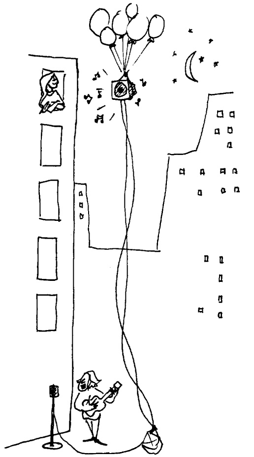
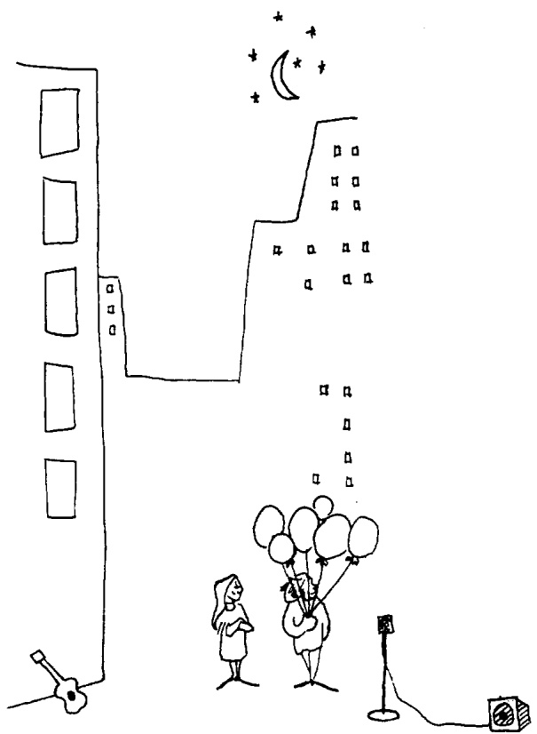

# 研究笔记：理解所需的语境前提——关于理解与记忆的若干研究（Contextual Prerequisites for Understanding: Some Investigations of Comprehension and Recall）

> 本笔记由 MinerU 解析原始 PDF 后整理，公式按原文逐条收录。

## 一、基本信息（Basic Information）

| 项目 | 内容 |
| --- | --- |
| 英文标题 | Contextual Prerequisites for Understanding: Some Investigations of Comprehension and Recall |
| 中文译名 | 理解所需的语境前提——关于理解与记忆的若干研究 |
| 作者 | John D. Bransford, Marcia K. Johnson |
| 机构 | State University of New York, Stony Brook, New York 11790 |
| 发表 venue 与年份 | 原文未明确说明（版权页标注 © 1972 by Academic Press, Inc.；收稿日期 Received March 13, 1972） |
| 代码链接 | 原文未明确说明（心理学行为实验，不涉及代码） |
| 任务 | 实验心理学 / 认知心理学——考察语境（context）与先验知识（prior knowledge）对语篇理解（comprehension）与回忆（recall）的影响 |
| 关键词 | 语境前提（contextual prerequisites）、先验知识（prior knowledge）、语义语境（semantic context）、主题（topic）、理解（comprehension）、回忆（recall） |

## 二、一句话概括（One-sentence Summary）

本文报告四个实验，证明**相关的语境知识是理解语篇的前提条件（prerequisite）**：在听到材料之前提供恰当的语境图或主题词，能显著提高被试的理解评分与回忆量；而在听之后才提供同样信息，则几乎无帮助。

## 三、研究问题与动机（Problem and Motivation）

当时关于理解（comprehension）最成熟的理论来自转换生成语言学（transformational linguistics，如 Chomsky, 1957/1965/1968; Postal, 1964）。该观点认为句子同时具有表层结构（surface structure）与深层结构（deep structure），理解即恢复并解释句子的抽象深层语义关系（Katz & Postal, 1964，p.12 称深层结构关系构成对认知意义的完整分析），句子记忆则保留深层而非表层形式。许多研究（如 Bever, Lackner & Kirk, 1969; Sachs, 1967 等）支持了深层结构的重要性。

但作者指出，理解与记忆表现的基础比"语义解释过的深层结构"更广：
- Kintsch (1972) 发现被试常知道比单句明确写出的更多内容；
- Bransford & Franks (1971, 1972) 与 Johnson, Bransford & Solomon（in press）表明，记忆任务中被试使用的信息可能来自多个相关句子的整合，并包含材料未直接表达的想法。

**经典例证**：给一组被试听 "The river was narrow. A beaver hit the log that a turtle was sitting beside/ on and the log flipped over…"。听到 "sitting on"（坐在原木上）的被试，比听到 "sitting beside"（坐在一旁）的被试，更可能误认自己听过 "A beaver hit the log and knocked the turtle into the water"——说明被试的理解包含了对情境可能后果的推断，并常把"可推断的信息"误记为已听到的信息。

由此引出本文核心论点：被试并非简单解释并存储句子意义，而是创造**语义产物（semantic products）**，它是输入信息与先验知识的联合函数。本文进一步聚焦：**某些先验知识对于信息的"意义加工（meaningful processing）"本身可能就是必要的**，而不只是事后反映在被试表现中。四个实验通过操纵"先验知识（语境/主题）的可用性"来评估其对理解与记忆的影响。

## 四、记号与预备知识（Notation and Preliminaries）

- **S / Ss**：被试（subjects）。
- **理解评分（comprehension rating）**：7 点量表，1 = 非常难懂，4 = 中等，7 = 非常易懂。
- **回忆（recall）**：以**观念单元（idea units）**计分，对应单个句子、基本语义命题或短语；允许释义（paraphrase）。
- **评分者间信度（interjudge reliability）**：对材料独立双评分，范围为 .91–.99；分歧由第三评分者仲裁。
- **语境（context）/ 语义语境（semantic context）**：材料所基于的概念情境。
- **主题（topic）**：用于激活合适语境的线索词。
- **d**：Dunnett 多重比较检验统计量；**F**：方差分析（ANOVA）F 统计量；**p**：显著性水平。

## 五、方法（Proposed Method）

四个实验采用同一范式：获取阶段（单次听觉录音呈现）→ 理解评分 → 回忆。

### 实验一（语境图操纵）

- **材料**：一段语篇，句子符合正常英语结构、词汇非隐喻。内容为"如果气球破了，声音就传不远……关窗也会阻挡声音……电线中断也有问题……人喊不够响……乐器琴弦断了就没有伴奏……最好距离更近、面对面接触"。该语篇并不直接描述语境图，而是以图所提供的基本概念基础，描述在该情境下可能发生的各种事件（实际指向"小夜曲表演中可能出现的沟通故障"）。
- **前提知识以"图片"形式给出**，提供语篇背后的语境信息。
- **五组，每组 10 人**：
  1. **No Context (1)**：只听语篇；
  2. **Context Before**：听之前看恰当语境图；
  3. **Context After**：先听语篇，再看恰当语境图；
  4. **Partial Context**：听之前看"部分语境图"（含恰当图全部物体，但重新排列，物体间关系不当）；
  5. **No Context (2)**：听语篇两遍（考察无语境下重复的效果）。
- **假设**：Context Before 理解与回忆最佳；Context After 低于 Context Before（语境对正在进行的理解过程是必要的）；Partial Context 低于 Context Before（物体关系不当，构成不恰当的概念基础）；No Context (2) 用于评估无语境下重复的作用。
- **流程**：组测。Context Before 与 Partial Context 组听前看各自图片 30 秒；No Context (2) 听两遍。获取后延迟 2 分钟评分（含 Context After 看图 30 秒），7 点量表；评分后立刻回忆 7 分钟，要求尽量写下要点。

### 实验二、三、四（主题词操纵）

范式同上（单次听觉呈现 + 理解评分 + 回忆，7 点量表相同），前提知识改为以**主题词（topic）**给出。

- **材料**：Passage A（表面为抽象步骤描述，实为"洗衣服"）；Passage B（A 的加长版）；实验四改用一系列句子（实为"做风筝并放飞"）。
- **条件**：No Topic / Topic After（听后给主题）/ Topic Before（听前给主题）。
  - 实验二：No Topic (17)、Topic After (17)、Topic Before (18)，材料 Passage A，主题"washing clothes（洗衣服）"；
  - 实验三：Topic After (10)、Topic Before (11)，材料 Passage B；
  - 实验四：No Topic (9)、Topic After (11)、Topic Before (11)，材料为句子串，主题"making and flying a kite（做风筝并放飞）"。
- **与 Dooling & Lachman (1971) 的区别**：本文语篇是直白的语言描述（而非隐喻），且专门设置"听后给主题"条件，以检验回忆提升是否仅来自被试对熟悉主题生成可能陈述的能力。

## 六、理论分析（Theoretical Analysis）

**原文未给出理论分析**（本文为实验报告，无定理、引理或推导）。但文中提出概念性论点：理解需要恰当的语义语境被**激活**；主题词的作用不仅是作为记忆术或图式（schema）来生成词汇匹配/联想，更关键的是帮助被试创建"可用于理解（in the first place）"的语境。作者强调，至少在本实验中，听后给主题组相对于听前组处于明显劣势，说明"知道主题"既非最优理解之必要也非其充分条件。

## 七、实验设计（Experimental Design）

- **被试**：实验一 50 名高中生志愿者；实验二 52 名 Stony Brook 人类学习课程大学生；实验三 21 名高中生；实验四 31 名高中生。
- **获取**：单次听觉呈现（录音或主试朗读），实验四句间间隔 2 秒。
- **评分**：同 7 点理解量表；延迟后回忆（5–7 分钟）。
- **统计**：以 Dunnett 检验比较 Context Before / Topic Before 与其余各组；实验三用 ANOVA 的 F 检验。
- **回忆计分**：a priori 设定观念单元，双评分者独立盲评，允许释义，第三人仲裁分歧；评分者间信度 .91–.99。

## 八、实验结果（Experimental Results）

**表 1（实验一）理解评分与回忆均值（括号为标准误，Maximum score 为满分）**

| | No context (1) | No context (2) | Context after | Partial context | Context before | 满分 |
| --- | --- | --- | --- | --- | --- | --- |
| 理解 | 2.30 (.30) | 3.60 (.27) | 3.30 (.45) | 3.70 (.56) | 6.10 (.38) | 7 |
| 回忆 | 3.60 (.64) | 3.80 (.79) | 3.60 (.75) | 4.00 (.60) | 8.00 (.65) | 14 |

实验一：Context Before 理解评分高于其余四组，均 $d(5,45) \geqslant 4.19,\ p < .005$；回忆亦高于其余四组，均 $d(5,45) \geqslant 4.12,\ p < .005$。相对 No Context (1)，听两遍 / 听后给语境 / 部分语境仅略提升理解评分，对回忆几乎无影响。

**表 2（实验二、三）理解评分与回忆均值**

| | ExpII No topic | ExpII Topic after | ExpII Topic before | ExpII 满分 | ExpIII Topic after | ExpIII Topic before | ExpIII 满分 |
| --- | --- | --- | --- | --- | --- | --- | --- |
| 理解 | 2.29 (.22) | 2.12 (.26) | 4.50 (.49) | 7 | 3.40 (.48) | 5.27 (.27) | 7 |
| 回忆 | 2.82 (.60) | 2.65 (.53) | 5.83 (.49) | 18 | 3.30 (.66) | 7.00 (.43) | 20 |

- 实验二：Topic Before 理解高于 No Topic 与 Topic After，Dunnett $(3,49) = 4.46,\ 4.80,\ p < .005$；回忆 $d(3,49) = 3.97,\ 4.20,\ p < .005$。
- 实验三：Topic Before 在理解与回忆上均高于 Topic After，$F(1,19) = 12.24$（理解）、$20.03$（回忆），均 $p < .005$。

**表 3（实验四）理解评分与回忆均值**

| | No topic | Topic after | Topic before | 满分 |
| --- | --- | --- | --- | --- |
| 理解 | 2.44 (.47) | 3.82 (.52) | 4.00 (.59) | 7 |
| 回忆 | 3.22 (.55) | 3.18 (.57) | 5.54 (.76) | 14 |

实验四：理解上 Topic Before 高于 No Topic，$d(3,28) = 2.01,\ p < .05$；但 Topic Before 与 Topic After 差异不显著（$p > .05$）。回忆上 Topic Before 优于 No Topic 与 Topic After，$d(3,28) = 2.49,\ 2.68,\ p < .05$。

## 九、相关工作（Related Work）

- **转换生成语言学深层结构理论**（Chomsky; Katz & Postal）：理解 = 恢复深层结构。本文在肯定其重要性的同时，扩展了"理解基础"的范围。
- **整合与推断研究**（Bransford & Franks, 1971, 1972; Johnson et al.）：记忆包含未直接表达的想法，本文承接并进一步聚焦"前提性"知识。
- **Dooling & Lachman (1971)**：主题影响散文保持（隐喻材料）。本文用直白材料并增设听后条件以分离效应。
- **Lachman 等（Pompi & Lachman, 1967; Dooling & Lachman, 1971）**：认为主题作为记忆术（mnemonic），通过图式重构助记。本文反驳：主题的关键作用在于**帮助创建可用于理解的语境**，而非仅作词汇匹配的图式。
- **认知结构作为前提**（Bartlett, 1932; Piaget, 1950; Ausubel, 1960; Arnheim, 1971; Gombrich, 1961; Winograd, 1971）：作者指出这些观点与本文一致，但认为目前尚无法精确综合并指明理解/记忆过程中的具体机制。

## 十、结论（Conclusion）

1. **相关语境知识是理解语篇的前提条件**；
2. **提供时机至关重要**：必须在理解进行中（听之前）提供才最有效，听后提供几乎无效；
3. **先验知识须被激活为语义语境才起作用**——"知识存在"不等于"知识有用"；
4. **部分语境不足**：仅有物体而无恰当关系，不构成理解基础（Partial Context 远低于 Context Before）；
5. 语境可用性的实验操纵，是研究"先验知识与当前输入交互"的有用策略。

## 十一、批判性评价与启发（Critical Appraisal）

### 11.1 优点

- 用巧妙的图片/主题操纵，简洁有力地证明"理解需要恰当语境"，且区分了"Context Before / After"与"Partial Context"，厘清了理解过程与检索线索（retrieval cues）对回忆的不同作用。
- 跨四个实验、不同材料形态（视觉语境图 vs 主题词；不同题材）结论稳健，增强了说服力。
- 与 Dooling & Lachman 的对比设计（直白材料 + 听后条件）使"语境/主题激活"的因果归因更清晰。

### 11.2 局限与可质疑之处

- **样本小、功效受限**：实验一每组仅 10 人（共 50 人）；实验四中 Topic Before 与 Topic After 的理解差异不显著，提示效应在某些条件下并不稳定。
- **回忆计分主观**：以"观念单元"建构性评分，虽双盲仲裁，仍依赖评分者判断。
- **无计算性机制**：仅提出概念框架，未给出可检验的"语境如何被激活"的模型或公式。
- **外部效度有限**：材料短、人工、实验室情境，难以直接推广到自然阅读与课堂教学。
- **语境与主题是否同一构念未细分**：本文称二者效应"类似"，但实验一的图并未包含主题信息却能大幅提升表现，暗示视觉语境可能比主题词更强，二者机制差异未进一步分析。

### 11.3 与本课题（Learning Cognitive Structure）的关联

- 本文直接呼应"认知结构（cognitive structure）是学习的 prerequisite"：先验知识 / 图式必须被激活，才能组织与同化新信息，这与 Ausubel (1960) 的"有意义学习（meaningful learning）"及"先行组织者（advance organizer）"思想一致。
- 对教学设计的启示：在向学习者呈现新材料前，应主动激活或提供恰当的情境 / 先行组织者；否则学习者会陷入类似实验中的"问题解决"式搜索，难以为整段材料找到合适组织，理解评分与保持量都会显著下降。

（以下为笔记撰写者的延伸思考，非原文内容）本文虽无形式化模型，但其"语境作为 prerequisite"的立场，可为本课题构建"学习者的认知结构先验 → 新信息的可理解性"测量框架提供实验范式参考，例如用"先给背景 / 后给背景"的回忆差异来量化某知识点的语境依赖程度。

## 附录 A：全文公式汇总（Formula Index）

**原文未给出数学公式**（论文为实验心理学研究，不含推导性或模型公式）。

论文中出现的均为统计检验统计量（属实验结果报告，而非数学公式），列于下方供参考：

| 编号 | 统计量 | 含义 |
| --- | --- | --- |
| (1) | $d(5,45) \geqslant 4.19,\ p < .005$ | 实验一理解评分，Context Before 与其余四组 Dunnett 检验 |
| (2) | $d(5,45) \geqslant 4.12,\ p < .005$ | 实验一回忆，Context Before 与其余四组 Dunnett 检验 |
| (3) | $\text{Dunnett}(3,49) = 4.46,\ 4.80,\ p < .005$ | 实验二理解，Topic Before vs No Topic / Topic After |
| (4) | $d(3,49) = 3.97,\ 4.20,\ p < .005$ | 实验二回忆，Topic Before vs 其余两组 |
| (5) | $F(1,19) = 12.24,\ p < .005$ | 实验三理解，Topic Before vs Topic After |
| (6) | $F(1,19) = 20.03,\ p < .005$ | 实验三回忆，Topic Before vs Topic After |
| (7) | $d(3,28) = 2.01,\ p < .05$ | 实验四理解，Topic Before vs No Topic |
| (8) | $d(3,28) = 2.49,\ 2.68,\ p < .05$ | 实验四回忆，Topic Before vs No Topic / Topic After |

（以上 $d$ 为 Dunnett 检验统计量，$F$ 为 ANOVA F 统计量，均为结果报告，非数学推导公式。）

## 附录 B：图表索引（Figure & Table Index）

| 编号 | 内容 | 文件路径 |
| --- | --- | --- |
| 图 1 | 实验一恰当语境图（气球、窗、电线、乐器等小夜曲场景） | ../md/Bransford_Johnson_1972_Contextual_Prerequisites_markdown/images/page_1_image_9.jpg |
| 图 2 | 实验一部分语境图（物体相同但重新排列，关系不当） | ../md/Bransford_Johnson_1972_Contextual_Prerequisites_markdown/images/page_2_image_7.jpg |
| 表 1 | 实验一理解评分与回忆均值（正文 Markdown 表格） | 正文「八、实验结果」Table 1（对应切图 page_3_table_13.jpg） |
| 表 2 | 实验二、三理解评分与回忆均值（正文 HTML/Markdown 表格） | 正文「八、实验结果」Table 2（对应切图 page_6_table_12.jpg） |
| 表 3 | 实验四理解评分与回忆均值（正文 Markdown 表格） | 正文「八、实验结果」Table 3（对应切图 page_6_table_16.jpg） |
