# 研究笔记：检索练习比精加工学习（概念图）产生更多学习（Retrieval Practice Produces More Learning than Elaborative Studying with Concept Mapping）

> 本笔记由 MinerU 解析原始 PDF 后整理，公式按原文逐条收录。本文为实证（empirical）研究，原文未给出模型推导类数学公式，统计结果见附录 A。

## 一、基本信息（Basic Information）

| 项目 | 内容 |
| --- | --- |
| 英文标题 | Retrieval Practice Produces More Learning than Elaborative Studying with Concept Mapping |
| 中文译名 | 检索练习比精加工学习（概念图）产生更多学习 |
| 作者 | Jeffrey D. Karpicke、Janell R. Blunt |
| 机构 | Department of Psychological Sciences, Purdue University, USA |
| 发表 venue 与年份 | *Science*, 2011, 331(6018): 772（在线发表 2011-01-20，DOI: 10.1126/science.1199327） |
| 代码链接 | 原文未提供；材料与方法见 Science Online 补充材料（Supporting Online Material） |
| 任务 | 教育心理学/学习科学实证实验：比较检索练习（retrieval practice）与精加工学习（elaborative studying，以概念图 concept mapping 为操作）对科学文本长时意义学习的影响 |
| 关键词 | 检索练习（retrieval practice）、概念图（concept mapping）、精加工学习（elaborative studying）、意义学习（meaningful learning）、元认知（metacognition）、提取练习效应（testing effect） |

## 二、一句话概括（One-sentence Summary）

作者通过两个课堂实验发现，在总学习时间严格匹配的前提下，**主动提取并重构知识的检索练习**比被广泛使用的精加工学习活动（边看材料边画概念图）能带来显著更多的长时意义学习（效应量高达 d≈1.0–1.5，约 1–1.5 个标准差），且这一优势在最终测验采用简答题、甚至采用"画概念图"本身时都成立，但学生普遍无法凭元认知预测到这一好处。

## 三、研究问题与动机（Problem and Motivation）

作者指出，关于人类学习的思考长期依赖几个"隐性假设"（tacit assumptions）：其一，学习主要发生在个体**编码**（encoding）知识的时候；其二，**检索**（retrieval，即在线索驱动下主动重构知识的过程）只是测量已有学习结果的手段，本身并不产生学习——正如"测量物体的大小不会改变物体本身"，人们也假设"测量记忆不会改变记忆"（Bjork 1975; Karpicke & Roediger 2007）。因此，教育研究与实践主要聚焦于"把知识装进记忆"的编码加工，而对检索在学习中的作用关注甚少——连美国国家研究委员会（National Research Council）关于"学生如何学习"的丛书都未提及检索过程。

然而认知科学证据表明：检索并非中性，它本身就是一种强大的学习活动，甚至可能比编码事件更具学习价值。每位作者想检验的核心问题是：

> **检索练习是否比另一种"主动的、精加工的学习活动"（概念图）更有效？** 如果存在检索特异性机制（retrieval-specific mechanisms），那么检索练习带来的学习可能超越科学教育中常用的精加工学习活动；否则两种活动效果可能持平。

选择概念图作为对照的代表性理由：概念图（concept mapping）由 Novak 等人提出，学生在节点（nodes，表示概念）之间用连线（links，表示概念间关系）构建图示。当学生在**能看到所学材料**的情况下构建概念图时，它具备精加工学习方法的所有特征——要求学生丰富材料、在有序的知识结构中编码概念间有意义的关系，是被教育界广泛倚重的"主动学习"活动。把它和检索练习直接对比，是对"主动学习=更多学习"这一直觉的严格检验。

## 四、记号与预备知识（Notation and Preliminaries）

本文为行为实验，无形式化记号体系，仅涉及以下常用概念与统计量的中文-英文对应：

- **检索练习（retrieval practice）**：初始学习阶段后，学生在不看材料的情况下尽力回忆（自由回忆 free recall）所学内容，随后重学再回忆；通过"提取—重构"促进学习。
- **精加工学习/概念图（elaborative studying / concept mapping）**：学生在看到所学文本的同时，在纸上构建概念图（先看示例、再自行绘制），属于在材料在场条件下的精加工编码活动。
- **意义学习（meaningful learning）**：指学生能进行推理（inference）、展现对概念的深层理解，区别于机械记忆；文中用两类题目测量：
  - **逐字题（verbatim questions）**：考查文本中直接陈述的概念性知识；
  - **推理题（inference questions）**：要求学生连通文本中多个概念，考查更深层的概念理解。
- **元认知判断/学习判断（judgments of learning, JOL）**：学生在学习阶段预测自己一周后能记住文本信息的百分比。
- **统计量与效应量**：文中报告方差分析 F 值 $F_{df1,df2}$、偏 eta 方（partial eta-squared, $\eta_{\mathrm{p}}^2$）与 Cohen's d（标准化均值差异，衡量组间差异的标准差倍数）。误差棒表示标准误（SEM）。

## 五、方法（Proposed Method / Experimental Design）

### 5.1 实验 1：被试间四条件设计

- **被试**：80 名本科生（undergraduate students）。
- **初始学习阶段**设四个条件：
  1. **学一次（study-once）**：单段学习文本。
  2. **重复学习（repeated study）**：连续四段学习同一文本（Roediger & Karpicke 2006 范式）。
  3. **精加工概念图（elaborative concept mapping）**：先学一段文本，随后在**看到文本**的情况下在纸上画概念图（先看概念图说明与示例再自行绘制）。
  4. **检索练习（retrieval practice）**：先学一段，随后进行自由回忆（尽可能写出所学信息），回忆一次后重学文本再回忆一次。
- **关键控制**：概念图条件与检索练习条件的**总学习时间被精确匹配**（exactly matched）。
- **初始学习等价性检验**：概念图上产生的观点比例（0.78）与检索练习回忆出的观点比例（0.81）几乎相同 $[F_{1,38}=0.46$，不显著]，说明后续最终测验的差异不能被初始学习时间或初始产出比例差异所混淆。
- **元认知测量**：学习阶段结束后，学生预测一周后能记住的文本信息百分比（Dunlosky & Metcalfe 2009）。
- **最终测验（一周后）**：简短回答测验（short-answer test），含逐字题与推理题两类，均属概念性题目，但考查不同深度的概念知识。

### 5.2 实验 2：被试内设计 + 文本结构泛化 + 多测验形式

作者用第二个实验复制并扩展实验 1，扩展体现在三方面：

1. **泛化到不同知识结构的文本**：采用**枚举结构（enumeration structures）**文本（描述一列概念，如不同肌肉组织特性）与**序列结构（sequence structures）**文本（描述连续有序的事件序列，如消化过程），因为不同学习活动效果可能依赖材料结构。
2. **考察每个个体的稳健性**：共 **120 名学生**，采用**被试内设计**——每名学生对一篇文本画概念图、对另一篇文本做检索练习，从而统计多少学生表现出检索优势、多少相反、多少无差异。
3. **两种最终测验形式**：一半学生做与实验 1 相同的简答测验；另一半做**最终概念图测验**（不看文本、凭记忆为两篇文本构建概念图）。若"初始学习与最终测验的表面相似性"是关键，则最终也画概念图时，初始概念图条件应占优——以此检验检索优势的稳健性。

- **初始学习等价性/偏向检验**：概念图产生的观点比例（0.74）高于检索练习初始测验（0.65）$[F_{1,117}=23.13,\ \eta_{\mathrm{p}}^2=0.17]$，即初始表现**偏向概念图条件**，使后续检索优势更保守、更可信。
- **元认知**：每次文本学习后分别收集学习判断。

## 六、理论解释（Theoretical Account）

> 原文未给出形式化定理或数学证明；以下为作者对本研究机制的概念性理论解释（非公式推导），源自论文讨论部分。

作者提出，检索与精加工在学习机制上存在根本差异：

- **精加工（elaboration）**通过丰富或增加已编码特征的数量，使个体获得细节化的编码表征；
- **检索（retrieval）**则利用检索线索（retrieval cues）重构"在特定时间、特定地点发生了什么"。在自由回忆中，被试必须先建立**组织化检索结构**（organizational retrieval structure, Raaijmakers & Shiffrin 1981），再在其中辨别并恢复单个概念（Hunt & McDaniel 1993）。

作者据此推测，**检索练习提升了检索线索的诊断价值**（diagnostic value / cue diagnosticity，即一条线索能在排除其他候选的前提下多好地指向某一特定知识，Nairne 2002, 2006; Karpicke & Zaromb 2010）。换言之，检索练习并非像精加工那样"增加编码特征数量"，而是通过把线索所指定的候选集合收窄进搜索集，从而**提高线索诊断性**。这一"检索特异性机制"解释了为何检索练习比精加工学习产生更多长时学习。

## 七、实验设计（Experimental Design）

（设计细节见第五节，本节汇总关键参数。）

| 维度 | 实验 1 | 实验 2 |
| --- | --- | --- |
| 设计 | 被试间，4 条件 | 被试内，每人两文本（一图一检索） |
| 被试数 | 80 名本科生 | 120 名学生 |
| 文本类型 | 未明确说明具体结构（常见科学文本） | 枚举结构 + 序列结构 |
| 关键控制 | 概念图 vs 检索总学习时间精确匹配 | 同左；初始表现偏向概念图 |
| 最终测验 | 一周后简答（逐字 + 推理） | 一半简答、一半最终概念图（不看文本） |
| 元认知 | 学习后预测一周 retention | 每文本学习后分别预测 |

## 八、实验结果（Experimental Results）

### 8.1 实验 1

- 一周后最终简答测验中，**重复学习、精加工概念图、检索练习**三条件在逐字题与推理题上均显著优于"学一次"条件（图 1A、1B）。
- 检索练习效果最好，且**优于精加工概念图**；而概念图条件相比"多花时间重读"并无显著更优。
- 跨题型合并：检索练习 $M=0.67$，精加工概念图 $M=0.45$，长时保持分数提升约 **50%**；效应量 **$d=1.50$**，$F_{1,38}=21.63$，$\eta_{\mathrm{p}}^2=0.36$。即检索练习比概念图高出约 **1.5 个标准差**。
- **元认知失配**：学生在初始阶段预测"重复学习" retention 最好、"检索练习"最差，与真实结果相反（图 1C）。

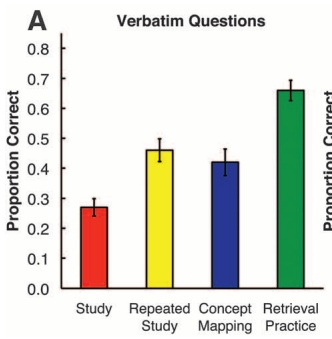
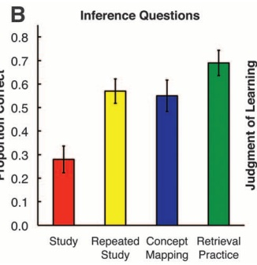
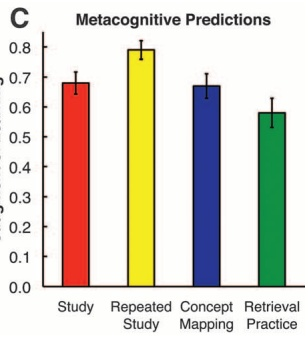

### 8.2 实验 2

- 最终简答测验中，检索练习在**枚举与序列两类文本**上均优于概念图（图 2A、2B）；跨文本合并效应量 **$d=1.07$**，$F_{1,59}=68.54$，$\eta_{\mathrm{p}}^2=0.54$。
- **关键稳健性检验**：即便最终测验本身就是"凭记忆画概念图"（图 2C、2D），初始做检索练习仍优于初始做概念图，效应量 **$d=1.01$**，$F_{1,59}=58.42$，$\eta_{\mathrm{p}}^2=0.50$。表面相似性假设被推翻。
- **元认知**：学生普遍错误预测概念图 ≥ 检索练习（图 2E–2H）。
- **个体层面（表 1）**：在 120 名学生中，**101 人（84%）**最终测验表现检索 > 概念图；仅 13 人为相反、6 人无差异。而 **90 人（75%）**认为概念图不逊于甚至优于检索练习——绝大多数人未能预期检索的优势。

| 表 1 摘要（实验 2 个体表现与元认知模式，单位：人数） | Retrieval > Mapping | Retrieval = Mapping | Retrieval < Mapping |
| --- | --- | --- | --- |
| 最终简答测验 | 52 | 3 | 5 |
| 最终概念图测验 | 49 | 3 | 8 |
| 合计 Total | 101 | 6 | 13 |
| 元认知预测-简答 | 12 | 14 | 34 |
| 元认知预测-概念图 | 18 | 17 | 25 |
| 元认知预测合计 | 30 | 31 | 59 |

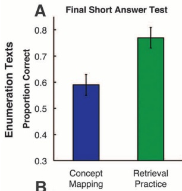
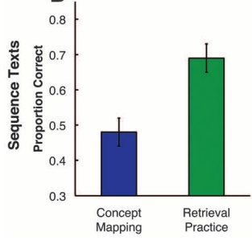
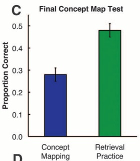
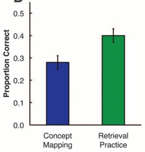
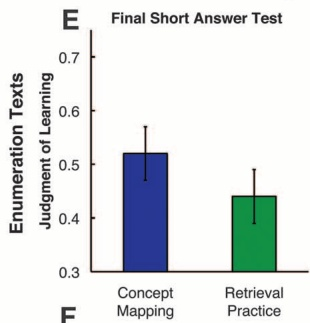
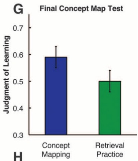
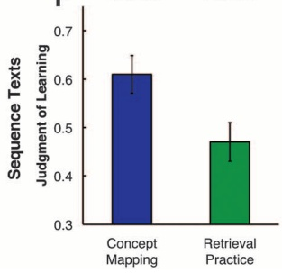
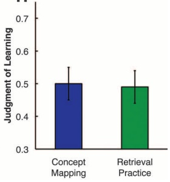

## 九、相关工作（Related Work）

- **与既往检索练习研究的关系**：此前多数检索练习研究沿用言语学习（verbal learning）传统，材料较简单、未反映真实教育情境的复杂信息，也少用测量"意义学习"的评估（Karpicke & Roediger 2008; Roediger & Karpicke 2006 等）。本文把检索练习置于真实科学文本与推理/逐字双题型框架下，弥补了生态效度缺口。
- **与概念图研究的关系**：概念图（Novak & Gowin 1984; Nesbit & Adesope 2006 元分析）通常被视为有效的精加工/主动学习活动。本文并非否定概念图本身，而是区分了"材料在场的概念图=精加工"与"材料不在场的概念图=检索练习"两种机制，并指出**"是否主动"并不能诊断学习活动产生多少学习**——活动的具体性质（编码 vs 检索）才是关键。
- **与材料结构研究的关系**：McDaniel & Einstein (1989)、Cook & Mayer (1988) 指出学习活动效果可能依赖材料结构，故实验 2 特意纳入枚举与序列两类结构以检验泛化性。

## 十、结论（Conclusion）

1. **检索练习优于精加工学习**：在总学习时间匹配下，检索练习比边看材料边画概念图产生更多长时意义学习，优势达约 1–1.5 个标准差（d=1.07–1.50）。
2. **优势稳健且可泛化**：跨文本结构（枚举/序列）、跨最终测验形式（简答甚至"画概念图"本身）均成立，且 84% 的个体表现出检索优势。
3. **支持检索特异性机制**：结果支持"检索通过检索特异性机制（提升线索诊断性）增强学习"，而非通过精加工编码过程。
4. **元认知盲区**：学生普遍预测概念图不逊于甚至优于检索练习，实际恰恰相反，揭示教育实践中对检索价值的系统性低估。

## 十一、批判性评价与启发（Critical Appraisal）

### 11.1 优点

- **控制了关键混淆变量**：概念图与检索练习总学习时间精确匹配；实验 1 初始产出比例等价、实验 2 初始表现反而偏向概念图，使检索优势结论更稳健、更难被"初始投入差异"解释。
- **生态效度较高**：使用真实科学教育类文本、双题型（逐字+推理）、并泛化到枚举/序列结构，回应对既往检索研究"材料简单"的批评。
- **最严格的检验设计**：实验 2 让最终测验本身变成"画概念图"，直接排除了"初始-测验表面相似性"这一替代解释，论证有力。
- **个体差异视角**：表 1 提供个体层面分布，而非仅报群体均值，结论更有说服力。

### 11.2 局限与可质疑之处

- **样本与生态边界**：被试为本科生、材料为特定科学说明文，推广到中小学课堂、其他学科或长周期学习仍需谨慎（原文将其作为"科学教育中的概念学习"推论，外部效度待验证）。
- **概念图操作的定义**：作为对照的"概念图"是"材料在场"的精加工版本；若采用"材料不在场的概念图"（即检索练习的一种），结果可能不同——作者也承认概念图本身并非天生只是精加工任务。因此对照的是"精加工式概念图"，而非概念图方法的全部潜力。
- **元认知结论的解释**：学生低估检索价值，可能部分源于实验情境与告知方式，未必完全反映真实教学中的可迁移元认知；且该文未训练学生元认知，无从判断干预能否纠正偏差。
- **统计细节缺失**：部分报告（如误差棒 SEM、各条件逐字/推理细分均值）依赖图表，正文未给全数值；材料与方法在补充材料，主文可独立复现性有限。

### 11.3 与本课题（Learning Cognitive Structure）的关联

- 本文直接关乎"学习者如何构建并长期保持**认知结构**（cognitive structure）"：作者主张检索练习帮助建立"组织化检索结构"与提升"线索诊断性"，这与认知结构的可提取性（accessibility）而非单纯存储量密切相关。
- 对"概念图能外化/促进认知结构"的常识提出了修正——外显构建结构（精加工）并不必然优于隐性重构（检索），提示在设计促进认知结构形成的干预时，应更重视**提取与重构**而非仅重视编码丰富度。
- **以下为笔记撰写者的延伸思考，非原文内容**：若将"检索练习"映射到本课题，可设想用结构化提取任务（如让学生不看材料地重建知识网络）来测量与训练认知结构；同时，概念图作为"材料不在场"的检索任务，或可作为认知结构诊断工具，与本文的"材料在场"版本形成方法学对照。

## 附录 A：全文公式汇总（Formula Index）

**原文未给出数学推导公式（无模型公式、定理或证明）。** 本文为行为实验，所有量化结果均为统计检验报告，文中未见显式写出的数学公式（如 Cohen's d 的表达式、$\eta_{\mathrm{p}}^2$ 的算式均未在正文以公式形式给出）。下表汇总文中报告的关键统计量及其含义，供查证：

| 编号 | 文中统计量（原文形式） | 含义 / 对应结果 |
| --- | --- | --- |
| A1 | $F_{1,38}=0.46$（不显著） | 实验 1 初始概念图观点比例(0.78) vs 检索回忆比例(0.81) 无差异，初始学习等价 |
| A2 | $d=1.50,\ F_{1,38}=21.63,\ \eta_{\mathrm{p}}^2=0.36$ | 实验 1 最终测验检索练习($M=0.67$) vs 概念图($M=0.45$) 的优势，约 1.5 SD |
| A3 | $F_{1,117}=23.13,\ \eta_{\mathrm{p}}^2=0.17$ | 实验 2 初始概念图比例(0.74) > 检索初始(0.65)，初始表现偏向概念图 |
| A4 | $d=1.07,\ F_{1,59}=68.54,\ \eta_{\mathrm{p}}^2=0.54$ | 实验 2 最终简答测验检索 > 概念图（跨文本合并） |
| A5 | $d=1.01,\ F_{1,59}=58.42,\ \eta_{\mathrm{p}}^2=0.50$ | 实验 2 最终概念图测验（不看文本）检索 > 概念图 |

> 说明：上表为文中以数值形式报告的统计检验结果，并非原文以 LaTeX/公式块写出的推导式。Cohen's d 与偏 eta 方的标准定义属方法学惯例，原文未显式列出算式，故不在此杜撰其表达式。

## 附录 B：图表索引（Figure & Table Index）

| 编号 | 内容 | 文件路径 |
| --- | --- | --- |
| Figure 1A | 实验 1 逐字简答题正确率 | ../md/Karpicke_Blunt_2011_Retrieval_Concept_Mapping_markdown/images/page_2_chart_6.jpg |
| Figure 1B | 实验 1 推理简答题正确率 | ../md/Karpicke_Blunt_2011_Retrieval_Concept_Mapping_markdown/images/page_2_chart_7.jpg |
| Figure 1C | 实验 1 元认知学习判断预测 | ../md/Karpicke_Blunt_2011_Retrieval_Concept_Mapping_markdown/images/page_2_chart_8.jpg |
| Figure 2A | 实验 2 枚举文本简答正确率 | ../md/Karpicke_Blunt_2011_Retrieval_Concept_Mapping_markdown/images/page_2_chart_16.jpg |
| Figure 2B | 实验 2 序列文本简答正确率 | ../md/Karpicke_Blunt_2011_Retrieval_Concept_Mapping_markdown/images/page_2_chart_17.jpg |
| Figure 2C | 实验 2 枚举文本最终概念图测验正确率 | ../md/Karpicke_Blunt_2011_Retrieval_Concept_Mapping_markdown/images/page_2_chart_18.jpg |
| Figure 2D | 实验 2 序列文本最终概念图测验正确率 | ../md/Karpicke_Blunt_2011_Retrieval_Concept_Mapping_markdown/images/page_2_chart_20.jpg |
| Figure 2E | 实验 2 元认知预测（枚举-简答） | ../md/Karpicke_Blunt_2011_Retrieval_Concept_Mapping_markdown/images/page_2_chart_22.jpg |
| Figure 2F | 实验 2 元认知预测（序列-简答） | ../md/Karpicke_Blunt_2011_Retrieval_Concept_Mapping_markdown/images/page_2_chart_23.jpg |
| Figure 2G | 实验 2 元认知预测（枚举-概念图） | ../md/Karpicke_Blunt_2011_Retrieval_Concept_Mapping_markdown/images/page_2_chart_24.jpg |
| Figure 2H | 实验 2 元认知预测（序列-概念图） | ../md/Karpicke_Blunt_2011_Retrieval_Concept_Mapping_markdown/images/page_2_chart_25.jpg |
| Table 1 | 实验 2 个体实际表现与元认知判断的模式分布（正文中以 HTML 表格呈现，非图片） | 正文内联表格（见第八节），images 下无对应切图 |
