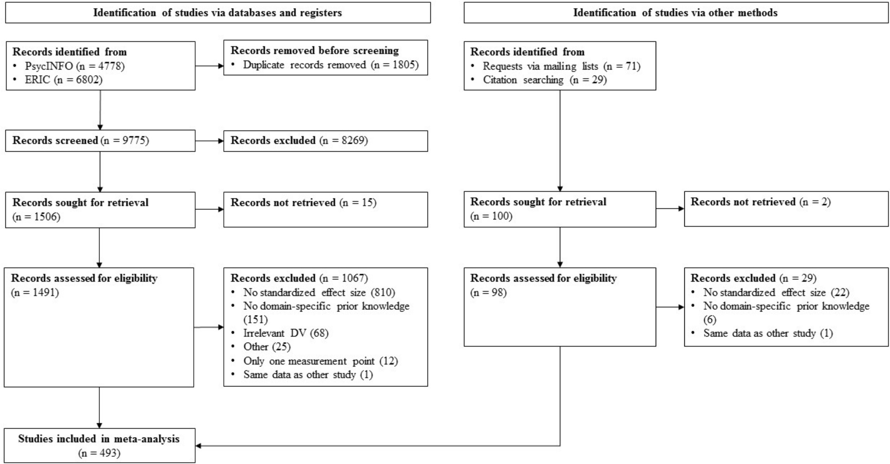
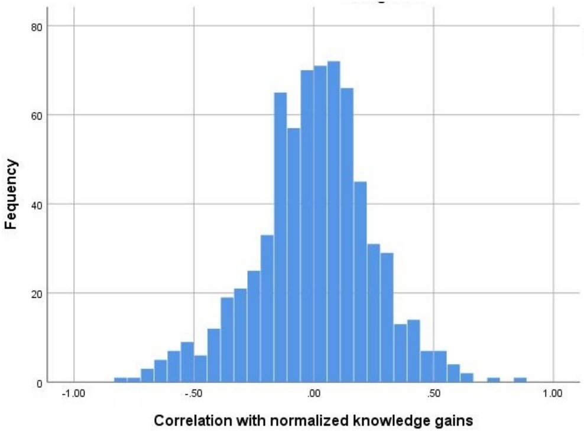
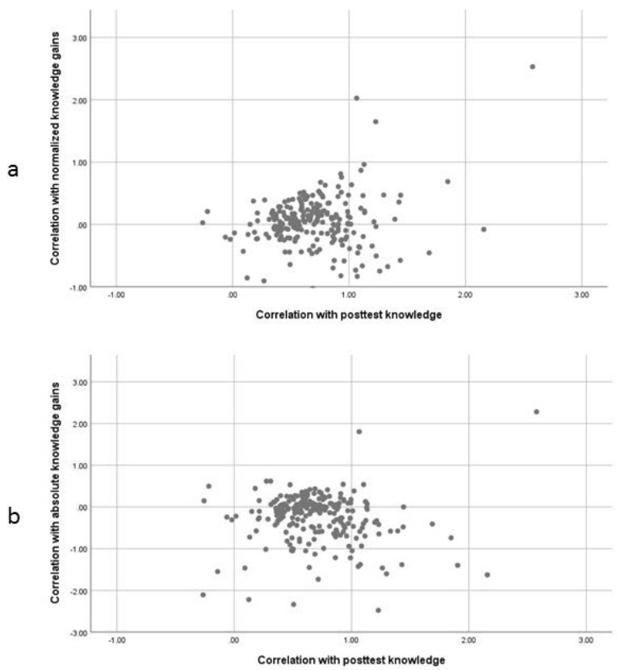
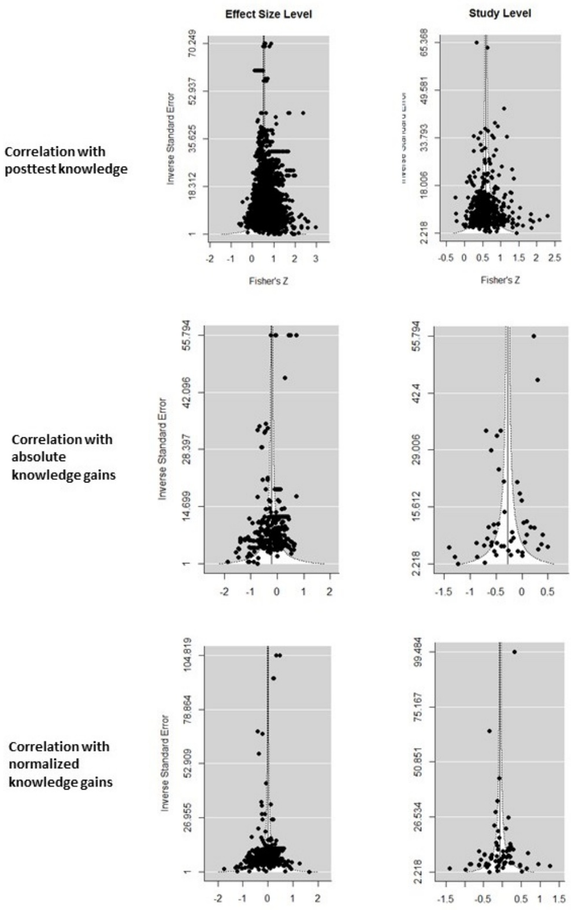

# 研究笔记：领域特异性先验知识与学习：一项元分析（Domain-Specific Prior Knowledge and Learning: A Meta-Analysis）

> 本笔记由 MinerU 解析原始 PDF 后整理，公式按原文逐条收录。本文是一篇**元分析（meta-analysis）**，研究对象为"先验知识（prior knowledge）"与"学习"之间的关系，强调区分两种不同含义的效应量。

## 一、基本信息（Basic Information）

| 项目 | 内容 |
| --- | --- |
| 英文标题 | Domain-Specific Prior Knowledge and Learning: A Meta-Analysis |
| 中文译名 | 领域特异性先验知识与学习：一项元分析 |
| 作者 | Bianca A. Simonsmeier, Maja Flaig, Anne Deiglmayr, Lennart Schalk, Michael Schneider |
| 机构 | 特里尔大学（德）、图宾根大学（德）、莱比锡大学（德）、苏黎世联邦理工与施维茨师范学院（瑞士） |
| 发表 venue 与年份 | Educational Psychologist；2021（in press，稿件接受版） |
| DOI | 10.1080/00461520.2021.1939700 |
| 代码链接 | 数据与统计代码"available upon request"（原文未公开仓库） |
| 任务/研究类型 | 元分析（meta-analysis），综述类 |
| 关键词 | prior knowledge（先验知识）；knowledge-is-power hypothesis（知识即力量假说，KiP）；learning（学习）；achievement（学业成就）；gain scores（增益分数） |

## 二、一句话概括（One-sentence Summary）

本元分析整合 493 项研究、685 个独立样本、126,050 名被试与 8,776 个效应量，发现**先验知识对"学后测知识"的预测力很强（个体知识差异的稳定性 $r_{\mathrm{P}}^{+}=.531$），但对其"知识增益"的预测力几乎为零（标准化增益 $r_{\mathrm{NG}}^{+}=-.059$），且效应量高度异质、预测区间极宽，从而证伪了"知识即力量"或"先验知识无关紧要"这类笼统论断，呼吁系统研究先验知识发挥正负效应的条件与中介机制。**

## 三、研究问题与动机（Problem and Motivation）

"知识即力量假说（KiP）"认为领域特异性知识（domain-specific knowledge）是表现与学习最强的前因之一（Ausubel 1968 的"影响学习的最重要的单一因素就是学习者已知的东西"）。但作者指出，以往大量研究在**方法论上混淆了两种相关性**：

- 先验知识与**学后测知识（posttest knowledge）**的相关 $r_{\mathrm{P}}$：反映个体间知识量排名在学前的稳定性，即使无人学习、排名不变，$r_{\mathrm{P}}$ 也会很高。
- 先验知识与**知识增益（knowledge gains）**的相关 $r_{\mathrm{G}}$：反映高先验知识者是否比低先验知识者学得更多（正）或更少（负），即 Matthew 效应（富者愈富）还是补偿效应（compensation effect）。

许多文献错误地把 $r_{\mathrm{P}}$ 当作支持 KiP（先验知识促进学习）的证据，而实际上只有 $r_{\mathrm{G}}$ 才能回答"先验知识是否预测了新知识习得"。作者因此强调必须同时报告并解释两者。此外，$r_{\mathrm{P}}$ 与 $r_{\mathrm{NG}}$ 在统计上**部分独立**：一个高、另一个可高可低可负（见图 1）。

作者的核心动机：在实证层面首次系统量化（a）先验知识对学习的平均效应，（b）效应量分布形态（是否存在明显正负两群），（c）异质性，（d）能解释效应差异的**调节变量（moderators）**。

## 四、记号与预备知识（Notation and Preliminaries）

| 记号 | 含义 |
| --- | --- |
| $r_{\mathrm{P}}$ | 先验知识（前测）与学后测知识（后测）之间的相关，表示个体/群体知识差异的**稳定性（stability）** |
| $r_{\mathrm{G}}$ | 先验知识与知识增益之间的相关，表示先验知识对"学习新知识"的**预测力（predictive power）** |
| $r_{\mathrm{AG}}$ | 先验知识与**绝对增益（absolute gain, AG）**的相关 |
| $r_{\mathrm{NG}}$ | 先验知识与**标准化增益（normalized gain, NG）**的相关 |
| AG | 绝对增益 $= \text{后测分数} - \text{前测分数}$ |
| NG | 标准化增益 $= (\text{后测分数} - \text{前测分数}) / (\text{量表满分} - \text{前测分数})$ |
| $r^{+}$ | 经校正（测量误差、二分变量方差损失、winsorize）后的效应量 |
| $SD_{X},\ SD_{Y}$ | 前测、后测分数的标准差 |
| $I^{2},\ \tau^{2}$ | 异质性指标（meta-analysis 中由抽样误差之外因素解释的变异比例） |
| RVE | 稳健方差估计（robust variance estimation），用于处理相依效应量 |

先验知识定义：学习开始时个体长时记忆中可用的知识，包括陈述性知识（declarative knowledge）、程序性知识（procedural knowledge）以及科学上正确或错误的概念（misconceptions）。领域特异性指知识关联到某领域的核心原理（如数学中的"等价"、物理中的"力"）。

## 五、方法：元分析流程（Meta-Analytic Method）

（本文无独立"理论分析"章节，故删去模板第六节，相关数学推导见附录 A。）

1. **文献检索与筛选**：2018 年 5 月检索 PsycINFO 与 ERIC，并以 PRISMA 流程（见图 2）筛选；额外通过邮件列表、网络搜索补获 29 项研究。最后纳入 **493 项研究**，列于补充材料 SM1。

2. **纳入标准**：(1) 测量或操纵领域特异性先验知识"数量"；(2) 有学后测知识或知识增益的测量；(3) 能提供至少一个可计算的标准化效应量。排除：仅操纵知识"激活"、自我评估、晶体智力、复合分数等。
3. **编码**：主编码员 + 3 名受训助手，100 个效应量独立编码，绝对一致率 89%–92%；多测量点研究对每对测量点编码 $r_{\mathrm{P}}$，对含前测的增益编码 $r_{\mathrm{G}}$。
4. **缺失数据补充**：向符合纳入标准但未报告效应量的作者发 1,192 封邮件，回收 71 项研究的 1,252 个 unpublished 效应量。
5. **效应量准备**：以 Pearson 相关 $r$ 为主因变量；组间设计由均值/标准差计算 AG、NG 再转 Cohen's $d$ 再转 $r$；全部效应量做 **Fisher Zr 变换**以近似正态；仅在原研究报告信度时校正测量误差；对二分变量造成的方差损失按 Schmidt & Hunter (2015) 校正，并 winsorize 到 $[-1,1]$。
6. **异常值**：用 Cook's 值识别并剔除——学后测 2 个、绝对增益 6 个、标准化增益 4 个。
7. **统计分析与调节**：采用**随机效应模型（random-effects models）**与**稳健方差估计（RVE）**处理相依效应量（robumeta 包）；连续调节变量做对数变换，分类变量以最低效应量水平为参照做哑变量编码；每项调节变量单独回归（避免多重共线性），用 clubSandwich 包 Wald 检验整体显著性并计算 $R^{2}$。
8. **发表偏倚**：漏斗图 + Egger 回归（metafor 包），分别对单个效应量与研究平均效应量检验。

## 六、实验设计（Experimental Design）

> 元分析的"实验设计"即其研究方案与样本构成，文中称为 Characteristics of the Included Studies。

**研究总体规模**：493 项研究、685 个独立样本、126,050 名被试、8,776 个效应量。

**样本与情境特征**：
- 发表年份中位数 2012，最早 1965；68% 发表于近 10 年。
- 覆盖 47 个国家：北美 45%、欧洲 33%、亚洲 12%、中东 4%、澳新 4%、非洲 1%、南美 1%。
- 前测（先验知识）到后测（学习结果）间隔 0–3,780 天，中位数 360 天。
- 被试年龄均值 11.32 岁（$SD=6.90$），范围 7.5 个月至 42.39 岁。

**三类效应量对应的研究数/效应量数**：
- $r_{\mathrm{P}}$（先验知识—学后测）：476 项研究、7,772 个效应量，范围 $[-.565, .995]$；其中 9 项 RCT（45 个效应量）。
- $r_{\mathrm{AG}}$（先验知识—绝对增益）：50 项研究、307 个效应量，范围 $[-.954, .623]$。
- $r_{\mathrm{NG}}$（先验知识—标准化增益）：69 项研究、697 个效应量，范围 $[-.943, .929]$。

**调节变量（moderators）**：分四类——知识相关（知识类型、子类型、内容领域、相似性 7 维度等）、学习者相关（年龄、教育水平）、环境相关（认知要求、教学干预形式、国家）、方法相关（发表状态、题目数、反应格式等）。完整列表见 SM2，结果见 SM4（表 S1）。

**五大研究问题（RQ）与对应假设**：
- RQ1：知识差异跨时间稳定性多高？→ 假设 $r_{\mathrm{P}}\ge .50$（强）。
- RQ2：$r_{\mathrm{NG}}$ 分布单峰还是双峰？→ 假设单峰（接近正态）。
- RQ3：$r_{\mathrm{NG}}$ 均值多少？→ 假设 $0 < r_{\mathrm{NG}} < r_{\mathrm{P}}$（弱正）。
- RQ4：$r_{\mathrm{P}}$ 与 $r_{\mathrm{NG}}/r_{\mathrm{AG}}$ 跨研究相关多强？→ 假设相关小（<$ .50）。
- RQ5：$r_{\mathrm{AG}}$ 是否小于 $r_{\mathrm{NG}}$？→ 假设 $r_{\mathrm{AG}} < r_{\mathrm{NG}}$（天花板效应导致）。

## 七、实验结果（Experimental Results）

**主元分析结果（表 2，含全部三类效应量的研究）**：

| 效应量类型 | $j$（研究数） | $k$（效应量数） | $r^{+}$ | 95% CI | $\tau^{2}$ | $I^{2}$ |
| --- | --- | --- | --- | --- | --- | --- |
| $r_{\mathrm{P}}$（学后测） | 476 | 7772 | **.531** | [.509, .552] | .112 | 94.16 |
| $r_{\mathrm{AG}}$（绝对增益） | 50 | 307 | **-.263** | [-.370, -.149] | .224 | 98.05 |
| $r_{\mathrm{NG}}$（标准化增益） | 69 | 697 | **-.059** | [-.150, .034] | .120 | 96.94 |

仅纳入能同时计算三类效应量的 28 项研究（238 个效应量）时：$r_{\mathrm{P}}^{+}=.632$，$r_{\mathrm{AG}}^{+}=-.277$，$r_{\mathrm{NG}}^{+}=.001$。

**RQ1（稳定性）**：$r_{\mathrm{P}}^{+}=.531$，显著大于 0 且按 Cohen 标准属强相关；但异质性强（$I^{2}=94.16$），95% 预测区间 $[-.067, .848]$ 极宽。9 项 RCT 给出因果证据 $r_{\mathrm{P}}^{+}=.394$；控制智力后相关未显著下降（$z=.219, p=.413$）。

**RQ2（分布）**：$r_{\mathrm{NG}}$ 分布**单峰、近正态**（偏度 $-.230$，超额峰度 $.612$，均值 $-.059$、中位数 $.010$ 接近；KS 检验 $p=.002$ 因大样本高检验力）。证伪了"强正/强负双峰"的朴素 KiP 版本。

**RQ3（均值）**：与假设 3 相反，$r_{\mathrm{NG}}^{+}=-.059$ 与 0 无显著差异（CI 含 0）；预测区间 $[-.688, .621]$ 极宽，意味着无法对"先验知识是否预测学习"做笼统结论。

**RQ4（部分独立）**：$r_{\mathrm{P}}^{+}$ 显著大于 $r_{\mathrm{NG}}^{+}$（$t(482)=13.80, p<.000, d=1.26$）与 $r_{\mathrm{AG}}^{+}$（$t(482)=12.70, p<.000, d=1.16$）；在 28 项研究子样本中差异更大（$r_{\mathrm{P}}^{+}$ vs $r_{\mathrm{NG}}^{+}$：$t(26)=5.74, d=2.25$；$r_{\mathrm{P}}^{+}$ vs $r_{\mathrm{AG}}^{+}$：$t(26)=6.91, d=2.71$）。两者跨研究**几乎不相关**：$r_{\mathrm{P}}^{+}$ 与 $r_{\mathrm{NG}}^{+}$ 的 Fischer Z 互相关 $r=.216\ (p=.001)$（238 对），$r_{\mathrm{P}}^{+}$ 与 $r_{\mathrm{AG}}^{+}$ 互相关 $r=-.051\ (p=.435)$。

**RQ5（AG vs NG）**：$r_{\mathrm{AG}}^{+}=-.263$ 显著小于 $r_{\mathrm{NG}}^{+}=-.059$（$t(89)=2.74, p=.016, d=.58$）；28 项研究子样本中 $r_{\mathrm{NG}}^{+}=.001$ vs $r_{\mathrm{AG}}^{+}=-.277$（$t(26)=3.92, p=.016, d=1.54$）。说明绝对增益因天花板效应更易低估先验知识的作用。

**调节分析结果（要点）**：
- 知识相似性（7 维度）同时进入回归解释 $r_{\mathrm{P}}^{+}$ 变异的 $R^{2}=.055$；知识类型 $R^{2}=.025$，内容领域 $R^{2}=.040$（化学、地球科学、物理 $r_{\mathrm{P}}^{+}<.50$；数学、"其他"、医护 $>.60$）。
- 教育水平调节 $r_{\mathrm{P}}^{+}$（$R^{2}=.044$）：日托/幼儿园/高教 $<.50$，继续教育/混合/小学 $>.58$。
- **认知要求（cognitive demands）**是 $r_{\mathrm{NG}}^{+}$ 最强调节变量（$R^{2}=.138$）：高认知要求呈 Matthew 效应（$r_{\mathrm{NG}}>0$），低要求呈补偿效应；同时高要求下 $r_{\mathrm{P}}^{+}$ 更高（$R^{2}=.073$）。
- **书面教学（written instruction）**调节 $r_{\mathrm{NG}}^{+}$（$R^{2}=.207$）：有书面教学 $r_{\mathrm{NG}}^{+}=.219$（显著正，Matthew 效应），无则 $-.194$。
- 国家层面：香港稳定性最低 $r_{\mathrm{P}}^{+}=.398$；加拿大、中国、台湾、德国、荷兰、美国 $.407$–$.762$。

**正确 vs 错误知识（表 3）**：知识"正确性"解释 $R^{2}=.235$。正确先验—正确后测 $r_{\mathrm{P}}^{+}=.533$；正确先验—错误后测 $-.438$；错误先验—正确后测 $-.472$（参照）；错误先验—错误后测 $.571$。但仅 3% 效应量（287/8489）测量了错误知识，且无一报告 $r_{\mathrm{NG}}/r_{\mathrm{AG}}$，须谨慎解读。

**发表偏倚**：漏斗图与 Egger 回归（图 3）均未发现小效应量被低估；已发表与 unpublished 效应量无显著差异。

## 八、相关工作（Related Work）

- 与 Dochy et al. (1999) 等的叙述性文献综述区别：本文首次以元分析量化先验知识—学习关系，并明确区分 $r_{\mathrm{P}}$ 与 $r_{\mathrm{G}}$ 两种效应量。
- 与 Hambrick & Engle (2002) 的 KiP 实证检验关系：其关注领域知识与工作记忆/年龄对认知表现的影响；本文在更宽的学科/年龄范围内验证了"先验知识预测学后测表现"的 KiP 版本 1，但否定了"先验知识预测知识增益"的版本 2 的普遍成立。
- 与 Baumert et al. (2012)、Schroeders et al. (2016) 关于 Matthew/补偿效应的争论：本文用调节分析解释其异质性——低认知要求教学更倾向补偿效应，高要求更倾向 Matthew 效应。

## 九、结论（Conclusion）

个体知识差异在学前—学后具有**高度稳定性**（$r_{\mathrm{P}}^{+}=.531$，相当于 Cohen's $d=1.23$，若纳入 Hattie 的 138 个学业成就变量排名将位列前三），故"先验知识预测学后表现"的 KiP 版本 1 完全成立。但先验知识对**知识增益**的预测力在多数研究中接近零、且在部分研究中极强正或极强负，预测区间 $[-.688,.621]$ 过宽使得均值失去解释力——故"知识即力量"或"先验知识无关紧要"等笼统论断都不成立。需要更精确地研究先验知识通过哪些**中介过程（mediators）**发挥作用，以及先验知识发挥作用的**阈值（thresholds）**。

## 十、批判性评价与启发（Critical Appraisal）

### 10.1 优点
- **方法论贡献突出**：明确区分 $r_{\mathrm{P}}$ 与 $r_{\mathrm{G}}$ 并论证其部分独立性（含 Linn & Slinde 公式推导），纠正了既往大量研究的方法误读。
- **样本规模空前**：8,776 个效应量、12.6 万被试，统计检验力高，零效应并非源于低功效。
- **处理相依效应量**：用 RVE 而非传统独立效应量假设，结论更稳健；并主动回收 unpublished 数据检验发表偏倚。

### 10.2 局限与可质疑之处
- **增益相关研究稀少**：$r_{\mathrm{AG}}$ 仅 50 项、$r_{\mathrm{NG}}$ 仅 69 项，远少于 $r_{\mathrm{P}}$ 的 476 项，关于"学习增益"的结论外部效度有限。
- **错误知识证据极少**：仅 3% 效应量涉及错误先验知识，且毫无增益相关，难以支撑"错误知识阻碍学习"的细分结论。
- **相关性≠因果**：$r_{\mathrm{P}}$ 强相关可能受第三变量（如社会经济地位、元认知）混淆；尽管 9 项 RCT 给出一定因果证据，但 RCT 未涉及增益。
- **调节变量多为探索性**、非研究内系统操纵，且存在研究间混淆，作者也提醒勿过度解读。

### 10.3 与本课题（Learning Cognitive Structure）的关联
- 本研究揭示"知识量的稳定性"与"新知识习得的可预测性"是两回事，提示**认知结构（知识结构）的稳定性**高，但其对学习增益的预测需依赖具体条件（认知要求、教学形式）。
- 对建模学习认知结构的启发：先验知识网络与待学知识网络的**相似性（7 维度）**调节稳定性，可为知识图谱/认知结构表征中"迁移距离"的量化提供实证依据。
- 以下为笔记撰写者的延伸思考，非原文内容：元分析显示正/负中介并存导致净效应接近零，或可借助认知结构模型区分"支持性子结构"与"干扰性子结构"，从而预测个体层面的增益方向，而非仅做群体平均。

## 附录 A：全文公式汇总（Formula Index）

| 编号 | 公式 | 含义 |
| --- | --- | --- |
| (1) | $r_{\mathrm{AG}} = \dfrac{r_{\mathrm{P}}\,SD_{Y} - SD_{X}}{\sqrt{SD_{X}^{2} + SD_{Y}^{2} - 2\,r_{\mathrm{P}}\,SD_{X}\,SD_{Y}}}$ | 前测知识与**绝对增益** $r_{\mathrm{AG}}$ 的解析表达（Linn & Slinde, 1977）。$r_{\mathrm{P}}$ 为前测—后测相关，$SD_{X}$、$SD_{Y}$ 为前测、后测标准差。分母恒正，符号由分子决定；$r_{\mathrm{AG}}>0$ 需 $SD_{Y}>SD_{X}$，即对应 Matthew 效应。该公式证明 $r_{\mathrm{P}}$ 与 $r_{\mathrm{AG}}$ 不冗余 |
| — | $\mathrm{AG} = \text{posttest} - \text{pretest}$ | **绝对增益（absolute gain）**：后测减前测分数 |
| — | $\mathrm{NG} = \dfrac{\text{posttest} - \text{pretest}}{\text{scale maximum} - \text{pretest}}$ | **标准化增益（normalized gain, Hake 1998）**：绝对增益除以最大可能增益，缓解高先验知识者的天花板效应 |
| — | Fisher $Z_{r} = \frac{1}{2}\ln\frac{1+r}{1-r}$（及其逆变换） | **Fisher Zr 变换**：将 Pearson $r$ 近似正态化后再做元分析整合（原文称 applied，完整表达式见 SM3，此处为标准形式） |
| — | Cohen's $d \rightarrow r$ 的转换 | 组间设计的增益分数先算 Cohen's $d$，再转为 Pearson $r$ 纳入元分析（原文称 applied，具体换算式见 SM3） |

> 公式 (1) 的视觉证据见图片：`../md/Simonsmeier_et_al_2022_Prior_Knowledge_Meta_Analysis_markdown/images/page_11_equation_4.jpg`。

## 附录 B：图表索引（Figure & Table Index）

| 编号 | 内容 | 文件路径 |
| --- | --- | --- |
| Figure 1 | $r_{\mathrm{P}}$ 与 $r_{\mathrm{NG}}$ 六种组合的散点示意（由 6 张子图构成） | `../md/Simonsmeier_et_al_2022_Prior_Knowledge_Meta_Analysis_markdown/images/page_12_chart_1.jpg`、`page_12_chart_3.jpg`、`page_12_chart_5.jpg`、`page_12_chart_7.jpg`、`page_12_chart_9.jpg`、`page_12_chart_11.jpg` |
| Figure 2 | 文献检索 PRISMA 流程图 | `../md/Simonsmeier_et_al_2022_Prior_Knowledge_Meta_Analysis_markdown/images/page_17_image_2.jpg` |
| Figure 3 | 三类效应量漏斗图（效应量层/研究层） | `../md/Simonsmeier_et_al_2022_Prior_Knowledge_Meta_Analysis_markdown/images/page_28_chart_2.jpg` |
| Figure 4 | $r_{\mathrm{NG}}$ 分布直方图 | `../md/Simonsmeier_et_al_2022_Prior_Knowledge_Meta_Analysis_markdown/images/page_31_chart_2.jpg` |
| Figure 5 | $r_{\mathrm{P}}$ 与 $r_{\mathrm{NG}}$/$r_{\mathrm{AG}}$ 跨研究关系散点 | `../md/Simonsmeier_et_al_2022_Prior_Knowledge_Meta_Analysis_markdown/images/page_33_chart_3.jpg` |
| Table 1 | 调节变量描述（知识/学习者/环境/方法四类） | 正文 Markdown 表格（原文部分截断，完整版见 SM2） |
| Table 2 | 三类效应量总体元分析结果 | 正文 Markdown 表格（含 RCT、控制智力等子行） |
| Table 3 | 正确 vs 错误先验/后测知识的元分析结果 | 正文 Markdown 表格 |
| 公式 (1) 切图 | Linn & Slinde 公式视觉证据 | `../md/Simonsmeier_et_al_2022_Prior_Knowledge_Meta_Analysis_markdown/images/page_11_equation_4.jpg` |
| 补充表图 | 表 4/5/7 等（SM 补充材料，正文未直接引用） | `../md/Simonsmeier_et_al_2022_Prior_Knowledge_Meta_Analysis_markdown/images/page_20_table_5.jpg`、`page_21_table_2.jpg`、`page_22_table_2.jpg`、`page_29_table_4.jpg`、`page_38_table_7.jpg` |
