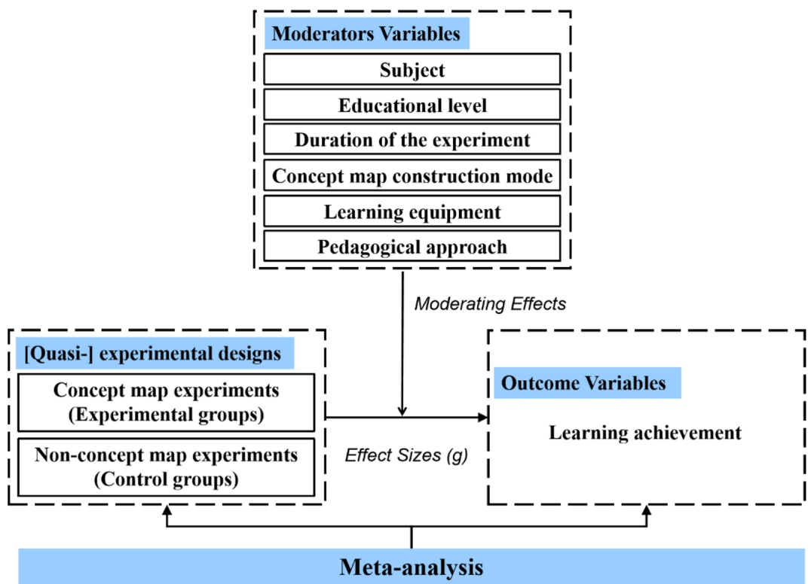
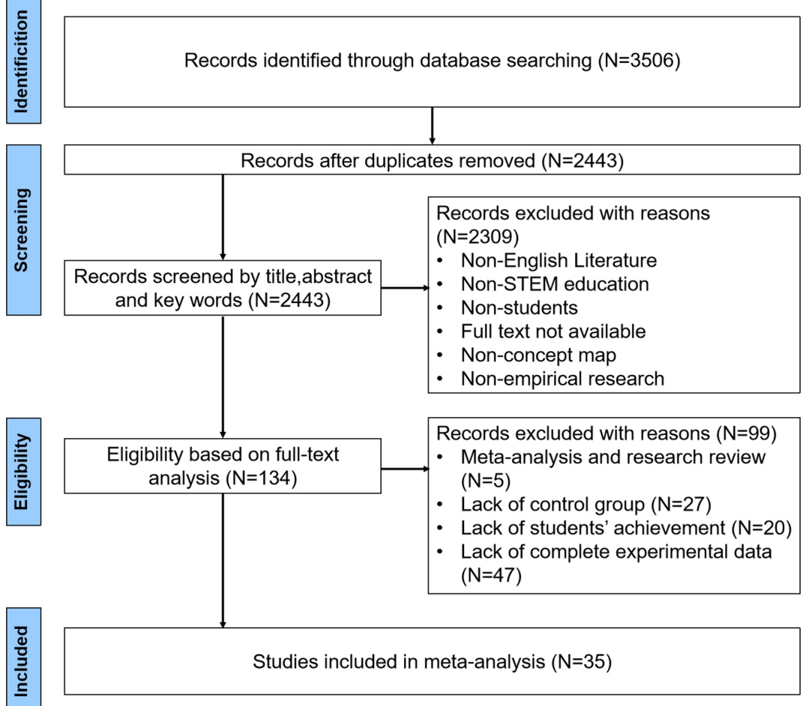
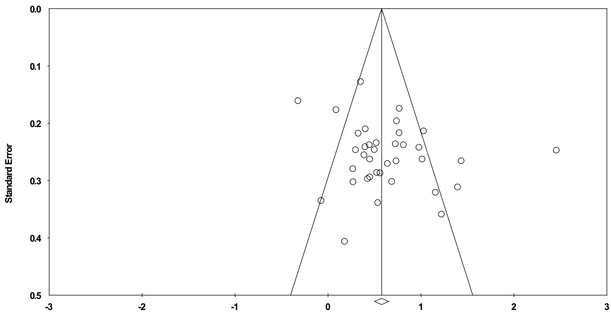
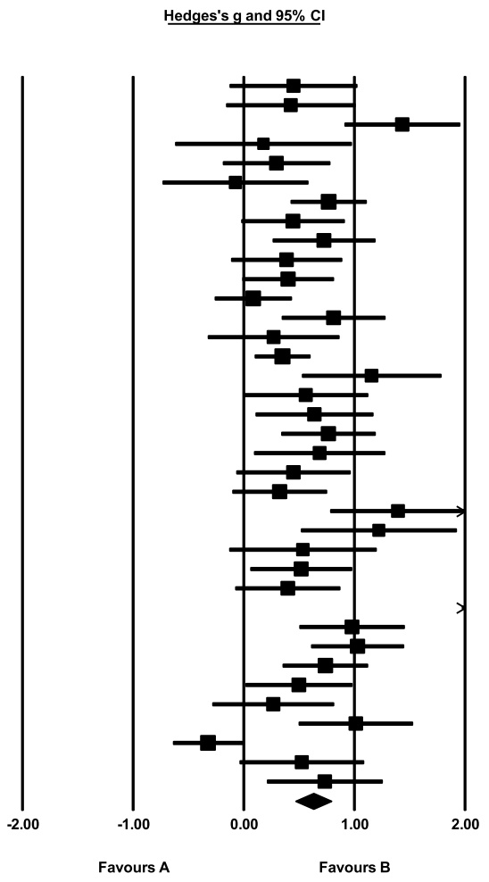

# 研究笔记：STEM 教育中的概念图（Concept Mapping）对学生学业成就影响的元分析（Concept mapping in STEM education: a meta-analysis of its impact on students' achievement, 2004–2023）

> 本笔记由 MinerU 解析原始 PDF 后整理，公式按原文逐条收录。

## 一、基本信息（Basic Information）

| 项目 | 内容 |
| --- | --- |
| 英文标题 | Concept mapping in STEM education: a meta-analysis of its impact on students' achievement (2004–2023) |
| 中文译名 | STEM 教育中的概念图对学生学业成就影响的元分析（2004–2023） |
| 作者 | Xiao-Ming Wang、Jing-Lin Wang、Shu-Yan Xu、Si-Jie Xu（均来自浙江师范大学浙江省智能教育技术与应用重点实验室） |
| 发表 venue 与年份 | Open Access 综述论文（REVIEW）；Received 2024-11-30，Accepted 2025-06-14，Published online 2025-06-21 |
| 代码链接 | 原文未提供代码（元分析使用 CMA 3.0 商业软件进行计算） |
| 任务 | 元分析（Meta-analysis）：量化概念图（Concept Mapping）作为教学干预对 STEM 学生学业成就（Students' Achievement）的整体效应，并考察六个调节变量的作用 |
| 关键词 | Concept mapping、STEM education、Students' achievement、Meta-analysis |

## 二、一句话概括（One-sentence Summary）

本文对 2004–2023 年间 37 项独立研究（来自 35 篇论文）进行元分析，发现概念图对 STEM 学生学业成就具有**中等正向整体效应**（Hedges' g = 0.630，95% CI [0.469, 0.790]，p < 0.001）；在科学（Science）与技术（Technology）学科、中学阶段（Secondary Education）、1 周至 1 月的干预时长、学生独立建构概念图、以及情境化（Contextual）与探究式（Inquiry-based）教学法的条件下效应尤为突出。

## 三、研究问题与动机（Problem and Motivation）

**背景与问题。** STEM 教育融合科学、技术、工程、数学四大学科及其交叉领域，旨在超越传统学科边界、培养综合能力。概念图由 Novak 与 Gowin（1984）基于 Ausubel（1963）的有意义学习（Meaningful Learning）与认知同化理论发展而来，是一种以图式（Diagram）组织与表征概念及其关系的教学工具，可降认知负荷、提升动机与课堂参与度。

**动机：现有证据不一致，且缺乏针对 STEM 的量化综合。** 尽管大量研究支持概念图能提升学业成就，但也有研究（Balım, 2013 物理；Van Orman et al., 2022 代数）报告其无效甚至负面。此前虽有若干元分析（Nesbit & Adesope, 2006；Schroeder et al., 2018；Izci & Akkoc, 2024；Anastasiou et al., 2024），但**专门针对 STEM 教育**且系统纳入"教学法（Pedagogical Approach）"作为调节变量的定量研究较少。本文正是在这一空白下，首次从量化视角系统评估概念图对 STEM 学业成就的影响，并解释既往结果的不一致。

**研究问题（RQ）。**
1. 概念图对 STEM 学生学业成就的整体效应有多大？
2. 学科（Subject）、教育阶段（Educational Level）、实验时长（Duration）、概念图建构方式（Construction Mode）、学习设备（Learning Equipment）、教学法（Pedagogical Approach）这六个调节变量在多大程度上调节该效应？

## 四、记号与预备知识（Notation and Preliminaries）

- **STEM**：科学（Science）、技术（Technology）、工程（Engineering）、数学（Mathematics）四学科及其交叉。
- **概念图（Concept Mapping）**：用节点（概念）与连线（关联词）表征概念间层级与关系的知识建构工具。本文特指作为**教学干预**而非测评工具的概念图。
- **学业成就（Students' Achievement）**：学生在学术测评、考试或学习结果中的表现（不包括认知、动机、情感等结果）。
- **调节变量（Moderator Variable）**：影响自变量与因变量关系方向或强度的变量（Baron & Kenny, 1986）。元分析中的调节变量基于**研究间差异**而非个体内差异（Lipsey & Wilson, 2001；Cooper et al., 2019）。
- **效应量（Effect Size, ES）**：标准化均值差，经 Hedges' g 校正小样本偏差。
- **Hedges' g**：经小样本偏差校正的标准化均值差，作为本研究的统一效应量指标。
- **随机效应模型（Random-effects Model）**：因研究间存在显著异质性而采用。
- **异质性指标**：Q 统计量（Q-test）与 I² 统计量。I² 含义（Huedo-Medina et al., 2006）：0–25% 低异质，25–75% 中等异质，75–100% 高异质。
- **发表偏倚（Publication Bias）**：阳性结果更易发表导致的偏倚，以漏斗图（Funnel Plot）、失安全系数（Fail-safe N）、Egger 回归与 Begg–Mazumdar 秩相关检验评估。

## 五、方法：元分析流程与效应量计算（Meta-analytic Method）

**文献检索与筛选（PRISMA 框架）。** 检索 Web of Science、ERIC、ProQuest、Springer、Scopus、Wiley 六个数据库；检索词分三组（概念图相关、STEM 相关、教育相关）以布尔算子组合；限定 2004–2023、英文、同行评审期刊。初检得 3,506 篇，去重并筛除会议/综述/学位论文等后剩 2,443 篇；经标题摘要（标准 a–e）筛得 134 篇；全文筛选（标准 e–h）排除 99 篇，**最终纳入 35 篇论文**。详见图 2（PRISMA 流程图）。

**纳入/排除标准（Table 1）。** 关键标准：仅限 STEM 学科、K–16 学生、概念图 vs. 非概念图（须有对照组）、概念图用作教学工具（非仅测评）、以学业成就为因变量、具备可计算效应量的数据。

**数据抽取与编码。** 35 项研究编码为基本信息、主要内容（六调节变量）、统计量三部分。两名独立研究者编码，编码者间信度用 Cronbach's α 衡量，达 **0.882**（高可靠），分歧经讨论解决。

**效应量计算。** 使用 Comprehensive Meta-Analysis（CMA）3.0 软件，以标准化均值差（SMD）为效应量，并用 Hedges' g 校正小样本偏差。因异质性显著，采用随机效应模型。具体公式见附录 A。

**提取原则。** (a) 若多时段报告成就，取最终数据（Bernard et al., 2004）；(b) 一项研究含多个独立比较组时，每组视为独立研究（Borenstein et al., 2021）。Adesope et al. (2017) 与 Kwon & Cifuentes (2007) 各贡献 2 个效应量，故**35 篇论文共提取出 37 个效应量**。

**统计检验。** 异质性检验（Q、I²）→ 调节分析 → 发表偏倚检验（漏斗图、Fail-safe N、Egger、Begg–Mazumdar）→ 敏感性分析（逐项剔除研究，观察 95% CI 稳定性）。

## 六、理论分析（Theoretical Analysis）

原文未给出理论分析（无定理、引理、定义或证明）。本文为实证元分析，其方法论依据来自既有元分析统计学文献（Glass, 1976；Hedges & Olkin, 1985；Lipsey & Wilson, 2001；Borenstein et al., 2021），而非作者新提出的理论框架。

## 七、实验设计（Experimental Design）

**研究池（Datasets / Studies）。** 37 个效应量，源自 35 篇同行评审英文论文，覆盖 2004–2023 年、多个国家和地区；样本量 N 从 23（Asan, 2007）到 248（Haugwitz et al., 2010）不等（详见文末 Table 3 / 附录 Table 3 图片）。

**六个调节变量及其编码（Moderators）。**
1. **学科（Subject）**：科学（再细分物理、化学、生物、地球科学）、技术、工程、数学。
2. **教育阶段（Educational Level）**：小学（Primary）、初中（Lower Secondary）、高中（Upper Secondary）、高等教育（Higher Education）。
3. **实验时长（Duration）**：<1 周、1 周–1 月、1–3 月、>3 月、未说明。
4. **概念图建构方式（Construction Mode）**：教师/研究者建构、学生独立建构、学生协作建构、师生共建。
5. **学习设备（Learning Equipment）**：纸笔（Paper-and-pen）、个人电脑（PC）、移动设备（Mobile）。
6. **教学法（Pedagogical Approach）**：协作学习、探究式、问题式（PBL）、情境化学习、游戏化学习、多媒体学习。

**设计依据。** 前五个调节变量沿用既有元分析（Nesbit & Adesope, 2006；Anastasiou et al., 2024）；教学法因被广泛认为是影响学业成就的关键因素（Wang et al., 2024）而新增纳入——这是本文相对既往元分析的增量贡献。

**质量保障。** 双盲独立编码 + Cronbach's α = 0.882；研究者均接受概念图作为"教学工具"而非"测评工具"的严格界定，以控制异质性来源。

## 八、实验结果（Experimental Results）

### 8.1 整体效应与异质性

- **整体效应量**：g = **0.630**（95% CI [0.469, 0.790]，p < 0.001），按 Cohen（1988）标准属**中等效应**（0.5–0.8 之间）。
- **异质性**：I² = **76.145%**，Q = 150.909，p < 0.001 → 高异质性，故采用**随机效应模型**并进行调节分析。
- **发表偏倚**：漏斗图（图 3）基本对称；Fail-safe N = **2,184**，远大于 5×37+10 = 195 的阈值，表明需 2184 篇缺失研究才能使结果失效，稳健；Egger 检验（p = 0.075 > 0.05，t = 1.84 < 1.96）与 Begg–Mazumdar（p = 0.680 > 0.05，Z = 0.412 < 1.96）均提示发表偏倚风险低。
- **敏感性分析**：逐项剔除后，固定效应 95% CI 为 [0.500, 0.654]，随机效应为 [0.469, 0.790]，无单一研究主导结果，稳定性好。

### 8.2 调节变量分析结果

所有六个调节变量的组间差异均**不显著**（p > 0.05），即没有哪个变量单独"造成"效应差异的统计显著性，但各水平的平均效应量在数值上呈现清晰模式（下表 g 为 Hedges' g，*p<0.05, **p<0.01, ***p<0.001）。

**表：各调节变量水平下的效应量（部分 CI 来自原文 Table 2；n 为效应量数）**

| 调节变量 | 水平 | n | Hedges' g | 95% CI | 组间 Q (p) |
| --- | --- | --- | --- | --- | --- |
| 学科 | 物理 Physics | 8 | 0.782*** | [0.413, 1.151] | Q=3.145 (p=0.790) |
| 学科 | 地球科学 Earth science | 8 | 0.679*** | [0.321, 1.037] | 同上 |
| 学科 | 生物 Biology | 13 | 0.632*** | [0.358, 0.906] | 同上 |
| 学科 | 化学 Chemistry | 2 | 0.514 | [-0.165, 1.192] | 同上（p=0.138） |
| 学科 | 技术 Technology | 2 | 0.769* | [0.080, 1.458] | 同上（p=0.029） |
| 学科 | 工程 Engineering | 2 | 0.363 | [-0.311, 1.038] | 同上（p=0.291） |
| 学科 | 数学 Mathematics | 2 | 0.217 | [-0.432, 0.866] | 同上（p=0.512） |
| 教育阶段 | 小学 | 15 | 0.576*** | [0.312, 0.839] | Q=1.232 (p=0.745) |
| 教育阶段 | 初中 | 7 | 0.755*** | [0.373, 1.138] | 同上 |
| 教育阶段 | 高中 | 5 | 0.780** | [0.324, 1.237] | 同上 |
| 教育阶段 | 高等教育 | 10 | 0.552** | [0.238, 0.866] | 同上 |
| 实验时长 | <1 周 | 13 | 0.533*** | [0.261, 0.805] | Q=1.624 (p=0.804) |
| 实验时长 | 1 周–1 月 | 13 | 0.768*** | [0.488, 1.049] | 同上 |
| 实验时长 | 1–3 月 | 8 | 0.622*** | [0.270, 0.975] | 同上 |
| 实验时长 | >3 月 | 1 | 0.499 | [-0.484, 1.482] | 同上 |
| 实验时长 | 未说明 | 2 | 0.500 | [-0.207, 1.206] | 同上 |
| 建构方式 | 教师/研究者建构 | 12 | 0.653*** | [0.373, 0.933] | Q=3.635 (p=0.304) |
| 建构方式 | 学生独立建构 | 7 | 0.933*** | [0.552, 1.315] | 同上 |
| 建构方式 | 学生协作建构 | 7 | 0.515** | [0.136, 0.895] | 同上 |
| 建构方式 | 师生共建 | 11 | 0.494** | [0.203, 0.786] | 同上 |
| 学习设备 | 纸笔 | 原文未明确说明 n | 0.619*** | 见表 2 | Q=0.107 (p=0.948) |
| 学习设备 | 个人电脑 | 原文未明确说明 n | 0.615*** | 见表 2 | 同上 |
| 学习设备 | 移动设备 | 原文未明确说明 n | 0.687*** | 见表 2 | 同上 |
| 教学法 | 情境化 Contextual | 2 | 0.873 (p=0.020) | 见表 2 | Q=1.837 (p=0.871) |
| 教学法 | 探究式 Inquiry-based | 14 | 0.746*** | 见表 2 | 同上 |
| 教学法 | 协作学习 Collaborative | 原文未明确说明 n | 0.554** (p=0.009) | 见表 2 | 同上 |
| 教学法 | 问题式 PBL | 原文未明确说明 n | 0.511 (p=0.052) | 见表 2 | 同上 |
| 教学法 | 游戏化 Game-based | 原文未明确说明 n | 0.544 (p=0.149) | 见表 2 | 同上 |
| 教学法 | 多媒体 Multimedia | 原文未明确说明 n | 0.523*** (p=0.003) | 见表 2 | 同上 |

**关键模式解读。**
- **学科**：科学类整体中等效应，物理最高（0.782）、技术次之（0.769）；数学最低（0.217，且不显著）。但化学、技术、工程、数学各仅 2 项研究，结论需谨慎。
- **教育阶段**：中学（初中 0.755、高中 0.780）效应最大，小学（0.576）与高等教育（0.552）较小。
- **实验时长**：1 周–1 月最佳（0.768），呈"先升后降"趋势；>3 月效应回落（0.499）。
- **建构方式**：学生独立建构最高（0.933），远高于被动使用教师建构图（0.653）与协作/共建（约 0.5）。
- **学习设备**：纸笔、PC、移动设备效应相近（均约 0.6–0.69），无显著差异。
- **教学法**：情境化（0.873，仅 2 项）与探究式（0.746，14 项，最稳健）最高。

## 九、相关工作（Related Work）

本文与既往系统综述/元分析形成承接与区分：
- **Hartmeyer et al. (2018)**、**Chang et al. (2022)**、**Jackson et al. (2023)** 为系统综述，聚焦 K-12 或高等教育工程，未做 STEM 整体量化综合。
- **Nesbit & Adesope (2006)**（55 研究，发现"建构 > 学习现成图"）、**Schroeder et al. (2018)**（37 研究，整体 ES=0.58，自建图 0.72 vs 预制图 0.43）、**Yeşilyurt (2012)**（ES 优于传统教学）、**Izci & Akkoc (2024)**（78 研究，ES=1.08）、**Anastasiou et al. (2024)**（55 研究科学表现，ES=0.776）均为跨领域或非 STEM 专属元分析。
- **本文区别**：(1) 首次专门量化 STEM 情境下概念图对学业成就的影响；(2) **新增"教学法"作为调节变量**，这是既往元分析未系统纳入的维度；(3) 通过六调节变量解释既往不一致结果。

## 十、结论（Conclusion）

综合 37 项研究，概念图对 STEM 学业成就呈**中等正向整体效应**（g = 0.630）。六调节变量组间差异虽不显著，但模式清晰：**科学/技术学科**最优，**中学阶段**最受益，**1 周–1 月**干预时长最佳，**学生独立建构**概念图效应最高，**纸笔与数字设备**效果相当，**情境化与探究式**教学法结合概念图尤为有效。

## 十一、批判性评价与启发（Critical Appraisal）

### 11.1 优点

- 首个专门面向 STEM 的概念图元分析，明确区分"教学干预"与"测评工具"用途，提升了纳入标准的针对性。
- 调节变量设计系统，尤其新增"教学法"维度，弥补了既往空白，并据此有效解释了既往结果的不一致。
- 方法学严谨：双盲独立编码（α=0.882）、随机效应模型、异质性检验、发表偏倚多重检验（漏斗图/Fail-safe N/Egger/Begg）、敏感性分析一应俱全，结论稳健。
- 实践建议具体（按学科、教育阶段、时长、建构方式、设备、教学法分别给出操作指引）。

### 11.2 局限与可质疑之处

- **样本量偏小且学科分布失衡**：仅 35 篇论文、37 效应量，平均每年不足 2 篇；且集中于科学领域。化学、技术、工程、数学各仅 2 项研究，其效应量（尤其数学 0.217 不显著、工程 0.363）置信区间宽、可靠性低。
- **调节变量无统计显著性**：六变量组间 Q 检验 p 均 > 0.05，说明"哪些因素真正调节效应"在统计上并未确立；文中模式解读依赖点估计，存在过度解读风险。
- **仅纳入英文文献**，可能遗漏非英语国家（如中文、西班牙语文献）的异质结果，外部效度受限。
- **排除数据不足的研究**，可能引入选择性偏倚。
- **元分析调节变量为研究级固定特征**，只能揭示关联而非因果（作者自评），需 RCT 设计验证。
- **未深入分析** AR、AI 辅助、生成式 AI 与概念图的结合（因相关文献不足，仅作讨论）。

### 11.3 与本课题（Learning Cognitive Structure）的关联

- 概念图本质上是**外显化学习者认知结构（Cognitive Structure）**的工具：节点=概念，连线=概念间关系，层级=组织程度。本研究提供的"学生独立建构 > 被动使用"（g=0.933 vs 0.653）证据，直接支持"主动构建认知结构比接收现成结构更能促进有意义学习（Ausubel）"这一假设，与本项目"学习认知结构"主题高度契合。
- "中学阶段效应最高"可联系形式运算期（Formal Operations）抽象思维成熟；"高等教育效应回落"则可解读为大学生已内化了自主知识组织能力、对外部结构工具依赖降低——这为"认知结构发展的阶段性"提供了实证侧写。
- 以下为笔记撰写者的延伸思考，非原文内容：本文仅以学业成就为终点指标，未测量认知结构本身的变化（如结构映射、聚类系数、概念连通度）。若结合知识图谱/认知网络分析（如结构性测验、聚类分析、滞后序列），可进一步把"概念图干预→认知结构重组→成就提升"的因果链量化，这正是本课题可切入的深化方向。

## 附录 A：全文公式汇总（Formula Index）

| 编号 | 公式 | 含义 |
| --- | --- | --- |
| (1) | $ES = \dfrac{X_T - X_C}{SD_{\text{pooled.post}}}$ | 标准化均值差（效应量原始值）。$X_T$ 为实验组前–后测均值差，$X_C$ 为控制组前–后测均值差，$SD_{\text{pooled.post}}$ 为两组后测的合并标准差。来源：Lipsey & Wilson (2001)。 |
| (2) | $g = \left(1 - \dfrac{3}{4 \cdot df - 1}\right) \cdot ES$ | Hedges' g 小样本偏差校正。$df$ 为各研究的自由度；校正后各研究 g 值汇总得整体效应量（Hedges' g）。 |

> 公式均经 MinerU 切图（page_5_equation_12.jpg、page_6_equation_5.jpg）与正文双重核对一致，全文仅此两条公式，已完整收录。

## 附录 B：图表索引（Figure & Table Index）

| 编号 | 内容 | 文件路径 |
| --- | --- | --- |
| Figure 1 | 元分析机制框架（Meta-analysis mechanism framework） | ../md/Wang_et_al_2025_Concept_Mapping_STEM_Meta_Analysis_markdown/images/page_4_image_11.jpg |
| Figure 2 | PRISMA 文献筛选流程图 | ../md/Wang_et_al_2025_Concept_Mapping_STEM_Meta_Analysis_markdown/images/page_6_image_2.jpg |
| Figure 3 | 漏斗图（trim-and-fill 法，评估发表偏倚） | ../md/Wang_et_al_2025_Concept_Mapping_STEM_Meta_Analysis_markdown/images/page_7_chart_15.jpg |
| Figure 4 | 森林图（Hedges's g 与 95% CI） | ../md/Wang_et_al_2025_Concept_Mapping_STEM_Meta_Analysis_markdown/images/page_8_chart_11.jpg |
| Table 1 | 纳入与排除标准（正文 Markdown 表格） | 正文内嵌（原文 Table 1） |
| Table 2 | 各调节变量对 STEM 学业成就的效应量（正文 HTML 表格） | 正文内嵌（原文 Table 2；切图见 page_8_table_6.jpg / page_9_table_3.jpg） |
| Table 3 | 纳入研究全部调节变量信息（35 篇论文明细） | ../md/Wang_et_al_2025_Concept_Mapping_STEM_Meta_Analysis_markdown/images/page_16_table_3.jpg |
| Equation 1 | 公式 (1) ES 切图 | ../md/Wang_et_al_2025_Concept_Mapping_STEM_Meta_Analysis_markdown/images/page_5_equation_12.jpg |
| Equation 2 | 公式 (2) g 切图 | ../md/Wang_et_al_2025_Concept_Mapping_STEM_Meta_Analysis_markdown/images/page_6_equation_5.jpg |
